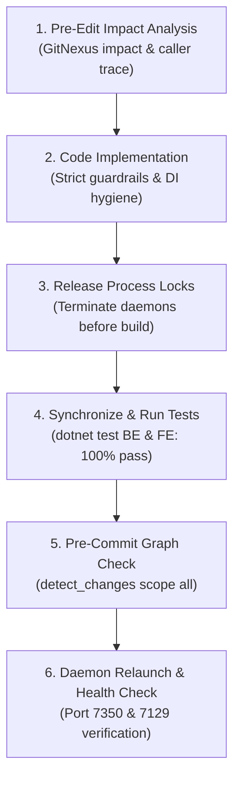

# DentalCare SWP391 — Automated Test Synchronization & Verification Skill

This skill guarantees that all code modifications in the DentalCare SWP391 project strictly adhere to the business rules specified in `DENTALCARE_SWP391.docx`, maintain 100% test pass rates across both Backend and Frontend test suites, prevent locked DLL build failures (`MSB3026/MSB3027`), and eliminate runtime regression bugs.

---

## ⚡ The Mandatory 6-Stage Code & Test Lifecycle

Every coding task (feature addition, bug fix, or refactoring) MUST follow this 6-stage lifecycle in sequence:



---

### Stage 1: Pre-Edit Impact Analysis

Before modifying any class, service, or controller:
1. Run GitNexus impact analysis to discover upstream callers, dependencies, and execution flows:
   ```json
   call_mcp_tool("gitnexus", "impact", {"target": "TargetSymbolOrMethod", "direction": "upstream"})
   ```
2. If `risk` is `HIGH` or `CRITICAL`, evaluate affected callers carefully before proceeding.
3. If `risk` is `UNKNOWN`, perform a text search across the repository to confirm call sites before altering or removing signatures.

---

### Stage 2: Code Implementation with DentalCare Guardrails

Follow these project-specific guardrails during implementation:

1. **Dependency Injection (Constructor Ambiguity):**
   - Controllers in `DentalClinic.Web` must never expose multiple constructors that confuse the DI container.
   - Always decorate the DI-injected constructor with `[Microsoft.Extensions.DependencyInjection.ActivatorUtilitiesConstructor]`.
2. **Session & Token Synchronization:**
   - In `TokenService`, when access/refresh tokens expire or fail to refresh, automatically invoke `SignOutAsync`, set `TokensInvalidatedKey` in session, and clear cookies to prevent zombie sessions.
   - Any patient-facing action must check that the authenticated user matches the patient record ownership.
3. **Shift-Based Booking Quota:**
   - Enforce maximum 2 bookings per patient per calendar day.
   - The 2 appointments MUST be in different shifts: 1 Morning (before 12:00) and 1 Afternoon (at or after 12:00).
   - Time intervals must never overlap: $(Start_{new} < End_{existing} \land End_{new} > Start_{existing})$.
   - Filter available slots dynamically in `PatientAppointmentController.cs`.
   - See [Shift Booking Policy](./references/shift-booking-policy.md) for complete details.
4. **Anti-Double-Click & Concurrency:**
   - Ensure all booking submissions and invoice generation operations have double-click prevention on buttons and backend locking (`InMemoryLock` / `sp_getapplock`).
5. **Strict 4-Role RBAC:**
   - Active roles: `Patient`, `Receptionist`, `Dentist`, `SystemAdministrator`. Ensure no unauthorized role bypass.
   - See [Quality Gates Matrix](./references/quality-gates.md) for the 16-phase requirements.

---

### Stage 3: Safe Build & Process Lock Management

> [!WARNING]
> Running the `DentalClinic.Api` or `DentalClinic.Web` projects holds persistent file handles on `DentalClinic.Infrastructure.dll` and `DentalClinic.Core.dll`. Attempting `dotnet build` or `dotnet test` while processes are running will cause compilation failure `MSB3026` or `MSB3027` (file locked by another process).

Before building or running tests, always execute the daemon shutdown script:

```powershell
& "D:\SWP\.agents\skills\dentalcare-testing-sync\scripts\stop-daemons.ps1"
```

Or execute inline:
```powershell
Get-CimInstance Win32_Process -Filter "Name = 'dotnet.exe'" | ForEach-Object {
    if ($_.CommandLine -match "DentalClinic" -or $_.CommandLine -match "MSBuild.dll") {
        Stop-Process -Id $_.ProcessId -Force -ErrorAction SilentlyContinue
    }
}
Start-Sleep -Milliseconds 800
```

---

### Stage 4: Automated Testing & Test Synchronization

Every code change MUST synchronize with automated test coverage:

1. **Test Addition Rule:** If you add a new validation, business rule, or API endpoint, you **MUST** add or update unit tests in:
   - Backend: `D:\SWP\BE\DentalClinic.Tests\` (e.g. `AppointmentFlowTests.cs`, `BookingServiceTests.cs`)
   - Frontend: `D:\SWP\FE\DentalClinic.Web.Tests\` (e.g. `PatientAppointmentControllerTests.cs`)
2. **Execute Full Suite via Helper Script:**
   ```powershell
   & "D:\SWP\.agents\skills\dentalcare-testing-sync\scripts\sync-and-test.ps1"
   ```
3. **Manual CLI Execution:**
   - Backend test command:
     ```bash
     dotnet test D:\SWP\BE\DentalClinic.Tests\DentalClinic.Tests.csproj -c Debug --nologo
     ```
   - Frontend test command:
     ```bash
     dotnet test D:\SWP\FE\DentalClinic.Web.Tests\DentalClinic.Web.Tests.csproj -c Debug --nologo
     ```
4. **Acceptance Threshold:** **100% Pass Rate (0 Failed, 0 Errors).** Any failure must be diagnosed and resolved before proceeding.

---

### Stage 5: Pre-Commit Graph Change Analysis

Before committing changes to Git:
1. Run GitNexus graph change detection:
   ```json
   call_mcp_tool("gitnexus", "detect_changes", {"scope": "all"})
   ```
   Or via CLI runner:
   ```bash
   node .gitnexus/run.cjs detect-changes --scope all --repo .
   ```
2. Verify that modified call graphs are clean and no unhandled regressions are introduced.

---

### Stage 6: Daemon Relaunch & Live Health Verification

After tests pass and changes are verified:
1. Start Backend API and Frontend Web daemons:
   - Run command as background daemon for Backend:
     ```bash
     dotnet run --project D:\SWP\BE\DentalClinic.Api --launch-profile https
     ```
   - Run command as background daemon for Frontend:
     ```bash
     dotnet run --project D:\SWP\FE\DentalClinic.Web --launch-profile https
     ```
   - Or execute the launch script:
     ```powershell
     & "D:\SWP\.agents\skills\dentalcare-testing-sync\scripts\start-daemons.ps1"
     ```
2. Verify health responses:
   - Backend API: `https://localhost:7350/api/health` or `swagger/index.html` (HTTP 200)
   - Frontend Web: `https://localhost:7129/` (HTTP 200)

---

## 📚 Supporting References & Scripts

- [Automated Sync & Test Script](./scripts/sync-and-test.ps1) — One-click runner for stopping daemons and executing all BE + FE tests.
- [Stop Daemons Script](./scripts/stop-daemons.ps1) — Terminates all locked `dotnet.exe` processes.
- [Start Daemons Script](./scripts/start-daemons.ps1) — Relaunches Backend and Frontend daemons.
- [Quality Gates Matrix](./references/quality-gates.md) — 16-phase requirements from `DENTALCARE_SWP391.docx`.
- [Shift-Based Booking Policy](./references/shift-booking-policy.md) — Detailed shift allocation and interval rules.
