# DentalCare SWP391 — System Architecture & Knowledge Graph Map

## 1. Overview
DentalCare is an enterprise multi-specialty dental clinic management system built on ASP.NET Core 8 Web API, ASP.NET Core 8 MVC Razor, Entity Framework Core 8, and SQL Server. The architecture is strictly structured around **4 core roles**:
- **Patient** (Online service-first booking, EMR, Odontogram viewing, ratings & reviews)
- **Receptionist** (Front-desk triage, walk-in registration, resource dispatching, queue management, billing with dynamic VietQR)
- **Dentist** (Chair-side clinical treatment, Odontogram charting, imaging order, FEFO chair-side medicine dispensation, treatment planning)
- **System Administrator** (Clinic operations, staff scheduling, medicine inventory, audit trails, blog publication approval, financial reporting)

### Knowledge Graph Stats (GitNexus Indexed)
- **Files:** 832
- **Symbols:** 15,466
- **Clusters (Functional Modules):** 526
- **Execution Flows (Processes):** 328

---

## 2. Functional Areas (Clusters)

| Functional Area | Key Responsibilities | Primary Assemblies / Directories |
| :--- | :--- | :--- |
| **Appointments & Dispatch** | Online booking (3 branches), walk-in triage, queue numbering, distributed locking (`sp_getapplock`), conflict prevention. | `BE/DentalClinic.Api/Controllers/AppointmentsController.cs` `FE/DentalClinic.Web/Controllers/Receptionist/` |
| **Clinical Diagnostics & Imaging** | Dedicated X-ray rooms, equipment scheduling, imaging queue, radiology order & DICOM/PNG uploads. | `BE/DentalClinic.Api/Controllers/ClinicalDiagnosticsController.cs` `FE/DentalClinic.Web/Controllers/Receptionist/ReceptionistImagingQueueController.cs` |
| **Dentist Schedule & Disruption** | Doctor work schedules, leave registration, automated appointment disruption recovery worker. | `BE/DentalClinic.Api/Controllers/DentistLeaveController.cs` `BE/DentalClinic.Infrastructure/Services/AppointmentDisruptionService.cs` |
| **Receptionist Workforce & Shifts** | Receptionist shift scheduling, shift templates, shift swap requests, leave management, handover. | `BE/DentalClinic.Api/Controllers/ReceptionistWorkforceController.cs` `FE/DentalClinic.Web/Controllers/Receptionist/ReceptionistScheduleController.cs` |
| **Staff Attendance & Operations** | Time-clock events, daily attendance records, manager correction workflow, period closure. | `BE/DentalClinic.Api/Controllers/AttendanceController.cs` `BE/DentalClinic.Infrastructure/Services/AttendanceService.cs` |
| **Medical Records & Odontogram** | Clinical entries, 32/20 interactive tooth chart (surfaces: M, D, O, B, L), treatment history. | `BE/DentalClinic.Api/Controllers/MedicalRecordController.cs` `FE/DentalClinic.Web/Controllers/Dentist/DentistMedicalRecordController.cs` |
| **Medicine Inventory & FEFO** | Medicine catalog, batch lots, FEFO expiration deduction on chair-side dispensation. | `BE/DentalClinic.Api/Controllers/MedicineController.cs` `BE/DentalClinic.Infrastructure/Services/MedicineInventoryService.cs` |
| **Billing & Payments** | Final invoice calculation based on performed services + chair-dispensed medicines, dynamic VietQR. | `BE/DentalClinic.Api/Controllers/BillingController.cs` `FE/DentalClinic.Web/Controllers/Receptionist/ReceptionistBillingController.cs` |

---

## 3. High-Level Architecture Diagram

```mermaid
graph TB
    subgraph Frontend_Web ["FE: DentalClinic.Web (ASP.NET Core 8 MVC Razor - Port 7129)"]
        UI_Patient["Patient Portal<br/>(/Patient/Appointment)"]
        UI_Receptionist["Receptionist Portal<br/>(/Receptionist/Appointments/TodayCheckIn)"]
        UI_Dentist["Dentist Dashboard<br/>(/Dentist/Appointments/Today)"]
        UI_Admin["Admin Operations<br/>(/Admin/Workforce)"]
        UI_SignalR["SignalR Queue Listener<br/>(/hubs/clinic-queue)"]
    end

    subgraph Backend_API ["BE: DentalClinic.Api (Web API - Port 7350)"]
        API_Appt["AppointmentsController"]
        API_Diagnostics["ClinicalDiagnosticsController"]
        API_Disruption["AppointmentDisruptionController"]
        API_Workforce["ReceptionistWorkforceController"]
        API_Attendance["AttendanceController"]
        API_Billing["BillingController"]
        API_Medicine["MedicineController"]
        Hub_Clinic["ClinicQueueHub (SignalR)"]
    end

    subgraph Core_Services ["BE: DentalClinic.Infrastructure & Application"]
        SVC_Appt["AppointmentService & BookingService"]
        SVC_Lock["SqlAppLockHelper (sp_getapplock)"]
        SVC_Disruption["AppointmentDisruptionService"]
        SVC_Attendance["AttendanceService & CompositeShiftProvider"]
        SVC_Billing["BillingService (Napas 247 VietQR)"]
        SVC_Med["MedicineInventoryService (FEFO)"]
        Worker_Reminder["AppointmentReminderWorker"]
        Worker_Disruption["AppointmentDisruptionWorker"]
    end

    subgraph Database_Layer ["SQL Server: DentalCare_Integration_Dev"]
        DB_Appt["Appointments & StatusHistories"]
        DB_Resources["Rooms, DentalChairs, Equipments"]
        DB_Clinical["ClinicalEntries, OdontogramEntries, Imaging"]
        DB_Med["Medicines, MedicineBatches, StockTrans"]
        DB_Billing["Invoices, InvoiceItems, Payments"]
        DB_Workforce["StaffAttendance, ShiftTemplates, Handover"]
    end

    UI_Patient --> API_Appt
    UI_Receptionist --> API_Appt
    UI_Receptionist --> API_Billing
    UI_Receptionist --> API_Workforce
    UI_Dentist --> API_Appt
    UI_Dentist --> API_Diagnostics
    UI_Admin --> API_Attendance
    UI_SignalR <--> Hub_Clinic

    API_Appt --> SVC_Appt
    API_Appt --> SVC_Lock
    API_Diagnostics --> DB_Clinical
    API_Disruption --> SVC_Disruption
    API_Workforce --> DB_Workforce
    API_Attendance --> SVC_Attendance
    API_Billing --> SVC_Billing
    API_Medicine --> SVC_Med

    SVC_Appt --> DB_Appt
    SVC_Lock --> DB_Resources
    SVC_Billing --> DB_Billing
    SVC_Med --> DB_Med
    Worker_Reminder --> DB_Appt
    Worker_Disruption --> DB_Appt
```

---

## 4. Key Execution Flows

### 1. Receptionist Walk-In / Online Confirmation with `sp_getapplock`
`Client (Receptionist) → AppointmentsController.ReceptionistConfirm / RegisterWalkInPatient → SqlAppLockHelper.AcquireLocksAsync(APPOINTMENT_LOCK_{Dentist}_{Room}_{Chair}_{Slot}) → DbContext.Appointments.Add / Update → Status: Confirmed/CheckedIn → ClinicQueueHub broadcast → Email Notification Worker`

### 2. Chair-Side Examination, Performed Services & FEFO Medicine Dispensation
`Dentist → InService → Odontogram Update → PerformedServices Add → Prescription Create → MedicineDispensations (FEFO Auto-Deduction from earliest batch) → Completed → SignalR Queue Notify`

### 3. Settlement & Dynamic VietQR Billing
`Receptionist Billing Queue → GetBillableAppointmentAsync → Aggregate PerformedServices + MedicineDispensations → CreateInvoice → Generate Napas 247 VietQR Payload (Account + RemainingAmount + Content: DENTALCARE APPXXXXXX) → Payment Confirmation → Paid`

### 4. Automated Appointment Disruption Recovery
`Dentist Registers Leave → DentistLeaveRequest Created → Worker Polls Affected Appointments → AppointmentDisruption Generated → Dynamic Token Generated & Email Sent to Patient → Patient Selects Reassign or Reschedule → Atomic Resolution`

### 5. Multi-Provider Staff Attendance & Operations
`GetTodayAttendance → AttendanceService.GetTodayShiftsAndAttendanceAsync → CompositeStaffShiftProvider.GetShiftsForStaffAsync → DentistShiftProvider / ReceptionistShiftProvider → StaffShiftDto`
