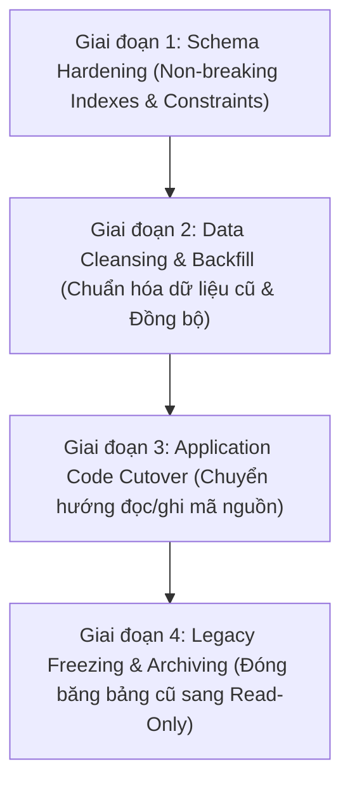

# DentalCare SWP391 – Database Safe Migration & Transition Plan

> **Tài liệu chuyển đổi:** Kế hoạch Thực thi Di chuyển Dữ liệu An Toàn & Bảo Toàn 100% Dữ Liệu Lịch Sử  
> **Dự án:** Hệ thống Quản lý Phòng khám Nha khoa DentalCare (SWP391 - Nhóm 6)  
> **Nguyên tắc bất biến:** Tuyệt đối KHÔNG DROP bảng, KHÔNG thay đổi khóa chính/khóa ngoại gây phá vỡ tương thích ngược trên database gốc. Mọi thay đổi đều có kịch bản Rollback tức thì.

---

## 1. LỘ TRÌNH THỰC THI 4 GIAI ĐOẠN (4-PHASE EXECUTION PLAN)



---

## 2. GIAI ĐOẠN 1: SCHEMA HARDENING (ÁP DỤNG NGAY - KHÔNG PHÁ MÃ NGUỒN)

Giai đoạn này chỉ bổ sung các Filtered Unique Indexes và Composite Constraints vào các vị trí đã kiểm chứng 100% dữ liệu hiện hành không bị vi phạm. Không sửa đổi cấu trúc bảng hay đổi tên cột.

### 2.1. Kịch bản Forward Migration (Script Áp Dụng)

```sql
-- =====================================================================================
-- DENTALCARE PHASE 1: SAFE SCHEMA HARDENING & BILLING PROTECTION
-- =====================================================================================
SET NOCOUNT ON;
SET XACT_ABORT ON;
BEGIN TRANSACTION;

-- 1. Bảo đảm mỗi CareEpisode chỉ có tối đa 1 Hóa đơn viện phí
IF NOT EXISTS (SELECT 1 FROM sys.indexes WHERE name = 'UQ_Invoices_CareEpisodeId')
BEGIN
    CREATE UNIQUE NONCLUSTERED INDEX [UQ_Invoices_CareEpisodeId]
    ON [dbo].[Invoices]([CareEpisodeId])
    WHERE [CareEpisodeId] IS NOT NULL;
    PRINT '>>> Đã tạo index [UQ_Invoices_CareEpisodeId] (Chống sinh nhiều hóa đơn cho 1 đợt khám).';
END;

-- 2. Chống Double-Billing: Một ServiceTaskId chỉ được thanh toán tối đa 1 lần
IF NOT EXISTS (SELECT 1 FROM sys.indexes WHERE name = 'UQ_InvoiceItems_Unique_ServiceTask')
BEGIN
    CREATE UNIQUE NONCLUSTERED INDEX [UQ_InvoiceItems_Unique_ServiceTask]
    ON [dbo].[InvoiceItems]([ServiceTaskId])
    WHERE [ServiceTaskId] IS NOT NULL;
    PRINT '>>> Đã tạo index [UQ_InvoiceItems_Unique_ServiceTask] (Chống tính tiền trùng ServiceTask).';
END;

-- 3. Chống Double-Billing: Một PerformedServiceId chỉ được thanh toán tối đa 1 lần
IF NOT EXISTS (SELECT 1 FROM sys.indexes WHERE name = 'UQ_InvoiceItems_Unique_PerformedService')
BEGIN
    CREATE UNIQUE NONCLUSTERED INDEX [UQ_InvoiceItems_Unique_PerformedService]
    ON [dbo].[InvoiceItems]([PerformedServiceId])
    WHERE [PerformedServiceId] IS NOT NULL;
    PRINT '>>> Đã tạo index [UQ_InvoiceItems_Unique_PerformedService] (Chống tính tiền trùng PerformedService).';
END;

-- 4. Toàn vẹn Dược phẩm: Lô thuốc phải khớp chính xác với Mặt hàng thuốc
IF NOT EXISTS (SELECT 1 FROM sys.indexes WHERE name = 'UQ_MedicineBatches_Med_BatchId')
BEGIN
    CREATE UNIQUE NONCLUSTERED INDEX [UQ_MedicineBatches_Med_BatchId]
    ON [dbo].[MedicineBatches]([MedicineId], [MedicineBatchId]);
    PRINT '>>> Đã tạo index tổ hợp [UQ_MedicineBatches_Med_BatchId].';
END;

IF NOT EXISTS (SELECT 1 FROM sys.foreign_keys WHERE name = 'FK_DispensationItems_Medicine_Batch_Composite')
BEGIN
    ALTER TABLE [dbo].[MedicineDispensationItems]
    ADD CONSTRAINT [FK_DispensationItems_Medicine_Batch_Composite]
    FOREIGN KEY ([MedicineId], [MedicineBatchId])
    REFERENCES [dbo].[MedicineBatches] ([MedicineId], [MedicineBatchId]);
    PRINT '>>> Đã tạo Composite FK [FK_DispensationItems_Medicine_Batch_Composite] (Chống xuất nhầm lô thuốc).';
END;

-- 5. Toàn vẹn Cơ sở vật chất: Ghế nha khoa phải thuộc đúng Phòng khám được chỉ định
IF NOT EXISTS (SELECT 1 FROM sys.indexes WHERE name = 'UQ_DentalChairs_Room_Chair')
BEGIN
    CREATE UNIQUE NONCLUSTERED INDEX [UQ_DentalChairs_Room_Chair]
    ON [dbo].[DentalChairs]([RoomId], [DentalChairId]);
    PRINT '>>> Đã tạo index tổ hợp [UQ_DentalChairs_Room_Chair].';
END;

IF NOT EXISTS (SELECT 1 FROM sys.foreign_keys WHERE name = 'FK_Appointments_Room_Chair_Composite')
BEGIN
    ALTER TABLE [dbo].[Appointments]
    ADD CONSTRAINT [FK_Appointments_Room_Chair_Composite]
    FOREIGN KEY ([RoomId], [DentalChairId])
    REFERENCES [dbo].[DentalChairs] ([RoomId], [DentalChairId]);
    PRINT '>>> Đã tạo Composite FK [FK_Appointments_Room_Chair_Composite] (Chống xếp ghế sai phòng).';
END;

COMMIT TRANSACTION;
PRINT '>>> HOÀN TẤT GIAI ĐOẠN 1: AN TOÀN & BẢO VỆ DÒNG TIỀN THÀNH CÔNG!';
```

### 2.2. Kịch bản Rollback (Kế Hoạch Khôi Phục Khi Có Sự Cố)

```sql
-- =====================================================================================
-- DENTALCARE PHASE 1: ROLLBACK SCRIPT
-- =====================================================================================
BEGIN TRANSACTION;

IF EXISTS (SELECT 1 FROM sys.foreign_keys WHERE name = 'FK_Appointments_Room_Chair_Composite')
    ALTER TABLE [dbo].[Appointments] DROP CONSTRAINT [FK_Appointments_Room_Chair_Composite];

IF EXISTS (SELECT 1 FROM sys.indexes WHERE name = 'UQ_DentalChairs_Room_Chair')
    DROP INDEX [UQ_DentalChairs_Room_Chair] ON [dbo].[DentalChairs];

IF EXISTS (SELECT 1 FROM sys.foreign_keys WHERE name = 'FK_DispensationItems_Medicine_Batch_Composite')
    ALTER TABLE [dbo].[MedicineDispensationItems] DROP CONSTRAINT [FK_DispensationItems_Medicine_Batch_Composite];

IF EXISTS (SELECT 1 FROM sys.indexes WHERE name = 'UQ_MedicineBatches_Med_BatchId')
    DROP INDEX [UQ_MedicineBatches_Med_BatchId] ON [dbo].[MedicineBatches];

IF EXISTS (SELECT 1 FROM sys.indexes WHERE name = 'UQ_InvoiceItems_Unique_PerformedService')
    DROP INDEX [UQ_InvoiceItems_Unique_PerformedService] ON [dbo].[InvoiceItems];

IF EXISTS (SELECT 1 FROM sys.indexes WHERE name = 'UQ_InvoiceItems_Unique_ServiceTask')
    DROP INDEX [UQ_InvoiceItems_Unique_ServiceTask] ON [dbo].[InvoiceItems];

IF EXISTS (SELECT 1 FROM sys.indexes WHERE name = 'UQ_Invoices_CareEpisodeId')
    DROP INDEX [UQ_Invoices_CareEpisodeId] ON [dbo].[Invoices];

COMMIT TRANSACTION;
PRINT '>>> ROLLBACK GIAI ĐOẠN 1 THÀNH CÔNG - DATABASE TRỞ VỀ NGUYÊN TRẠNG.';
```

---

## 3. GIAI ĐOẠN 2: CHUẨN HÓA DỮ LIỆU CŨ & BACKFILL (DATA CLEANSING & BACKFILL)

### 3.1. Chuẩn hóa 3 cuộc hẹn lịch sử bị lệch Chuyên khoa (ID 95, 97, 100)
Trước khi có thể thêm Composite FK `Appointments(DepartmentId, RequestedServiceId)`, 3 cuộc hẹn từ tháng 10 cần được chuẩn hóa `DepartmentId` cho khớp với chuyên khoa thực của dịch vụ:

```sql
BEGIN TRANSACTION;
-- 1. Appointment 95: Dịch vụ 11 (Điều trị tủy) thuộc Khoa 1 (Răng Tổng Quát & Nội Nha)
UPDATE dbo.Appointments
SET DepartmentId = 1
WHERE AppointmentId = 95 AND RequestedServiceId = 11;

-- 2. Appointment 97: Dịch vụ 7 (Tư vấn Implant) thuộc Khoa 3 (Phẫu Thuật Miệng & Implant)
UPDATE dbo.Appointments
SET DepartmentId = 3
WHERE AppointmentId = 97 AND RequestedServiceId = 7;

-- 3. Appointment 100: Dịch vụ 18 (Bọc sứ Cercon) thuộc Khoa 2 (Chỉnh Nha & Thẩm Mỹ)
UPDATE dbo.Appointments
SET DepartmentId = 2
WHERE AppointmentId = 100 AND RequestedServiceId = 18;

-- Sau khi chuẩn hóa 3 dòng, tạo Composite FK bảo vệ vĩnh viễn:
IF NOT EXISTS (SELECT 1 FROM sys.indexes WHERE name = 'UQ_DepartmentServices_Dept_Service')
BEGIN
    CREATE UNIQUE NONCLUSTERED INDEX [UQ_DepartmentServices_Dept_Service]
    ON [dbo].[DepartmentServices]([DepartmentId], [DepartmentServiceId]);
END;

IF NOT EXISTS (SELECT 1 FROM sys.foreign_keys WHERE name = 'FK_Appointments_Dept_Service_Composite')
BEGIN
    ALTER TABLE [dbo].[Appointments]
    ADD CONSTRAINT [FK_Appointments_Dept_Service_Composite]
    FOREIGN KEY ([DepartmentId], [RequestedServiceId])
    REFERENCES [dbo].[DepartmentServices]([DepartmentId], [DepartmentServiceId]);
    PRINT '>>> Đã tạo Composite FK [FK_Appointments_Dept_Service_Composite] (Chống đặt lịch sai khoa).';
END;

COMMIT TRANSACTION;
```

### 3.2. Backfill dữ liệu từ `PerformedServices` sang `EpisodeServiceTasks`
Chuyển đổi 181 bản ghi từ mô hình cũ sang mô hình mới để chuẩn bị cho việc hợp nhất Single Source of Truth:

```sql
BEGIN TRANSACTION;

-- Chèn các dịch vụ đã thực hiện từ PerformedServices sang EpisodeServiceTasks (nếu chưa có)
INSERT INTO dbo.EpisodeServiceTasks (
    TaskCode,
    CareEpisodeId,
    AppointmentId,
    DepartmentServiceId,
    PerformingDentistUserId,
    Status,
    Quantity,
    UnitPriceSnapshot,
    EstimatedDurationMinutes,
    PlannedAtUtc,
    StartedAtUtc,
    CompletedAtUtc,
    Notes,
    CreatedAtUtc
)
SELECT 
    'TASK-MIG-' + CAST(ps.PerformedServiceId AS VARCHAR(20)),
    COALESCE(a.CareEpisodeId, 1), -- Nối vào CareEpisode của cuộc hẹn hoặc Episode mặc định
    ts.AppointmentId,
    ps.DepartmentServiceId,
    ts.DentistUserId,
    'Completed',
    ps.Quantity,
    ps.UnitPrice,
    30, -- Thời lượng ước tính mặc định
    ts.SessionDate,
    ts.SessionDate,
    ts.SessionDate,
    N'[Dữ liệu di chuyển từ PerformedService #' + CAST(ps.PerformedServiceId AS NVARCHAR(20)) + N'] ' + COALESCE(ts.ClinicalNote, N''),
    SYSUTCDATETIME()
FROM dbo.PerformedServices ps
JOIN dbo.TreatmentSessions ts ON ps.TreatmentSessionId = ts.TreatmentSessionId
JOIN dbo.Appointments a ON ts.AppointmentId = a.AppointmentId
WHERE NOT EXISTS (
    SELECT 1 FROM dbo.EpisodeServiceTasks est 
    WHERE est.TaskCode = 'TASK-MIG-' + CAST(ps.PerformedServiceId AS VARCHAR(20))
);

PRINT '>>> Đã hoàn thành Backfill toàn bộ dữ liệu PerformedServices sang EpisodeServiceTasks!';
COMMIT TRANSACTION;
```

---

## 4. GIAI ĐOẠN 3: CẬP NHẬT MÃ NGUỒN (APPLICATION CODE CUTOVER)

1. **Phương thức `TreatmentService.AddPerformedServiceToAppointmentAsync`:**
   - Thay vì tạo dummy `TreatmentPlan` và `TreatmentPlanItem`, chuyển hướng sang gọi trực tiếp `CareEpisodeService.CreateServiceTaskAsync` hoặc ghi thẳng vào `EpisodeServiceTasks`.
   - Vẫn ghi đệm (Dual-write) vào `PerformedServices` trong 1 sprint chuyển giao để bảo đảm an toàn.
2. **Phương thức `CareEpisodeService.GetConsolidatedInvoiceSummaryAsync`:**
   - Đọc 100% dữ liệu dịch vụ từ `EpisodeServiceTasks`.
3. **Phân hệ tải ảnh `MedicalRecordController`:**
   - Chuyển hướng lưu trữ hình ảnh X-quang vào bảng chuẩn `DiagnosticResults`.

---

## 5. GIAI ĐOẠN 4: ĐÓNG BĂNG VÀ LƯU TRỮ (FREEZING & ARCHIVING)

1. **Bảng `PerformedServices`:**
   - Chuyển sang chế độ Read-Only (thu hồi quyền `INSERT/UPDATE/DELETE` của tài khoản ứng dụng).
   - Giữ lại phục vụ tra cứu dữ liệu lịch sử.
2. **Bảng `ImagingRecords`:**
   - Đổi tên hoặc đánh dấu `Legacy_ImagingRecords`.
3. **Bảng `DentistAvailability`:**
   - Đánh dấu deprecate trong mã nguồn DbContext và đóng các controller liên quan.
