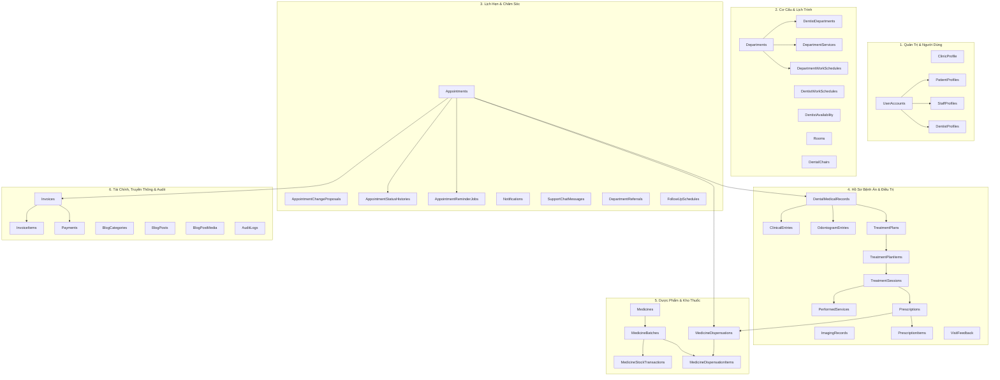

# THƯ MỤC CƠ SỞ DỮ LIỆU - DENTAL CLINIC MANAGEMENT SYSTEM (SWP391 GROUP 6)

Thư mục này chứa toàn bộ cấu trúc cơ sở dữ liệu (**44 bảng, Views, Stored Procedures khớp 100% với EF Core DbContext**), file backup nén `.bak` và dữ liệu mẫu chuẩn hóa UTF-8 tiếng Việt hoàn chỉnh (toàn bộ 26 tài khoản demo đại diện 5 vai trò, lịch hẹn, hồ sơ bệnh án EMR, sơ đồ răng Odontogram, phác đồ điều trị, đơn thuốc, cấp phát dược phẩm, quản lý kho thuốc & hạn sử dụng, hóa đơn, thanh toán, tin tức bài viết, tin nhắn tư vấn và nhật ký kiểm toán) phục vụ kiểm thử và bảo vệ đồ án.

---

## 📦 Danh Sách Các Tệp Chuẩn Hóa Cốt Lõi

| Tên Tệp | Ý Nghĩa / Mục Đích Sử Dụng | Cách Dùng |
| :--- | :--- | :--- |
| **`DentalClinic_Full_Database_And_Data.sql`** | **Script TỔNG HỢP TOÀN DIỆN (1 BƯỚC KHUYÊN DÙNG)**: Tự động khởi tạo database, toàn bộ 44 bảng, ràng buộc khóa ngoại, indexes, views, stored procedures và nạp đầy đủ dữ liệu mẫu chuẩn UTF-8 (không lỗi font). Có cơ chế **Idempotent** tự làm sạch an toàn khi chạy lại nhiều lần. | Chạy 1 lần duy nhất trong SSMS hoặc PowerShell. |
| **`DentalClinicManagementDB.bak`** | **File Backup SQL Server chuẩn nén (2.0 MB)**: Chứa toàn bộ 44 bảng và dữ liệu hoàn chỉnh, backup trực tiếp từ SQL Server. Phù hợp cho giảng viên/thành viên nhóm muốn khôi phục tức thì. | Dùng tính năng *Restore Database* trong SSMS hoặc lệnh `RESTORE DATABASE`. |
| **`Dental_Clinic_Final_Database_Clean.sql`** | Script tạo cấu trúc database sạch (Schema Only: 44 Bảng, Views, Stored Procedures, Ràng buộc, Computed Columns, Indexes). | Dành cho môi trường muốn tự khởi tạo database rỗng (production/staging). |
| **`Generate_Standardized_DB_Files.ps1`** | Script PowerShell tự động xuất khẩu Schema, Full Data và Backup `.bak` từ Database đang chạy bằng SQL Server Management Objects (SMO). | Chạy khi cập nhật cấu trúc DB để tự động đồng bộ lại 3 tệp master trên. |
| **`legacy_patches_and_seeds/`** | Thư mục lưu trữ lịch sử các bản vá (migration patches) và kịch bản nạp dữ liệu thành phần trong quá trình phát triển (đã được gộp vào file master). | Lưu trữ đối chiếu (archive). |

---

## 🚀 Hướng Dẫn Khôi Phục Nhanh (Chọn 1 trong 2 cách)

### Cách 1: Chạy Script SQL Tổng Hợp (Khuyên dùng - Nhanh nhất & Tự động)
Chạy lệnh sau trên terminal PowerShell tại thư mục gốc của dự án (thay `.\MSSQLSERVER01` bằng instance SQL Server của bạn nếu dùng `.\SQLEXPRESS` hoặc `(localdb)\mssqllocaldb`):

```powershell
sqlcmd -S .\MSSQLSERVER01 -E -i "DB\DentalClinic_Full_Database_And_Data.sql"
```

> [!NOTE]
> Script đã được tích hợp khối **Idempotent Teardown**: Nếu database `DentalClinicManagementDB` đã tồn tại từ trước, script sẽ tự động gỡ bỏ các ràng buộc và bảng cũ để tái thiết lập trạng thái sạch 100%, không bao giờ phát sinh lỗi trùng khóa hay "Object already exists".

---

### Cách 2: Restore từ file Backup (`DentalClinicManagementDB.bak`)
Chạy lệnh PowerShell:
```powershell
sqlcmd -S .\MSSQLSERVER01 -E -Q "RESTORE DATABASE DentalClinicManagementDB FROM DISK = '$(Get-Location)\DB\DentalClinicManagementDB.bak' WITH REPLACE;"
```

Hoặc qua giao diện đồ họa **SQL Server Management Studio (SSMS)**:
1. Chuột phải vào mục **Databases** $\rightarrow$ chọn **Restore Database...**
2. Chọn **Device** $\rightarrow$ click nút `...` $\rightarrow$ chọn **Add** $\rightarrow$ duyệt đến file `DentalClinicManagementDB.bak` trong thư mục `DB/`.
3. Trong mục **Files**, kiểm tra đường dẫn lưu trữ `.mdf` và `.ldf`.
4. Trong mục **Options**, tích chọn **Overwrite the existing database (WITH REPLACE)** và **Close existing connections**.
5. Nhấn **OK** để khôi phục.

---

## 🏗️ Cấu Trúc 44 Bảng Dữ Liệu Phân Theo Phân Hệ Nghiệp Vụ



| Phân Hệ | Danh Sách Bảng | Chức Năng Cốt Lõi |
| :--- | :--- | :--- |
| **1. Quản trị & Nhân sự** | `ClinicProfile`, `UserAccounts`, `PatientProfiles`, `StaffProfiles`, `DentistProfiles` | Hồ sơ phòng khám, tài khoản 5 vai trò, xác thực mật khẩu PBKDF2, thông tin chi tiết bệnh nhân, nhân viên và nha sĩ. |
| **2. Cơ cấu cơ sở** | `Departments`, `DentistDepartments`, `DepartmentWorkSchedules`, `DentistWorkSchedules`, `DentistAvailability`, `Rooms`, `DentalChairs`, `DepartmentServices` | Quản lý chuyên khoa, ghế khám, phòng điều trị, bảng giá dịch vụ và phân ca trực tuần của bác sĩ. |
| **3. Lịch hẹn & Chăm sóc** | `Appointments`, `AppointmentChangeProposals`, `AppointmentStatusHistories`, `AppointmentReminderJobs`, `Notifications`, `SupportChatMessages`, `DepartmentReferrals`, `FollowUpSchedules` | Luồng đặt hẹn bệnh nhân - lễ tân, nhắc hẹn tự động T-24h & T-8h (WF-12), chuyển tuyến liên khoa (WF-13), tái khám định kỳ (WF-11). |
| **4. Bệnh án EMR & Điều trị** | `DentalMedicalRecords`, `ClinicalEntries`, `OdontogramEntries`, `ImagingRecords`, `TreatmentPlans`, `TreatmentPlanItems`, `TreatmentSessions`, `PerformedServices`, `Prescriptions`, `PrescriptionItems`, `VisitFeedback` | Bệnh án điện tử, sơ đồ răng FDI, hình ảnh X-quang/CT, phác đồ điều trị đa giai đoạn, phiên điều trị thực tế, kê đơn thuốc và khảo sát hài lòng. |
| **5. Kho thuốc & Cấp phát** | `Medicines`, `MedicineBatches`, `MedicineStockTransactions`, `MedicineDispensations`, `MedicineDispensationItems` | Quản lý danh mục thuốc nội bộ, quản lý theo số lô và hạn sử dụng (WF-15), bác sĩ cấp phát thuốc trực tiếp (WF-16), lịch sử xuất nhập tồn kiểm toán kho. |
| **6. Tài chính & Truyền thông** | `Invoices`, `InvoiceItems`, `Payments`, `BlogCategories`, `BlogPosts`, `BlogPostMedia`, `AuditLogs` | Tích hợp lập hóa đơn tự động gồm dịch vụ đã thực hiện và thuốc cấp phát (WF-17), thanh toán đa kênh, truyền thông tin tức bài viết chuẩn SEO (WF-20, WF-21), nhật ký kiểm toán hệ thống. |

---

## 🔑 Thông Tin Đăng Nhập Mẫu Sẵn Có

* **Mật khẩu dùng chung cho TOÀN BỘ tài khoản:** `Password123@`

| Vai trò | Email đăng nhập | Tên người dùng đại diện | Ghi chú tài khoản |
| :--- | :--- | :--- | :--- |
| **SystemAdministrator** | `admin@dentalcare.com` | Quản Trị Hệ Thống | Toàn quyền kiểm soát tài khoản, danh mục, kho thuốc, kiểm duyệt bài viết. |
| **DepartmentManager** | `manager@dentalcare.com` | BS.CKII Lê Hoàng Nam | Trưởng khoa Răng Tổng Quát, quản lý phân ca, soạn thảo bài viết truyền thông. |
| **DepartmentManager** | `manager1@dentalcare.com` | BS.CKI Nguyễn Văn A | Trưởng khoa Răng Trẻ Em. |
| **Dentist** | `dentist@dentalcare.com` | BS. Trần Văn Hùng | Bác sĩ điều trị chính, lập phác đồ, cấp phát thuốc, kê đơn. |
| **Dentist** | `dentist2@dentalcare.com` | BS. Phương Thảo | Bác sĩ Chỉnh nha - Niềng răng. |
| **Receptionist** | `receptionist@dentalcare.com` | Trần Thị Mai Anh | Tiếp đón, điều phối hàng đợi, xác nhận lịch hẹn, thu ngân thanh toán hóa đơn. |
| **Patient** | `patient1@dentalcare.com` | Trần Mai Chi | Bệnh nhân demo đặt lịch hẹn, xem tiến trình điều trị và lịch sử hóa đơn. |
| **Patient** | `patient.tuan@gmail.com` | Nguyễn Tuấn Kiệt | Bệnh nhân mẫu có đơn thuốc và cấp phát thuốc hoàn chỉnh. |
