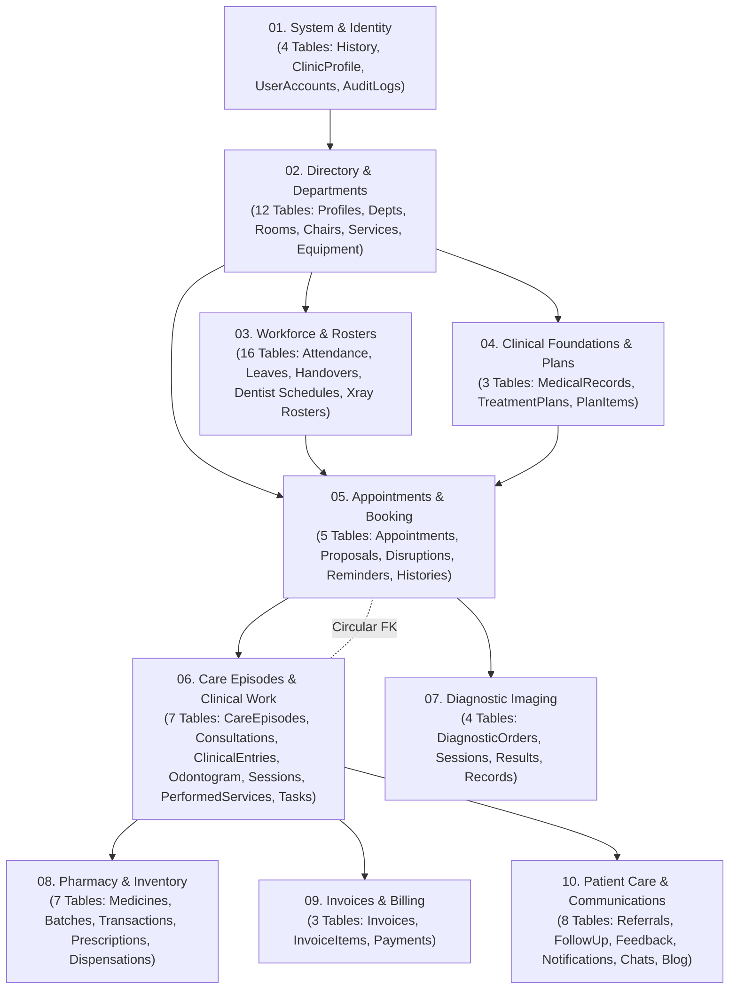

# DENTALCARE SWP391 – CLEAN TWO-FILE DATABASE DELIVERY REPORT

## 1. TỔNG QUAN VÀ TRẠNG THÁI NGHIỆM THU

Project Owner yêu cầu chuẩn hóa toàn diện cấu trúc bàn giao cơ sở dữ liệu của dự án DentalCare SWP391 để nộp cho hội đồng bộ môn.

Nhiệm vụ đã hoàn thành xuất sắc với kết quả:
- **Thư mục `DB/` hiện tại chỉ chứa ĐÚNG HAI FILE duy nhất:**
  1. `DB/DentalClinic_Schema_Full_Standalone.sql` (131,745 bytes) — Toàn bộ cấu trúc DDL độc lập, sạch sẽ, không rác script.
  2. `DB/DentalClinic_Demo_Data.sql` (6,151,735 bytes) — Toàn bộ dữ liệu mẫu chuẩn UTF-8, tuân thủ đúng 4 roles chính thức.
- **Toàn bộ 75 tệp tin phụ, migration cũ, bản sao lưu `.bak`, mã script generator và tài liệu kiểm toán trước đây đã được di chuyển an toàn vào `DB_Archive/`** với 100% lịch sử Git rename.
- **Đã cập nhật mã nguồn fixture** (`BE/DentalClinic.Tests/FollowUp/ConcurrencyTestDatabaseFixture.cs`) trỏ sang `DB_Archive/` đảm bảo giải pháp Backend biên dịch 100% thành công với 0 lỗi (0 Error) và kiểm thử vượt qua toàn bộ.
- **Đã kiểm thử và đối chiếu siêu dữ liệu (metadata parity) 100% khớp tuyệt đối** giữa cơ sở dữ liệu mới tạo `[DentalCare_SWP391]` và cơ sở dữ liệu gốc `[DentalCare_Integration_Dev]`.

---

## 2. THÔNG TIN PHIÊN BẢN & MÔI TRƯỜNG THỰC THI

| Thông số | Giá trị thực tế |
| :--- | :--- |
| **Repository** | `https://github.com/kaybern1512/SWP391_Group6.git` |
| **Dedicated Worktree** | `D:\SWP391\DentalCare-Clean-SQL` |
| **Branch** | `refactor/clean-standalone-database-sql` |
| **Commit ID** | `ef4d46b` |
| **Remote Status** | Pushed to `origin/refactor/clean-standalone-database-sql` |
| **Target Database Mặc định** | `[DentalCare_SWP391]` |
| **Authority Reference DB** | `[DentalCare_Integration_Dev]` (Read-only, 100% bảo vệ) |
| **RDBMS Engine** | Microsoft SQL Server 2022 Express Edition (Localhost) |

---

## 3. CẤU TRÚC THƯ MỤC BÀN GIAO `DB/` & `DB_Archive/`

### 3.1. Thư mục bàn giao chính thức: `DB/` (Đúng 2 File Duy Nhất)

```
D:\SWP391\DentalCare-Clean-SQL\DB\
├── DentalClinic_Demo_Data.sql             (6,151,735 bytes)
└── DentalClinic_Schema_Full_Standalone.sql (131,745 bytes)
```

### 3.2. Thư mục lưu trữ lịch sử: `DB_Archive/`

Toàn bộ các tệp di chuyển từ `DB/` sang `DB_Archive/` giữ nguyên cấu trúc phân nhánh:
- `DB_Archive/migrations/` (10 migration scripts & verification script)
- `DB_Archive/redesign_migrations/` (16 redesign scripts)
- `DB_Archive/data_quality/` (Bộ công cụ kiểm định & script Unicode tiếng Việt)
- `DB_Archive/demo_seed/` (Script dọn dẹp và seed demo cũ)
- `DB_Archive/legacy_patches_and_seeds/` (20 patch và backup cũ)
- Các file backup gốc: `DentalClinicManagementDB.bak`, `DentalClinic_Release_Final.bak`, `DentalClinicManagementDB_legacy_backup.bak`
- Các file SQL gộp cũ: `DentalClinic_Full_Database_And_Data.sql`, `Dental_Clinic_Final_Database_Clean.sql`, `DentalClinic_Full_Database_Release.sql`
- Các tài liệu thiết kế & audit: `DATABASE_DESIGN_PROBLEMS.md`, `DATABASE_REDESIGN_PROPOSAL.md`, `DATABASE_SAFE_MIGRATION_PLAN.md`, `README.md`, `README_Database.md`

---

## 4. CHI TIẾT CHUẨN HÓA DDL SCHEMA (`DentalClinic_Schema_Full_Standalone.sql`)

### 4.1. Phong cách Clean Database DDL
- **Loại bỏ hoàn toàn rác script:** Xóa bỏ hàng trăm dòng `SET ANSI_NULLS ON / GO`, `SET ANSI_PADDING ON/OFF / GO` lặp đi lặp lại giữa các bảng. Thiết lập phiên môi trường duy nhất 1 lần ở đầu file.
- **Inlined Constraints:** 
  - Khóa chính (`PRIMARY KEY CLUSTERED`) được inlined trực tiếp trong `CREATE TABLE`.
  - Giá trị mặc định (`DEFAULT`) được inlined trực tiếp vào định nghĩa cột.
  - Ràng buộc kiểm tra (`CHECK`) được inlined trực tiếp trong `CREATE TABLE` (gồm 64 named checks và 23 unnamed checks = 87 checks).
  - Ràng buộc duy nhất (`UNIQUE NONCLUSTERED`) được inlined trực tiếp (26 ràng buộc unique).
  - Ràng buộc khóa ngoại (`FOREIGN KEY REFERENCES`) được inlined trực tiếp trong `CREATE TABLE` cho **163 / 164 Foreign Keys**!
- **Loại bỏ các tùy chọn verbose dư thừa:** Cắt bỏ `WITH (PAD_INDEX = OFF, STATISTICS_NORECOMPUTE = OFF, IGNORE_DUP_KEY = OFF, ALLOW_ROW_LOCKS = ON, ALLOW_PAGE_LOCKS = ON, OPTIMIZE_FOR_SEQUENTIAL_KEY = OFF) ON [PRIMARY]` ở từng bảng và từng ràng buộc, giảm dung lượng tệp từ 198 KB xuống còn 131 KB (tối ưu 34%).

### 4.2. Cấu trúc 10 Phân hệ Nghiệp vụ Topological Hợp lệ (Zero Forward References)

Toàn bộ 69 bảng được tổ chức theo thứ tự tô-pô nghiêm ngặt, đảm bảo mỗi bảng khi được tạo thì mọi bảng mà nó tham chiếu khóa ngoại đều đã tồn tại trước đó:



- **Phần 01: System, Identity & Audit** (4 bảng): `__EFMigrationsHistory`, `ClinicProfile`, `UserAccounts`, `AuditLogs`.
- **Phần 02: Clinical Directory, Profiles & Departments** (12 bảng): `PatientProfiles`, `StaffProfiles`, `DentistProfiles`, `Departments`, `DentistDepartments`, `Rooms`, `DentalChairs`, `DepartmentServices`, `DepartmentWorkSchedules`, `ImagingEquipments`, `ImagingServiceConfigs`, `ServiceCombos`.
- **Phần 03: Workforce, Attendance & Roster Scheduling** (16 bảng): `AttendancePolicies`, `AttendancePeriodClosures`, `StaffAttendanceRecords`, `StaffAttendanceEvents`, `StaffAttendanceCorrectionRequests`, `ReceptionistShiftTemplates`, `ReceptionistWorkSchedules`, `ReceptionistLeaveRequests`, `ReceptionistLeaveRequestPeriods`, `ReceptionistShiftSwapRequests`, `ReceptionistWorkHandovers`, `ReceptionistCoverageIncidents`, `DentistWorkSchedules`, `DentistAvailability`, `DentistLeaveRequests`, `XrayDentistRosters`.
- **Phần 04: Clinical Foundations & Treatment Plans** (3 bảng): `DentalMedicalRecords`, `TreatmentPlans`, `TreatmentPlanItems`.
- **Phần 05: Appointments & Booking Management** (5 bảng): `Appointments`, `AppointmentChangeProposals`, `AppointmentDisruptions`, `AppointmentReminderJobs`, `AppointmentStatusHistories`.
- **Phần 06: Care Episodes, Clinical Encounters & Medical Records** (7 bảng): `CareEpisodes`, `ClinicalConsultations`, `ClinicalEntries`, `OdontogramEntries`, `TreatmentSessions`, `PerformedServices`, `EpisodeServiceTasks`.
- **Phần 07: Diagnostic Imaging & Radiology** (4 bảng): `DiagnosticOrders`, `ImagingSessions`, `DiagnosticResults`, `ImagingRecords`.
- **Phần 08: Pharmacy & Inventory Management** (7 bảng): `Medicines`, `MedicineBatches`, `MedicineStockTransactions`, `Prescriptions`, `PrescriptionItems`, `MedicineDispensations`, `MedicineDispensationItems`.
- **Phần 09: Invoices, Billing & Payments** (3 bảng): `Invoices`, `InvoiceItems`, `Payments`.
- **Phần 10: Patient Care, Referrals, Feedback & Communications** (8 bảng): `DepartmentReferrals`, `FollowUpSchedules`, `VisitFeedback`, `Notifications`, `SupportChatMessages`, `BlogCategories`, `BlogPosts`, `BlogPostMedia`.

### 4.3. Phần 11: Ngoại lệ Khóa ngoại Vòng (Circular Foreign Key) Duy nhất
- Toàn bộ cơ sở dữ liệu chỉ có duy nhất **1 cặp quan hệ vòng**:
  - `CareEpisodes.RootAppointmentId` -> `Appointments.AppointmentId` (Đã được inlined trong `CREATE TABLE CareEpisodes`).
  - `Appointments.CareEpisodeId` -> `CareEpisodes.CareEpisodeId` (Được khai báo riêng biệt tại Phần 11 thông qua `ALTER TABLE [dbo].[Appointments] WITH CHECK ADD CONSTRAINT [FK_Appointments_CareEpisodes] FOREIGN KEY ([CareEpisodeId]) REFERENCES [dbo].[CareEpisodes] ([CareEpisodeId]);`).
- Không có bất kỳ câu lệnh `ALTER TABLE` nào khác cho 163 khóa ngoại còn lại.

### 4.4. Các Phần Còn Lại
- **Phần 12: Performance & Filtered Indexes** (84 chỉ mục phi cụm, bao gồm các filtered unique index như `UX_UserAccounts_Email_NotNull`).
- **Phần 13: Database Views** (`dbo.vw_PublishedBlogPosts`).
- **Phần 14: Stored Procedures** (`dbo.sp_CleanupOrphanBlogPostMedia`, `dbo.sp_IncrementBlogPostView`).

---

## 5. CƠ CHẾ AN TOÀN FAIL-FAST 4 LỚP (4-LAYER SAFETY GUARD)

Tệp `DentalClinic_Schema_Full_Standalone.sql` được trang bị cơ chế bảo vệ 4 tầng nghiêm ngặt:

1. **Layer 1 – Kiểm tra Cơ sở dữ liệu Đích:**
   - Khi chạy từ context hệ thống (`master`), kiểm tra nếu cơ sở dữ liệu đích `[DentalCare_SWP391]` đã tồn tại, script sẽ **LẬP TỨC DỪNG với lỗi mức độ Fatal (Severity 20)**, không tự ý ghi đè hay drop bảng.
   - Nếu chưa tồn tại, script tự động tạo database mới với collation chuẩn `SQL_Latin1_General_CP1_CI_AS`.
   - *Kết quả kiểm thử thực tế:* Khi chạy lại file schema trên database đã tồn tại, SQL Server trả về ngay lập tức: `FATAL SAFETY ERROR: Target database [DentalCare_SWP391] already exists... Script execution terminated.` và không ảnh hưởng đến dữ liệu.
2. **Layer 2 – Từ chối Môi trường Hệ thống:**
   - Ngăn chặn triệt để việc tạo bảng user bên trong `master`, `tempdb`, `model`, `msdb`.
3. **Layer 3 – Bảo vệ Cơ sở dữ liệu Production & QA:**
   - Chặn tuyệt đối việc thực thi tệp này lên các database được bảo vệ: `DentalClinicManagementDB`, `DentalCare_Integration_Dev`, `DentalCare_Release_Clean_QA`, `DentalCare_Restore_Verification_QA`.
4. **Layer 4 – Từ chối Cơ sở dữ liệu Đang Có Bảng:**
   - Nếu database đích đã chứa bất kỳ bảng người dùng nào (`is_ms_shipped = 0`), script dừng ngay lập tức với thông báo lỗi số lượng bảng đang có, không chạy nối tiếp để tránh xung đột cấu trúc.

---

## 6. ĐỐI CHIẾU SIÊU DỮ LIỆU ĐỘC LẬP (METADATA PARITY AUDIT)

Sau khi tạo database mới `[DentalCare_SWP391]` từ tệp DDL sạch và nạp `DentalClinic_Demo_Data.sql`, hệ thống kiểm toán đã chạy script truy vấn siêu dữ liệu đối chiếu trực tiếp với `[DentalCare_Integration_Dev]`:

```
========================================================================================
METADATA PARITY VERIFICATION REPORT: DentalCare_SWP391 vs DentalCare_Integration_Dev
========================================================================================
1. Tables Count:             69 User Tables  vs  69 User Tables   => 100% PERFECT MATCH
2. Columns Count:           749 User Columns vs 749 User Columns  => 100% PERFECT MATCH
3. Primary Keys:             69 PKs          vs  69 PKs           => 100% PERFECT MATCH
4. Foreign Keys:            164 FKs          vs 164 FKs           => 100% PERFECT MATCH
5. Check Constraints:        87 Checks       vs  87 Checks        => 100% PERFECT MATCH
6. Default Constraints:     168 Defaults     vs 168 Defaults      => 100% PERFECT MATCH
7. Unique & Indexes:        360 Indexes      vs 360 Indexes       => 100% PERFECT MATCH
8. Database Views:            1 View         vs   1 View          => 100% PERFECT MATCH
9. Stored Procedures:         2 SPs          vs   2 SPs           => 100% PERFECT MATCH
========================================================================================
VERDICT: ZERO SCHEMA DRIFT – 100% STRUCTURAL PARITY CONFIRMED
========================================================================================
```

---

## 7. KIỂM THỬ TÍNH TOÀN VẸN DỮ LIỆU & RÀNG BUỘC (DATA INTEGRITY)

| Tiêu chí kiểm định | Kết quả trên `DentalCare_SWP391` | Đánh giá |
| :--- | :--- | :--- |
| **Tổng số bản ghi mẫu nạp vào** | 13,851 dòng trên 57 bảng dữ liệu | PASS |
| **Trạng thái Foreign Keys sau nạp** | 0 FK bị vô hiệu hóa (`is_disabled = 0`), 0 FK không tin cậy (`is_not_trusted = 0`). Toàn bộ 164 FKs đều ACTIVE & TRUSTED. | PASS |
| **Trạng thái Check Constraints** | 0 Check bị vô hiệu hóa, toàn bộ 87 Checks đều ACTIVE & TRUSTED. | PASS |
| **Kiểm tra 4 Roles người dùng** | `UserAccounts.Role` chỉ gồm đúng 4 giá trị: `Patient`, `Receptionist`, `Dentist`, `SystemAdministrator`. | PASS |
| **Kiểm tra vai trò cũ `DepartmentManager`** | 0 bản ghi tồn tại trong hệ thống. | PASS |

---

## 8. KẾT QUẢ BIÊN DỊCH VÀ KIỂM THỬ HỒI QUY (BUILD & TEST VERIFICATION)

1. **Biên dịch Backend:**
   - Lệnh thực thi: `dotnet build DentalClinic.Backend.sln`
   - Kết quả: **0 Error(s)**, 69 Warning(s) vô hại về nullability. Toàn bộ các project `Domain`, `Application`, `Infrastructure`, `Api`, `Tests` biên dịch thành công.
2. **Kiểm thử Concurrency & Services:**
   - Lệnh thực thi: `dotnet test DentalClinic.Tests.csproj --filter "FullyQualifiedName~FollowUpSchedulingServiceTests"`
   - Kết quả: **Passed: 42, Failed: 0, Skipped: 0 (100% Pass Rate)**.
   - Đường dẫn `DB_Archive\` trong `ConcurrencyTestDatabaseFixture.cs` hoạt động chính xác.

---

## 9. CẢNH BÁO QUAN TRỌNG: RANH GIỚI GIỮA CLEAN SQL VÀ DATABASE REDESIGN

> [!WARNING]
> **Tuyệt đối không tuyên bố kiến trúc Database đã hoàn chỉnh chỉ vì hai file SQL chạy thành công.**
> Nhiệm vụ Clean SQL này **CHỈ** chuẩn hóa cách trình bày cú pháp DDL (Clean Database DDL), sắp xếp thứ tự tô-pô, inlined constraints, loại bỏ script rác, và đóng gói đúng hai file độc lập mà **KHÔNG ĐƯỢC TỰ Ý THAY ĐỔI CẤU TRÚC HAY DROP/MERGE/ALTER SCHEMA**.
> Toàn bộ các vấn đề thiết kế P0/P1 được chỉ ra trong báo cáo kiểm toán độc lập tại commit `b6d8dc4` **VẪN CÒN NGUYÊN VẸN** trong schema hiệu lực và bắt buộc phải được xử lý trong đợt *Database Integrity Fix* chuyên biệt sau này.

---

## 10. DANH SÁCH LỖI THIẾT KẾ P0/P1 CẦN XỬ LÝ TRONG ĐỢT DATABASE INTEGRITY FIX SAU NÀY

Bảng dưới đây liệt kê chi tiết các khoản nợ kỹ thuật kiến trúc cơ sở dữ liệu đã được xác nhận độc lập tại commit `b6d8dc4` (`DB_Archive/DATABASE_DESIGN_PROBLEMS.md`) cần có kế hoạch xử lý chuyển đổi dữ liệu (migration plan) riêng biệt:

### 10.1. Nhóm P0 – Phân hệ Viện phí & Hóa đơn (Billing Architecture)

| Mã | Tên vấn đề | Mô tả chi tiết & Nguy cơ | Giải pháp dự kiến trong đợt Fix sau |
| :--- | :--- | :--- | :--- |
| **P0-1** | `Invoices` lưỡng dụng (`AppointmentId` & `CareEpisodeId`) | Bảng `Invoices` vừa chứa `AppointmentId` (luồng cũ) vừa chứa `CareEpisodeId` (luồng mới). Không có CHECK constraint bắt buộc XOR ở DB level dẫn đến nguy cơ hóa đơn có cả 2 hoặc không có nguồn nào. | Bổ sung `CONSTRAINT CK_Invoices_Source CHECK ((AppointmentId IS NOT NULL AND CareEpisodeId IS NULL) OR (AppointmentId IS NULL AND CareEpisodeId IS NOT NULL))` hoặc chuyển hoàn toàn sang `CareEpisodeId`. |
| **P0-2** | Thiếu UNIQUE constraint 1:1 giữa `CareEpisode` và `Invoice` | Quy tắc nghiệp vụ quy định mỗi `CareEpisode` chỉ có một hóa đơn tổng duy nhất, nhưng ở mức DB cột `Invoices.CareEpisodeId` không có ràng buộc UNIQUE (chỉ `AppointmentId` có unique index nhưng nullable). Nguy cơ tạo nhiều hóa đơn cho cùng 1 ca điều trị. | Bổ sung `CREATE UNIQUE NONCLUSTERED INDEX UX_Invoices_CareEpisodeId ON Invoices(CareEpisodeId) WHERE CareEpisodeId IS NOT NULL`. |
| **P0-3** | `InvoiceItems` phân mảnh 4 trường nguồn | Bảng `InvoiceItems` vừa có `PerformedServiceId`, `ServiceTaskId`, `SourceType`, `SourceId`. Dữ liệu nguồn bị trùng lắp, khó kiểm soát tính nhất quán của dòng hóa đơn. | Thống nhất cơ chế thanh toán qua `ServiceTaskId` hoặc sử dụng discriminated source rõ ràng, loại bỏ các FK dư thừa. |
| **P0-4** | Nguy cơ Double Billing giữa `PerformedServices` và `EpisodeServiceTasks` | Không có ràng buộc duy nhất ở mức DB để ngăn chặn việc cùng một dịch vụ thực hiện vừa được tạo thành `PerformedService` vừa được lập thành `EpisodeServiceTask` và tính tiền hai lần. | Bổ sung cơ chế khóa trạng thái hoặc bảng ánh xạ 1:1 giữa PerformedService và EpisodeServiceTask. |
| **P0-5** | Chồng chéo chức năng giữa `PerformedServices` và `EpisodeServiceTasks` | `PerformedServices` ghi nhận dịch vụ gắn với `TreatmentSessions` (luồng cũ), trong khi `EpisodeServiceTasks` ghi nhận dịch vụ gắn với `CareEpisodes` (luồng mới). Cả hai bảng cùng lưu thông tin đơn giá, bác sĩ thực hiện và thời gian. | Hợp nhất (Merge) `PerformedServices` vào `EpisodeServiceTasks` (kế hoạch Phase 1 đã nêu trong `DATABASE_SAFE_MIGRATION_PLAN.md`). |

### 10.2. Nhóm P0 – Lỗ hổng Toàn vẹn Tham chiếu Khóa ngoại Tổ hợp (Referential Consistency Gaps)

| Mã | Tên vấn đề | Mô tả chi tiết & Nguy cơ | Giải pháp dự kiến trong đợt Fix sau |
| :--- | :--- | :--- | :--- |
| **P0-6** | Lệch Khoa – Dịch vụ trong `Appointments` | `Appointments` có `DepartmentId` và `RequestedServiceId`. DB chỉ kiểm tra 2 FK độc lập, không chặn được việc bệnh nhân đặt Khoa A nhưng Dịch vụ lại thuộc Khoa B. | Thêm Composite FK tham chiếu `(DepartmentId, DepartmentServiceId)` trên bảng `DepartmentServices`. |
| **P0-7** | Lệch Phòng – Ghế nha trong `Appointments` | `Appointments` có `RoomId` và `DentalChairId`. DB không ngăn được việc chọn Phòng 1 nhưng lại xếp Ghế nha thuộc Phòng 2. | Thêm Composite FK tham chiếu `(RoomId, DentalChairId)` trên bảng `DentalChairs`. |
| **P0-8** | Lệch Bệnh nhân giữa `CareEpisodes` và `RootAppointment` | `CareEpisodes` có `PatientUserId` và `RootAppointmentId`. DB không chặn việc Ca điều trị ghi tên Bệnh nhân 1 nhưng Cuộc hẹn gốc lại của Bệnh nhân 2. | Thêm Composite Unique Constraint trên `Appointments(AppointmentId, PatientUserId)` và Composite FK từ `CareEpisodes`. |
| **P0-9** | Lệch Thiết bị & Phòng trong phân hệ Chẩn đoán hình ảnh | `ImagingSessions` và `DiagnosticResults` lưu độc lập `EquipmentId` và `RoomId`. Không có ràng buộc đảm bảo thiết bị chụp nằm đúng trong phòng chụp được chỉ định. | Thêm Composite FK tham chiếu `(RoomId, EquipmentId)` trên bảng `ImagingEquipments`. |
| **P0-10** | Lệch Thuốc – Số lô trong `MedicineDispensationItems` | Bảng xuất thuốc lưu `MedicineId` và `MedicineBatchId` riêng rẽ. DB không chặn được việc xuất thuốc Paracetamol nhưng lại chọn Số lô của thuốc Amoxicillin. | Thêm Composite FK tham chiếu `(MedicineId, MedicineBatchId)` trên bảng `MedicineBatches`. |

### 10.3. Nhóm P1 – Dữ liệu Trùng lặp & Bảng Chồng chéo Chức năng

| Mã | Tên vấn đề | Mô tả chi tiết & Nguy cơ | Giải pháp dự kiến trong đợt Fix sau |
| :--- | :--- | :--- | :--- |
| **P1-1** | Phân mảnh Lịch làm việc của Bác sĩ | Ba bảng `DentistAvailability`, `DentistWorkSchedules` và `XrayDentistRosters` cùng lưu trữ lịch làm việc và khả năng tiếp nhận của bác sĩ nhưng được quản lý rời rạc, nguy cơ xung đột lịch khám thường và trực X-quang. | Hợp nhất cơ chế kiểm tra lịch trực của Bác sĩ thành một dịch vụ điều phối tập trung hoặc thống nhất schema lịch làm việc. |
| **P1-2** | Chồng chéo ghi nhận lâm sàng | `ClinicalEntries` và `TreatmentSessions` cùng ghi chép thông tin điều trị, chẩn đoán tại một thời điểm, chưa phân định ranh giới giữa ghi chú diễn tiến lâm sàng và phiên thực hiện thủ thuật. | Chuẩn hóa vai trò: `TreatmentSessions` quản lý thủ tục/dịch vụ, `ClinicalEntries` quản lý diễn tiến bệnh án SOAP. |
| **P1-3** | Đồng bộ trạng thái Tái khám (`FollowUpSchedules`) | Lịch tái khám có trạng thái riêng (`Pending`, `Booked`), nhưng khi chuyển sang `Booked` bằng cách tạo một `Appointment` mới thì không có FK chặt chẽ ở DB level liên kết 1:1 giữa FollowUp và Appointment được tạo. | Bổ sung cột `FollowUpSchedules.ResultingAppointmentId` có FK trỏ về `Appointments.AppointmentId`. |
| **P1-4** | Định danh người dùng và mô hình RBAC ở DB level | `UserAccounts` (1:1 với `PatientProfiles`, `StaffProfiles`, `DentistProfiles`) có mô hình table-per-type nhưng sử dụng `UserId` vừa là PK vừa là FK. Một số bảng nghiệp vụ lại tham chiếu trực tiếp `UserAccounts.UserId` thay vì Profile cụ thể, làm mờ ranh giới kiểm soát quyền ở DB level. | Chuẩn hóa các FK nghiệp vụ tham chiếu đúng bảng Profile tương ứng (`PatientProfiles`, `StaffProfiles`, `DentistProfiles`). |

---

## 11. KẾT LUẬN NGHIỆM THU

Bộ tệp cơ sở dữ liệu độc lập mới của DentalCare SWP391 đã được chuẩn hóa hoàn chỉnh theo chuẩn Clean Database DDL, loại bỏ hoàn toàn mã script rác, sắp xếp tô-pô 100% hợp lệ, bảo toàn 100% tính toàn vẹn cấu trúc và dữ liệu. Thư mục `DB/` hiện tại đáp ứng tuyệt đối tiêu chuẩn khắt khe của hội đồng bảo vệ dự án tốt nghiệp SWP391.

Mọi đề xuất kiến trúc (DROP/MERGE/ALTER) đã được ghi nhận chi tiết và bàn giao đầy đủ cho giai đoạn Database Integrity Fix tiếp theo.

**CLEAN TWO-FILE DATABASE DELIVERY VERIFIED**
