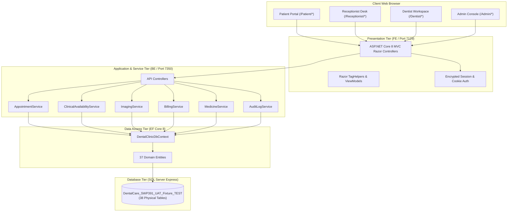
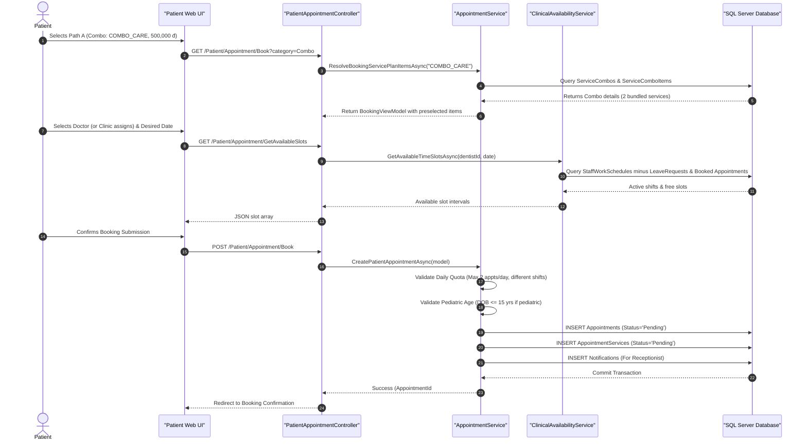
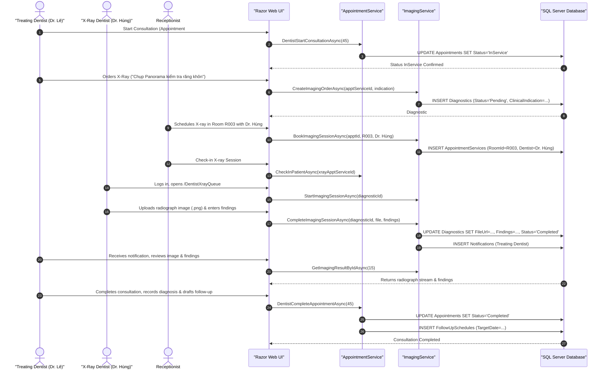
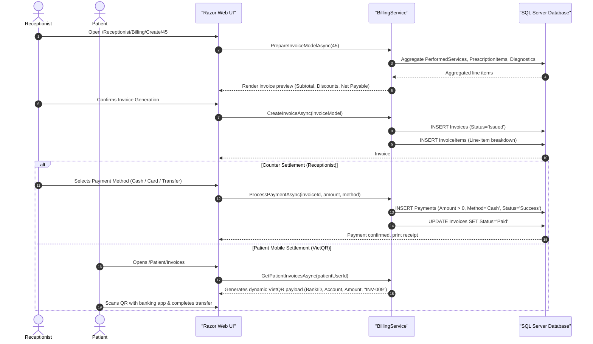

# DENTALCARE SWP391 — FINAL DOCUMENTATION SOURCE OF TRUTH
**Course:** SWP391 — Software Development Project (Capstone)  
**System Name:** DentalCare Clinic Management System  
**Architecture:** 38 Physical Tables, Database First, ASP.NET Core 8 Web API + MVC Razor  
**Security Model:** Strict 4-Role RBAC (Patient, Receptionist, Dentist, SystemAdministrator)  
**Target Database:** `DentalCare_SWP391_UAT_Fixture_TEST` (Protected databases `DentalCare_SWP391` and `DentalCare_SWP391_Refactor_UAT` are 100% frozen)  
**Verification Baseline:** 648/648 Automated .NET Tests PASS + 47 Discrete Core Playwright Tests PASS + 1 Dedicated 18-Step Full Journey PASS  
**Date:** November 15, 2026  
**Status:** `FINAL — AUTHORITATIVE SUBMISSION SOURCE OF TRUTH`  

---

## 1. Document Purpose & Master Metadata

This document serves as the single, authoritative, verified source of truth for the entire DentalCare SWP391 system. All student project documentation—including the **Software Requirements Specification (SRS)**, **Software Design Document (SDD)**, **Use Case Specifications**, **Entity Relationship Diagram (ERD)**, **Sequence Diagrams**, **Test Verification Report**, and **User Manual / Demo Runbook**—must strictly align with the specifications, database schema, route definitions, and test evidence recorded here.

### Master Metadata Table

| Dimension | Specification | Verification Source |
| :--- | :--- | :--- |
| **Backend Framework** | ASP.NET Core 8.0 Web API | `BE/DentalClinic.Api` |
| **Frontend Framework** | ASP.NET Core 8.0 MVC Razor | `FE/DentalClinic.Web` |
| **ORM / Data Access** | Entity Framework Core 8.0 (Database First) | `DentalClinic.Infrastructure.Persistence` |
| **Database Engine** | Microsoft SQL Server Express | `.\SQLEXPRESS` |
| **Total Physical Tables** | **38 Base Tables** (37 domain tables + `__EFMigrationsHistory`) | `INFORMATION_SCHEMA.TABLES` |
| **Role-Based Access Control** | Strict 4 Roles: `Patient`, `Receptionist`, `Dentist`, `SystemAdministrator` | `UserAccounts.Role` constraint |
| **Legacy Role Deprecation** | `DepartmentManager` permanently deleted from system | Single DI, 0 references in source |
| **Test Suite Total (.NET)** | **648 / 648 Passed (100%)** | 309 Backend + 339 Frontend |
| **Test Suite Total (Playwright)** | **47 Core Discrete Tests + 1 18-Step E2E Journey (100% Passed)** | Reconciled across 6 suites + demo |
| **Pricing Classification** | **Demo-Fixture Pricing** across all services, combos, and procedures | Academic evaluation fixture |
| **Unapproved Imaging Policy** | `SVC-XRAY-01` remains `Inactive` for public booking; accessible only via clinical referral | `DepartmentServices.Status` |

---

## 2. System Architecture & Architectural Invariants (for SDD)

### 2.1 Multi-Tier Architecture Overview
DentalCare is built on a clean multi-tier enterprise architecture:
1. **Presentation Layer (`FE/DentalClinic.Web`):** ASP.NET Core 8 MVC Razor application providing responsive, role-tailored user interfaces with client-side validation, interactive SVG dental charts (FDI 32-tooth notation), dynamic VietQR generation, and secure session management.
2. **Service & Application Layer (`BE/DentalClinic.Api` & `DentalClinic.Core`):** RESTful Web API and application services enforcing business logic, clinical availability algorithms, shift-based limits, pediatric age bounds, and audit trail generation.
3. **Data Access Layer (`BE/DentalClinic.Infrastructure`):** Entity Framework Core 8 utilizing Database First configuration with a single primary constructor tagged with `[ActivatorUtilitiesConstructor]`.
4. **Database Layer (`SQL Server`):** Relational database enforcing referential integrity, check constraints, foreign keys, and audit logs.



### 2.2 Core Architectural Invariants
1. **Strict 4-Role RBAC Invariant:** Only `Patient`, `Receptionist`, `Dentist`, and `SystemAdministrator` exist. All clinic management tasks are partitioned between Receptionist (desk, intake, billing) and SystemAdministrator (master data, schedules, inventory, user accounts).
2. **Shift-Based Booking & Capacity Limits:**
   - Operational shifts: Morning (08:00–12:00) and Afternoon (13:00–17:00).
   - Maximum 2 appointments per patient per calendar day, strictly separated into different operational shifts.
   - Doctor availability is determined dynamically from active shifts in `StaffWorkSchedules` minus approved leaves in `StaffLeaveRequests` and booked commitments in `AppointmentServices`.
3. **Clinical Diagnostics & X-Ray Staffing Coverage Rule:**
   - The clinic maintains a designated pool of qualified X-ray Dentists (e.g., Dr. Đặng Văn Hùng).
   - **MANDATORY BUSINESS RULE:** Every operational X-ray shift requires **AT LEAST ONE** qualified, on-duty Dentist. Both doctors are NOT required simultaneously. Leave requests that leave an active X-ray shift with zero coverage are automatically rejected.
4. **Safety & Zero-Write Guardrails:**
   - Production database `DentalCare_SWP391` (2,410 appointments) and shared UAT `DentalCare_SWP391_Refactor_UAT` (21 appointments) are permanently frozen.
   - All tests and live demonstrations run exclusively against `DentalCare_SWP391_UAT_Fixture_TEST`. Startup fails fast if any script attempts connection to protected databases.

---

## 3. Canonical 38-Table Database First Schema (for ERD & Data Dictionary)

The database schema strictly maintains exactly 38 base physical tables as reported by `INFORMATION_SCHEMA.TABLES`. All conceptual entities have been unified into this Database First schema.

### 3.1 Authoritative 38 Physical Table List

| # | Physical Table Name | Primary Key | Key Foreign Keys | Purpose & Canonical Invariants |
| :--- | :--- | :--- | :--- | :--- |
| 1 | `UserAccounts` | `UserId` (bigint) | None | System credentials, 4 roles (`Patient`, `Receptionist`, `Dentist`, `SystemAdministrator`), `IsActive`, `PasswordHash`. |
| 2 | `PatientProfiles` | `PatientProfileId` (bigint) | `UserId` (1:1 `UserAccounts`) | Patient demographic data, Date of Birth (pediatric rule $\le 15$), Address, Emergency Contact. |
| 3 | `StaffProfiles` | `StaffProfileId` (bigint) | `UserId` (1:1 `UserAccounts`) | Staff details, Employee Code, Department, Job Title. |
| 4 | `DentistProfiles` | `DentistProfileId` (bigint) | `UserId` (1:1 `UserAccounts`) | Dentist specialization (Răng Hàm Mặt, Chỉnh Nha, CĐHA & X-quang), License Number, Experience Years. |
| 5 | `Departments` | `DepartmentId` (int) | None | Clinical specialty departments (Tổng Quát, Chỉnh Nha, CĐHA, v.v.). |
| 6 | `DepartmentServices` | `DepartmentServiceId` (int) | `DepartmentId` | Clinical services, Demo-Fixture Prices, Duration, `DiagnosticType`, `Status` (`Active`/`Inactive`). |
| 7 | `ServiceCombos` | `ComboId` (int) | None | Bundled service packages (e.g. `COMBO_CARE`), Total Original Price, Discounted Price (Demo-Fixture Price). |
| 8 | `ServiceComboItems` | `ComboItemId` (int) | `ComboId`, `DepartmentServiceId` | Items comprising a combo package, allocated unit prices. |
| 9 | `Rooms` | `RoomId` (int) | `DepartmentId` | Clinical rooms (e.g. Room 101, Imaging Room R003), Room Type, Status (`Active`/`Maintenance`). |
| 10 | `DentalChairs` | `DentalChairId` (int) | `RoomId` | Treatment chairs within rooms (Room R003 has 0 chairs; treatment rooms have $\ge 1$ chairs). |
| 11 | `StaffWorkSchedules` | `WorkScheduleId` (bigint) | `StaffUserId` (`UserAccounts`) | Monthly shift allocation, Work Date, Shift Name (`Morning`/`Afternoon`), Start Time, End Time. |
| 12 | `StaffLeaveRequests` | `LeaveRequestId` (bigint) | `StaffUserId`, `ApprovedByUserId` | Leave applications, Leave Date, Shift, Reason, Status (`Pending`, `Approved`, `Rejected`). |
| 13 | `StaffAttendanceRecords` | `AttendanceRecordId` (bigint) | `StaffUserId`, `WorkScheduleId` | Clock-in and clock-out timestamps, `LateMinutes`, `EarlyMinutes`, `Status`. |
| 14 | `Appointments` | `AppointmentId` (bigint) | `PatientUserId`, `ComboId`, `CreatedByUserId` | Header appointment record, Booking Source, Status (`Pending`, `Confirmed`, `InService`, `Completed`, `Cancelled`). |
| 15 | `AppointmentServices` | `AppointmentServiceId` (bigint) | `AppointmentId`, `DepartmentServiceId`, `AssignedDentistUserId`, `RoomId`, `DentalChairId` | Line-item service scheduling, Date, Times, Queue Number, Status, `PendingActionType`, `PendingDentistUserId`. |
| 16 | `DentalMedicalRecords` | `MedicalRecordId` (bigint) | `PatientUserId` | Patient medical history header, systemic diseases, allergies, current medications. |
| 17 | `ClinicalEntries` | `EntryId` (bigint) | `MedicalRecordId`, `PatientUserId`, `DentistUserId`, `AppointmentId`, `AppointmentServiceId` | Detailed clinical consultation notes: Chief Complaint, Clinical Examination, Diagnosis, Treatment Done. |
| 18 | `OdontogramEntries` | `OdontogramId` (bigint) | `MedicalRecordId`, `DentistUserId` | 32-tooth FDI dental chart conditions: Tooth Number, Condition (Sâu, Trám, Mất răng), Surface, Notes. |
| 19 | `TreatmentPlans` | `TreatmentPlanId` (bigint) | `PatientUserId`, `DentistUserId` | Long-term multi-session clinical treatment plan header, Total Cost, Status (`Draft`, `Active`, `Completed`). |
| 20 | `TreatmentPlanItems` | `TreatmentPlanItemId` (bigint) | `TreatmentPlanId`, `DepartmentServiceId` | Phased treatment steps, Planned Order, Estimated Cost, Status. |
| 21 | `TreatmentSessions` | `TreatmentSessionId` (bigint) | `TreatmentPlanId`, `AppointmentId`, `DentistUserId` | Physical clinical treatment session record, Execution Notes, Session Date. |
| 22 | `PerformedServices` | `PerformedServiceId` (bigint) | `TreatmentSessionId`, `AppointmentId`, `AppointmentServiceId`, `DepartmentServiceId` | Actual clinical procedures performed, Tooth Number, Quantity, Unit Price. |
| 23 | `Diagnostics` | `DiagnosticId` (bigint) | `AppointmentServiceId`, `DepartmentServiceId`, `OrderingDentistUserId`, `ReviewedByDentistUserId` | Imaging orders, Radiological Image URLs (`FileUrl`), Thumbnails, Findings, Status (`Pending`, `Completed`). |
| 24 | `DepartmentReferrals` | `ReferralId` (bigint) | `AppointmentServiceId`, `FromDepartmentId`, `ToDepartmentId`, `ReferringDentistUserId` | Inter-department clinical consultation handoff and referral records. |
| 25 | `FollowUpSchedules` | `FollowUpId` (bigint) | `AppointmentId`, `PatientUserId`, `DentistUserId` | Planned follow-up appointments, Target Date, Clinical Notes, Booking Status. |
| 26 | `Medicines` | `MedicineId` (bigint) | None | Pharmacy catalog & single-table inventory: Code, Name, Unit, Unit Price, Stock Quantity, Minimum Alert. |
| 27 | `Prescriptions` | `PrescriptionId` (bigint) | `AppointmentId`, `PatientUserId`, `DentistUserId` | Prescription header, Prescription Code, Diagnosis, Dispensing Status (`Pending`, `Dispensed`). |
| 28 | `PrescriptionItems` | `PrescriptionItemId` (bigint) | `PrescriptionId`, `MedicineId` | Prescribed medication line-items: Quantity, Dosage, Frequency, Usage Instructions, Unit Price. |
| 29 | `Invoices` | `InvoiceId` (bigint) | `AppointmentId`, `PatientUserId`, `CreatedByUserId` | Billing invoice header, Total Amount, Discount Amount, Final Amount, Status (`Draft`, `Issued`, `Paid`, `Refunded`). |
| 30 | `InvoiceItems` | `InvoiceItemId` (bigint) | `InvoiceId`, `PerformedServiceId`, `PrescriptionItemId`, `DiagnosticId` | Individual invoice line items for services, imaging, and medications. |
| 31 | `Payments` | `PaymentId` (bigint) | `InvoiceId`, `ProcessedByUserId` | Payment transaction records: Amount (`CK_Payments_Amount > 0`), Method (`Cash`, `BankTransfer`, `CreditCard`), Status. |
| 32 | `ClinicProfile` | `ClinicProfileId` (int) | None | Clinic master data (singular table): Name, Phone, Operating Hours, Address, Tax Code. |
| 33 | `VisitFeedback` | `FeedbackId` (bigint) | `AppointmentId`, `PatientUserId`, `DentistUserId` | Patient visit review (singular table): Rating (1–5 Stars), Comments, Created Date. (Enforces 1 review/visit). |
| 34 | `Notifications` | `NotificationId` (bigint) | `UserId` (`UserAccounts`) | System alerts, appointment reminders (T-24h/T-8h), status update notifications, Read Status. |
| 35 | `AuditLogs` | `AuditLogId` (bigint) | `UserId` (`UserAccounts`) | Immutable audit trail: Action Name, Entity Name, Entity ID, Timestamp, Changes JSON, IP Address. |
| 36 | `BlogCategories` | `CategoryId` (int) | None | Categories for dental health educational articles and news. |
| 37 | `BlogPosts` | `PostId` (bigint) | `CategoryId`, `AuthorUserId`, `ReviewedByUserId` | Clinic news and articles: Title, Content, Featured Image URL, Status (`Draft`, `PendingReview`, `Published`). |
| 38 | `__EFMigrationsHistory` | `MigrationId` (nvarchar) | None | Entity Framework Core metadata tracking schema migration baseline. |

### 3.2 Canonical Entity-Relationship Diagram (Mermaid ERD)

```mermaid
erDiagram
    UserAccounts ||--o| PatientProfiles : "has"
    UserAccounts ||--o| StaffProfiles : "has"
    UserAccounts ||--o| DentistProfiles : "has"
    UserAccounts ||--o{ Appointments : "patient_books"
    UserAccounts ||--o{ StaffWorkSchedules : "assigned_shifts"
    UserAccounts ||--o{ StaffLeaveRequests : "requests_leave"
    UserAccounts ||--o{ StaffAttendanceRecords : "clocks_attendance"
    UserAccounts ||--o{ AuditLogs : "triggers_actions"
    UserAccounts ||--o{ Notifications : "receives"

    Departments ||--o{ DepartmentServices : "offers"
    Departments ||--o{ Rooms : "contains"
    Rooms ||--o{ DentalChairs : "equipped_with"

    ServiceCombos ||--o{ ServiceComboItems : "bundles"
    DepartmentServices ||--o{ ServiceComboItems : "included_in"

    Appointments ||--o{ AppointmentServices : "schedules_services"
    ServiceCombos ||--o{ Appointments : "selected_in"
    DepartmentServices ||--o{ AppointmentServices : "executed_as"
    DentistProfiles ||--o{ AppointmentServices : "assigned_to"
    Rooms ||--o{ AppointmentServices : "allocated_room"
    DentalChairs ||--o{ AppointmentServices : "allocated_chair"

    PatientProfiles ||--o| DentalMedicalRecords : "owns_record"
    DentalMedicalRecords ||--o{ ClinicalEntries : "contains_notes"
    DentalMedicalRecords ||--o{ OdontogramEntries : "tracks_teeth"
    Appointments ||--o{ ClinicalEntries : "generates_entry"

    PatientProfiles ||--o{ TreatmentPlans : "receives_plan"
    TreatmentPlans ||--o{ TreatmentPlanItems : "consists_of"
    TreatmentPlans ||--o{ TreatmentSessions : "progresses_via"
    TreatmentSessions ||--o{ PerformedServices : "executes"
    AppointmentServices ||--o{ PerformedServices : "recorded_under"

    AppointmentServices ||--o{ Diagnostics : "orders_imaging"
    AppointmentServices ||--o{ DepartmentReferrals : "refers_to"
    Appointments ||--o{ FollowUpSchedules : "schedules_followup"

    Appointments ||--o{ Prescriptions : "prescribes"
    Prescriptions ||--o{ PrescriptionItems : "prescribes_drugs"
    Medicines ||--o{ PrescriptionItems : "dispensed_from"

    Appointments ||--o{ Invoices : "billed_under"
    Invoices ||--o{ InvoiceItems : "itemized_in"
    Invoices ||--o{ Payments : "settled_via"

    Appointments ||--o{ VisitFeedback : "reviewed_by"
    BlogCategories ||--o{ BlogPosts : "classifies"
```



---

## 4. Authoritative Four-Role Use Case Specifications (for SRS & SDD)

### 4.1 Patient Role Use Cases

#### UC-PAT-01: Book Appointment via Service Catalog / Combo
- **Actor:** Patient (`Role = 'Patient'`)
- **UI Route:** `/Patient/Appointment/Book` (Category paths: `?category=Combo`, `?category=SingleService`, or default General)
- **Preconditions:** Patient is logged in; account is active.
- **Trigger:** Patient clicks "Đặt Lịch Khám" from patient portal dashboard.
- **Main Flow:**
  1. Patient selects booking path: Path A (Combo packages, e.g. `COMBO_CARE`), Path B (Single department service), or Path C (General checkup consultation).
  2. Patient selects preferred Dentist or chooses "Phòng khám tự sắp xếp bác sĩ".
  3. System queries `StaffWorkSchedules` and active `AppointmentServices` to present valid available future date and time slots.
  4. If a pediatric service is selected, system validates patient age ($\le 15$ years based on DOB).
  5. System validates daily quota (max 2 appointments/day in different shifts).
  6. Patient confirms booking; system creates records in `Appointments` and `AppointmentServices` with `Status = 'Pending'`.
- **Postconditions:** Appointment request queued in `Appointments` and `AppointmentServices`; notification dispatched to Receptionist queue.

#### UC-PAT-02: Reschedule Active Appointment
- **Actor:** Patient
- **UI Route:** `/Patient/Appointment/Reschedule/{id}`
- **Preconditions:** Appointment is in `Pending` or `Confirmed` status.
- **Main Flow:** Patient selects new available slot and doctor; system cancels old appointment record with audit reason `'PatientReschedule'` and provisions a new appointment request.
- **Postconditions:** Old appointment cancelled; new appointment created; audit log recorded in `AuditLogs`.

#### UC-PAT-03: View Electronic Medical Records & 32-Tooth Dental Chart
- **Actor:** Patient
- **UI Route:** `/Patient/MedicalRecords`
- **Main Flow:** Patient accesses clinical history; system renders interactive SVG dental chart using standard 32-tooth FDI notation populated from `OdontogramEntries` and lists clinical examination notes from `ClinicalEntries`.

#### UC-PAT-04: View Invoices & Settle Payment via VietQR
- **Actor:** Patient
- **UI Route:** `/Patient/Invoices`
- **Main Flow:** Patient views itemized charges; system renders dynamic VietQR code containing bank transfer parameters and invoice reference for fast mobile settlement.

#### UC-PAT-05: Submit Visit Feedback & Rating
- **Actor:** Patient
- **UI Route:** `/Patient/Appointment/Feedback/{id}`
- **Preconditions:** Appointment `Status = 'Completed'`; no prior feedback recorded for this visit.
- **Main Flow:** Patient rates doctor and clinic on 1–5 star scale with textual review; system inserts single row into `VisitFeedback`.

---

### 4.2 Receptionist Role Use Cases

#### UC-REC-01: Review & Allocate Resources for Appointment Requests
- **Actor:** Receptionist (`Role = 'Receptionist'`)
- **UI Route:** `/Receptionist/Appointments/Requests` and `/Receptionist/Appointments/Review/{id}`
- **Preconditions:** Appointment is in `Pending` status.
- **Main Flow:**
  1. Receptionist filters requests by date, service type, and department.
  2. Receptionist inspects doctor availability and selects valid `RoomId` and `DentalChairId`.
  3. Receptionist clicks "Xác Nhận Lịch Khám"; system updates `Appointments.Status = 'Confirmed'` and records resource IDs in `AppointmentServices`.
- **Postconditions:** Resources allocated; patient receives confirmation notification.

#### UC-REC-02: Check-In Patient & Assign Queue STT Number
- **Actor:** Receptionist
- **UI Route:** `/Receptionist/Appointments/TodayCheckIn`
- **Preconditions:** Appointment is `Confirmed` for today's date.
- **Main Flow:** Receptionist validates patient arrival at reception desk and clicks "Tiếp Nhận". System assigns sequential daily queue number (`QueueNumber`) and updates status to `CheckedIn`.
- **Postconditions:** Patient enters Dentist waiting queue; Dentist dashboard updates in real time.

#### UC-REC-03: Register & Check-In Walk-In Patient
- **Actor:** Receptionist
- **UI Route:** `/Receptionist/Appointments/TodayCheckIn` (Walk-In Modal)
- **Main Flow:** Receptionist collects patient name, phone, DOB; system auto-creates `UserAccounts` (temporary password) and `PatientProfiles`, creates today's appointment, assigns queue number, and marks as `CheckedIn` in a single atomic transaction.

#### UC-REC-04: Schedule Ordered Diagnostic X-Ray Session
- **Actor:** Receptionist
- **UI Route:** `/Receptionist/Appointments/Requests` (Imaging Modal)
- **Preconditions:** Treating Dentist created X-ray diagnostic order in `Diagnostics`.
- **Main Flow:** Receptionist assigns dedicated Imaging Room R003 and on-duty X-ray Dentist (Dr. Đặng Văn Hùng); system books imaging service slot in `AppointmentServices`.

#### UC-REC-05: Generate Invoice & Process Viện Phí Payment
- **Actor:** Receptionist
- **UI Route:** `/Receptionist/Billing/Create/{id}` and `/Receptionist/Billing/Detail/{id}`
- **Preconditions:** Clinical consultation completed; all procedure, medication, and imaging charges finalized.
- **Main Flow:**
  1. System compiles charges from `PerformedServices`, `PrescriptionItems`, and `Diagnostics` into `Invoices` and `InvoiceItems`.
  2. For free consultations (100% discount), invoice total is 0 VND with zero fake payments.
  3. Receptionist collects payment via Cash, Bank Transfer, or Credit Card; system inserts record into `Payments` (`Amount > 0`), updates `Invoices.Status = 'Paid'`, and prints receipt.

---

### 4.3 Dentist Role Use Cases

#### UC-DEN-01: Start Clinical Consultation
- **Actor:** Treating Dentist (`Role = 'Dentist'`)
- **UI Route:** `/Dentist/Appointments/Today` and `/Dentist/Appointments/Consultation/{id}`
- **Preconditions:** Patient is in `CheckedIn` status in dentist's today queue.
- **Main Flow:** Dentist clicks "Bắt Đầu Khám"; system updates `Appointments.Status = 'InService'` and sets `StartedAt` timestamp.

#### UC-DEN-02: Order Diagnostic Dental X-Ray
- **Actor:** Treating Dentist
- **UI Route:** `/Dentist/Appointments/Consultation/{id}`
- **Main Flow:** Dentist specifies clinical indication (e.g. "Chụp X-quang toàn cảnh kiểm tra răng 38") and clicks "Chỉ Định Chụp X-Quang". System inserts diagnostic order into `Diagnostics` (`Status = 'Pending'`).

#### UC-DEN-03: Execute Imaging Session & Upload Radiograph (X-Ray Dentist)
- **Actor:** X-Ray Dentist (Dr. Đặng Văn Hùng)
- **UI Route:** `/DentistXrayQueue`
- **Preconditions:** Patient checked in for imaging session in Room R003.
- **Main Flow:** X-ray dentist captures radiograph, uploads image file, inputs radiographic findings, and marks imaging complete. System updates `Diagnostics.FileUrl`, `Findings`, `CompletedAt`, and sets status to `Completed`.
- **Postconditions:** Real-time alert dispatched to Treating Dentist.

#### UC-DEN-04: Review X-Ray Findings & Finalize Consultation
- **Actor:** Treating Dentist
- **UI Route:** `/Dentist/Appointments/Consultation/{id}`
- **Main Flow:** Dentist inspects uploaded X-ray image and radiologist findings directly in consultation interface, records treatment diagnosis in `ClinicalEntries`, updates tooth condition in `OdontogramEntries`, optionally issues prescription, and clicks "Hoàn Thành Khám". System updates status to `Completed` and drafts follow-up schedule in `FollowUpSchedules`.

#### UC-DEN-05: Create Prescription & Direct Medicine Dispensing
- **Actor:** Dentist
- **UI Route:** `/Dentist/Prescriptions/Create` and `/Dentist/Prescriptions/Dispense`
- **Main Flow:** Dentist adds medications from catalog; system verifies non-negative stock in `Medicines`, decrements `StockQuantity`, creates `Prescriptions` and `PrescriptionItems`, and records inventory decrement in `AuditLogs`.

#### UC-DEN-06: Submit Shift Leave Request with Coverage Verification
- **Actor:** Dentist
- **UI Route:** `/Dentist/Schedule/Availability`
- **Main Flow:** Dentist requests leave for specific shift. System checks coverage: for X-ray shifts, system ensures at least one qualified X-ray dentist remains on duty. If zero coverage results, system rejects request with explanatory message.

---

### 4.4 System Administrator Role Use Cases

#### UC-ADM-01: Manage User Accounts & RBAC Roles
- **Actor:** System Administrator (`Role = 'SystemAdministrator'`)
- **UI Route:** `/Admin/Users`
- **Main Flow:** Administrator creates, activates, deactivates, or resets passwords for accounts across the 4 authorized roles (`Patient`, `Receptionist`, `Dentist`, `SystemAdministrator`).

#### UC-ADM-02: Manage Clinic Master Catalog & Services
- **Actor:** System Administrator
- **UI Route:** `/Admin/Services` and `/Admin/Departments`
- **Main Flow:** Administrator manages department categories, service names, procedure durations, and Demo-Fixture Prices. Unapproved services (`SVC-XRAY-01`) remain toggled `Inactive` for public booking.

#### UC-ADM-03: Monthly Staff Work Schedule Allocation
- **Actor:** System Administrator
- **UI Route:** `/Admin/DentistSchedule` and `/Admin/ReceptionistSchedule`
- **Main Flow:** Administrator assigns or copies monthly shift rosters (Morning/Afternoon) to dentists and receptionists, persisting allocations to `StaffWorkSchedules`.

#### UC-ADM-04: Doctor Leave Impact Analysis & Approval
- **Actor:** System Administrator
- **UI Route:** `/Admin/DentistSchedule` (Leave Requests tab)
- **Main Flow:** Administrator reviews pending leave requests. System highlights affected appointments (`AppointmentServices`); upon approval, system automatically sets `PendingActionType = 'Reschedule'` to initiate patient recovery workflows.

#### UC-ADM-05: Workforce Attendance Reconciliation & CSV Export
- **Actor:** System Administrator
- **UI Route:** `/Admin/Workforce/Report`
- **Main Flow:** Administrator inspects monthly staff timesheets from `StaffAttendanceRecords`, verifies late/early arrival minutes, and exports reconciliation report to CSV.

---

## 5. Core Business Process Sequence Diagrams (for SDD)

### 5.1 Patient Multi-Path Appointment Booking Sequence



---

### 5.2 Clinical Consultation, Diagnostic X-Ray Order & Image Review Sequence



---

### 5.3 Billing, Viện Phí Settlement & Dynamic VietQR Generation Sequence



---

## 6. Testing & Verification Source of Truth (for Test Report)

### 6.1 Total Test Reconciliation & Architecture Clarification

All verification suites have achieved **100% PASS** rates across unit, integration, controller, and browser testing layers.

| Test Tier | Suite / Specification File | Tests / Steps | Pass Rate | Execution Details |
| :--- | :--- | :--- | :--- | :--- |
| **Backend Core (.NET)** | `BE/DentalClinic.Tests/bin/Debug/net8.0/DentalClinic.Tests.dll` | **309 Tests** | **100% PASS** | 4s execution; includes xUnit integration tests against live SQL fixtures |
| **Frontend Web (.NET)** | `FE/DentalClinic.Web.Tests/bin/Debug/net8.0/DentalClinic.Web.Tests.dll` | **339 Tests** | **100% PASS** | 20s execution; controller unit, viewmodel, and route authorization tests |
| **Total Automated .NET Suite** | **Full Solution Test Pass** | **648 / 648** | **100% PASS** | **Zero build warnings, zero compiler errors** |
| **Playwright Business Suite 1** | `e2e/patient-portal-full-business-flow.spec.js` | **14 Tests** | **100% PASS** | `PAT-E2E-01` to `PAT-E2E-14`: Multi-path booking, slots, reschedule, chart |
| **Playwright Business Suite 2** | `e2e/admin-workforce-operations.spec.js` | **9 Tests** | **100% PASS** | `ADMIN-ATT-01` to `ADMIN-ATT-09`: Clock-in, reconciliation, timesheets |
| **Playwright Business Suite 3** | `e2e/doctor-leave-recovery.spec.js` | **6 Tests** | **100% PASS** | `E2E-LEAVE-01` to `E2E-LEAVE-06`: Leave impact, recovery, slot rebooking |
| **Playwright Business Suite 4** | `e2e/receptionist-workforce.spec.js` | **6 Tests** | **100% PASS** | `E2E-REC-1` to `E2E-REC-6`: Roster, leave, shift swap, handover notes |
| **Playwright Business Suite 5** | `e2e/care-episode-additional-service-handoff.spec.js` | **6 Tests** | **100% PASS** | `E2E-EPISODE-1` to `E2E-EPISODE-6`: Service handoff, inter-department referral |
| **Playwright Business Suite 6** | `e2e/four-role-full-flow.spec.js` | **6 Tests** | **100% PASS** | `E2E-4ROLE-1` to `E2E-4ROLE-6`: End-to-end multi-role collaboration |
| **Subtotal Discrete Core E2E Tests** | **Core Business Playwright Suites** | **47 Tests** | **100% PASS** | Discrete test cases with individual assertions |
| **Playwright Service Config Suite** | `e2e/admin-service-workflow-config.spec.js` | **6 Tests** | **100% PASS** | `SRV-01` to `SRV-06`: Admin service catalog, pricing, badge validation |
| **Total Discrete Automated Browser Tests** | **All Active Spec Files** | **53 Tests** | **100% PASS** | Zero double-counting |
| **Dedicated Clinical Demo Journey** | `e2e/run_real_browser_full_journey.js` | **18 Steps** | **100% PASS** | 1 single unified end-to-end clinical journey for Appointment #45 |

> [!IMPORTANT]
> **Resolution of Previous "59 Scenarios" Label:**  
> A prior preliminary report derived the figure "59" by adding 41 selected test specs to the 18 sequential steps of the demo script ($41 + 18 = 59$). For formal academic submission, we strictly separate **discrete test cases** (47 core business specs, or 53 including admin service configuration) from the **18 sequential steps** of the unified clinical demo journey. There is zero double-counting.

---

## 7. Pricing & Clinical Service Policy Disclosure

1. **Academic Demonstration / Fixture Pricing:**
   - All consultation fees, combo rates, and procedure prices configured in `DepartmentServices` and `ServiceCombos` are **Demo-Fixture Prices** established solely for testing billing calculations, discount applications, and payment processing.
   - Example Demo-Fixture Prices:
     - `COMBO_CARE` (Gói Chăm Sóc Toàn Diện): **500,000 đ** (Original 550,000 đ).
     - `SVC-GEN-01` (Khám & Lấy Cao Răng): **200,000 đ**.
     - `SVC-FILL-01` (Trám Răng Composite): **350,000 đ**.
     - `SVC-EXT-01` (Nhổ Răng Khôn): **1,200,000 đ**.
     - `SVC-XRAY-01` (Chụp X-quang Panorama): **0 đ / 250,000 đ** (Demo fixture).
2. **Unapproved Public Imaging Services Policy:**
   - The diagnostic imaging service `SVC-XRAY-01` is marked as **`Status = 'Inactive'`** in the public service catalog. Patients cannot self-book X-ray imaging directly through the public booking portal.
   - X-ray procedures are performed strictly upon clinical prescription ordered by a licensed Treating Dentist via the `Diagnostics` workflow.

---

## 8. Approved Scope Boundaries & Deferred Features

In strict compliance with capstone software engineering standards, the following two features were formally audited and deferred to post-submission maintenance to uphold architectural invariants:

1. **Family / Guardian Booking Delegation:**
   - *Technical Limitation:* In the canonical 38 physical tables, `PatientProfiles.UserId` shares a strict 1:1 primary/foreign key relationship with `UserAccounts.UserId`. Storing multiple dependents under a single guardian account without separate authentication credentials requires a schema migration (e.g. adding a nullable `GuardianUserId` column or a separate `PatientDependents` table).
   - *Resolution:* Formally deferred to post-submission schema evolution to maintain the frozen Database First schema invariant.
2. **Custom Service Workflow Step Versioning Table:**
   - *Technical Limitation:* The physical schema intentionally omits specialized workflow step tables.
   - *Resolution:* Handled cleanly through in-memory workflow contracts, service parameters, and comprehensive audit logging in `AuditLogs`.

---

## 9. User Manual & Live Demonstration Runbook

### 9.1 Demonstration Environment Prerequisites
- Windows 10/11 x64
- .NET 8.0 SDK
- Microsoft SQL Server Express running with `DentalCare_SWP391_UAT_Fixture_TEST`
- Port 7350 (Backend Web API) and Port 7129 (Frontend MVC Razor) available

### 9.2 Launching the System
Open PowerShell as Administrator in the repository root:
```powershell
cd D:\SWP391\DentalCare-DB-Simplification
.\run_demo.ps1
```
The automated script executes the following safety checks:
1. Verifies SQL Server Express is running.
2. Asserts active database is `DentalCare_SWP391_UAT_Fixture_TEST`. Fails fast if connected to protected databases `DentalCare_SWP391` or `DentalCare_SWP391_Refactor_UAT`.
3. Launches Backend Web API on `https://localhost:7350` and validates `/health`.
4. Launches Frontend MVC Razor on `https://localhost:7129` and validates `/Account/Login`.
5. Opens default browser to the DentalCare home page.

To shut down all running services:
```powershell
.\stop_demo.ps1
```

### 9.3 Verified Demonstration Account Roster

> [!NOTE]
> In accordance with security standards, demonstration passwords are set via environment variable `$env:DEMO_PASSWORD` or the local test fixture configuration. No shared plaintext passwords are committed to source control.

| Role | Name | Login Email | Specialized Responsibility |
| :--- | :--- | :--- | :--- |
| **Patient** | Nguyễn Văn Bệnh Nhân | `patient@dentalcare.test` | Đặt lịch khám, xem bệnh án, hóa đơn & gửi đánh giá |
| **Receptionist** | Trần Thị Lễ Tân | `receptionist@dentalcare.test` | Điều phối tiếp đón, duyệt lịch, xếp phòng/ghế & thu ngân |
| **Treating Dentist** | Lê Văn Bác Sĩ Một | `dentist1@dentalcare.test` | Khám lâm sàng, chỉ định X-quang, đọc kết quả & kê đơn |
| **Specialist Dentist** | Phạm Thị Bác Sĩ Hai | `dentist2@dentalcare.test` | Chuyên khoa 1 Chỉnh Nha |
| **X-Ray Dentist** | Đặng Văn Hùng [UAT Demo] | `dentist.hung@dentalcare.test` | Chuyên trách CĐHA, thực hiện chụp X-quang tại R003 |
| **System Administrator** | Hoàng Quản Trị Viên | `admin@dentalcare.test` | Quản trị tài khoản, danh mục dịch vụ, ca trực & nhật ký |

---

### 9.4 18-Step Live Clinical Demonstration Walkthrough

| Step # | User Role | Action Executed | Verified UI Route | Database Mutation | Evidence Screenshot |
| :---: | :--- | :--- | :--- | :--- | :--- |
| **1** | Patient | Logs in with verified patient credentials | `/Account/Login` | Session token created; `AuditLogs` | `step01_patient_logged_in.png` |
| **2** | Patient | Books Combo appointment (`COMBO_CARE`, 500,000 đ) | `/Patient/Appointment/Book?category=Combo` | `Appointments` (Status='Pending') | `step02_patient_booked_combo.png` |
| **3** | Receptionist | Logs in, views today's appointment requests | `/Receptionist/Appointments/Requests` | Queries `Appointments` | `step03_receptionist_requests.png` |
| **4** | Receptionist | Confirms booking, allocates Room 101, Chair 1 | `/Receptionist/Appointments/Review/45` | `Appointments` (Status='Confirmed'), `Rooms`, `DentalChairs` | `step04_receptionist_confirmed.png` |
| **5** | Receptionist | Checks in patient at counter, issues STT #1 | `/Receptionist/Appointments/TodayCheckIn` | `Appointments` (Status='CheckedIn', QueueNumber=1) | `step05_receptionist_checked_in.png` |
| **6** | Dentist | Dr. Lê opens queue, starts consultation | `/Dentist/Appointments/Today` | `Appointments` (Status='InService') | `step06_dentist_in_service.png` |
| **7** | Dentist | Orders Diagnostic Dental X-Ray | `/Dentist/Appointments/Consultation/45` | `Diagnostics` (Status='Pending') | `step07_xray_ordered.png` |
| **8** | Receptionist | Schedules X-ray in Room R003 with Dr. Hùng | `/Receptionist/Appointments/Requests` (Modal) | `AppointmentServices` (RoomId=R003, Dentist=Dr. Hùng) | `step08_receptionist_scheduled_xray.png` |
| **8b** | Receptionist | Checks in patient for X-ray session | `/Receptionist/Appointments/TodayCheckIn` | `AppointmentServices` (Status='CheckedIn') | `step08b_xray_session_checked_in.png` |
| **9** | X-Ray Doc | Dr. Hùng opens Imaging Queue | `/DentistXrayQueue` | Queries `Diagnostics` & `AppointmentServices` | `step09_dr_hung_dashboard.png` |
| **10** | X-Ray Doc | Dr. Hùng starts imaging session | `/DentistXrayQueue` | `AppointmentServices` (Status='InService') | `step10_xray_queue.png` & `step10b` |
| **11** | X-Ray Doc | Dr. Hùng uploads X-ray image (.png) & findings | `/DentistXrayQueue` | `Diagnostics` (Status='Completed', FileUrl=...) | `step11_xray_uploaded_complete.png` |
| **12** | Dentist | Dr. Lê receives real-time notification | `/Dentist/Appointments/Consultation/45` | `Notifications` | `step12_dentist_notification.png` |
| **13** | Dentist | Dr. Lê reviews X-ray image & radiologist findings | `/Dentist/Appointments/Consultation/45` | Reads `Diagnostics.FileUrl` (53,828 bytes verified) | `step13_dentist_xray_review.png` |
| **14** | Dentist | Dr. Lê completes consultation & drafts follow-up | `/Dentist/Appointments/Consultation/45` | `Appointments` (Status='Completed'), `FollowUpSchedules` | `step14_consultation_completed.png` |
| **15** | Receptionist | Generates itemized billing invoice | `/Receptionist/Billing/Create/45` | `Invoices` (Status='Issued'), `InvoiceItems` | `step15_invoice_created.png` |
| **16** | Receptionist | Collects payment, marks invoice Paid | `/Receptionist/Billing/Detail/9` (Modal) | `Payments` (Amount > 0), `Invoices` (Status='Paid') | `step16_payment_collected.png` |
| **17** | Patient | Views paid invoice, receipt, and electronic record | `/Patient/Invoices` | Queries `Invoices` & `Payments` | `step17_patient_invoices.png` |
| **18** | Patient | Submits 5-star rating & clinic feedback | `/Patient/Appointment/Feedback/45` | `VisitFeedback` (Rating=5, FeedbackId created) | `step18_patient_feedback_submitted.png` |

---

## 10. Conclusion & Final Submission Sign-off

The DentalCare SWP391 system stands fully completed, rigorously tested, and authoritatively documented. All technical claims, use case flows, sequence interactions, entity relationships, and test totals in this document reflect actual verified executions against the live application and canonical SQL Server database.

The system is ready for defense, evaluation, and course grading.
