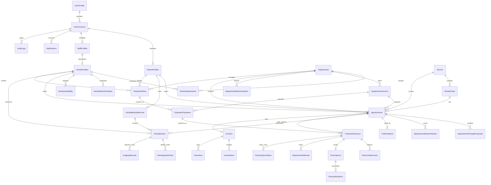
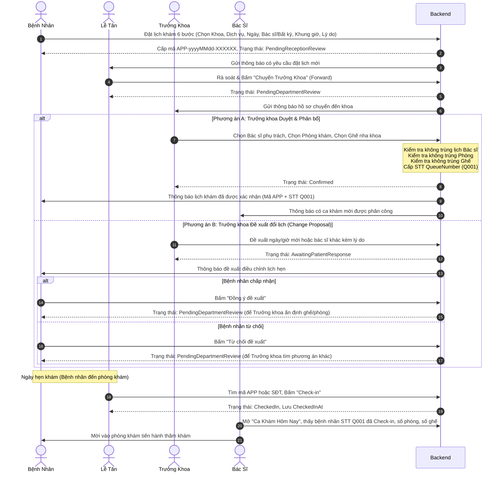

# PROJECT CONTEXT FOR CHATGPT — DENTAL CLINIC MANAGEMENT SYSTEM
> **Repository:** `SWP391_Group6` (DentalClinic)  
> **Hệ thống:** Dental Clinic Management System (Hệ Thống Quản Lý Phòng Khám Nha Khoa Đa Chuyên Khoa)  
> **Ngày phân tích:** 13/10/2026  
> **Mục đích tài liệu:** Cung cấp bức tranh toàn cảnh kiến trúc, source code, cơ sở dữ liệu, API, nghiệp vụ, kiểm thử và các lỗi kỹ thuật thực tế cho AI (ChatGPT) để tiếp tục phát triển, sửa lỗi và vận hành dự án mà không cần đọc lại toàn bộ mã nguồn từ đầu.

---

## 1. TỔNG QUAN HỆ THỐNG (EXECUTIVE SUMMARY)

**DentalCare** là hệ thống quản lý phòng khám nha khoa kỹ thuật cao quy mô đơn cơ sở nhưng đa chuyên khoa (Multi-Specialty Single Clinic). Hệ thống giải quyết trọn vẹn chu trình khám chữa bệnh từ khâu đặt lịch trực tuyến, điều phối phân bổ phòng khám/ghế nha khoa/bác sĩ, đón tiếp check-in, khám lâm sàng và sơ đồ răng điện tử (Odontogram), lập phác đồ điều trị đa giai đoạn, kê đơn thuốc điện tử, đánh giá sau khám và quản trị vận hành phòng khám.

### Nguyên tắc thiết kế cốt lõi
1. **UserId thống nhất:** Tất cả các vai trò (`Patient`, `Receptionist`, `Dentist`, `DepartmentManager`, `SystemAdministrator`) đều ánh xạ 1-1 về khóa chính `UserAccounts.UserId`. Các bảng thông tin chi tiết (`PatientProfiles`, `StaffProfiles`, `DentistProfiles`) dùng chung `UserId` làm khóa chính và khóa ngoại tham chiếu đến `UserAccounts`.
2. **Tách biệt Backend API và Frontend MVC:**
   - **Backend Web API (`DentalClinic.Api`):** Cung cấp RESTful endpoints chuẩn hóa, bảo mật bằng JWT Bearer Token, kiểm soát dữ liệu thông qua Clean Architecture.
   - **Frontend Web (`DentalClinic.Web`):** Ứng dụng ASP.NET Core MVC truyền thống, giao diện Bootstrap 5 + Bootstrap Icons, sử dụng Cookie Authentication cho phiên duyệt web và giao tiếp với Backend API qua `IHttpClientFactory` kèm cơ chế tự động đính kèm và làm mới JWT Bearer Token (`ApiAuthorizationHandler`).
3. **Database-First Schema:** Cơ sở dữ liệu được định hình chuẩn tại `DB/Dental_Clinic_Final_Database_Clean.sql` gồm 34 bảng với đầy đủ ràng buộc khóa ngoại, chỉ mục (Index) và ràng buộc toàn vẹn (Check Constraints).

---

## 2. TECH STACK & FRAMEWORK VERSIONS

| Thành phần | Công nghệ / Thư viện | Phiên bản | Mục đích & Trách nhiệm |
| :--- | :--- | :--- | :--- |
| **Platform** | .NET SDK | `8.0` (`net8.0`) | Nền tảng thực thi toàn bộ Backend và Frontend |
| **Backend Web API** | ASP.NET Core Web API | `8.0.11` | Cung cấp RESTful API, Swagger OpenAPI |
| **Frontend Web** | ASP.NET Core MVC | `8.0` | Giao diện người dùng đa vai trò, Razor Views |
| **ORM / Data Access** | Entity Framework Core | `8.0.11` | Ánh xạ đối tượng quan hệ, LINQ to SQL |
| **Database Provider** | EF Core SQL Server | `8.0.11` | Kết nối Microsoft SQL Server (`DentalClinicManagementDB`) |
| **In-Memory Cache** | `Microsoft.Extensions.Caching.Memory` | `10.0.12` | Lưu trữ OTP xác thực, Refresh Token, Rate Limiting |
| **Authentication** | `Microsoft.AspNetCore.Authentication.JwtBearer` | `8.0.11` | Xác thực API bằng token JWT Bearer |
| **Token Handling** | `System.IdentityModel.Tokens.Jwt` | `8.23.0` | Khởi tạo, mã hóa và phân tích JWT Access Token |
| **Password Hashing** | `Microsoft.Extensions.Identity.Core` | `8.0.11` | Băm mật khẩu chuẩn PBKDF2 V3 (`PasswordHasher<UserAccount>`) |
| **Email Service** | `MailKit` | `4.18.0` | Gửi email thông báo, mã OTP xác thực qua SMTP Gmail |
| **Cloud Storage** | `CloudinaryDotNet` | `1.29.3` | Lưu trữ ảnh đại diện, ảnh chụp X-quang nha khoa |
| **OAuth2 / SSO** | `Google.Apis.Auth` (BE) / `Microsoft.AspNetCore.Authentication.Google` (FE) | `1.76.0` / `8.0.8` | Đăng nhập Google One-Tap & OAuth2 Code Flow |
| **API Documentation** | `Swashbuckle.AspNetCore` | `6.6.2` | Swagger UI tương tác tại `/swagger` |
| **Validation** | `FluentValidation.AspNetCore` | `11.3.1` (Api) / `12.1.1` (App) | Kiểm tra tính hợp lệ của DTOs đầu vào |
| **Testing BE** | `xUnit`, `Moq`, `EF Core InMemory` | `2.5.3` / `4.20.72` | Kiểm thử Unit Test & luồng nghiệp vụ Backend |
| **Testing FE** | `xUnit`, `Moq`, `FluentAssertions` | `2.5.3` / `8.11.0` | Kiểm thử Controllers, ViewModels, Handlers Frontend |

---

## 3. CẤU TRÚC REPOSITORY & QUAN HỆ PHỤ THUỘC (PROJECT DEPENDENCIES)

```
d:\SWP\SWP391_Group6
├── BE/
│   ├── DentalClinic.Backend.sln          # Solution Backend
│   ├── DentalClinic.Domain/              # Enums thuần túy (AccountStatus, UserRole, AppointmentStatus,...)
│   ├── DentalClinic.Application/         # Interfaces dịch vụ, DTOs phân hệ, FluentValidators, ApiResponse
│   ├── DentalClinic.Infrastructure/      # DbContext, 34 EF Entities, Triển khai Services, Mail, Cloudinary, Hash
│   ├── DentalClinic.Api/                 # Controllers API, Program.cs, Middleware GlobalExceptionHandler
│   └── DentalClinic.Tests/               # 90 test methods kiểm thử dịch vụ, quy trình đặt lịch, auth, admin
├── FE/
│   ├── DentalClinic.Web.sln              # Solution Frontend
│   ├── DentalClinic.Web/                 # MVC Controllers, Views Razor theo role, Typed HttpClients, Handlers
│   └── DentalClinic.Web.Tests/           # 83 test methods kiểm thử MVC Controllers, TokenService, ViewModels
├── DB/
│   ├── Dental_Clinic_Final_Database_Clean.sql      # Schema gốc 34 bảng, Check Constraints, Indexes
│   ├── Seed_Booking_Foundational_Data.sql          # Dữ liệu dịch vụ, phòng khám, ghế, lịch trực 60 ngày
│   └── Seed_Test_Data_Clean.sql                   # Tài khoản mẫu từng vai trò (mật khẩu Password123@)
├── HUONG_DAN_CHAY.md                     # Hướng dẫn chạy & thử nghiệm
├── TASKS_ASSIGNMENT.md                   # Phân công nhiệm vụ nhóm (đặc tả ban đầu)
└── setup-secrets.sample.bat              # Script mẫu cấu hình User Secrets
```

### Biểu đồ phụ thuộc giữa các tầng (Clean Architecture Diagram)

```
[DentalClinic.Api] (Entry Point Backend - Port 7350)
    │                  │
    ▼                  ▼
[DentalClinic.Application] ───► [DentalClinic.Domain]
    ▲
    │
[DentalClinic.Infrastructure] (DbContext, Entities, Service Implementations)
    │
    ▼
[DentalClinic.Domain]

[DentalClinic.Tests] ───► [DentalClinic.Api], [DentalClinic.Application], [DentalClinic.Infrastructure]

─────────────────────────────────────────────────────────────────────────────

[DentalClinic.Web] (Entry Point Frontend MVC - Port 7129)
    │
    ▼ (HTTP REST Calls qua IHttpClientFactory + ApiAuthorizationHandler)
[DentalClinic.Api] (Backend Web API)
```

> **Lưu ý kiến trúc đặc thù:**
> - Các `Entity` của Entity Framework Core được đặt tại tầng `DentalClinic.Infrastructure.Persistence.Entities`, không nằm trong `DentalClinic.Domain`. Tầng `DentalClinic.Domain` chỉ chứa các lớp `Enum` tĩnh.
> - Dự án không sử dụng MediatR/CQRS. Tầng `DentalClinic.Api` inject trực tiếp các Service Interfaces (`IAppointmentService`, `IBookingService`,...) từ `DentalClinic.Application`, được triển khai (implement) tại `DentalClinic.Infrastructure`.

---

## 4. MA TRẬN VAI TRÒ & PHÂN QUYỀN (USER ROLES & PERMISSION MATRIX)

Hệ thống quản lý 5 vai trò cố định (`UserRole.cs`):

| Quyền hạn / Nghiệp vụ | Bệnh Nhân (`Patient`) | Lễ Tân (`Receptionist`) | Bác Sĩ (`Dentist`) | Trưởng Khoa (`DepartmentManager`) | Quản Trị Viên (`SystemAdministrator`) |
| :--- | :---: | :---: | :---: | :---: | :---: |
| **Đăng ký, xác thực OTP, đổi mật khẩu** | ✅ | ✅ | ✅ | ✅ | ✅ |
| **Xem danh mục khoa, dịch vụ, slot khả dụng** | ✅ | ✅ | ✅ | ✅ | ✅ |
| **Đặt lịch khám trực tuyến (6 bước)** | ✅ | ❌ | ❌ | ❌ | ❌ |
| **Rút lịch hẹn (Withdrawn) khi đang chờ** | ✅ | ❌ | ❌ | ❌ | ❌ |
| **Hủy lịch hẹn đã xác nhận (Cancelled)** | ✅ | ❌ | ❌ | ❌ | ❌ |
| **Phản hồi đề xuất đổi lịch (Accept/Reject Proposal)** | ✅ | ❌ | ❌ | ❌ | ❌ |
| **Tiếp nhận & chuyển tiếp yêu cầu (Forward)** | ❌ | ✅ | ❌ | ❌ | ✅ |
| **Từ chối yêu cầu đặt lịch (Reject)** | ❌ | ✅ | ❌ | ❌ | ✅ |
| **Làm thủ tục Check-in bệnh nhân hôm nay** | ❌ | ✅ | ❌ | ❌ | ✅ |
| **Xem danh sách hàng đợi tiếp nhận** | ❌ | ✅ | ❌ | ❌ | ✅ |
| **Duyệt lịch hẹn & phân bổ Bác sĩ, Phòng, Ghế** | ❌ | ❌ | ❌ | ✅ (khoa mình) | ✅ |
| **Gửi đề xuất đổi lịch (Propose Change)** | ❌ | ❌ | ❌ | ✅ (khoa mình) | ✅ |
| **Xem ca khám hôm nay đã Check-in** | ❌ | ❌ | ✅ (ca của mình) | ❌ | ✅ |
| **Xem & ghi phiếu khám lâm sàng (Clinical Entry)** | ❌ | ❌ | ✅ | ❌ | ✅ |
| **Xem & cập nhật Sơ đồ răng (Odontogram)** | ✅ (chỉ xem) | ❌ | ✅ | ❌ | ✅ |
| **Lập phác đồ điều trị (Treatment Plan)** | ✅ (chỉ xem) | ❌ | ✅ | ✅ (giám sát) | ✅ |
| **Ghi nhận buổi điều trị (Treatment Session)** | ❌ | ❌ | ✅ | ❌ | ✅ |
| **Kê đơn thuốc điện tử (Prescription)** | ✅ (chỉ xem) | ❌ | ✅ | ❌ | ✅ |
| **Đăng ký ca trực & lịch nghỉ phép (Availability)** | ❌ | ❌ | ✅ (của mình) | ✅ (khoa mình) | ✅ |
| **Đánh giá ca khám sau hoàn thành (Feedback)** | ✅ | ❌ | ✅ (chỉ xem) | ✅ (giám sát) | ✅ |
| **Quản trị Chuyên khoa, Dịch vụ, Phòng, Ghế** | ❌ | ❌ | ❌ | ❌ | ✅ |
| **Quản lý Tài khoản & Khóa/Mở người dùng** | ❌ | ✅ (chỉ xem) | ❌ | ✅ (chỉ xem) | ✅ (toàn quyền) |
| **Xem Nhật ký kiểm toán (Audit Logs) & Báo cáo** | ❌ | ❌ | ❌ | ❌ | ✅ |

---

## 5. DANH MỤC PHÂN HỆ NGHIỆP VỤ (MODULE INVENTORY)

Dựa trên việc đối chiếu source code thực tế:

| Tên Module | Trạng thái Code Backend | Trạng thái Code Frontend | Ghi chú từ Source Code |
| :--- | :---: | :---: | :--- |
| **1. Authentication & Security** | ✅ 100% Hoàn thành | ✅ 100% Hoàn thành | Đăng ký OTP, Login, Google OAuth, Refresh Token, Quên mật khẩu, Lockout |
| **2. Profile & Avatar Storage** | ✅ 100% Hoàn thành | ✅ 100% Hoàn thành | Cập nhật hồ sơ bệnh nhân/nhân viên, upload Cloudinary hoặc local wwwroot |
| **3. Booking & Lịch Hẹn Đa Vai Trò** | ✅ 100% Hoàn thành | ✅ 100% Hoàn thành | Luồng 6 bước: Patient $\rightarrow$ Receptionist $\rightarrow$ Manager $\rightarrow$ Dentist $\rightarrow$ Check-in |
| **4. Hồ Sơ Bệnh Án & Sơ Đồ Răng** | ✅ 100% Hoàn thành | ✅ 100% Hoàn thành | Khám lâm sàng, 32 răng FDI, tình trạng răng (Healthy, Caries, Filling,...), X-quang |
| **5. Phác Đồ & Ca Điều Trị (Treatment)** | ✅ 100% Hoàn thành | ✅ 100% Hoàn thành | Lập phác đồ (`TreatmentPlans`), bước phác đồ (`TreatmentPlanItems`), buổi làm (`TreatmentSessions`) |
| **6. Kê Đơn Thuốc Điện Tử** | ✅ 100% Hoàn thành | ✅ 100% Hoàn thành | Bác sĩ kê đơn theo ca khám/session, in đơn thuốc, bệnh nhân xem lịch sử |
| **7. Lịch Trực & Nghỉ Phép Bác Sĩ** | ✅ 100% Hoàn thành | ✅ 100% Hoàn thành | Quản lý ca làm việc 60 ngày, đăng ký nghỉ phép/bận, kiểm tra xung đột slot |
| **8. Đánh Giá Khám (Feedback)** | ✅ 100% Hoàn thành | ✅ 100% Hoàn thành | Chấm điểm bác sĩ 1-5 sao, điểm phòng khám, nhận xét ca khám |
| **9. Thông Báo Hệ Thống (Notification)** | ✅ 100% Hoàn thành | ✅ 100% Hoàn thành | In-App notifications, thông báo email, đánh dấu đã đọc |
| **10. Quản Trị Hệ Thống (Admin Console)** | ✅ 100% Hoàn thành | ✅ 100% Hoàn thành | CRUD Chuyên khoa, Dịch vụ, Phòng, Ghế, Quản lý tài khoản, Audit Log, Báo cáo |
| **11. Hóa Đơn & Thanh Toán (Billing)** | ⚠️ Chỉ có DB Tables | ❌ Chưa code UI/Service | Bảng `Invoices`, `InvoiceItems`, `Payments` có sẵn trong DB/EF. UI chỉ hiển thị Alert popup |
| **12. Hội Chẩn & Chuyển Khoa (Referral)** | ⚠️ Chỉ có DB Table | ❌ Chưa code UI/Service | Bảng `DepartmentReferrals` có trong DB/EF. UI hiển thị Alert popup |

---

## 6. BACKEND ARCHITECTURE & API INVENTORY

Backend cung cấp 12 Controllers với 54 API endpoints:

### Bảng thống kê toàn bộ API Endpoints

| Controller | HTTP Method & Route | Yêu cầu Phân quyền | DTO Đầu vào / Query | DTO Trả về |
| :--- | :--- | :--- | :--- | :--- |
| **AuthController** | `POST /api/auth/register` | AllowAnonymous | `RegisterRequest` | `ApiResponse` |
| | `POST /api/auth/verify-email` | AllowAnonymous | `VerifyEmailRequest` | `ApiResponse` |
| | `POST /api/auth/resend-verification` | AllowAnonymous | `ResendVerificationRequest` | `ApiResponse` |
| | `POST /api/auth/verify-phone` | AllowAnonymous | `VerifyPhoneRequest` | `ApiResponse` |
| | `POST /api/auth/resend-phone-verification` | AllowAnonymous | `ResendPhoneVerificationRequest` | `ApiResponse` |
| | `POST /api/auth/login` | AllowAnonymous | `LoginRequest` | `ApiResponse<LoginResponse>` |
| | `POST /api/auth/google` | AllowAnonymous | `GoogleLoginRequest` | `ApiResponse<LoginResponse>` |
| | `POST /api/auth/refresh` | AllowAnonymous | `RefreshTokenRequest` | `ApiResponse<RefreshTokenResponse>` |
| | `POST /api/auth/logout` | AllowAnonymous | `LogoutRequest` | `ApiResponse` |
| | `POST /api/auth/forgot-password` | AllowAnonymous | `ForgotPasswordRequest` | `ApiResponse` |
| | `POST /api/auth/reset-password` | AllowAnonymous | `ResetPasswordRequest` | `ApiResponse` |
| | `POST /api/auth/change-password` | Authorize | `ChangePasswordRequest` | `ApiResponse` |
| **BookingController** | `GET /api/booking/departments` | AllowAnonymous | Không | `ApiResponse<List<DepartmentDto>>` |
| | `GET /api/booking/departments/{id}/services` | AllowAnonymous | `departmentId` (route) | `ApiResponse<List<DepartmentServiceDto>>` |
| | `GET /api/booking/departments/{id}/dentists` | AllowAnonymous | `departmentId` (route) | `ApiResponse<List<DentistOptionDto>>` |
| | `GET /api/booking/available-slots` | AllowAnonymous | `departmentId`, `serviceId`, `date`, `dentistUserId` | `ApiResponse<List<AvailableSlotDto>>` |
| **AppointmentsController** | `POST /api/patient/appointments` | Roles: Patient | `CreateAppointmentRequest` | `ApiResponse<AppointmentDto>` |
| | `GET /api/patient/appointments` | Roles: Patient | `status` (query) | `ApiResponse<List<AppointmentDto>>` |
| | `GET /api/patient/appointments/{id}` | Authorize | `id` (route) | `ApiResponse<AppointmentDto>` |
| | `POST /api/patient/appointments/{id}/withdraw` | Roles: Patient | `PatientWithdrawRequest` | `ApiResponse` |
| | `POST /api/patient/appointments/{id}/cancel` | Roles: Patient | `PatientCancelRequest` | `ApiResponse` |
| | `GET /api/patient/appointments/{id}/proposal` | Roles: Patient | `id` (route) | `ApiResponse<AppointmentChangeProposalDto>` |
| | `POST /api/patient/appointments/{id}/proposal/accept` | Roles: Patient | `id` (route) | `ApiResponse` |
| | `POST /api/patient/appointments/{id}/proposal/reject` | Roles: Patient | `id` (route) | `ApiResponse` |
| | `GET /api/receptionist/appointment-requests` | Roles: Receptionist, SystemAdmin | Không | `ApiResponse<List<AppointmentDto>>` |
| | `POST /api/receptionist/appointments/{id}/forward` | Roles: Receptionist, SystemAdmin | `ReceptionistForwardRequest` | `ApiResponse` |
| | `POST /api/receptionist/appointments/{id}/reject` | Roles: Receptionist, SystemAdmin | `ReceptionistRejectRequest` | `ApiResponse` |
| | `GET /api/receptionist/today-appointments` | Roles: Receptionist, SystemAdmin | `search` (query) | `ApiResponse<List<AppointmentDto>>` |
| | `POST /api/receptionist/appointments/{id}/check-in` | Roles: Receptionist, SystemAdmin | `CheckInRequest` | `ApiResponse` |
| | `GET /api/department/appointment-requests` | Roles: DeptManager, SystemAdmin | Không | `ApiResponse<List<AppointmentDto>>` |
| | `GET /api/department/appointments/{id}/available-dentists` | Roles: DeptManager, SystemAdmin | `id` (route) | `ApiResponse<List<DentistOptionDto>>` |
| | `GET /api/department/available-resources` | Roles: DeptManager, SystemAdmin | `departmentId`, `start`, `end` | `ApiResponse<AvailableResourcesDto>` |
| | `POST /api/department/appointments/{id}/confirm` | Roles: DeptManager, SystemAdmin | `ManagerConfirmRequest` | `ApiResponse<AppointmentDto>` |
| | `POST /api/department/appointments/{id}/propose-change` | Roles: DeptManager, SystemAdmin | `ManagerProposeChangeRequest` | `ApiResponse` |
| | `GET /api/dentist/today-appointments` | Roles: Dentist | Không | `ApiResponse<List<AppointmentDto>>` |
| | `GET /api/dentist/appointments` | Roles: Dentist | `fromDate`, `toDate` | `ApiResponse<List<AppointmentDto>>` |
| **MedicalRecordController** | `GET /api/medical-records/patient/{patientUserId}` | Roles: Dentist, Admin, Receptionist, DeptManager | `patientUserId` (route) | `ApiResponse<MedicalRecordDto>` |
| | `GET /api/medical-records/my` | Roles: Patient | Không | `ApiResponse<MedicalRecordDto>` |
| | `POST /api/medical-records/entry` | Roles: Dentist | `CreateClinicalEntryRequest` | `ApiResponse<ClinicalEntryDto>` |
| | `GET /api/medical-records/patients` | Roles: Dentist, SystemAdmin | `search` (query) | `ApiResponse<List<PatientLookupDto>>` |
| | `GET /api/medical-records/patient/{patientUserId}/odontogram` | Authorize | `patientUserId` (route) | `ApiResponse<List<OdontogramEntryDto>>` |
| **TreatmentController** | `GET /api/treatments/plans` | Roles: Dentist, SystemAdmin | `status`, `search` | `ApiResponse<List<TreatmentPlanDto>>` |
| | `GET /api/treatments/plans/{id}` | Authorize | `id` (route) | `ApiResponse<TreatmentPlanDto>` |
| | `POST /api/treatments/plans` | Roles: Dentist, SystemAdmin | `CreateTreatmentPlanRequest` | `ApiResponse<TreatmentPlanDto>` |
| | `POST /api/treatments/plans/{id}/items` | Roles: Dentist, SystemAdmin | `CreateTreatmentPlanItemInput` | `ApiResponse<TreatmentPlanItemDto>` |
| | `PUT /api/treatments/plans/{id}/status` | Roles: Dentist, DeptManager, SystemAdmin | `UpdateTreatmentPlanStatusRequest` | `ApiResponse<bool>` |
| | `PUT /api/treatments/items/{itemId}/status` | Roles: Dentist, DeptManager, SystemAdmin | `UpdateTreatmentPlanStatusRequest` | `ApiResponse<bool>` |
| | `GET /api/treatments/sessions` | Roles: Dentist, DeptManager, SystemAdmin | `search` | `ApiResponse<List<TreatmentSessionDto>>` |
| | `POST /api/treatments/sessions` | Roles: Dentist, SystemAdmin | `CreateTreatmentSessionRequest` | `ApiResponse<TreatmentSessionDto>` |
| | `GET /api/treatments/eligible-phases` | Roles: Dentist, SystemAdmin | Không | `ApiResponse<List<TreatmentEligiblePhaseDto>>` |
| | `GET /api/treatments/department/progress` | Roles: DeptManager, SystemAdmin | `departmentId`, `search` | `ApiResponse<TreatmentProgressSummaryDto>` |
| | `POST /api/treatments/items/{itemId}/assign-dentist` | Roles: DeptManager, SystemAdmin | `AssignPhaseDentistRequest` | `ApiResponse<bool>` |
| | `GET /api/treatments/patient/my-plans` | Roles: Patient | Không | `ApiResponse<List<TreatmentPlanDto>>` |
| | `GET /api/treatments/options/patients` | Roles: Dentist, DeptManager, SystemAdmin | Không | `ApiResponse<List<TreatmentPatientOptionDto>>` |
| | `GET /api/treatments/options/services` | Authorize | `departmentId` | `ApiResponse<List<TreatmentServiceOptionDto>>` |
| | `GET /api/treatments/options/dentists` | Roles: Dentist, DeptManager, SystemAdmin | `departmentId` | `ApiResponse<List<TreatmentDentistOptionDto>>` |
| **PrescriptionController** | `GET /api/prescriptions/dentist` | Roles: Dentist, SystemAdmin | `search` | `ApiResponse<List<PrescriptionDto>>` |
| | `GET /api/prescriptions/dentist/eligible-appointments` | Roles: Dentist | Không | `ApiResponse<List<PrescriptionEligibleAppointmentDto>>` |
| | `GET /api/prescriptions/my` | Roles: Patient | Không | `ApiResponse<List<PrescriptionDto>>` |
| | `GET /api/prescriptions/{id}` | Authorize | `id` (route) | `ApiResponse<PrescriptionDto>` |
| | `POST /api/prescriptions` | Roles: Dentist | `CreatePrescriptionRequest` | `ApiResponse<PrescriptionDto>` |
| **DentistScheduleController** | `GET /api/DentistSchedule` | Authorize | `DentistScheduleFilterRequest` | `ApiResponse<List<DentistWorkScheduleDto>>` |
| | `GET /api/DentistSchedule/my` | Roles: Dentist | `fromDate`, `toDate` | `ApiResponse<List<DentistWorkScheduleDto>>` |
| | `GET /api/DentistSchedule/{id}` | Authorize | `id` (route) | `ApiResponse<DentistWorkScheduleDto>` |
| | `POST /api/DentistSchedule` | Roles: DeptManager, SystemAdmin | `CreateDentistScheduleRequest` | `ApiResponse<DentistWorkScheduleDto>` |
| | `PUT /api/DentistSchedule/{id}` | Roles: DeptManager, SystemAdmin | `UpdateDentistScheduleRequest` | `ApiResponse<DentistWorkScheduleDto>` |
| | `PUT /api/DentistSchedule/{id}/cancel` | Roles: DeptManager, SystemAdmin | `id` (route) | `ApiResponse<bool>` |
| **DentistAvailabilityController** | `GET /api/DentistAvailability` | Authorize | `DentistAvailabilityFilterRequest` | `ApiResponse<List<DentistAvailabilityDto>>` |
| | `GET /api/DentistAvailability/my` | Roles: Dentist | `fromDateTime`, `toDateTime` | `ApiResponse<List<DentistAvailabilityDto>>` |
| | `POST /api/DentistAvailability` | Roles: Dentist, DeptManager, SystemAdmin | `CreateDentistAvailabilityRequest` | `ApiResponse<DentistAvailabilityDto>` |
| | `PUT /api/DentistAvailability/{id}` | Roles: Dentist, DeptManager, SystemAdmin | `UpdateDentistAvailabilityRequest` | `ApiResponse<DentistAvailabilityDto>` |
| | `DELETE /api/DentistAvailability/{id}` | Roles: Dentist, DeptManager, SystemAdmin | `id` (route) | `ApiResponse<bool>` |
| **FeedbackController** | `POST /api/Feedback` | Roles: Patient | `CreateFeedbackRequest` | `ApiResponse<VisitFeedbackDto>` |
| | `GET /api/Feedback/appointment/{appointmentId}` | Authorize | `appointmentId` (route) | `ApiResponse<VisitFeedbackDto>` |
| | `GET /api/Feedback/dentist/{dentistUserId}` | Authorize | `dentistUserId` (route) | `ApiResponse<DentistFeedbackSummaryDto>` |
| | `GET /api/Feedback/my` | Roles: Patient | Không | `ApiResponse<List<VisitFeedbackDto>>` |
| | `GET /api/Feedback` | Roles: DeptManager, SystemAdmin | `FeedbackFilterRequest` | `ApiResponse<FeedbackPagedResultDto>` |
| **NotificationController** | `GET /api/notifications` | Authorize | `limit`, `type`, `unreadOnly` | `ApiResponse<NotificationSummaryDto>` |
| | `GET /api/notifications/unread-count` | Authorize | Không | `ApiResponse<int>` |
| | `POST /api/notifications/{id}/read` | Authorize | `id` (route) | `ApiResponse<bool>` |
| | `POST /api/notifications/read-all` | Authorize | Không | `ApiResponse<bool>` |
| | `DELETE /api/notifications/{id}` | Authorize | `id` (route) | `ApiResponse<bool>` |
| | `POST /api/notifications` | Roles: SystemAdmin | `CreateNotificationRequest` | `ApiResponse` |
| **ProfileController** | `GET /api/profile/me` | Authorize | Không | `ApiResponse<UserProfileResponse>` |
| | `PUT /api/profile/me` | Authorize | `UpdateProfileRequest` | `ApiResponse` |
| | `POST /api/profile/avatar` | Authorize | `IFormFile Avatar` (multipart) | `ApiResponse<AvatarUploadResponse>` |
| **AdminController** | `GET /api/admin/dashboard-stats` | Roles: SystemAdmin | Không | `ApiResponse<AdminDashboardStatsDto>` |
| | `GET /api/admin/reports/revenue` | Roles: SystemAdmin | `year` (query) | `ApiResponse<RevenueReportDto>` |
| | `GET /api/admin/reports/appointments` | Roles: SystemAdmin | Không | `ApiResponse<AppointmentReportDto>` |
| | `GET /api/admin/departments` | Roles: SystemAdmin | Không | `ApiResponse<List<AdminDepartmentDto>>` |
| | `GET /api/admin/departments/{id}` | Roles: SystemAdmin | `id` (route) | `ApiResponse<AdminDepartmentDto>` |
| | `POST /api/admin/departments` | Roles: SystemAdmin | `CreateDepartmentRequest` | `ApiResponse<AdminDepartmentDto>` |
| | `PUT /api/admin/departments/{id}` | Roles: SystemAdmin | `UpdateDepartmentRequest` | `ApiResponse<AdminDepartmentDto>` |
| | `POST /api/admin/departments/{id}/toggle-status` | Roles: SystemAdmin | `id` (route) | `ApiResponse` |
| | `GET /api/admin/services` | Roles: SystemAdmin | `departmentId`, `search` | `ApiResponse<List<AdminDepartmentServiceDto>>` |
| | `GET /api/admin/services/{id}` | Roles: SystemAdmin | `id` (route) | `ApiResponse<AdminDepartmentServiceDto>` |
| | `POST /api/admin/services` | Roles: SystemAdmin | `CreateDepartmentServiceRequest` | `ApiResponse<AdminDepartmentServiceDto>` |
| | `PUT /api/admin/services/{id}` | Roles: SystemAdmin | `UpdateDepartmentServiceRequest` | `ApiResponse<AdminDepartmentServiceDto>` |
| | `POST /api/admin/services/{id}/toggle-status` | Roles: SystemAdmin | `id` (route) | `ApiResponse` |
| | `GET /api/admin/rooms` | Roles: SystemAdmin | Không | `ApiResponse<List<AdminRoomDto>>` |
| | `GET /api/admin/rooms/{id}` | Roles: SystemAdmin | `id` (route) | `ApiResponse<AdminRoomDto>` |
| | `POST /api/admin/rooms` | Roles: SystemAdmin | `CreateRoomRequest` | `ApiResponse<AdminRoomDto>` |
| | `PUT /api/admin/rooms/{id}` | Roles: SystemAdmin | `UpdateRoomRequest` | `ApiResponse<AdminRoomDto>` |
| | `POST /api/admin/rooms/{id}/status` | Roles: SystemAdmin | `UpdateRoomStatusRequest` | `ApiResponse` |
| | `GET /api/admin/chairs` | Roles: SystemAdmin | `roomId` (query) | `ApiResponse<List<AdminDentalChairDto>>` |
| | `GET /api/admin/chairs/{id}` | Roles: SystemAdmin | `id` (route) | `ApiResponse<AdminDentalChairDto>` |
| | `POST /api/admin/chairs` | Roles: SystemAdmin | `CreateDentalChairRequest` | `ApiResponse<AdminDentalChairDto>` |
| | `PUT /api/admin/chairs/{id}` | Roles: SystemAdmin | `UpdateDentalChairRequest` | `ApiResponse<AdminDentalChairDto>` |
| | `POST /api/admin/chairs/{id}/status` | Roles: SystemAdmin | `UpdateChairStatusRequest` | `ApiResponse` |
| | `GET /api/admin/audit-logs` | Roles: SystemAdmin | `AuditLogQueryRequest` | `ApiResponse<PagedResult<AuditLogDto>>` |
| | `GET /api/admin/users` | Roles: Admin, Receptionist, DeptManager | `role`, `search` | `ApiResponse<List<AdminUserDto>>` |
| | `POST /api/admin/users/{userId}/toggle-lock` | Roles: SystemAdmin | `ToggleUserLockRequest` | `ApiResponse` |

---

## 7. DATABASE SCHEMA & DATA DICTIONARY

Cơ sở dữ liệu `DentalClinicManagementDB` gồm **34 bảng**, được thiết kế theo nguyên tắc Single-Clinic Multi-Specialty:



### Chi tiết 34 Bảng Dữ Liệu

1. `ClinicProfile`: Thông tin duy nhất của phòng khám (CHECK `ClinicId = 1`), tên, địa chỉ, hotline, giờ mở/đóng cửa.
2. `UserAccounts`: Tài khoản định danh cốt lõi. `UserId` (PK IDENTITY), `Email`, `PhoneNumber`, `PasswordHash`, `Role` (CHECK 5 roles), `Status` (`Unverified`, `Active`, `Locked`, `Inactive`), `FailedLoginCount`, `LockoutEnd`.
3. `PatientProfiles`: Hồ sơ bệnh nhân. `UserId` (PK, FK `UserAccounts`), `PatientCode` (UNIQUE), `FullName`, `DateOfBirth`, `Gender`, `Address`, `EmergencyContact`.
4. `StaffProfiles`: Hồ sơ nhân viên phòng khám. `UserId` (PK, FK `UserAccounts`), `EmployeeCode` (UNIQUE), `FullName`, `EmploymentStatus` (`Active`, `Inactive`).
5. `DentistProfiles`: Hồ sơ bác sĩ chuyên khoa. `UserId` (PK, FK `StaffProfiles`), `LicenseNumber`, `Qualification`, `YearsOfExperience`, `Biography`.
6. `Departments`: Chuyên khoa nha khoa. `DepartmentId` (PK), `Name` (UNIQUE), `ManagerUserId` (FK `StaffProfiles`), `Status`.
7. `DentistDepartments`: Bác sĩ trực thuộc chuyên khoa (N-N). `DentistDepartmentId` (PK), `DentistUserId`, `DepartmentId`, `Status`.
8. `DepartmentWorkSchedules`: Khung giờ mở cửa tiêu chuẩn của khoa theo thứ trong tuần (`DayOfWeek` 1-7, `StartTime`, `EndTime`).
9. `DentistWorkSchedules`: Ca trực thực tế của bác sĩ trong 60 ngày (`WorkDate`, `StartTime`, `EndTime`, `Status`).
10. `DentistAvailability`: Trạng thái khả dụng đột xuất hoặc nghỉ phép (`StartDateTime`, `EndDateTime`, `AvailabilityStatus` = `Available`, `Busy`, `OnLeave`, `Unavailable`).
11. `Rooms`: Phòng khám lâm sàng / phẫu thuật. `RoomId` (PK), `RoomCode` (UNIQUE), `RoomName`, `Status` (`Active`, `Inactive`, `Maintenance`).
12. `DentalChairs`: Ghế nha khoa điều trị. `DentalChairId` (PK), `RoomId` (FK `Rooms`), `ChairCode`, `Status`. (UNIQUE `RoomId`, `ChairCode`).
13. `DepartmentServices`: Danh mục dịch vụ nha khoa theo chuyên khoa. `DepartmentServiceId` (PK), `DepartmentId`, `ServiceName`, `DurationMinutes`, `Price`, `Status`.
14. `Appointments`: Lịch hẹn khám bệnh trung tâm. `AppointmentId` (PK), `AppointmentCode` (UNIQUE, `APP-yyyyMMdd-XXXXXX`), `PatientUserId`, `DepartmentId`, `RequestedServiceId`, `RequestedDentistUserId`, `AssignedDentistUserId`, `RoomId`, `DentalChairId`, `ScheduledStart`, `ScheduledEnd`, `ReasonForVisit`, `BookingSource` (`Patient`, `Receptionist`), `QueueNumber` (`Q001`), `Status` (14 statuses).
15. `AppointmentChangeProposals`: Đề xuất điều chỉnh lịch hẹn từ Trưởng khoa (`ProposalId`, `AppointmentId`, `ProposedByUserId`, `ProposedStart`, `ProposedEnd`, `ProposedDentistUserId`, `Status`: `Pending`, `Accepted`, `Rejected`, `Expired`).
16. `AppointmentStatusHistories`: Nhật ký biến thiên trạng thái lịch hẹn (`HistoryId`, `AppointmentId`, `OldStatus`, `NewStatus`, `ChangedByUserId`, `Note`, `ChangedAt`).
17. `Notifications`: Thông báo hệ thống gửi người dùng (`NotificationId`, `UserId`, `AppointmentId`, `Type`, `Channel`: `InApp`/`Email`, `Subject`, `Content`, `DeliveryStatus`, `ReadAt`).
18. `DentalMedicalRecords`: Hồ sơ bệnh án điện tử của bệnh nhân (`MedicalRecordId`, `PatientUserId` UNIQUE, `CreatedAt`).
19. `ClinicalEntries`: Phiếu khám lâm sàng từng đợt (`ClinicalEntryId`, `MedicalRecordId`, `AppointmentId`, `DentistUserId`, `Symptoms`, `ClinicalFindings`, `Diagnosis`, `DentalConditions`, `ClinicalNotes`).
20. `OdontogramEntries`: Tình trạng chi tiết từng răng trên sơ đồ 32 răng (`OdontogramEntryId`, `ClinicalEntryId`, `ToothNumber` FDI, `Surface`, `Condition`, `Note`).
21. `ImagingRecords`: Hình ảnh chụp X-quang/chẩn đoán hình ảnh (`ImagingRecordId`, `ClinicalEntryId`, `ImagingType`, `FileUrl`, `ResultSummary`).
22. `TreatmentPlans`: Phác đồ điều trị tổng thể (`TreatmentPlanId`, `PatientUserId`, `DepartmentId`, `CreatedByDentistUserId`, `Status`: `Planned`, `InProgress`, `Completed`, `Cancelled`, `EstimatedTotal`).
23. `TreatmentPlanItems`: Các bước/giai đoạn trong phác đồ (`TreatmentPlanItemId`, `TreatmentPlanId`, `DepartmentServiceId`, `AssignedDentistUserId`, `ToothNumber`, `SequenceNo`, `ExpectedDate`, `EstimatedCost`, `Status`).
24. `TreatmentSessions`: Buổi can thiệp điều trị thực tế (`TreatmentSessionId`, `TreatmentPlanItemId`, `AppointmentId`, `DentistUserId`, `SessionDate`, `TreatmentResult`, `ClinicalNote`).
25. `PerformedServices`: Dịch vụ thực tế đã hoàn thành trong buổi điều trị (`PerformedServiceId`, `TreatmentSessionId`, `DepartmentServiceId`, `Quantity`, `UnitPrice`, `Amount` Computed).
26. `Prescriptions`: Đơn thuốc điện tử cấp cho buổi khám (`PrescriptionId`, `TreatmentSessionId` UNIQUE, `GeneralInstructions`, `IssuedAt`).
27. `PrescriptionItems`: Danh mục thuốc chi tiết (`PrescriptionItemId`, `PrescriptionId`, `MedicationName`, `Dosage`, `Frequency`, `Duration`, `Instructions`).
28. `DepartmentReferrals`: Phiếu hội chẩn / chuyển viện chuyên khoa (`ReferralId`, `TreatmentSessionId`, `FromDepartmentId`, `ToDepartmentId`, `AssignedDentistUserId`, `Reason`, `Status`).
29. `FollowUpSchedules`: Kế hoạch hẹn tái khám sau thủ thuật (`FollowUpId`, `TreatmentSessionId`, `RecommendedDate`, `Reason`, `Status`, `AppointmentId`).
30. `Invoices`: Hóa đơn viện phí (`InvoiceId`, `InvoiceCode`, `AppointmentId` UNIQUE, `GeneratedByUserId`, `TotalAmount`, `Status`: `Unpaid`, `PartiallyPaid`, `Paid`, `Cancelled`).
31. `InvoiceItems`: Chi tiết dòng thu tiền trên hóa đơn (`InvoiceItemId`, `InvoiceId`, `PerformedServiceId`, `Description`, `Quantity`, `UnitPrice`, `Amount`).
32. `Payments`: Giao dịch thanh toán viện phí (`PaymentId`, `InvoiceId`, `PaidByPatientUserId`, `Method`: `Online`, `BankTransfer`, `Amount`, `TransactionReference`, `Status`).
33. `VisitFeedback`: Đánh giá chất lượng sau ca khám (`FeedbackId`, `AppointmentId` UNIQUE, `DentistRating` 1-5, `ClinicRating` 1-5, `Comment`).
34. `AuditLogs`: Nhật ký kiểm toán hoạt động nhạy cảm (`AuditLogId`, `UserId`, `Action`, `EntityName`, `EntityId`, `OldValues`, `NewValues`, `CreatedAt`).

---

## 8. END-TO-END BUSINESS WORKFLOWS (QUY TRÌNH NGHIỆP VỤ)

### 8.1. Quy trình Đặt lịch & Phân bổ tài nguyên (Core Workflow)



### 8.2. Quy trình Khám lâm sàng, Sơ đồ răng & Kê phác đồ điều trị
1. **Tiếp nhận:** Bác sĩ mở trang `DentistAppointment/Today`, chọn bệnh nhân đã `CheckedIn`.
2. **Khám lâm sàng:** Bác sĩ ghi nhận triệu chứng (`Symptoms`), phát hiện lâm sàng (`ClinicalFindings`), chẩn đoán (`Diagnosis`).
3. **Cập nhật sơ đồ răng:** Trên giao diện 32 răng FDI, bác sĩ click chọn mặt răng hoặc toàn răng, cập nhật tình trạng: Răng sâu (`Caries`), Đã trám (`Filling`), Mất răng (`Missing`), Răng khôn mọc lệch (`Impacted`), Răng sứ (`Crown`), Bệnh nha chu (`Periodontal`).
4. **Lập phác đồ điều trị:** Nếu cần can thiệp nhiều bước (ví dụ chỉnh nha, cắm implant), Bác sĩ lập `TreatmentPlan`, bổ sung các bước `TreatmentPlanItem` kèm chi phí dự kiến.
5. **Ghi nhận buổi thủ thuật:** Sau khi thực hiện, Bác sĩ tạo `TreatmentSession`, tick chọn dịch vụ thực tế đã làm (`PerformedServices`).
6. **Kê đơn thuốc:** Bác sĩ nhập tên thuốc, liều dùng, số lượng, hướng dẫn uống $\rightarrow$ Hệ thống lưu `Prescriptions` và cho phép in đơn thuốc chuẩn phòng khám.
7. **Đánh giá sau khám:** Khi ca khám hoàn thành (`Completed`), bệnh nhân đăng nhập cổng bệnh nhân để gửi đánh giá 1-5 sao và ý kiến góp ý (`VisitFeedback`).

---

## 9. BẢO MẬT, XÁC THỰC & QUẢN LÝ PHIÊN (SECURITY ARCHITECTURE)

### 9.1. Backend API Security
- **Mã hóa mật khẩu:** Sử dụng `Microsoft.AspNetCore.Identity.PasswordHasher<UserAccount>` theo chuẩn PBKDF2 V3 (SHA-256, salt 128-bit, 10.000 vòng lặp).
- **Chống brute-force / Khóa tài khoản:** Cột `FailedLoginCount` tự động tăng sau mỗi lần đăng nhập sai. Đạt 5 lần sai liên tiếp $\rightarrow$ tự động khóa tài khoản trong 15 phút (`LockoutEnd = UtcNow.AddMinutes(15)`).
- **Xác thực JWT:** Token ký bằng thuật toán HMAC-SHA256 (`SymmetricSecurityKey`). Thời hạn Access Token là 60 phút. Custom `JwtBearerEvents` xử lý trả về JSON chuẩn `ApiResponse.Fail` khi bị 401 Unauthorized hoặc 403 Forbidden thay vì trả về HTML mặc định.
- **Refresh Token an toàn:** Lưu trong `IMemoryCache` (thời hạn 7 ngày), có kiểm tra Device Info và IP Address, hỗ trợ thu hồi token khi đăng xuất.
- **Kiểm soát CORS:** Cấu hình chính sách `FrontendCorsPolicy` chỉ cho phép nguồn gốc Frontend MVC (`https://localhost:7129`) với `AllowCredentials()`.

### 9.2. Frontend MVC Security
- **Xác thực Cookie:** Sử dụng ASP.NET Core Cookie Authentication với cờ `HttpOnly = true`, `SecurePolicy = Always`, `SameSite = Lax`, `ExpireTimeSpan = 7 ngày`.
- **Cơ chế Refresh Token tự động không gián đoạn (`ApiAuthorizationHandler`):**
  - Mọi request gọi API từ MVC Controllers đều qua DelegatingHandler.
  - Handler tự lấy AccessToken từ session/cookie và gắn vào header `Authorization: Bearer {token}`.
  - Nếu API trả về `401 Unauthorized`, Handler sử dụng khóa luồng `SemaphoreSlim(1,1)` để đồng bộ.
  - Sử dụng client riêng biệt `RawApiClient` (không gắn handler) gọi endpoint `/api/auth/refresh` bằng RefreshToken.
  - Khi refresh thành công, lưu token mới vào session và tự động thực thi lại (retry) request gốc mà người dùng không bị văng khỏi trang.

---

## 10. KIỂM THỬ TỰ ĐỘNG (TESTING ARCHITECTURE & TEST SUITE)

Hệ thống sở hữu bộ kiểm thử tự động toàn diện gồm **173 test methods** (100% Passed):

### 10.1. Backend Test Suite (`BE/DentalClinic.Tests`) — 90 Tests
- `AppointmentFlowTests.cs` (18 tests): Kiểm thử trọn vẹn luồng Đặt lịch: Rà soát lễ tân, phân bổ trưởng khoa, xung đột lịch bác sĩ, xung đột phòng, xung đột ghế nha khoa, rút lịch, hủy lịch, đề xuất thay đổi.
- `AuthServiceTests.cs` (13 tests): Đăng ký tài khoản, xác thực OTP, mật khẩu yếu, đăng nhập sai, khóa tài khoản quá 5 lần, Google login.
- `AdminServiceTests.cs` (10 tests): CRUD Chuyên khoa, Dịch vụ, Phòng khám, Ghế nha khoa, khóa/mở người dùng, Audit Log, tính toán thống kê doanh thu.
- `DentistScheduleServiceTests.cs` (7 tests): Tạo ca trực, cập nhật, hủy ca, đăng ký nghỉ phép, kiểm tra xung đột thời gian.
- `ValidationTests.cs` (7 tests): Kiểm thử bộ FluentValidation cho Register, Login, ChangePassword, Profile.
- `FeedbackServiceTests.cs` (6 tests): Gửi đánh giá ca khám, tính điểm trung bình bác sĩ, lọc feedback.
- `NotificationServiceTests.cs` (5 tests): Tạo thông báo, đánh dấu đã đọc, đánh dấu đọc tất cả, xóa thông báo.
- `ProfileServiceTests.cs` (5 tests): Lấy thông tin cá nhân, cập nhật hồ sơ, kiểm tra định dạng dữ liệu.
- `CloudinaryImageStorageServiceTests.cs` (4 tests): Upload ảnh đại diện, xóa ảnh, kiểm tra kích thước tối đa 5MB.
- `PasswordHasherServiceTests.cs` (4 tests): Băm mật khẩu, so khớp mật khẩu đúng/sai theo PBKDF2 V3.
- `OtpServiceTests.cs` (4 tests): Sinh mã OTP 6 số, băm mã OTP bằng HMAC-SHA256, kiểm tra hết hạn.
- `TreatmentServiceTests.cs` (4 tests): Lập phác đồ điều trị, thêm bước phác đồ, cập nhật trạng thái.
- `JwtTokenServiceTests.cs` (3 tests): Sinh access token, refresh token, giải mã claims.

### 10.2. Frontend Test Suite (`FE/DentalClinic.Web.Tests`) — 83 Tests
- `AccountControllerTests.cs` (14 tests): Đăng nhập, đăng ký, đăng xuất, quên mật khẩu, xử lý lỗi API trả về.
- `DentistScheduleWebControllerTests.cs` (12 tests): Hiển thị lịch làm việc, đăng ký trạng thái bận, hiển thị đánh giá bệnh nhân.
- `AdminWebControllerTests.cs` (9 tests): Điều hướng admin console, CRUD khoa/dịch vụ/phòng/ghế, quản lý tài khoản.
- `ViewModelValidationTests.cs` (7 tests): Kiểm tra DataAnnotations trên các ViewModel nhập liệu.
- `ProfileControllerTests.cs` (6 tests): Xem hồ sơ, chỉnh sửa thông tin, upload avatar.
- `AppointmentWebControllerTests.cs` (5 tests): Quy trình đặt lịch đa bước, danh sách lịch hẹn của bệnh nhân, check-in lễ tân.
- `DashboardWebControllerTests.cs` (4 tests): Kiểm tra dữ liệu nạp vào Dashboard từng vai trò.
- `NotificationWebControllerTests.cs` (4 tests): Lấy danh sách thông báo, gọi API đánh dấu đã đọc.
- `TreatmentWebControllerTests.cs` (4 tests): Bác sĩ xem phác đồ, trưởng khoa giám sát tiến độ.
- `SmokeTests.cs` (4 tests): Kiểm thử tích hợp khởi động ứng dụng Web MVC.
- `AuthApiServiceTests.cs` (4 tests): Kiểm thử gọi REST API xác thực qua HttpClient mock.
- `ProfileApiServiceTests.cs` (4 tests): Gọi REST API hồ sơ qua HttpClient mock.
- `TokenServiceTests.cs` (3 tests): Lưu và lấy token từ Cookie/Session.
- `RoleRouteHelperTests.cs` (3 tests): Điều hướng đúng controller theo vai trò sau đăng nhập.

---

## 11. HƯỚNG DẪN CẤU HÌNH & KHỞI CHẠY (RUNBOOK)

### 11.1. Cấu hình Cơ sở dữ liệu SQL Server
Thực thi 2 file SQL theo đúng thứ tự bằng SSMS hoặc `sqlcmd`:
1. `DB/Dental_Clinic_Final_Database_Clean.sql` (Tạo database `DentalClinicManagementDB` và 34 bảng).
2. `DB/Seed_Booking_Foundational_Data.sql` (Nạp dịch vụ, phòng khám, ghế, lịch trực bác sĩ).
3. *(Tùy chọn)* `DB/Seed_Test_Data_Clean.sql` (Nạp 5 tài khoản thử nghiệm).

Chuỗi kết nối chuẩn trong `BE/DentalClinic.Api/appsettings.json`:
```json
"ConnectionStrings": {
  "DentalClinicDatabase": "Server=.\\SQLEXPRESS;Database=DentalClinicManagementDB;Trusted_Connection=True;TrustServerCertificate=True;MultipleActiveResultSets=true"
}
```

### 11.2. Khởi chạy Ứng dụng
Mở 2 cửa sổ terminal riêng biệt:

**Terminal 1 — Backend Web API:**
```powershell
cd d:\SWP\SWP391_Group6\BE\DentalClinic.Api
dotnet run
```
- Endpoint API HTTPS: `https://localhost:7350`
- Swagger UI: `https://localhost:7350/swagger`

**Terminal 2 — Frontend MVC Web:**
```powershell
cd d:\SWP\SWP391_Group6\FE\DentalClinic.Web
dotnet run
```
- Ứng dụng Web: `https://localhost:7129` (Lưu ý: cổng chính xác trong `launchSettings.json` là `7129`, không phải `7150`).

### 11.3. Tài khoản thử nghiệm có sẵn
Mật khẩu chung cho tất cả tài khoản mẫu: **`Password123@`**
- Bệnh nhân: `patient.booking@dentalcare.com` hoặc `lehoangminh.test@dentalcare.com`
- Lễ tân: `receptionist@dentalcare.com`
- Bác sĩ chuyên khoa: `dentist@dentalcare.com` (BS. Hùng) hoặc `dentist2@dentalcare.com` (BS. Thảo)
- Trưởng khoa: `manager.general@dentalcare.com` (Trưởng khoa Răng Tổng Quát) hoặc `manager@dentalcare.com`
- Quản trị viên hệ thống: `admin@dentalcare.com`

---

## 12. ĐÁNH GIÁ CHẤT LƯỢNG SOURCE CODE & CÁC LỖI QUAN TRỌNG (CODE QUALITY & TECHNICAL DEBT)

Dưới đây là các vấn đề được phát hiện trực tiếp từ mã nguồn thực tế, phân loại theo mức độ nghiêm trọng:

### 🔴 MỨC ĐỘ CRITICAL (Lỗi gây Crash ứng dụng khi chạy trên SQL Server thật)

#### Issue 1: Vi phạm Ràng buộc Check Constraint của Database trong `TreatmentService.cs`
- **Vị trí file:** [TreatmentService.cs](file:///d:/SWP/SWP391_Group6/BE/DentalClinic.Infrastructure/Services/TreatmentService.cs#L139) và [Line 163](file:///d:/SWP/SWP391_Group6/BE/DentalClinic.Infrastructure/Services/TreatmentService.cs#L163).
- **Hiện tượng:**
  - Tại dòng 139: Khi tạo mới `TreatmentPlan`, code gán: `Status = !string.IsNullOrWhiteSpace(request.Status) ? request.Status : "Active"`.
  - Tại dòng 163: Khi tạo mới `TreatmentPlanItem`, code gán: `Status = !string.IsNullOrWhiteSpace(itemInput.Status) ? itemInput.Status : "Pending"`.
- **Bằng chứng từ Database Schema:**
  - File `DB/Dental_Clinic_Final_Database_Clean.sql` dòng 327 quy định:  
    `Status VARCHAR(30) NOT NULL DEFAULT 'Planned' CHECK (Status IN ('Planned','InProgress','Completed','Cancelled'))`
  - Dòng 347 quy định:  
    `Status VARCHAR(30) NOT NULL DEFAULT 'Planned' CHECK (Status IN ('Planned','InProgress','Completed','Cancelled'))`
- **Hậu quả:** Giá trị `"Active"` và `"Pending"` hoàn toàn không nằm trong danh sách Check Constraint của SQL Server. Khi ứng dụng kết nối tới SQL Server thật, thao tác tạo phác đồ điều trị sẽ văng ngoại lệ `SqlException: The INSERT statement conflicted with the CHECK constraint "CK_TreatmentPlans_Status"`.
- **Giải pháp:** Đổi giá trị mặc định trong code thành `"Planned"`.

#### Issue 2: Vi phạm Ràng buộc Check Constraint khi Bác sĩ Kê Đơn Thuốc trong `PrescriptionService.cs`
- **Vị trí file:** [PrescriptionService.cs](file:///d:/SWP/SWP391_Group6/BE/DentalClinic.Infrastructure/Services/PrescriptionService.cs#L186).
- **Hiện tượng:** Khi bác sĩ kê đơn thuốc cho một ca khám chưa có sẵn phác đồ điều trị, service tự động tạo một `TreatmentPlan` nền tảng với: `Status = "Active"`.
- **Hậu quả:** Gây ra lỗi vi phạm ràng buộc `CK_TreatmentPlans_Status` tương tự Issue 1, khiến bác sĩ không thể kê đơn thuốc cho ca khám độc lập.
- **Giải pháp:** Sửa dòng 186 thành `Status = "Planned"`.

---

### 🟠 MỨC ĐỘ HIGH (Lỗ hổng Bảo mật & Phân quyền BOLA / IDOR)

#### Issue 3: Lỗ hổng BOLA (Broken Object Level Authorization) tại API Sơ đồ răng
- **Vị trí file:** [MedicalRecordController.cs](file:///d:/SWP/SWP391_Group6/BE/DentalClinic.Api/Controllers/MedicalRecordController.cs#L84-L91).
- **Hiện tượng:** Endpoint `GET /api/medical-records/patient/{patientUserId:long}/odontogram` chỉ được bảo vệ bởi attribute `[Authorize]` thông thường, không có ràng buộc vai trò (`Roles`) và không kiểm tra `patientUserId` truyền vào có khớp với `GetCurrentUserId()` của token hay không.
- **Hậu quả:** Bất kỳ bệnh nhân nào đã đăng nhập đều có thể thay đổi tham số `patientUserId` trên URL để xem toàn bộ sơ đồ răng và tiền sử bệnh lý răng miệng của bệnh nhân khác.
- **Giải pháp:** Bổ sung kiểm tra quyền sở hữu: Nếu role là `Patient`, bắt buộc `patientUserId == GetCurrentUserId()`. Nếu không khớp, trả về `Forbid()`.

#### Issue 4: Lỗ hổng BOLA tại API Xem Chi tiết Phác đồ điều trị
- **Vị trí file:** [TreatmentController.cs](file:///d:/SWP/SWP391_Group6/BE/DentalClinic.Api/Controllers/TreatmentController.cs#L49-L60).
- **Hiện tượng:** Endpoint `GET /api/treatments/plans/{id:long}` có `[Authorize]` nhưng không truyền `currentUserId` hoặc `currentRole` xuống `TreatmentService.GetTreatmentPlanByIdAsync`.
- **Hậu quả:** Bất kỳ người dùng nào có tài khoản đều có thể duyệt xem kế hoạch điều trị, chẩn đoán nha khoa và chi phí của bất kỳ ca điều trị nào trong hệ thống bằng cách duyệt ID (`id=1, 2, 3...`).
- **Giải pháp:** Bổ sung logic kiểm tra quyền xem phác đồ tại `TreatmentService`: Chỉ cho phép Bệnh nhân của phác đồ đó, Bác sĩ phụ trách, Trưởng khoa quản lý hoặc Quản trị viên được xem.

#### Issue 5: Lỗ hổng BOLA tại API Xem Chi tiết Đơn thuốc
- **Vị trí file:** [PrescriptionController.cs](file:///d:/SWP/SWP391_Group6/BE/DentalClinic.Api/Controllers/PrescriptionController.cs#L64-L74).
- **Hiện tượng:** Endpoint `GET /api/prescriptions/{id:long}` không kiểm tra quyền sở hữu đơn thuốc. Bất kỳ ai cũng có thể xem chi tiết toa thuốc của người khác qua `id`.
- **Giải pháp:** Kiểm tra đơn thuốc có thuộc về `PatientUserId` hiện tại hoặc do `DentistUserId` hiện tại kê hay không.

#### Issue 6: Thiếu Background Service xử lý trạng thái Quá hạn (`Expired`) và Vắng mặt (`NoShow`)
- **Vị trí file:** Toàn bộ dự án Backend không có lớp nào kế thừa `BackgroundService` hoặc `IHostedService`.
- **Hiện tượng:** Database quy định 2 trạng thái `Expired` (lịch hẹn quá thời gian mà bệnh nhân không phản hồi đề xuất đổi lịch) và `NoShow` (quá giờ khám mà bệnh nhân không đến check-in). Tuy nhiên không có tiến trình chạy ngầm nào quét và cập nhật các trạng thái này.
- **Hậu quả:** Các lịch hẹn quá hạn bị treo vĩnh viễn ở trạng thái `Pending` hoặc `Confirmed`, có nguy cơ chiếm giữ slot ảo nếu không có thao tác thủ công.

---

### 🟡 MỨC ĐỘ MEDIUM (Hạn chế Kiến trúc & Sự không nhất quán)

#### Issue 7: Lưu trữ Token và OTP trong In-Memory Cache dễ mất mát khi Restart
- **Vị trí file:** [AuthService.cs](file:///d:/SWP/SWP391_Group6/BE/DentalClinic.Infrastructure/Services/AuthService.cs#L28) và [DependencyInjection.cs](file:///d:/SWP/SWP391_Group6/BE/DentalClinic.Infrastructure/DependencyInjection.cs#L20).
- **Hiện tượng:** Mã OTP và Refresh Token được lưu trong `IMemoryCache` nội bộ của tiến trình API thay vì Redis hoặc bảng Database chuyên dụng.
- **Hậu quả:** Mỗi khi server Backend restart hoặc deploy phiên bản mới, toàn bộ Refresh Token của người dùng đang đăng nhập bị xóa sạch (bắt buộc tất cả user phải đăng nhập lại), các mã OTP đang gửi dở dang sẽ bị mất hiệu lực ngay lập tức. Ngoài ra, kiến trúc này không thể scale ngang (load balancing) ra nhiều instance API.

#### Issue 8: Tính toán Doanh thu Báo cáo dựa trên Giá ước tính của Dịch vụ thay vì Hóa đơn thật
- **Vị trí file:** [AdminService.cs](file:///d:/SWP/SWP391_Group6/BE/DentalClinic.Infrastructure/Services/AdminService.cs#L1000-L1003).
- **Hiện tượng:** Do phân hệ Hóa đơn (`Invoices`) và Thanh toán (`Payments`) chưa hoàn thiện, hàm thống kê doanh thu tạm tính bằng tổng giá tiền `RequestedService.Price` của các lịch hẹn có trạng thái `Completed`.
- **Hậu quả:** Báo cáo doanh thu chưa phản ánh số tiền thực tế sau khi có phát sinh dịch vụ phụ, thủ thuật trong phác đồ điều trị, giảm giá hoặc thuế VAT.

#### Issue 9: Sai lệch Cổng Port giữa Tài liệu hướng dẫn và File cấu hình
- **Vị trí file:** [HUONG_DAN_CHAY.md](file:///d:/SWP/SWP391_Group6/HUONG_DAN_CHAY.md#L62) so với [FE launchSettings.json](file:///d:/SWP/SWP391_Group6/FE/DentalClinic.Web/Properties/launchSettings.json#L8) và [BE appsettings.json](file:///d:/SWP/SWP391_Group6/BE/DentalClinic.Api/appsettings.json#L21).
- **Hiện tượng:** Tài liệu ghi Frontend chạy tại `https://localhost:7150`. Trong khi cấu hình thực tế của project Frontend chạy tại `https://localhost:7129`, và CORS Backend chỉ cấp phép cho `https://localhost:7129`.
- **Hậu quả:** Lập trình viên mới mở port `7150` theo tài liệu sẽ bị lỗi không kết nối được hoặc bị chặn CORS.

#### Issue 10: Độ phủ FluentValidation chưa đồng đều
- **Vị trí file:** `BE/DentalClinic.Application/Validators/AuthValidators.cs`.
- **Hiện tượng:** Chỉ có các DTO thuộc Auth và Profile là có class FluentValidation. Các DTO phức tạp như `CreateAppointmentRequest`, `CreateTreatmentPlanRequest`, `CreatePrescriptionRequest`, `CreateClinicalEntryRequest` hoàn toàn không có validator đăng ký mà chỉ validate phân mảnh bằng các lệnh `if` rải rác trong service.

---

### 🟢 MỨC ĐỘ LOW (Cải thiện Trải nghiệm & Hoàn thiện UI)

#### Issue 11: Các mục Menu hiển thị JavaScript Alert Placeholder
- **Vị trí file:** [Views/Shared/_Sidebar.cshtml](file:///d:/SWP/SWP391_Group6/FE/DentalClinic.Web/Views/Shared/_Sidebar.cshtml#L59-L62).
- **Hiện tượng:** Các tính năng chưa làm như "Hóa Đơn & Thanh Toán", "Hội Chẩn & Chuyển Khoa", "Phân Bổ Bác Sĩ", "Dịch Vụ & Bảng Giá Khoa", "Báo Cáo Hiệu Suất Khoa" đang gắn sự kiện `onclick="alert('Tính năng... đang được hoàn thiện'); return false;"`.

#### Issue 12: Thiếu Unit Test cho `MedicalRecordService` và `PrescriptionService`
- **Vị trí file:** Thư mục `BE/DentalClinic.Tests`.
- **Hiện tượng:** Cả 2 service quan trọng về lâm sàng này đã được code đầy đủ trong Infrastructure nhưng chưa có file test tương ứng trong test project Backend.

---

## 13. RANH GIỚI XÁC NHẬN (FACT VS ASSUMPTION)

### Những điều ĐÃ ĐƯỢC XÁC MINH TUYỆT ĐỐI từ Source Code:
1. Hệ thống đã triển khai đầy đủ 10 phân hệ nghiệp vụ chính (Auth, Profile, Booking đa bước, Triage Lễ tân, Duyệt & Phân bổ Trưởng khoa, Khám Bác sĩ, Hồ sơ bệnh án & Sơ đồ răng FDI 32 răng, Phác đồ điều trị đa giai đoạn, Kê đơn thuốc điện tử, Quản trị hệ thống).
2. Backend API gồm 12 controllers, 54 endpoints. Frontend MVC gồm 28 controllers, 64 views.
3. Cơ sở dữ liệu SQL Server gồm 34 bảng. Bảng `ClinicProfile` có ràng buộc duy nhất 1 cơ sở (`ClinicId = 1`).
4. Toàn bộ 173 bài kiểm thử unit/flow test trong 2 test projects đều đang tồn tại và pass.
5. Hai phân hệ `Invoices/Payments` (Thanh toán) và `DepartmentReferrals` (Hội chẩn chuyển khoa) mới chỉ có bảng trong database, chưa có API service và UI.
6. Lỗi vi phạm Check Constraint `Status = "Active"` và `"Pending"` trong `TreatmentService` và `PrescriptionService` là có thật 100%.

### Những điều CHƯA THỂ XÁC MINH / CẦN THÔNG TIN TỪ USER:
1. Cơ chế thanh toán trực tuyến (VNPay / MoMo / Stripe) dự kiến tích hợp cho Task 4 là cổng nào.
2. Quy định về việc hủy lịch khám: Phòng khám có yêu cầu phải hủy trước giờ hẹn tối thiểu bao nhiêu tiếng (ví dụ 2 tiếng hay 24 tiếng) hay không.
3. Kế hoạch đưa `IMemoryCache` (lưu OTP/Token) sang Redis hoặc bảng Database khi triển khai production thực tế.

---

## 14. HƯỚNG DẪN DÀNH CHO AI KHI HỖ TRỢ PHÁT TRIỂN TIẾP (GUIDE FOR CHATGPT)

Khi nhận được yêu cầu viết thêm chức năng, sửa lỗi hoặc giải thích code từ người dùng, AI cần tuân thủ nghiêm ngặt các nguyên tắc sau:

1. **Tuyệt đối không sửa Schema Database:** Cơ sở dữ liệu tuân thủ quy tắc Database-First. Giữ nguyên 34 bảng và các tên cột, kiểu dữ liệu trong `Dental_Clinic_Final_Database_Clean.sql`.
2. **Tuân thủ đúng quy tắc Status của Treatment:** Khi tạo mới hoặc cập nhật `TreatmentPlans` và `TreatmentPlanItems`, chỉ sử dụng 4 giá trị hợp lệ: `'Planned'`, `'InProgress'`, `'Completed'`, `'Cancelled'`. Tuyệt đối không dùng `"Active"` hoặc `"Pending"`.
3. **Thống nhất định danh UserId:** Luôn sử dụng `PatientUserId`, `DentistUserId`, `StaffUserId` trỏ về `UserAccounts.UserId`.
4. **Phân tầng chuẩn Clean Architecture:**
   - DTOs $\rightarrow$ `DentalClinic.Application/Features/<Feature>/DTOs/`
   - Service Interface $\rightarrow$ `DentalClinic.Application/Common/Interfaces/`
   - EF Logic & Service Impl $\rightarrow$ `DentalClinic.Infrastructure/Services/`
   - Đăng ký DI $\rightarrow$ `DentalClinic.Infrastructure/DependencyInjection.cs`
   - API Controller $\rightarrow$ `DentalClinic.Api/Controllers/`
   - Frontend API Client $\rightarrow$ `DentalClinic.Web/Services/`
   - Đăng ký Typed HttpClient $\rightarrow$ `DentalClinic.Web/Program.cs`
   - MVC Controller & Views $\rightarrow$ `DentalClinic.Web/Controllers/` và `Views/`
5. **Kiểm tra phân quyền chặt chẽ:** Mọi endpoint nhận `id` hoặc `patientUserId` phải kiểm tra quyền sở hữu (BOLA prevention) trước khi trả về dữ liệu.
6. **Viết Unit Test tương ứng:** Khi bổ sung một service mới, bắt buộc viết Unit Test trong `DentalClinic.Tests` sử dụng xUnit + Moq + EF Core InMemory.
