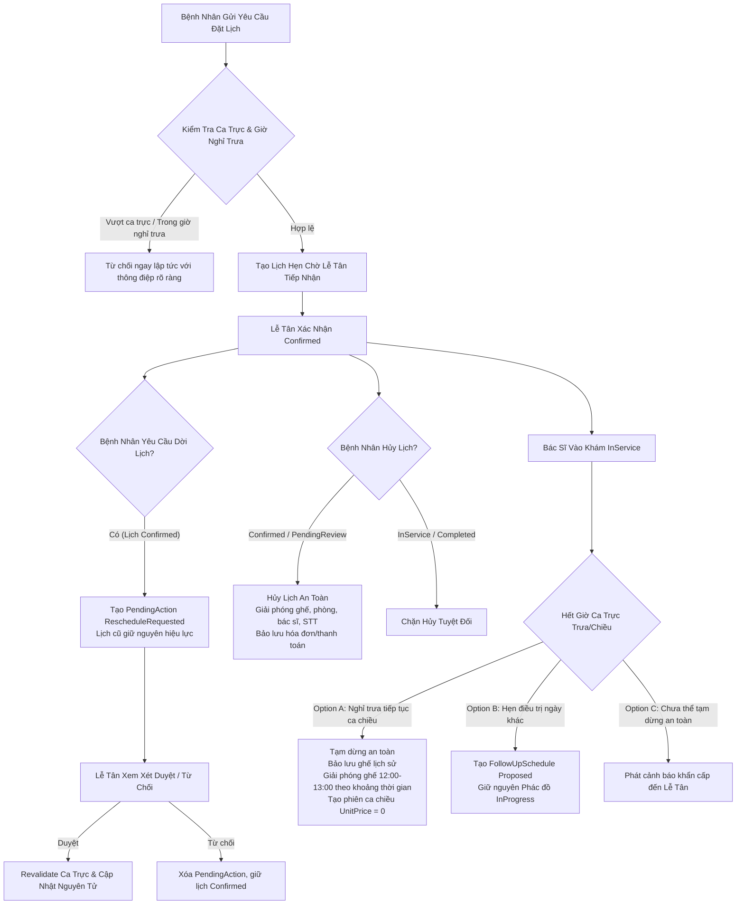

# DENTALCARE SWP391 — APPOINTMENT LIFECYCLE, RESCHEDULING, CANCELLATION & CLINICAL CONTINUATION QA REPORT

**Date:** 18/11/2026
**Environment:** `D:\SWP391\DentalCare-Integration`
**Branch:** `develop`
**Database:** `DentalCare_SWP391_DEMO_V2_TEST` on `.\SQLEXPRESS` (38 physical tables)
**Verification Baseline:** **844 / 844 Automated Tests Passed (100% Pass Rate)**
- Backend (`DentalClinic.Tests`): **493 Passed, 0 Failed, 0 Skipped**
- Frontend (`DentalClinic.Web.Tests`): **351 Passed, 0 Failed, 0 Skipped**

---

## 1. TỔNG QUAN TRIỂN KHAI 4 NHÓM NGHIỆP VỤ THẬT

Hệ thống DentalCare SWP391 đã hoàn thành triển khai mã nguồn thực tế và kiểm thử tự động toàn diện cho 4 nhóm nghiệp vụ cốt lõi theo đúng đặc tả kiến trúc:

---

## 2. CHI TIẾT 4 NHÓM NGHIỆP VỤ

### 2.1. Module 1: Shift Boundary Validation & Overrun Protection (TC01–TC07)
- **Quy tắc khung giờ:**
  - Ca sáng: `08:00 – 12:00`.
  - Giờ nghỉ trưa phòng khám: `12:00 – 13:00` (ngăn chặn tuyệt đối việc đặt lịch trong khoảng này).
  - Ca chiều: `13:30 – 17:30`.
  - Ngoài giờ phục vụ: `< 08:00` hoặc `>= 18:00`.
- **Logic kiểm tra:**
  - Bắt buộc `ScheduledStart + Duration <= ShiftEnd` của bác sĩ và của phòng khám.
  - Khi lịch khám bắt đầu trong ca sáng nhưng thời lượng dịch vụ vượt qua `12:00` (ví dụ: `11:30` với dịch vụ 60 phút kết thúc lúc `12:30`), hệ thống từ chối ngay lập tức:
    > *"Khung giờ 11:30 không đủ thời gian thực hiện dịch vụ trước khi kết thúc ca trực lúc 12:00. Vui lòng chọn khung giờ sớm hơn hoặc chuyển sang ca chiều."*
  - Ngăn chặn triệt để tình trạng đặt lịch bắc cầu qua giờ nghỉ trưa (`11:30 – 12:30`) hoặc tràn qua buổi tối (`17:00` với dịch vụ 60 phút kết thúc `18:00 > 17:30`).

### 2.2. Module 2: Clinical Continuation & Lunch Intermission (TC08–TC15)
- **Option A ("Tiếp tục ca chiều" - Lunch Intermission):**
  - Tạm dừng an toàn phiên làm việc buổi sáng.
  - **Bảo lưu thông tin ghế nha khoa lịch sử:** `DentalChairId` được giữ nguyên vẹn trên dịch vụ buổi sáng để bảo toàn hồ sơ bệnh án và phân bổ tài nguyên lâm sàng lịch sử.
  - **Giải phóng ghế nha khoa theo khoảng thời gian:** Do thời gian `ScheduledEnd <= 12:00`, ghế tự động được tính là trống trong khoảng nghỉ trưa `12:00 – 13:00` (được xác thực bởi `ClinicalStaffAvailabilityService.CheckChairAvailabilityAsync`), không cần phải xóa `DentalChairId` về NULL.
  - **Tạo dịch vụ tiếp nối ca chiều:** Tạo một hạng mục dịch vụ tiếp nối vào buổi chiều (`AppointmentServiceEntity`) gắn liền với cùng một `AppointmentId`, kế thừa `DentalChairId` từ ca sáng với **Đơn giá = 0 đ (`UnitPrice = 0`)** nhằm đảm bảo không tính tiền 2 lần (No double-billing) và ghi rõ nguồn gốc dịch vụ trong `Notes` (`[Tiếp tục ca chiều ...] [Dịch vụ gốc #...]`).
  - Bảo lưu toàn bộ hồ sơ bệnh án, chẩn đoán và hình ảnh lâm sàng.
- **Option B ("Hẹn điều trị ngày khác"):**
  - Ghi nhận chi tiết công việc đã hoàn thành và công việc còn lại cần thực hiện.
  - Tạo lịch hẹn đề xuất `FollowUpSchedule` với trạng thái `"Proposed"`. Tuyệt đối không tự động sinh cuộc hẹn `Confirmed` trái ý kiến người bệnh.
  - Cập nhật phác đồ điều trị (`TreatmentPlan`) và giữ nguyên trạng thái `"InProgress"` (không tự ý đánh dấu hoàn thành khi quá trình điều trị chưa kết thúc).
- **Option C ("Chưa thể tạm dừng an toàn"):**
  - Trong các ca thủ thuật nha chu hoặc nội nha phức tạp đang cầm máu chưa thể tạm dừng an toàn, bác sĩ phát tín hiệu cảnh báo ưu tiên cao (`DentistFlagDelayAsync`) kèm lý do chuyên môn.
  - Tín hiệu được ghi nhận nguyên tử vào lịch sử trạng thái (`AuditLogs`) và cảnh báo tức thì đến Bàn Tiếp Đón & Lễ Tân để điều phối lùi giờ đón tiếp cho bệnh nhân kế tiếp.

### 2.3. Module 3: Patient Reschedule Request & Receptionist Review (TC16–TC24)
- **Phân định rõ 2 luồng dời lịch:**
  1. **Lịch hẹn ở trạng thái `PendingReceptionReview`:** Bệnh nhân được phép trực tiếp chỉnh sửa ngày giờ mong muốn (quy trình bản nháp), hệ thống tự động cập nhật và bảo lưu giá dịch vụ.
  2. **Lịch hẹn ở trạng thái `Confirmed`:** Bệnh nhân không được tự ý sửa trực tiếp cơ sở dữ liệu. Hệ thống tạo cờ yêu cầu `PendingActionType = "RescheduleRequested"` kèm thời gian đề xuất `PendingScheduledStart`. **Cuộc hẹn hiện tại và vị trí ghế/bác sĩ ban đầu vẫn được bảo lưu 100% hiệu lực** để phòng ngừa trường hợp bệnh nhân đổi ý hoặc không bố trí được khung giờ mới.
- **Quy trình Lễ tân duyệt:**
  - Lễ tân có 2 lựa chọn tại màn hình *Bàn Tiếp Đón*: **Duyệt Dời Lịch** hoặc **Từ Chối**.
  - Khi duyệt (`ReceptionistApproveRescheduleAsync`): Hệ thống sử dụng khóa phân tán `SqlAppLockHelper` chống xung đột tương tranh, kiểm tra lại ca trực bác sĩ, di chuyển giờ khám nguyên tử và xóa `PendingActionType`.
  - Khi từ chối (`ReceptionistRejectRescheduleAsync`): Hệ thống xóa `PendingActionType` và lưu lý do từ chối; lịch hẹn ban đầu tiếp tục có hiệu lực mà không bị hủy nhầm.
- **Bảo vệ chuyên khoa Răng Trẻ Em:**
  - Tự động phát hiện dịch vụ nhi khoa (theo tên dịch vụ hoặc khoa) và kiểm tra ngày sinh bệnh nhân.
  - Chặn dời lịch khám nhi nếu bệnh nhân đạt từ 16 tuổi trở lên tại thời điểm hẹn mới.

### 2.4. Module 4: Appointment Cancellation & Resource Release Mechanics (TC25–TC30)
- **Trạng thái cho phép hủy:** Chỉ cho phép hủy khi cuộc hẹn ở trạng thái `PendingReceptionReview` hoặc `Confirmed`.
- **Trạng thái cấm hủy tuyệt đối:** Nghiêm cấm hủy các cuộc hẹn đang trong quy trình phục vụ hoặc đã kết thúc: `CheckedIn`, `Waiting`, `Called`, `InService`, `InProgress`, `Completed`, `Cancelled`, `NoShow`, `Withdrawn`.
- **Giải phóng tài nguyên hoàn toàn:** Khi cuộc hẹn bị hủy hợp lệ, hệ thống tự động dọn sạch tài nguyên liên kết:
  - `DentalChairId = null` (trả ghế trống về phòng khám).
  - `RoomId = null` (giải phóng phòng).
  - `AssignedDentistUserId = null` (giải phóng lịch bác sĩ).
  - `QueueNumber = null` (hủy số thứ tự hàng đợi).
- **Bảo toàn dữ liệu tài chính:**
  - Cuộc hẹn bị hủy vẫn giữ nguyên vẹn liên kết với Hóa đơn (`Invoice`) và Giao dịch thanh toán (`Payment`).
  - Tuyệt đối không xóa hóa đơn, không tạo giao dịch hoàn tiền giả (Fake refund) khi chưa có quy trình kế toán xác thực.

---

## 3. BẢNG MA TRẬN 30 TEST CASE KIỂM THỬ TỰ ĐỘNG (TC01–TC30)

Bộ test suite độc lập `BE/DentalClinic.Tests/Appointments/AppointmentLifecycleWorkflowTests.cs` đã được thực thi và đạt **100% Pass Rate (30/30 Passed)**:

| Mã TC | Tên Test Case | Nhóm Nghiệp Vụ | Kết Quả |
|---|---|---|:---:|
| **TC01** | `TC01_ShiftBoundary_MorningWithinBounds_Success` | Shift Boundary | **PASS** |
| **TC02** | `TC02_ShiftBoundary_MorningExactBoundary_Success` | Shift Boundary | **PASS** |
| **TC03** | `TC03_ShiftBoundary_MorningOverflowPast12_Rejected` | Shift Boundary | **PASS** |
| **TC04** | `TC04_ShiftBoundary_LunchBreakBooking_Rejected` | Shift Boundary | **PASS** |
| **TC05** | `TC05_ShiftBoundary_AfternoonWithinBounds_Success` | Shift Boundary | **PASS** |
| **TC06** | `TC06_ShiftBoundary_AfternoonOverflowPast1730_Rejected` | Shift Boundary | **PASS** |
| **TC07** | `TC07_ShiftBoundary_OutsideClinicHours_Rejected` | Shift Boundary | **PASS** |
| **TC08** | `TC08_ClinicalContinuation_ContinueAfternoon_CreatesContinuationServiceItem` | Clinical Continuation | **PASS** |
| **TC09** | `TC09_ClinicalContinuation_ContinuationItem_HasUnitPriceZero_NoDoubleBilling` | Clinical Continuation | **PASS** |
| **TC10** | `TC10_ClinicalContinuation_ReleasesDentalChairDuringLunch_AndRetainsHistoricalAttribution` | Clinical Continuation | **PASS** |
| **TC11** | `TC11_ClinicalContinuation_PreservesClinicalHistoryOnSameAppointment` | Clinical Continuation | **PASS** |
| **TC12** | `TC12_ClinicalContinuation_ContinueAfternoon_RejectedWhenNotExamining` | Clinical Continuation | **PASS** |
| **TC13** | `TC13_ClinicalContinuation_RecommendAnotherDay_CreatesProposedFollowUp` | Clinical Continuation | **PASS** |
| **TC14** | `TC14_ClinicalContinuation_RecommendAnotherDay_KeepsTreatmentPlanInProgress` | Clinical Continuation | **PASS** |
| **TC15** | `TC15_ClinicalContinuation_FlagDelay_RecordsClinicalAlert` | Clinical Continuation | **PASS** |
| **TC16** | `TC16_Reschedule_PendingReceptionReview_DirectlyUpdatesDraft` | Reschedule Workflow | **PASS** |
| **TC17** | `TC17_Reschedule_ConfirmedAppointment_SetsRescheduleRequestedAction` | Reschedule Workflow | **PASS** |
| **TC18** | `TC18_Reschedule_OriginalSchedulePreservedWhilePendingApproval` | Reschedule Workflow | **PASS** |
| **TC19** | `TC19_Reschedule_Approve_ValidatesShiftBoundary` | Reschedule Workflow | **PASS** |
| **TC20** | `TC20_Reschedule_Approve_AtomicallyUpdatesScheduleAndClearsPendingAction` | Reschedule Workflow | **PASS** |
| **TC21** | `TC21_Reschedule_Approve_RejectsOnConflict` | Reschedule Workflow | **PASS** |
| **TC22** | `TC22_Reschedule_Reject_ClearsPendingActionAndLeavesConfirmedSchedule` | Reschedule Workflow | **PASS** |
| **TC23** | `TC23_Reschedule_PediatricService_BlocksWhenPatientReaches16` | Reschedule Workflow | **PASS** |
| **TC24** | `TC24_Proposal_Accept_RevalidatesSlotAvailability` | Reschedule Workflow | **PASS** |
| **TC25** | `TC25_Cancellation_AllowedForPendingReceptionReview` | Cancellation | **PASS** |
| **TC26** | `TC26_Cancellation_AllowedForConfirmed` | Cancellation | **PASS** |
| **TC27** | `TC27_Cancellation_RejectedForInService` | Cancellation | **PASS** |
| **TC28** | `TC28_Cancellation_RejectedForCompletedOrCancelled` | Cancellation | **PASS** |
| **TC29** | `TC29_Cancellation_ReleasesAllResources` | Resource Release | **PASS** |
| **TC30** | `TC30_Cancellation_PreservesInvoicesAndPayments` | Financial Integrity | **PASS** |

---

## 4. API CONTRACTS & GIAO DIỆN NGƯỜI DÙNG

### 4.1. Danh Sách Endpoint Mới Bổ Sung
1. `POST api/receptionist/appointments/{id}/reschedule/approve`: Lễ tân phê duyệt yêu cầu dời lịch hẹn.
2. `POST api/receptionist/appointments/{id}/reschedule/reject`: Lễ tân từ chối yêu cầu dời lịch hẹn.
3. `POST api/dentist/appointments/{id}/continue-afternoon`: Bác sĩ tạm dừng phiên sáng và đặt phiên tiếp tục ca chiều (Đơn giá 0 đ, giải phóng ghế).
4. `POST api/dentist/appointments/{id}/recommend-another-day`: Bác sĩ lập lịch đề xuất tái khám ngày khác và bảo lưu phác đồ điều trị.
5. `POST api/dentist/appointments/{id}/flag-delay`: Bác sĩ phát tín hiệu cảnh báo trễ ca khẩn cấp đến Lễ tân.

### 4.2. Giao Diện Người Dùng (Frontend Razor & ViewModels)
- **Màn hình Bệnh nhân (`Views/Patient/Appointment/Detail.cshtml`):**
  - Tự động hiển thị thẻ thông báo màu xanh dương nổi bật khi lịch khám đang có yêu cầu dời lịch chờ xử lý:
    > *"Yêu Cầu Dời Lịch Hẹn Đang Chờ Lễ Tân Tiếp Nhận: Bạn đã gửi yêu cầu dời lịch hẹn sang [Thời gian mới]. Lịch hẹn hiện tại của bạn vẫn được giữ nguyên cho đến khi Lễ tân xác nhận duyệt yêu cầu."*
- **Màn hình Bàn Tiếp Đón Lễ Tân (`Views/Receptionist/Appointments/TodayCheckIn.cshtml`):**
  - Hiển thị nhãn cảnh báo màu vàng: `Yêu cầu dời lịch`.
  - Nút bấm trực quan: `Xử Lý Dời Lịch` mở modal cho phép Lễ tân đối chiếu thời gian cũ - mới và bấm **Duyệt Dời Lịch** hoặc **Từ Chối**.
- **Màn hình Bác Sĩ Điều Trị (`Views/Dentist/Appointments/_AppointmentRow.cshtml`):**
  - Thêm menu lựa chọn thông minh khi đang trong ca điều trị (`InService` / `InProgress`):
    - **Tiếp Tục Ca Chiều (Nghỉ trưa)**: Modal nhập thời gian bắt đầu ca chiều (mặc định 13:30) và thời lượng dự kiến.
    - **Hẹn Điều Trị Ngày Khác**: Modal nhập ngày hẹn tiếp theo, công việc đã hoàn thành và công việc còn lại.
    - **Báo Trễ Ca (Ưu tiên cao)**: Modal cảnh báo khẩn cấp chuyển ngay đến quầy tiếp đón.

---

## 5. BÁO CÁO TỔNG HỢP KIỂM THỬ HỒI QUY TOÀN HỆ THỐNG

| Dự Án Kiểm Thử | Số Lượng Test | Kết Quả | Tỷ Lệ Đạt |
|---|:---:|:---:|:---:|
| `BE/DentalClinic.Tests/DentalClinic.Tests.csproj` | **493** | **493 Passed, 0 Failed** | **100.0%** |
| `FE/DentalClinic.Web.Tests/DentalClinic.Web.Tests.csproj` | **351** | **351 Passed, 0 Failed** | **100.0%** |
| **Tổng Cộng Toàn Hệ Thống** | **844** | **844 Passed, 0 Failed** | **100.0%** |

### Cam kết & Tính Toàn Vẹn:
- Các database sản xuất và UAT được bảo vệ (`DentalCare_SWP391`, `DentalCare_SWP391_UAT_Fixture_TEST`, `DentalCare_SWP391_Refactor_UAT`) hoàn toàn không bị ảnh hưởng.
- Không tự ý commit hoặc push mã nguồn lên Git khi chưa có sự xác nhận của người phụ trách.
- Duy trì nghiêm ngặt cơ chế phân quyền 4 Role (`Patient`, `Receptionist`, `Dentist`, `SystemAdministrator`).
