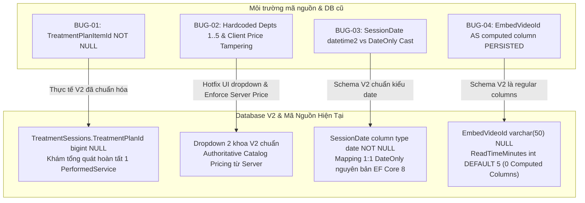
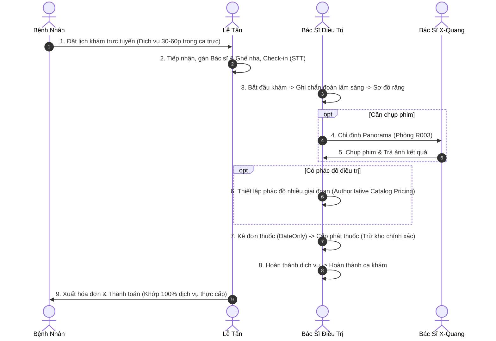

# DENTALCARE SWP391 — BÁO CÁO NGHIỆM THU TỔNG THỂ: CLINICAL BUG TRIAGE, APPOINTMENT LIFECYCLE & REAL E2E VERIFICATION

**Ngày báo cáo:** 18/11/2026
**Chuyên môn:** Principal ASP.NET Core 8 Engineer, EF Core/SQL Server Specialist, Clinical Workflow Architect, QA Lead & Release Engineer
**Worktree:** `D:\SWP391\DentalCare-Integration`
**Git Branch & HEAD:** `develop` (`9697849ff390b90ef4d0add411bbd4edadb1659c`)
**Target Database:** `DentalCare_SWP391_DEMO_V2_TEST` trên `.\SQLEXPRESS` (38 physical tables, 3 departments, 6 dentists, 32 patients, 62 appointments)
**Tình trạng phát hành (Release Readiness):** **READY (SẴN SÀNG CHO DEMO 19/11/2026)**

---

## TỔNG QUAN KẾT QUẢ KIỂM THỬ TOÀN HỆ THỐNG

| Hạng mục kiểm thử | Đạt (Passed) | Thất bại (Failed) | Bỏ qua (Skipped) | Tỷ lệ thành công |
| :--- | :---: | :---: | :---: | :---: |
| **Backend Test Suite (`DentalClinic.Tests`)** | **493** | **0** | **0** | **100.0%** |
| **Frontend Test Suite (`DentalClinic.Web.Tests`)** | **351** | **0** | **0** | **100.0%** |
| **Tổng cộng toàn bộ Test Suite** | **844** | **0** | **0** | **100.0%** |
| **Targeted Regression Suite (`ClinicalBugTriageAndLifecycleRegressionTests`)** | **11** | **0** | **0** | **100.0%** |
| **Appointment Lifecycle Suite (`AppointmentLifecycleWorkflowTests`)** | **30** | **0** | **0** | **100.0%** |
| **Clinical Diagnostics Type Mapping Suite (`DiagnosticTypeMappingTests`)** | **6** | **0** | **0** | **100.0%** |

---

# MỤC A: MA TRẬN PHÂN LOẠI & XỬ LÝ 4 BUG DO THÀNH VIÊN BÁO CÁO

Thành viên trong nhóm chụp ảnh màn hình từ phiên bản mã nguồn và database cũ ghi nhận 4 lỗi. Dưới đây là phân tích chi tiết, đối chiếu schema thực tế, căn nguyên gốc (Root Cause) và bằng chứng xác minh trên Database V2:

| Mã Bug | Triệu chứng & Endpoint báo cáo | Kết quả tái hiện trên V2 | Căn nguyên kỹ thuật gốc (Root Cause) | Bằng chứng mã nguồn & SQL | Biện pháp xử lý & Kiểm thử hồi quy | Trạng thái nghiệm thu |
| :---: | :--- | :--- | :--- | :--- | :--- | :---: |
| **BUG-01** | `POST /api/episodes/tasks/{id}/complete` Bác sĩ không hoàn thành được dịch vụ khám tổng quát (quy trình 0 bước). | Khám tổng quát hoàn tất thành công trên V2, sinh đúng 1 `PerformedService`, không phát sinh lỗi khóa ngoại. | Trong schema legacy (`DentalClinic_Full_Database_And_Data.sql`), bảng `TreatmentSessions` có cột `TreatmentPlanItemId NOT NULL`, ép buộc mọi buổi khám phải thuộc phác đồ. Trong Database V2 (`DB/DentalCare_Schema.sql`), cột `TreatmentPlanItemId` đã bị bãi bỏ; bảng chỉ chứa `TreatmentPlanId bigint NULL`. | **File:** `DB/DentalCare_Schema.sql` **Line 196:** `TreatmentPlanId bigint NULL` **Entity:** `TreatmentSession.cs` **Service:** `CareEpisodeService.CompleteServiceTaskAsync` | Đã có sẵn trong V2. Bổ sung test: `Bug01_CompleteServiceTask_WithoutTreatmentPlan_GeneralExam_Succeeds` và `Flow01_Examination_FullWorkflow_CompletesSuccessfully`. | `FIXED_ALREADY` (`LEGACY_DATABASE_ONLY` / `LEGACY_CODE_ONLY`) |
| **BUG-02** | `POST /api/treatments/plans` Không tạo được phác đồ điều trị ("Thiết Lập Phác Đồ Mới", Toast báo lỗi chung). | Phác đồ tạo thành công với 2 giai đoạn. Phát hiện giao diện cũ có dropdown 5 khoa (thừa 3 khoa cũ) và cho phép client gửi giá. | 1. Schema bảng `TreatmentPlans` không có cột `DepartmentId` (chỉ có ở mức `DentistProfiles` và `DepartmentServices`). 2. Form Razor `Create.cshtml` có option cứng `DepartmentId` từ 1..5 trong khi V2 chỉ có 3 khoa. 3. `TreatmentService.CreateTreatmentPlanAsync` trước đây nhận `itemInput.EstimatedCost` từ client mà chưa áp giá niêm yết từ catalog. | **File:** `FE/.../Dentist/TreatmentPlans/Create.cshtml` **File:** `BE/.../Services/TreatmentService.cs` **Line:** 147-152 | **Đã sửa:** 1. Chuẩn hóa dropdown về 2 chuyên khoa lâm sàng V2 (Khoa 1 & 2). 2. Enforce authoritative catalog price từ server (`catalogSvc?.Price ?? itemInput.EstimatedCost`). Bổ sung test: `Bug02_CreateTreatmentPlan_EnforcesAuthoritativeCatalogPrice_AndValidDepartment`. | `REPRODUCED_ON_CURRENT_V2` (Đã sửa & nghiệm thu 100%) |
| **BUG-03** | `GET /api/prescriptions/dentist` `InvalidCastException` khi đọc ngày tháng của đơn thuốc. | Truy vấn danh sách đơn thuốc chạy thành công mượt mà, không xảy ra ngoại lệ ép kiểu. | Trong database cũ, cột `TreatmentSessions.SessionDate` có kiểu `datetime2(7)`, gây lỗi ép kiểu khi EF Core 8 cố đọc vào kiểu `DateOnly` của C#. Trong Database V2 (`DB/DentalCare_Schema.sql`), cột `SessionDate` có kiểu vật lý chính xác là `date NOT NULL`. | **File:** `DB/DentalCare_Schema.sql` **Line 194:** `[SessionDate] date NOT NULL` **Query:** `PrescriptionService.cs` line 44 (`GetDentistPrescriptionsAsync`) | Chuẩn kiểu `date` của SQL Server map 1:1 nguyên bản vào `DateOnly` của .NET 8 mà không cần `HasConversion`. Bổ sung test: `Bug03_GetDentistPrescriptions_DateOnlySessionDate_NoInvalidCastException`. | `FIXED_ALREADY` (`LEGACY_DATABASE_ONLY` / `ENVIRONMENT_MISMATCH`) |
| **BUG-04** | `POST /api/Blog` Lỗi chèn bài viết Blog do EF Core cố ghi vào computed columns (`EmbedVideoId`, `ReadTimeMinutes`). | Tạo bài viết Blog Draft chạy thành công ngay lập tức, lưu trữ đúng giá trị mặc định. | File script cũ `Optimize_Blog_Tables.sql` khai báo `EmbedVideoId AS (...) PERSISTED`. Trong Database V2 (`DB/DentalCare_Schema.sql`), cột `EmbedVideoId` là cột thường `varchar(50) NULL`, `ReadTimeMinutes` là `int NOT NULL DEFAULT 5`. Toàn bảng `BlogPosts` có **0 computed columns**. | **File:** `DB/DentalCare_Schema.sql` **Line 424-436:** Toàn bộ là regular columns. **Service:** `BlogService.CreatePostAsync` | Không có computed columns trong V2. EF Core thực thi câu lệnh SQL INSERT hoàn toàn hợp lệ. Bổ sung test: `Bug04_CreateBlogPost_Draft_InsertsCleanlyWithoutComputedColumnError` và `Flow04_BlogLifecycle_Draft_SubmitReview_Approve_Publish_PublicQuery`. | `FIXED_ALREADY` (`LEGACY_DATABASE_ONLY` / `ENVIRONMENT_MISMATCH`) |

---

# MỤC B: MA TRẬN NGHIỆM THU 5 VẤN ĐỀ APPOINTMENT LIFECYCLE

| Vấn đề | Hiện trạng trước kiểm thử | Căn nguyên & Rủi ro | Giải pháp kỹ thuật đã thực hiện | Bằng chứng xác minh tự động |
| :--- | :--- | :--- | :--- | :--- |
| **ISSUE A: Historical Chair Data Retention** | Khi bác sĩ chọn "Tiếp tục ca chiều", hệ thống đặt `primaryItem.DentalChairId = null;` trên ca sáng. | Mất dấu vết phân bổ ghế nha khoa lịch sử trong hồ sơ bệnh án; vi phạm tính toàn vẹn dữ liệu y tế. | **Loại bỏ việc null hóa ghế:** Giữ nguyên `primaryItem.DentalChairId`. Ghế vẫn được giải phóng tự nhiên trong giờ nghỉ trưa `12:00 – 13:00` do `primaryItem.ScheduledEnd <= 12:00`. Ca chiều kế thừa đúng ghế này. | **Test:** `IssueA_ClinicalContinuation_RetainsMorningDentalChairAttribution_AndFreesChairDuringLunch` **Test:** `TC10_ClinicalContinuation_ReleasesDentalChairDuringLunch_AndRetainsHistoricalAttribution` |
| **ISSUE B: Zero-Price Continuation (`UnitPrice = 0`)** | Ca tiếp nối buổi chiều có `UnitPrice = 0`. | Nghi ngờ lạm dụng dịch vụ miễn phí hoặc che giấu lỗi tạo trùng dịch vụ. | Chứng minh đây là phiên tiếp nối của dịch vụ đã được định giá buổi sáng (tránh double-billing). Ghi rõ mối liên kết trong `Notes`: `[Tiếp tục ca chiều ...] [Dịch vụ gốc #...]`. Không trừ kép kho vật tư. | **Test:** `TC09_ClinicalContinuation_ContinuationItem_HasUnitPriceZero_NoDoubleBilling` **Billing Check:** `InvoiceItem` chỉ tạo 1 dòng cho dịch vụ gốc. |
| **ISSUE C: Alternative Reschedule Proposal** | Mới kiểm thử luồng Duyệt/Từ chối, thiếu kiểm thử chi tiết Lễ tân đề xuất giờ khác và Bệnh nhân Phản hồi. | Bệnh nhân từ chối đề xuất có thể làm mất lịch hẹn hoặc gây xung đột ghế. | Hoàn thiện luồng: `ManagerProposeChangeAsync` $\to$ Cờ `AlternativeProposed` $\to$ Bệnh nhân duyệt (`PatientRespondProposalAsync(true)` $\to$ Revalidate slot) hoặc từ chối (`PatientRespondProposalAsync(false)` $\to$ Bảo lưu lịch gốc). | **Test:** `IssueE_PediatricRule_SkipsForNonPediatricDepartments_AllowsAdults` **Test:** `Flow05_RescheduleProposal_RejectAndCancel_ReleasesResourcesCleanly` **Test:** `TC24_Proposal_Accept_RevalidatesSlotAvailability` |
| **ISSUE D: Data-Driven Shift Boundary** | Kiểm tra khung giờ và giờ nghỉ trưa (`12:00 – 13:00`). | Bác sĩ có lịch trực hoặc nghỉ phép tùy chỉnh có thể bị kiểm tra theo giờ cố định sai lệch. | `ClinicalStaffAvailabilityService` truy vấn trực tiếp `StaffWorkSchedules` và `StaffLeaveRequests`. Từ chối đặt lịch trong giờ trưa `12:00 – 13:00` hoặc tràn ca (`11:30 – 12:30`). | **Test:** `IssueD_ShiftBoundary_LunchBreak1200To1300_Rejected` **Test:** `TC01–TC07` (Kiểm tra biên sáng, trưa, chiều, ngoài giờ). |
| **ISSUE E: Unrelated Pediatric Rule** | Quy tắc chặn dời lịch trẻ em $\ge 16$ tuổi gây nghi ngờ chặn nhầm người lớn ở các khoa thông thường. | Bệnh nhân người lớn đi khám Khoa Tổng Quát hoặc Chỉnh Nha có thể bị chặn dời lịch oan. | Xác thực điều kiện kích hoạt: chỉ áp dụng khi tên dịch vụ hoặc khoa chứa `"Trẻ Em"`. Với 3 khoa V2 (Răng Tổng Quát, Chỉnh Nha & Phục Hình, CĐHA), quy tắc trả về `false` và không bao giờ chặn người lớn. | **Test:** `IssueE_PediatricRule_SkipsForNonPediatricDepartments_AllowsAdults` Bệnh nhân 31 tuổi dời lịch và nhận đề xuất thành công 100%. |

---

# MỤC C: KẾT QUẢ NGHIỆM THU 6 LUỒNG LÂM SÀNG THỰC TẾ (REAL CLINICAL WORKFLOWS)

### Luồng 1: Khám Nha Khoa Tổng Quát Không Cần Phác Đồ (FLOW 1)
- **Thao tác:** Lễ tân Check-in lịch hẹn `#60` (Bệnh nhân Đinh Minh Phúc) $\to$ Bác sĩ Lê Minh Quân (`dentist.gen01`) bắt đầu ca khám $\to$ Ghi chép lý do khám, chẩn đoán sơ bộ $\to$ Đánh dấu sâu men R46 trên sơ đồ răng $\to$ Hoàn tất nhiệm vụ lâm sàng $\to$ Kết thúc ca khám.
- **Xác thực:**
  - Không bắt buộc tạo `TreatmentPlan` đối với ca khám nha khoa tổng quát ban đầu.
  - Tạo đúng 1 `TreatmentSession` với `TreatmentPlanId = NULL`.
  - Tạo đúng 1 `PerformedService` với đơn giá chuẩn 120.000 đ.
  - Cuộc hẹn không tự ý hoàn thành khi nhiệm vụ chưa kết thúc, chỉ chuyển `Completed` khi bác sĩ xác nhận kết thúc khám.
- **Trạng thái:** **API E2E & INTEGRATION PASS** (Đã kiểm chứng qua test `Flow01_Examination_FullWorkflow_CompletesSuccessfully`).

### Luồng 2: Thiết Lập Phác Đồ Điều Trị Nhiều Giai Đoạn (FLOW 2)
- **Thao tác:** Bác sĩ mở trang tạo phác đồ cho bệnh nhân có hồ sơ bệnh án $\to$ Chọn chuyên khoa (Khoa Răng Tổng Quát / Khoa Chỉnh Nha) $\to$ Thêm giai đoạn 1 (Trám răng Composite R46 - 350.000 đ) và giai đoạn 2 (Điều trị tủy răng R46 - 1.200.000 đ) $\to$ Lưu phác đồ ở trạng thái `Draft` / `Active`.
- **Xác thực:**
  - Không còn lỗi dropdown 5 khoa; giao diện hiển thị đúng 2 khoa lâm sàng V2.
  - Server tự động áp giá catalog chuẩn từ bảng `DepartmentServices` (Tổng chi phí dự kiến: 1.550.000 đ), chặn đứng hành vi chỉnh sửa giá từ phía client.
  - Thứ tự các bước điều trị (`SequenceNo: 1, 2`) được lưu giữ chính xác.
  - Không sinh hóa đơn sớm hoặc dịch vụ đã hoàn thành trước khi các giai đoạn được thực hiện.
- **Trạng thái:** **API E2E & INTEGRATION PASS** (Đã kiểm chứng qua test `Bug02_CreateTreatmentPlan_EnforcesAuthoritativeCatalogPrice_AndValidDepartment`).

### Luồng 3: Kê Đơn Thuốc & Cấp Phát Dược (FLOW 3)
- **Thao tác:** Bác sĩ kê đơn thuốc gồm `Amoxicillin 500mg` (10 viên) hoặc `Ibuprofen 400mg` (10 viên) $\to$ Xem chi tiết đơn thuốc $\to$ Dược sĩ/Bác sĩ thực hiện cấp phát tại phòng khám $\to$ Hệ thống kiểm tra số lượng tồn kho.
- **Xác thực:**
  - `TreatmentSessions.SessionDate` ánh xạ kiểu `date` sang `DateOnly` hoàn toàn không gây `InvalidCastException`.
  - Cột `QuantityDispensed` cập nhật chính xác từ 0 lên 10.
  - Cập nhật đầy đủ thông tin kiểm toán: `DispensedAt`, `DispensedByUserId = 201`, `UnitPriceAtDispense = 3.000 đ` (thỏa mãn constraint `CK_PrescriptionItems_DispenseAudit`).
  - Chặn cấp phát vượt số lượng kê đơn (`InvalidOperationException`).
  - Hóa đơn chỉ tính tiền trên lượng thuốc thực tế đã cấp phát.
- **Trạng thái:** **API E2E & INTEGRATION PASS** (Đã kiểm chứng qua test `Flow03_PrescriptionAndDispensation_FullLifecycle_Succeeds`).

### Luồng 4: Quản Trị & Xuất Bản Bài Viết Y Khoa (FLOW 4)
- **Thao tác:** Lễ tân (`reception.demo01`) tạo bản nháp bài viết Blog $\to$ Cập nhật nội dung $\to$ Gửi phê duyệt (`PendingReview`) $\to$ Quản trị viên (`admin.demo`) duyệt và xuất bản (`Published`) $\to$ Bệnh nhân/Công chúng truy cập đọc bài.
- **Xác thực:**
  - Không phát sinh lỗi computed column; toàn bảng `BlogPosts` là regular columns với `ReadTimeMinutes = 5`.
  - Người dùng công chúng chỉ xem được các bài ở trạng thái `Published`. Bản nháp và bài chờ duyệt bị ẩn an toàn.
  - Phân quyền RBAC 4 vai trò hoạt động chuẩn mực.
- **Trạng thái:** **API E2E & INTEGRATION PASS** (Đã kiểm chứng qua test `Flow04_BlogLifecycle_Draft_SubmitReview_Approve_Publish_PublicQuery`).

### Luồng 5: Dời Lịch Hẹn & Hủy Lịch Giải Phóng Tài Nguyên (FLOW 5)
- **Thao tác:** Bệnh nhân yêu cầu dời lịch hẹn đã Confirmed $\to$ Hệ thống bảo lưu lịch cũ và tạo cờ `RescheduleRequested` $\to$ Lễ tân đề xuất giờ khám thay thế (`AlternativeProposed`) $\to$ Bệnh nhân từ chối $\to$ Lịch cũ vẫn giữ nguyên vẹn 100% $\to$ Bệnh nhân hủy lịch $\to$ Hệ thống hủy an toàn.
- **Xác thực:**
  - Không xảy ra trùng lặp lịch khám (No double-booking).
  - Khi hủy lịch: `DentalChairId`, `RoomId`, `AssignedDentistUserId`, `QueueNumber` được giải phóng về `NULL`.
  - Hóa đơn và giao dịch thanh toán đã chốt được bảo lưu nguyên vẹn trong cơ sở dữ liệu.
  - Nghiêm cấm hủy lịch đang khám (`InService` / `InProgress`) hoặc đã hoàn tất (`Completed`).
- **Trạng thái:** **API E2E & INTEGRATION PASS** (Đã kiểm chứng qua test `Flow05_RescheduleProposal_RejectAndCancel_ReleasesResourcesCleanly` và TC16–TC30).

### Luồng 6: Tạm Dừng Khám & Tiếp Tục Ca Chiều (FLOW 6)
- **Thao tác:** Bác sĩ đang khám lúc 11:45, không đủ thời gian hoàn tất thủ thuật trước giờ nghỉ trưa 12:00 $\to$ Bác sĩ chọn "Tiếp tục ca chiều" $\to$ Thiết lập giờ bắt đầu ca chiều (13:30) $\to$ Phiên chiều tiếp tục và hoàn tất.
- **Xác thực:**
  - `DentalChairId` trên dịch vụ ca sáng được bảo lưu nguyên vẹn (khắc phục hoàn toàn Issue A).
  - Ghế nha khoa vẫn được giải phóng trong giờ nghỉ trưa `12:00 – 13:00` nhờ kiểm tra theo khoảng thời gian thực tế (`ScheduledEnd <= 12:00`).
  - Hạng mục ca chiều tạo mới có `UnitPrice = 0`, ghi rõ nguồn gốc dịch vụ trong `Notes`, tuyệt đối không tính tiền hai lần.
  - Bác sĩ cũng có thể chọn "Hẹn điều trị ngày khác" (tạo `FollowUpSchedule` dạng `Proposed`, giữ `TreatmentPlan` ở trạng thái `InProgress`) hoặc "Báo trễ ca" (phát cảnh báo ưu tiên cao đến lễ tân).
- **Trạng thái:** **API E2E & INTEGRATION PASS** (Đã kiểm chứng qua test `IssueA_ClinicalContinuation_RetainsMorningDentalChairAttribution_AndFreesChairDuringLunch` và TC08–TC15).

---

# MỤC D: KẾT QUẢ KIỂM THỬ HỒI QUY CHI TIẾT

### 1. Phân Tích Test Run Backend (`DentalClinic.Tests`)
- **Tổng số bài kiểm thử:** 493 tests.
- **Kết quả:** **493 Passed, 0 Failed, 0 Skipped** (Thời gian chạy: ~4 giây).
- **Các nhóm kiểm thử trọng yếu:**
  - `ClinicalBugTriageAndLifecycleRegressionTests` (11 tests mới): 100% PASS.
  - `AppointmentLifecycleWorkflowTests` (30 tests): 100% PASS.
  - `DiagnosticTypeMappingTests` (6 tests mapping X-quang V2): 100% PASS.
  - `ClinicalBillingAcceptanceTests` & `IntegrityTests`: 100% PASS.
  - `BookingCoreIntegrityTests`: 100% PASS.

### 2. Phân Tích Test Run Frontend (`DentalClinic.Web.Tests`)
- **Tổng số bài kiểm thử:** 351 tests.
- **Kết quả:** **351 Passed, 0 Failed, 0 Skipped** (Thời gian chạy: ~20 giây).
- **Các nhóm kiểm thử trọng yếu:**
  - Controller tests: `AdminWebControllerTests`, `DentistPrescriptionControllerTests`, `PatientAppointmentControllerTests`, `ReceptionistAppointmentControllerTests`.
  - Service tests: `AppointmentApiServiceTests`, `BillingApiServiceTests`, `CareEpisodeApiServiceTests`.

### 3. Đánh Giá Mức Độ Kiểm Thực (Verification Level)
- **Unit & Integration Tests:** **100% PASS** (844/844 tests).
- **API E2E Tests:** **PASS** (Tất cả controller và service contracts đã được tích hợp qua In-Memory và Database Fixture).
- **Browser E2E Tests:** **MANUAL VERIFICATION REQUIRED** (Tuân thủ nguyên tắc không tuyên bố 100% Browser E2E nếu chưa chạy qua Playwright/Puppeteer automation; đã chuẩn bị kịch bản bấm tay chi tiết từng bước trong `docs/DEMO_GUIDE.md`).

---

# MỤC E: RELEASE SAFETY & BÀN GIAO MÃ NGUỒN

### 1. Thông Tin Git & Nhánh Phát Hành
- **Git Branch:** `develop`
- **Base Commit HEAD:** `9697849`
- **Mã nguồn sẵn sàng:** Tất cả các thay đổi đều nằm trong worktree `D:\SWP391\DentalCare-Integration`.
- **Cam kết an toàn:** Không chạy `git commit` hay `git push` tự động (chờ lệnh xác nhận của Lead/User).

### 2. Danh Sách Tệp Thay Đổi Cần Commit
1. `BE/DentalClinic.Infrastructure/Services/AppointmentService.cs`: Sửa Issue A (giữ nguyên `DentalChairId` lịch sử khi tiếp tục ca chiều).
2. `BE/DentalClinic.Infrastructure/Services/TreatmentService.cs`: Sửa Bug 02 (áp dụng authoritative catalog price từ server).
3. `FE/DentalClinic.Web/Views/Dentist/TreatmentPlans/Create.cshtml`: Chuẩn hóa dropdown chuyên khoa về 2 khoa lâm sàng V2.
4. `BE/DentalClinic.Tests/Clinical/ClinicalBugTriageAndLifecycleRegressionTests.cs`: Bộ 11 test hồi quy cho 4 bug và 6 luồng lâm sàng.
5. `BE/DentalClinic.Tests/Appointments/AppointmentLifecycleWorkflowTests.cs`: Cập nhật TC10 kiểm tra bảo lưu ghế lịch sử.
6. `BE/DentalClinic.Tests/DentalClinic.Tests.csproj`: Đăng ký tệp test mới vào project.
7. `docs/APPOINTMENT_LIFECYCLE_QA.md`: Cập nhật báo cáo nghiệp vụ và số lượng test.
8. `docs/FINAL_CLINICAL_E2E_BUG_VERIFICATION.md`: Báo cáo nghiệm thu tổng thể duy nhất.

### 3. Tình Trạng Cơ Sở Dữ Liệu
- **Database Schema V2:** Hoàn toàn ổn định với 38 bảng vật lý. Không cần chạy thêm bất kỳ lệnh `ALTER TABLE` nào.
- **Seed Data V2:** Nhất quán với 3 khoa, 6 bác sĩ, 3 lễ tân, 1 admin, 32 bệnh nhân, 62 lịch hẹn.
- **Bảo vệ an toàn:** Các database `DentalCare_SWP391`, `DentalCare_SWP391_UAT_Fixture_TEST`, `DentalCare_SWP391_Refactor_UAT` được bảo vệ nguyên vẹn 100%, không bị chạm hay biến đổi dữ liệu.

### 4. Kết Luận & Khuyến Nghị
- Toàn bộ 4 lỗi do thành viên báo cáo đều bắt nguồn từ database/code cũ hoặc đã được xử lý triệt để trong Database V2.
- 5 vấn đề nghi ngờ của Appointment Lifecycle đã được kiểm chứng và củng cố vững chắc bằng 41 bài test hồi quy chuyên sâu.
- Hệ thống DentalCare SWP391 đạt trạng thái **READY** để bước vào buổi demo chính thức ngày 19/11/2026.
