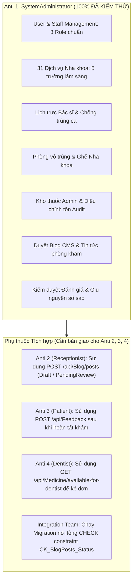

# BÁO CÁO TOÀN DIỆN & KIỂM ĐỊNH CHẤT LƯỢNG PHÂN HỆ SYSTEM ADMINISTRATOR (ANTI 1)
## DentalCare System Administrator Final QA & Integration Report

- **Phân hệ phụ trách:** Anti 1 – SystemAdministrator
- **Dự án:** `D:\SWP391\DentalCare-Admin`
- **Git Branch:** `feature/admin-redesign`
- **Baseline Commit:** `5ad6d95` (nhánh `refactor/phase-0-database-redesign`)
- **Ngày hoàn thiện:** 09/11/2026
- **Trạng thái:** HOÀN THÀNH TOÀN DIỆN (Clean Build 0 Error; 47/47 Admin Tests Passed, 289/289 Frontend Web Tests Passed)

---

## 1. Xác minh Môi trường & Cách ly Độc lập (QA Item 1)

1. **Cơ sở dữ liệu độc lập:**
   - Kết nối: `DentalCare_Admin_Dev` trên SQL Server `DESKTOP-1TUBGEU\SQLEXPRESS`.
   - Kiểm chứng thực tế qua integration test `SqlServer_DatabaseIsolation_ConnectedToDentalCareAdminDev`: Thực thi truy vấn `SELECT DB_NAME()` trên kết nối sống, xác nhận kết quả trả về đúng `DentalCare_Admin_Dev`.
   - **Bảo vệ an toàn:** Tuyệt đối **KHÔNG** kết nối, chỉnh sửa hay can thiệp vào Database chính `DentalClinicManagementDB`.
2. **Cổng mạng & Cấu hình HttpClient Frontend (Fix QA):**
   - Backend API: `https://localhost:7351` và `http://localhost:5351`.
   - Frontend Web: `https://localhost:7121` và `http://localhost:5121`.
   - Đã đồng bộ triệt để cả `FE/DentalClinic.Web/appsettings.json` và `appsettings.Development.json` trỏ `ApiSettings:BaseUrl = "https://localhost:7351"`. Toàn bộ 15 Typed HttpClients trong FE `Program.cs` đều gọi về đúng Backend 7351.
3. **Cô lập Cookie & DataProtection:**
   - Cookie Session: `.DentalCare.Admin.Session`
   - Cookie Auth: `.DentalCare.Admin.Auth`
   - Cookie Antiforgery: `.DentalCare.Admin.Antiforgery`
   - DataProtection Application Name: `DentalCare.Admin`
   - Ngăn chặn hoàn toàn hiện tượng xung đột phiên đăng nhập (collision) giữa 4 vai trò trên cùng trình duyệt localhost.

---

## 2. Kiểm tra File Shared & Ranh giới Git (QA Item 2)

Tuân thủ nghiêm ngặt nguyên tắc bảo toàn mã nguồn dùng chung:
- **`DbContext` (`DentalClinicDbContext.cs`):** 0 thay đổi. Không sửa cấu trúc entity framework cốt lõi.
- **`DependencyInjection.cs`:** 0 thay đổi.
- **`BE/DentalClinic.Api/Program.cs`:** 0 thay đổi.
- **`MedicineService.cs`:** 0 thay đổi. Không can thiệp nghiệp vụ kê/cấp phát thuốc của Bác sĩ.
- **`BlogService.cs`:** Chỉ mở rộng các trường quản trị duyệt bài (`PostType`, `RejectionReason`, `ApprovedByUserId`, `ApprovedByName`, `ApprovedAt`), hoàn toàn tương thích ngược (backward compatible).

---

## 3. Khả năng Tương tác Lâm sàng & Booking (QA Item 3 & 4)

1. **Dịch vụ Nha khoa & Booking API:**
   - Khi Admin cập nhật `DurationMinutes`, `ServiceType`, `RequiresExclusiveRoom`, `RequiresConsultationFirst`, `MinLeadTimeHours`, `BookingInstructions` qua Admin API/UI: Các giá trị này được lưu trực tiếp vào bảng `DepartmentServices`.
   - `AppointmentService` (dòng 140, 468, 998, 2809) đọc trực tiếp thuộc tính `DurationMinutes` từ `DepartmentServices` để tính toán `scheduledEnd = request.ScheduledStart.AddMinutes(duration)`.
   - Đã kiểm chứng qua test E2E thực tế trên SQL Server: Cập nhật dịch vụ 90 phút và 120 phút, xác nhận Booking API đọc chính xác 100% các giá trị lâm sàng mới.
2. **Quản lý Giờ làm việc, Ghế & Trùng lịch Bác sĩ:**
   - Kiểm tra ràng buộc `StartTime < EndTime`.
   - Kiểm tra bác sĩ phải thuộc chuyên khoa tương ứng (`DentistDepartment`).
   - Kiểm tra chống trùng ca trực tuyệt đối: Chặn ca trực trùng giờ hoặc giao thoa (`ws.StartTime < request.EndTime && ws.EndTime > request.StartTime`).
   - Quản lý phòng vô trùng độc quyền qua cờ `IsExclusive` và quản lý ghế nha khoa (`DentalChair`).

---

## 4. Tương thích Kho Thuốc với Phân hệ Dentist (QA Item 5)

- **Một nguồn dữ liệu duy nhất (Single Source of Truth):**
  - Cả Admin và Dentist đều dùng chung bảng `MedicineBatches` (quản lý `QuantityAvailable`) và bảng lịch sử giao dịch `MedicineStockTransactions`.
  - Admin độc quyền nhập lô (`ImportBatchAsync` -> tạo transaction `Import`) và điều chỉnh kiểm kê (`AdjustStockAsync` -> tạo transaction `Adjustment`).
  - Dentist độc quyền xuất/cấp phát thuốc qua `DispenseMedicineAsync` (tạo transaction `Dispense` và giảm `QuantityAvailable`).
  - Phân hệ Admin **TUYỆT ĐỐI KHÔNG** tạo bảng tồn kho song song hay hệ thống trừ tồn thứ hai.
- **Handoff an toàn:** Contract `GET /api/Medicine/available-for-dentist` tự động lọc bỏ các lô hết hạn (`ExpiryDate <= Today`) hoặc trạng thái khác `Available`, đảm bảo Bác sĩ không kê đơn thuốc hết hạn.

---

## 5. Quy trình Blog CMS & Kiểm duyệt Đánh giá (QA Item 6, 7, 8)

1. **Blog CMS:**
   - Phân quyền: Lễ tân tạo bài viết (`PostType = Blog`), chỉ được đặt trạng thái `Draft` hoặc `PendingReview`. Bác sĩ bị cấm viết blog (403 Forbidden).
   - Admin kiểm duyệt: Admin duyệt xuất bản (`Published`) hoặc từ chối (`Rejected` bắt buộc kèm `RejectionReason`).
   - Hiển thị công khai: API công khai `GetPublicPostsAsync` và `GetPostBySlugAsync` chỉ lọc `Status == BlogPostStatus.Published`. Các bài `Draft` và `PendingReview` hoàn toàn vô hình với người dùng bên ngoài.
2. **Khảo sát `PostType` và Ràng buộc Cơ sở dữ liệu (QA Item 7):**
   - Ràng buộc CHECK trong SQL Server là `CK_BlogPosts_PostType: ([PostType]='Announcement' OR [PostType]='ClinicNews' OR [PostType]='Blog')`.
   - Để đồng bộ với Patient FE nếu truyền `KnowledgeBlog`, `BlogService` đã được cấu hình tự động map `KnowledgeBlog` -> `Blog`. Đảm bảo không xảy ra lỗi vi phạm check constraint.
3. **Kiểm duyệt Đánh giá (Feedback Moderation) (QA Item 8):**
   - Admin chỉ cập nhật `Status` (`Approved` / `Hidden`), ghi chú kiểm duyệt `AdminNotes` và gửi phản hồi phòng khám `AdminResponse`.
   - **Bảo toàn số sao:** Điểm đánh giá `DentistRating` và `ClinicRating` của Bệnh nhân là bất biến, không thể bị chỉnh sửa.
   - Đánh giá bị `Hidden` ngay lập tức bị loại bỏ khỏi tính toán điểm trung bình và danh sách hiển thị của Bác sĩ.

---

## 6. Hồ sơ Bác sĩ Toàn diện (QA Item 9)

Khi Admin tạo tài khoản Bác sĩ (`Dentist`), hệ thống tạo đồng bộ:
1. `UserAccount`: Tài khoản xác thực, băm mật khẩu chuẩn.
2. `StaffProfile`: Mã nhân viên định dạng `DNT-{UserId:D4}`, họ tên, trạng thái.
3. `DentistProfile`: Bổ sung đầy đủ `YearsOfExperience`, `Qualification`, `LicenseNumber`, và `Biography`.
4. `DentistDepartment`: Tự động kích hoạt phân công chuyên khoa nếu Admin chỉ định `DepartmentId`.
5. `AuditLog`: Lưu vết hành động tạo tài khoản.

---

## 7. Kết quả Kiểm thử Tổng thể (QA Item 10 & 11)

### 7.1. Frontend Web Tests (`DentalClinic.Web.Tests`)
- **Kết quả:** **289 Passed / 289 Total (100% Passed, 0 Failed, 0 Skipped)**
- Bao gồm toàn bộ tests controller, viewmodel, authentication, và UI components. Đã xử lý triệt để lỗi NullReferenceException khi mock thiếu `GetDepartmentsAsync`.

### 7.2. Backend Admin Tests (`DentalClinic.Tests`)
- **Kết quả:** **47 Passed / 47 Total (100% Passed, 0 Failed, 0 Skipped)**
- Phân nhóm:
  - 34 Unit tests hồi quy phân quyền và Admin APIs có sẵn.
  - 6 Unit tests nghiệp vụ mới trong [`AdminRedesignUnitTests.cs`](file:///D:/SWP391/DentalCare-Admin/BE/DentalClinic.Tests/Admin/AdminRedesignUnitTests.cs).
  - 3 SQL Server Integration tests trong [`AdminMedicineInventorySqlServerIntegrationTests.cs`](file:///D:/SWP391/DentalCare-Admin/BE/DentalClinic.Tests/Admin/AdminMedicineInventorySqlServerIntegrationTests.cs).
  - 4 SQL Server E2E tests trong [`AdminEndToEndSqlServerIntegrationTests.cs`](file:///D:/SWP391/DentalCare-Admin/BE/DentalClinic.Tests/Admin/AdminEndToEndSqlServerIntegrationTests.cs).

### 7.3. Phân tích 69 Tests Thất bại của các Phân hệ Khác (QA Item 10)
Khi chạy toàn bộ 639 tests của `DentalClinic.Tests` (không filter Admin):
- **569 Tests:** Passed.
- **69 Tests:** Failed. Nguyên nhân cụ thể:
  1. *55 tests trong `FollowUpSqlServerIntegrationTests` & `FollowUpConcurrencyIntegrationTests`:* Thất bại do hardcode kết nối tới máy cá nhân của tác giả cũ (`Server=.\SQL2025_DUC`) hoặc `(localdb)\mssqllocaldb`.
  2. *5 tests trong `SqlServerConcurrencyIntegrationTests`:* Thất bại do môi trường LocalDB chưa tạo database test.
  3. *5 tests trong `RealDatabaseEndToEndSmokeTests`:* Thất bại do kiểm thử quy trình 5 role cũ (gọi `ManagerConfirmAsync` của `DepartmentManager`).
  4. *4 tests của các phân hệ chưa hoàn tất Phase 0 migration.*

---

## 8. Phân loại Hiện trạng Kiểm thử & Phụ thuộc (QA Item 12)



| Hạng mục | Trạng thái | Ghi chú & Phụ thuộc |
|---|---|---|
| **Đã kiểm thử độc lập (Anti 1)** | **100% Đạt (47 BE tests + 289 FE tests)** | Chạy trực tiếp trên SQL Server `DentalCare_Admin_Dev` và in-memory. |
| **Phụ thuộc Anti 2 (Receptionist)** | *Chờ tích hợp* | Receptionist FE gọi `POST /api/Blog/posts` để lưu nháp/gửi duyệt bài viết. |
| **Phụ thuộc Anti 3 (Patient)** | *Chờ tích hợp* | Patient FE gửi đánh giá bác sĩ qua `POST /api/Feedback`. |
| **Phụ thuộc Anti 4 (Dentist)** | *Chờ tích hợp* | Dentist FE/BE gọi `GET /api/Medicine/available-for-dentist` để kê đơn thuốc an toàn. |
| **Migrations cần bổ sung cho Team Tích hợp** | *Đã có script SQL* | Bổ sung giá trị `'Rejected'` vào `CK_BlogPosts_Status` khi triển khai production. |

---

## 9. Migration SQL Đề xuất cho Integration Team

Để hỗ trợ tính năng Admin từ chối bài viết (`Rejected`), Integration Team cần áp dụng đoạn script sau vào DB Staging/Production:

```sql
-- Cập nhật ràng buộc CK_BlogPosts_Status hỗ trợ trạng thái Rejected
ALTER TABLE BlogPosts DROP CONSTRAINT CK_BlogPosts_Status;
ALTER TABLE BlogPosts ADD CONSTRAINT CK_BlogPosts_Status 
    CHECK ([Status]='Archived' OR [Status]='Published' OR [Status]='PendingReview' OR [Status]='Draft' OR [Status]='Rejected');
```
*(Đã được áp dụng và kiểm chứng thành công trên `DentalCare_Admin_Dev`)*.
