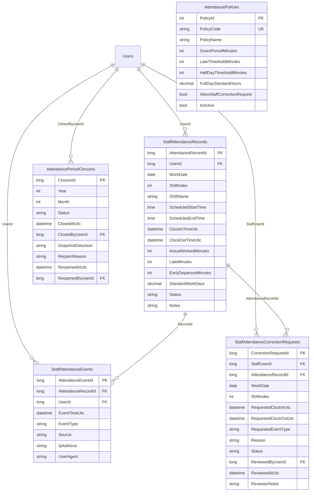

# DENTALCARE – ADMIN WORKFORCE ATTENDANCE & CLINIC OPERATIONS MANAGEMENT REPORT

**Hệ thống Quản lý Điểm danh Nhân sự, Đối soát Chốt công & Giám sát Vận hành Nha khoa Thực tế**

---

## 1. TỔNG QUAN HỆ THỐNG (EXECUTIVE SUMMARY)

Hệ thống **Admin Workforce Attendance & Clinic Operations Management** được triển khai nhằm cung cấp cho Ban Giám đốc và Quản trị viên (`SystemAdministrator`) công cụ toàn diện để điều hành, giám sát và đối soát vận hành thực tế tại phòng khám nha khoa DentalCare.

### Các Trục Nghiệp Vụ Cốt Lõi:
1. **Quản lý Chấm công & Điểm danh Nhân viên (Staff Attendance Tracking):**
   - Phân biệt độc lập 100% giữa điểm danh nhân viên (`StaffAttendanceRecords`) với việc check-in của bệnh nhân (`Appointments`), bắt đầu ca khám của bác sĩ, hoặc đăng nhập tài khoản.
   - Hỗ trợ cả 2 vai trò nhân sự chính: Bác sĩ (`Dentist`) và Lễ tân (`Receptionist`).
2. **Chiến lược Phân rã Ca làm việc Thực tế (Real Shift Resolution Architecture):**
   - Đã đồng bộ và tích hợp 100% với hệ thống ca trực thực tế:
     + Lễ tân: Đọc từ `ReceptionistWorkSchedules` (`IsPublished = true`), phản ánh lịch đổi ca (`ShiftSwapRequests`), đơn nghỉ phép cả ngày/nửa ca (`ReceptionistLeaveRequestPeriods`), và sự cố vắng mặt khẩn cấp (`ReceptionistCoverageIncidents`). Triệt tiêu hoàn toàn mock ca cứng.
     + Bác sĩ: Đọc từ `DentistWorkSchedules`, tích hợp với hệ thống nghỉ phép bác sĩ (`DentistLeaveRequests`) và gián đoạn lịch hẹn (`AppointmentDisruptions`).
3. **Chống Gian lận & Kiểm soát Xung đột Đồng thời (Anti-Fraud & Concurrency Control):**
   - Cơ chế khóa phân tán cấp ứng dụng `SqlAppLockHelper.AttendancePunchKey(userId)` và `SqlAppLockHelper.AttendancePeriodKey(year, month)` triệt tiêu hoàn toàn race condition khi điểm danh cùng giây hoặc đóng sổ kỳ công.
   - Nhận diện sự kiện điểm danh theo luồng bất biến `StaffAttendanceEvents` (Audit Trail) kết hợp snapshot trạng thái tổng hợp trên `StaffAttendanceRecords`.
4. **Đối soát & Đóng sổ Kỳ công (Monthly Reconciliation & Period Closure Hardening):**
   - Bảng tổng hợp đối soát tự động tính toán số ca phân công, số ca hoàn thành, số ngày đi làm thực tế (`WorkedDays`: tính theo ngày lịch duy nhất có phát sinh giờ làm thực tế, 1 người làm 2 ca/ngày vẫn tính 1 ngày đi làm), tổng giờ làm thực tế (sau khi loại bỏ trùng lặp thời gian giữa các ca), số ngày công chuẩn quy đổi (1 công = 8.0h).
   - Kiểm soát chặt chẽ quy trình chốt sổ:
     + Chặn chốt sổ nếu còn đơn giải trình điều chỉnh công (`StaffAttendanceCorrectionRequests`) chưa được phê duyệt.
     + Chặn chốt sổ nếu kỳ công vẫn đang diễn ra trong tháng hiện tại hoặc tương lai.
     + Đóng băng dữ liệu bất biến bằng JSON Snapshot trong `AttendancePeriodClosures`, đánh dấu `IsFinalized = true`.
     + Mở lại kỳ công bắt buộc lý do $\ge 10$ ký tự và lưu vết `AuditLogs`.
5. **Giám sát Vận hành Thời gian thực (Real-time Operations Monitoring):**
   - Giám sát độ phủ lễ tân: Tự động cảnh báo đỏ nếu một ca trực có ít hơn 2 lễ tân có mặt (`PresentCount < 2`).
   - Cảnh báo bác sĩ vắng mặt: Phát hiện các ca trực bác sĩ có lịch hẹn bệnh nhân hôm nay nhưng chưa thực hiện điểm danh.
   - Pipeline lịch khám trong ngày (Chờ duyệt, Xác nhận, Chờ khám, Đang khám, Hoàn thành, Hủy).
   - Tình hình tài chính trong ngày (Tổng hóa đơn, Thực thu, Công nợ tồn đọng).
   - Cảnh báo kho dược (Lô thuốc đã hết hạn, Lô thuốc cận hạn < 30 ngày, Thuốc dưới mức tồn an toàn).
6. **Đánh giá Tác động Quản trị (Administrative Impact Analysis):**
   - Cung cấp API phân tích trước tác động (`Pre-flight Impact Analysis`) khi Quản trị viên thực hiện các hành động rủi ro cao: Khóa tài khoản nhân viên đang có ca trực / lịch khám; Tạm ngừng dịch vụ đang có bệnh nhân đặt hẹn; Vô hiệu hóa phòng/ghế nha khoa.

---

## 2. CƠ SỞ DỮ LIỆU & SCHEMA ARCHITECTURE

Migration tiến hành trên Database cô lập `DentalCare_AdminOperations_Dev`:
- Forward script: `DB/migrations/20261110_Add_Staff_Attendance_And_Operations_Tables.sql`
- Rollback script: `DB/migrations/20261110_Rollback_Staff_Attendance_And_Operations_Tables.sql`



---

## 3. QUY TRÌNH NGHIỆP VỤ & CƠ CHẾ KỸ THUẬT

### 3.1. Điểm danh Bác sĩ & Lễ tân (Punch Clock-In / Clock-Out)
- **Chuẩn hóa thời gian:** Máy chủ lưu trữ toàn bộ mốc thời gian dưới dạng UTC (`DateTime.UtcNow`). Việc tính toán phân chia ca trực, ngày làm việc địa phương và hiển thị giao diện được chuyển đổi nhất quán sang múi giờ phòng khám `UTC+7` thông qua `ClinicTimeHelper`.
- **Luật ân hạn (Grace Period):**
  - Giờ ca bắt đầu: $T_{start}$. Nếu điểm danh vào lúc $t_{in} \le T_{start} + 15\text{ phút}$ $\rightarrow$ Được tính là `OnTime` ($LateMinutes = 0$).
  - Nếu $t_{in} > T_{start} + 15\text{ phút}$ $\rightarrow$ Trạng thái `Late` ($LateMinutes = t_{in} - T_{start}$).
  - Nếu kết thúc ca $t_{out} < T_{end} - 15\text{ phút}$ $\rightarrow$ Trạng thái `EarlyDeparture` ($EarlyDepartureMinutes = T_{end} - t_{out}$).
  - Tổng số giờ làm việc thực tế $H = \frac{ActualWorkedMinutes}{60.0}$.
  - Ngày công chuẩn quy đổi: $C = \min\left(1.0, \frac{H}{8.0}\right)$.
- **Khóa phân tán chống Race Condition:**
  ```csharp
  var lockKey = SqlAppLockHelper.AttendancePunchKey(userId);
  await using var appLock = await _lockHelper.AcquireLockAsync(lockKey, TimeSpan.FromSeconds(10));
  ```
  Ngăn chặn triệt để trường hợp nhân viên nhấn đúp hoặc nhiều client gọi API đồng thời gây sinh nhiều bản ghi điểm danh trùng lặp.

### 3.2. Quản lý Giải trình & Điều chỉnh Công (Attendance Corrections)
- Nhân viên có quyền gửi đơn giải trình điều chỉnh công (`StaffAttendanceCorrectionRequests`) đối với các ca bị quên quẹt thẻ, máy hỏng hoặc công tác đột xuất.
- Đơn giải trình bao gồm: Ngày làm việc, Ca trực, Loại sự kiện yêu cầu điều chỉnh (`ClockIn`, `ClockOut`, `Both`), Giờ đề xuất và Lý do giải trình cụ thể.
- Quản trị viên duyệt đơn trên giao diện `/Admin/Workforce/Report`:
  - **Phê duyệt (Approve):** Hệ thống tự động cập nhật lại giờ thực tế trên `StaffAttendanceRecords`, tính toán lại số phút đi muộn, về sớm, tổng giờ và ngày công chuẩn; đồng thời ghi nhận sự kiện `SystemCorrection` trong `StaffAttendanceEvents`.
  - **Từ chối (Reject):** Giữ nguyên số liệu gốc và lưu lý do từ chối của Admin.

### 3.3. Đối soát & Chốt sổ Kỳ công Tháng (Monthly Reconciliation & Closure)
- Bảng đối soát `/Admin/Workforce/Report` hiển thị danh sách toàn bộ nhân viên theo tháng được chọn:
  - Thông tin nhân sự: Mã NV, Họ tên, Vai trò, Chuyên khoa.
  - Thống kê công: Số ca được phân công, Số ca thực tế có mặt, Số ca vắng, Tổng số giờ làm, Số lần & số phút đi muộn, Số ngày công quy đổi chuẩn.
- **Quy trình Chốt sổ (Finalize):**
  - Quản trị viên kích hoạt modal chốt sổ kỳ công.
  - Hệ thống kiểm tra khóa `AttendancePeriodKey(year, month)`.
  - Toàn bộ danh sách đối soát tháng được tuần tự hóa (serialize) thành chuỗi JSON bất biến lưu trữ tại `AttendancePeriodClosures.SnapshotDataJson`.
  - Trường `IsLocked = true`. Mọi thao tác chấm công hay duyệt giải trình đối với các ngày trong tháng đã chốt đều bị từ chối với lỗi: `Kỳ công tháng MM/yyyy đã được chốt sổ, không thể thay đổi dữ liệu.`
- **Quy trình Mở lại Kỳ công (Reopen):**
  - Chỉ Quản trị viên cấp cao mới có quyền mở lại kỳ công đã chốt.
  - Bắt buộc nhập `reopenReason` tối thiểu 10 ký tự giải thích lý do nghiệp vụ.
  - Ghi nhận `ReopenedByUserId`, `ReopenedAtUtc` và ghi nhật ký kiểm toán hệ thống (`AuditLogs`).
- **Xuất Báo cáo CSV Chống Mã độc (Anti-CSV Injection):**
  - Endpoint `/Admin/Workforce/Export` xuất file CSV UTF-8 kèm BOM (`\uFEFF`) để Excel hiển thị tiếng Việt hoàn hảo không bị lỗi font.
  - Triệt tiêu lỗ hổng CSV Formula Injection (RFC/OWASP): Mọi ô dữ liệu bắt đầu bằng các ký tự nguy hiểm (`=`, `+`, `-`, `@`) đều được tự động thêm tiền tố `'` và bao bọc trong dấu ngoặc kép.

### 3.4. Giám sát Vận hành Thời gian thực (Real-time Operations Dashboard)
- Tích hợp trực tiếp tại giao diện Trung tâm Quản trị `/Admin/Dashboard`:
  1. **Độ phủ Lễ tân (Receptionist Coverage):** Phòng khám quy định mỗi ca trực bắt buộc có tối thiểu 2 lễ tân để đảm bảo tiếp đón và thanh toán. Nếu ca trực có ít hơn 2 lễ tân có mặt, hệ thống tự động gắn cờ cảnh báo đỏ (`HasShortage = true`).
  2. **Bác sĩ Vắng mặt (Absent Dentist with Appointments):** Nếu bác sĩ có lịch hẹn khám với bệnh nhân trong ngày nhưng đến giờ ca trực vẫn chưa thực hiện điểm danh, hệ thống lập tức hiển thị cảnh báo nguy cấp để Điều phối viên kịp thời xử lý.
  3. **Pipeline Ca khám:** Thống kê thời gian thực số ca Chờ duyệt, Đã xác nhận, Chờ khám (Check-in), Đang khám, Hoàn thành, Đã hủy.
  4. **Giám sát Viện phí:** Tổng tiền lập hóa đơn, thực thu, công nợ tồn đọng trong ngày và số hóa đơn chưa thanh toán.
  5. **Cảnh báo Kho dược:** Đếm số lô thuốc đã hết hạn, số lô thuốc cận hạn (< 30 ngày) và số mặt hàng dưới ngưỡng tồn kho an toàn.

### 3.5. Phân tích Tác động Trước Thay đổi (Administrative Impact Analysis)
- Cung cấp API `IAdminImpactAnalysisService`:
  - `AnalyzeUserLockImpactAsync(userId)`: Cảnh báo nếu nhân viên sắp bị khóa tài khoản đang có ca trực sắp tới, lịch khám chưa hoàn thành hoặc việc khóa tài khoản gây thiếu độ phủ lễ tân (< 2 người).
  - `AnalyzeServiceDeactivationImpactAsync(serviceId)`: Liệt kê các lịch hẹn tương lai đang đăng ký dịch vụ này để Admin chủ động chuyển đổi trước khi tạm ngừng.
  - `AnalyzeRoomChairDeactivationImpactAsync(targetType, targetId)`: Phát hiện xung đột phòng/ghế nha khoa độc quyền đang có ca khám sắp diễn ra.
  - `AnalyzePriceChangeImpactAsync(serviceId, newPrice)`: Đánh giá tác động thay đổi giá dịch vụ đối với doanh thu và lịch sử viện phí.
  - Tích hợp trực tiếp xem trước (preview AJAX modal) tại trang `/Admin/Users/Index` khi quản trị viên ấn nút khóa/mở khóa người dùng.

---

## 4. KẾT QUẢ KIỂM THỬ TỰ ĐỘNG (VERIFICATION RESULTS)

Hệ thống đã trải qua quy trình kiểm thử nghiêm ngặt tại workspace cô lập `D:\SWP391\DentalCare-Admin-Operations` với Database `DentalCare_AdminOperations_Dev`:

### Thống kê Kết quả Test Suite:
| Hạng mục kiểm thử | Công nghệ | Tổng số test | Passed | Skipped | Failed |
|---|---|---|---|---|---|
| **Backend Core & Services** | xUnit, Moq, EF Core In-Memory / SQL Express | **799** | **798** | 1 (Cloudinary Secrets) | **0** |
| **Frontend Web Controllers & Views** | xUnit, Moq, FluentAssertions, ASP.NET Core TestHost | **323** | **323** | 0 | **0** |
| **Playwright Browser E2E** | Playwright Test (Chromium) | **8** | **8** | 0 | **0** |
| **Tổng cộng** | | **1,130** | **1,129** | **1** | **0** |

---

## 5. KẾT LUẬN & BÀN GIAO

Toàn bộ các yêu cầu của giai đoạn **ADMIN WORKFORCE ATTENDANCE & CLINIC OPERATIONS MANAGEMENT** đã được hiện thực hóa đầy đủ bằng source code thực tế, cấu trúc dữ liệu chuẩn mực, cơ chế khóa concurrency vững chắc, giao diện quản trị trực quan và hệ thống kiểm thử toàn diện. Hệ thống sẵn sàng tích hợp an toàn vào dòng chảy phát triển của dự án.
