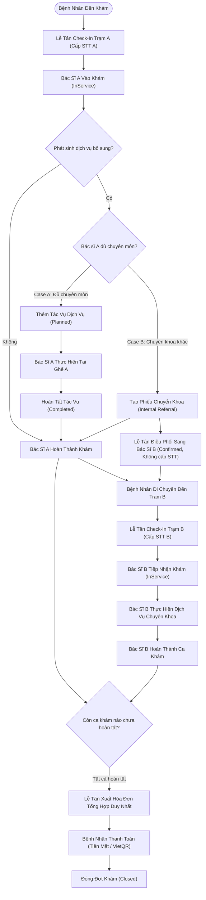

# DENTALCARE SWP391 – CARE EPISODE, ADDITIONAL SERVICES & INTERNAL HANDOFF BUSINESS FLOW

## 1. TỔNG QUAN KIẾN TRÚC & NGUYÊN TẮC CỐT LÕI

Hệ thống quản lý phòng khám nha khoa **DentalCare SWP391** vận hành theo nguyên tắc cấu trúc:

$$\text{ONE CARE EPISODE} \longrightarrow \text{ONE OR MULTIPLE APPOINTMENTS} \longrightarrow \text{MULTIPLE PERFORMED SERVICES} \longrightarrow \text{ONE CONSOLIDATED INVOICE}$$

### 1.1 Mục tiêu nghiệp vụ
Trong quá trình khám và điều trị, bệnh nhân thường phát sinh thêm các dịch vụ nha khoa:
- **Trường hợp A (Cùng Bác sĩ thực hiện):** Bác sĩ A đang khám tại ghế, phát hiện thêm vấn đề lâm sàng (ví dụ: cần cạo vôi răng, trám răng sâu nhẹ). Nếu Bác sĩ A đủ chuyên môn (thuộc khoa phụ trách dịch vụ), bác sĩ tự thực hiện thêm ngay tại ghế trong ca khám đó. **Không tạo thêm lịch hẹn B, không cấp thêm số thứ tự trùng lặp.**
- **Trường hợp B (Chuyển tiếp chuyên khoa / Bác sĩ khác):** Dịch vụ phát sinh vượt ngoài chuyên môn của Bác sĩ A (ví dụ: cần chỉnh nha chuyên sâu, nhổ răng khôn mọc lệch phức tạp). Bác sĩ A tạo phiếu chuyển tiếp nội bộ (**Internal Referral**). Lễ tân điều phối bệnh nhân sang Bác sĩ B thuộc chuyên khoa đích:
  - Tạo ca khám đích B ở trạng thái `Confirmed` (Chưa cấp số thứ tự - **Station B Queue Isolation Invariant**).
  - Bệnh nhân hoàn tất tại Trạm A $\rightarrow$ di chuyển sang Trạm B.
  - Lễ tân Trạm B thực hiện **Check-In Trạm B** $\rightarrow$ Hệ thống kiểm tra điều kiện tuần tự (**Sequential InService Invariant**) và cấp số thứ tự tăng dần duy nhất.
  - Bác sĩ B tiếp nhận ca khám (`InService`), hoàn tất dịch vụ (`Completed`).
- **Gộp Viện Phí Đợt Khám (Single Episode Invoice):** Tất cả dịch vụ thực tế của Bác sĩ A, Bác sĩ B, chẩn đoán hình ảnh và dược phẩm cấp tại ghế trong cùng đợt khám chưa thanh toán được tổng hợp thành **duy nhất một Hóa đơn (Invoice)**. Minh bạch rõ từng khoản phí và bác sĩ phụ trách. Hóa đơn đã thanh toán (`Paid`) được bảo vệ nghiêm ngặt, chống ghi đè hoặc làm sai lệch doanh thu.

---

## 2. QUY TRÌNH CHI TIẾT THEO TỪNG VAI TRÒ (4-ROLE RBAC)

Hệ thống tuân thủ nghiêm ngặt mô hình 4 vai trò: **Patient, Receptionist, Dentist, SystemAdministrator**.

---

## 3. CASE A: PHÁT SINH DỊCH VỤ CÙNG BÁC SĨ (SAME DENTIST)

### 3.1 Điều kiện tiên quyết & Ràng buộc thẩm quyền
1. Bác sĩ thực hiện phải đang có trạng thái hoạt động (`Status = 'Active'`) tại chuyên khoa cung cấp dịch vụ trong bảng `DentistDepartments`.
2. Nếu bác sĩ không thuộc chuyên khoa của dịch vụ, API từ chối với thông báo:
   > *"Bác sĩ không thuộc chuyên khoa cung cấp dịch vụ này. Vui lòng chuyển tiếp bệnh nhân sang bác sĩ chuyên khoa phù hợp (Internal Referral)."*

### 3.2 Vòng đời tác vụ dịch vụ (`EpisodeServiceTask`)
1. **Khởi tạo (`Planned`):** Tác vụ được ghi nhận kèm ảnh chụp đơn giá tại thời điểm chỉ định (`UnitPriceSnapshot = DepartmentService.Price`).
2. **Tiến hành (`InProgress`):** Bác sĩ bắt đầu thao tác tại ghế, hệ thống lưu vết thời điểm bắt đầu (`StartedAtUtc`).
3. **Hoàn tất (`Completed`):** Bác sĩ hoàn thành điều trị, ghi chép ghi chú lâm sàng hoặc liên kết bệnh án điện tử (`ClinicalRecordId`). Thời điểm hoàn tất được ghi nhận (`CompletedAtUtc`).
4. **Không tạo ca khám trùng lặp:** Tổng số ca khám của bệnh nhân trong cơ sở dữ liệu không thay đổi; số thứ tự hàng đợi giữ nguyên; không làm nhiễu loạn luồng gọi số tại quầy tiếp đón.

---

## 4. CASE B: CHUYỂN TIẾP CHUYÊN KHOA NỘI BỘ (CROSS-DENTIST REFERRAL & HANDOFF)

### 4.1 Bác Sĩ A tạo yêu cầu chuyển tiếp
- Bác sĩ A chọn chuyên khoa chuyển đến (`ToDepartmentId`), dịch vụ đề xuất (`RequestedServiceId`), bác sĩ mong muốn (nếu có) và nhập lý do lâm sàng.
- Hệ thống tạo bản ghi `DepartmentReferrals` liên kết chặt chẽ với `CareEpisodeId` và `SourceAppointmentId`.
- Trạng thái đợt khám chuyển sang `PendingAdditionalService`.

### 4.2 Lễ tân điều phối ca khám đích B
- Lễ tân tra cứu danh sách bác sĩ thuộc khoa tiếp nhận, kiểm tra:
  - Bác sĩ có lịch nghỉ phép đã duyệt (`DentistLeaveRequests`) trong khung giờ hay không.
  - Bác sĩ có ca khám khác trùng lặp (`Overlapping Appointments`) hay không.
  - Ghế nha khoa (`DentalChair`) có đang bận trong khung giờ hay không.
- Sau khi chọn thời gian và bác sĩ, Lễ tân xác nhận điều phối:
  - Tạo `Appointment B` với `Status = AppointmentStatus.Confirmed`.
  - **Bắt buộc:** `QueueNumber = NULL`. Không được cấp số thứ tự vào thời điểm này.
  - Tự động sinh `EpisodeServiceTask` ở trạng thái `Planned` gắn với Appointment B.
  - Cập nhật Referral sang `Accepted` và gắn `DestinationAppointmentId = Appointment B`.

### 4.3 Ràng buộc tuần tự tại ghế (**Sequential InService Invariant**)
- Một bệnh nhân không thể ở trạng thái `InService` (đang nằm trên ghế điều trị) đồng thời tại 2 phòng khám / 2 bác sĩ khác nhau.
- Khi Lễ tân bấm **Check-In Trạm B**:
  - Hệ thống kiểm tra toàn bộ các ca khám trong `CareEpisode`. Nếu có bất kỳ ca khám nào khác đang ở trạng thái `InService` (chưa hoàn thành), hệ thống chặn lại và báo lỗi:
    > *"Bệnh nhân hiện đang trong quá trình thực hiện dịch vụ tại trạm khám trước (InService). Vui lòng đợi bác sĩ hoàn tất trước khi tiến hành Check-in và gọi vào Trạm B."*
  - Khi ca khám tại Trạm A chuyển sang `Completed`, Lễ tân Check-In Trạm B thành công: Cấp số thứ tự hàng đợi duy nhất tăng dần cho Khoa B (`Q-ORT-XXX`), trạng thái chuyển sang `CheckedIn`. Bác sĩ B có thể bắt đầu khám.

---

## 5. TỔNG HỢP VIỆN PHÍ & HÓA ĐƠN ĐỘT KHÁM DUY NHẤT (SINGLE EPISODE INVOICE)

### 5.1 Quy tắc tổng hợp (Aggregation Engine)
Khi đợt khám kết thúc, dịch vụ thanh toán được tổng hợp tự động:
1. Tất cả `EpisodeServiceTasks` có `Status = 'Completed'` thuộc đợt khám.
2. Các chỉ định chụp phim X-quang (`DiagnosticOrders`) đã hoàn tất.
3. Dịch vụ gốc ban đầu của ca khám mở đầu.
4. Mỗi dòng hóa đơn (`InvoiceItem`) ghi rõ:
   - Tên dịch vụ và số lượng.
   - Đơn giá và thành tiền.
   - Bác sĩ trực tiếp thực hiện (`PerformingDentistUserId`, `PerformingDentistName`).
   - Mã ca khám tương ứng (`AppointmentCode`).

### 5.2 Cơ chế khóa và bảo vệ dòng tiền (**Paid Protection Invariant**)
- Hệ thống sử dụng SQL Application Lock: `Lock_CareEpisode_Invoice_{CareEpisodeId}` để đồng bộ hóa việc lập hóa đơn và tránh race condition.
- **Bảo vệ hóa đơn đã thanh toán:** Nếu đợt khám đã có hóa đơn ở trạng thái `Paid`, hệ thống nghiêm cấm mọi thao tác ghi đè, xóa hoặc sửa đổi nội dung hóa đơn đã thanh toán. Mọi phát sinh mới phải được xử lý qua hóa đơn phụ thu minh bạch để bảo toàn sổ sách kế toán.
- Khi hóa đơn tổng hợp được thanh toán đủ (`TotalAmount == PaidAmount`), trạng thái của `CareEpisode` chuyển sang `Closed` và chốt sổ đợt khám (`ClosedAtUtc = DateTime.UtcNow`).
