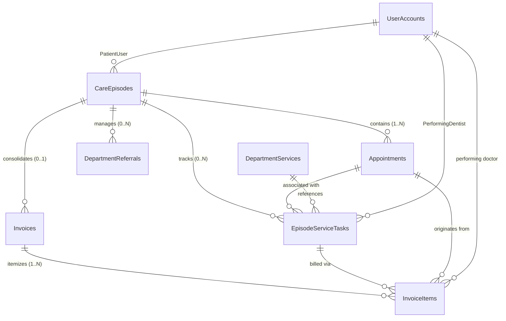

# DENTALCARE SWP391 – CARE EPISODE DATABASE & CONCURRENCY DESIGN

## 1. MÔ HÌNH DỮ LIỆU ĐỢT KHÁM & QUAN HỆ THỰC THỂ (ERD)

Mô hình dữ liệu triển khai giải quyết bài toán: **Một đợt khám $\rightarrow$ Nhiều ca khám $\rightarrow$ Nhiều tác vụ dịch vụ phát sinh $\rightarrow$ Một hóa đơn viện phí duy nhất**.



---

## 2. CHI TIẾT BẢNG VÀ CHỈ MỤC CƠ SỞ DỮ LIỆU

### 2.1 Bảng `CareEpisodes` (Đợt Khám Tổng Thể)
Quản lý vòng đời của một đợt khám từ khi bắt đầu đến khi thanh toán viện phí và đóng hồ sơ.

| Cột | Kiểu Dữ Liệu | Ràng Buộc | Ý Nghĩa Nghiệp Vụ |
| :--- | :--- | :--- | :--- |
| `CareEpisodeId` | `BIGINT` | `PK`, `IDENTITY(1,1)` | Khóa chính duy nhất của đợt khám. |
| `EpisodeCode` | `VARCHAR(30)` | `NOT NULL`, `UNIQUE` | Mã định danh dạng `EP-yyyyMMdd-XXXX`. |
| `PatientUserId` | `BIGINT` | `NOT NULL`, `FK` | Mã người dùng của bệnh nhân (`UserAccounts`). |
| `RootAppointmentId` | `BIGINT` | `NOT NULL`, `FK` | Ca khám gốc khởi tạo đợt khám (`Appointments`). |
| `Status` | `VARCHAR(30)` | `NOT NULL`, `DEFAULT('Open')` | Trạng thái: `Open`, `PendingAdditionalService`, `ReadyForBilling`, `Closed`, `Cancelled`. |
| `OpenedAtUtc` | `DATETIME2` | `NOT NULL`, `DEFAULT(SYSUTCDATETIME())` | Thời điểm bắt đầu đợt khám. |
| `ClosedAtUtc` | `DATETIME2` | `NULL` | Thời điểm kết thúc và đóng đợt khám (khi thanh toán). |
| `CreatedByUserId` | `BIGINT` | `NULL`, `FK` | Người khởi tạo đợt khám. |
| `CreatedAtUtc` | `DATETIME2` | `NOT NULL`, `DEFAULT(SYSUTCDATETIME())` | Thời điểm tạo bản ghi. |
| `UpdatedAtUtc` | `DATETIME2` | `NULL` | Thời điểm cập nhật cuối cùng. |
| `Notes` | `NVARCHAR(500)` | `NULL` | Ghi chú tổng quan về đợt khám. |

**Chỉ mục (Indexes):**
- `PK_CareEpisodes` (Clustered): `CareEpisodeId`
- `UQ_CareEpisodes_EpisodeCode` (Unique Non-Clustered): `EpisodeCode`
- `IX_CareEpisodes_Patient_Status` (Non-Clustered): `(PatientUserId, Status)`
- `IX_CareEpisodes_RootAppointment` (Non-Clustered): `RootAppointmentId`

---

### 2.2 Bảng `EpisodeServiceTasks` (Tác Vụ Dịch Vụ Phát Sinh)
Ghi nhận từng dịch vụ cụ thể được chỉ định và thực hiện trong quá trình khám tại ghế.

| Cột | Kiểu Dữ Liệu | Ràng Buộc | Ý Nghĩa Nghiệp Vụ |
| :--- | :--- | :--- | :--- |
| `ServiceTaskId` | `BIGINT` | `PK`, `IDENTITY(1,1)` | Khóa chính của tác vụ dịch vụ. |
| `TaskCode` | `VARCHAR(30)` | `NOT NULL`, `UNIQUE` | Mã định danh dạng `TSK-yyyyMMdd-XXXX`. |
| `CareEpisodeId` | `BIGINT` | `NOT NULL`, `FK` | Liên kết đến đợt khám (`CareEpisodes`). |
| `AppointmentId` | `BIGINT` | `NOT NULL`, `FK` | Liên kết đến ca khám cụ thể (`Appointments`). |
| `DepartmentServiceId`| `BIGINT` | `NOT NULL`, `FK` | Mã dịch vụ danh mục (`DepartmentServices`). |
| `PerformingDentistUserId`| `BIGINT`| `NOT NULL`, `FK` | Bác sĩ trực tiếp thực hiện (`UserAccounts`). |
| `Status` | `VARCHAR(30)` | `NOT NULL`, `DEFAULT('Planned')` | Trạng thái: `Planned`, `InProgress`, `Completed`, `Cancelled`. |
| `Quantity` | `INT` | `NOT NULL`, `DEFAULT(1)` | Số lượng thực hiện (răng, vị trí, lần). |
| `UnitPriceSnapshot` | `DECIMAL(18,2)` | `NOT NULL` | Ảnh chụp đơn giá niêm yết tại thời điểm chỉ định. |
| `EstimatedDurationMinutes`| `INT` | `NOT NULL`, `DEFAULT(30)` | Thời gian ước tính thực hiện. |
| `PlannedAtUtc` | `DATETIME2` | `NOT NULL` | Thời điểm lên kế hoạch tác vụ. |
| `StartedAtUtc` | `DATETIME2` | `NULL` | Thời điểm bác sĩ bắt đầu thực hiện tại ghế. |
| `CompletedAtUtc` | `DATETIME2` | `NULL` | Thời điểm bác sĩ hoàn thành thao tác. |
| `CancelledAtUtc` | `DATETIME2` | `NULL` | Thời điểm hủy (nếu có). |
| `CancellationReason` | `NVARCHAR(250)`| `NULL` | Lý do hủy tác vụ. |
| `ClinicalRecordId` | `BIGINT` | `NULL` | Liên kết bản ghi bệnh án chi tiết. |
| `Notes` | `NVARCHAR(500)` | `NULL` | Ghi chú lâm sàng của bác sĩ thực hiện. |

**Chỉ mục (Indexes):**
- `PK_EpisodeServiceTasks` (Clustered): `ServiceTaskId`
- `UQ_EpisodeServiceTasks_TaskCode` (Unique Non-Clustered): `TaskCode`
- `IX_EpisodeServiceTasks_Episode_Status` (Non-Clustered): `(CareEpisodeId, Status)`
- `IX_EpisodeServiceTasks_AppointmentId` (Non-Clustered): `AppointmentId`

---

### 2.3 Mở Rộng Bảng Hiện Hữu

#### Bảng `Appointments`
- Thêm cột: `CareEpisodeId BIGINT NULL`
- Khóa ngoại: `FK_Appointments_CareEpisodes` $\rightarrow$ `CareEpisodes(CareEpisodeId)`
- Chỉ mục: `IX_Appointments_CareEpisodeId` trên `CareEpisodeId`

#### Bảng `Invoices`
- Thêm cột: `CareEpisodeId BIGINT NULL`
- Khóa ngoại: `FK_Invoices_CareEpisodes` $\rightarrow$ `CareEpisodes(CareEpisodeId)`
- Chỉ mục: `IX_Invoices_CareEpisodeId` trên `CareEpisodeId`

#### Bảng `InvoiceItems` (Truy xuất nguồn gốc minh bạch)
- Thêm cột:
  - `AppointmentId BIGINT NULL` $\rightarrow$ `FK_InvoiceItems_Appointments`
  - `PerformingDentistUserId BIGINT NULL` $\rightarrow$ `FK_InvoiceItems_DentistUser`
  - `ServiceTaskId BIGINT NULL` $\rightarrow$ `FK_InvoiceItems_EpisodeServiceTasks`
  - `SourceType VARCHAR(50) NULL` (ví dụ: `ServiceTask`, `DiagnosticOrder`, `AppointmentService`, `Tax`)
  - `SourceId BIGINT NULL`
- Chỉ mục duy nhất: `UQ_InvoiceItems_Invoice_Source` trên `(InvoiceId, SourceType, SourceId)` khi cả hai trường khác NULL để chống trùng lặp dòng viện phí.

#### Bảng `DepartmentReferrals`
- Thêm cột:
  - `CareEpisodeId BIGINT NULL` $\rightarrow$ `FK_DepartmentReferrals_CareEpisodes`
  - `RequestedServiceId BIGINT NULL` $\rightarrow$ `FK_DepartmentReferrals_DepartmentServices`
  - `ClinicalInstructions NVARCHAR(500) NULL`
- Nới lỏng: Cho phép `TreatmentSessionId BIGINT NULL` để hỗ trợ chuyển khoa trực tiếp từ ca khám mà chưa cần tạo đợt điều trị dài hạn.

---

## 3. THIẾT KẾ ĐỒNG THỜI & APPLICATION LOCKING (`SqlAppLockHelper`)

Để loại bỏ hoàn toàn race condition, deadlock và bảo vệ tính toàn vẹn dữ liệu:

1. **Khóa Đợt Khám (`CareEpisodeKey`):**
   ```csharp
   public static string CareEpisodeKey(long careEpisodeId) => $"Lock_CareEpisode_{careEpisodeId}";
   ```
2. **Khóa Lập Hóa Đơn Đợt Khám (`CareEpisodeInvoiceKey`):**
   ```csharp
   public static string CareEpisodeInvoiceKey(long careEpisodeId) => $"Lock_CareEpisode_Invoice_{careEpisodeId}";
   ```
   Bảo đảm không có 2 nhân viên lễ tân xuất hóa đơn song song cho cùng 1 đợt khám.
3. **Khóa Điều Phối Chuyển Khoa (`CareEpisodeReferralKey`):**
   ```csharp
   public static string CareEpisodeReferralKey(long referralId) => $"Lock_CareEpisode_Referral_{referralId}";
   ```
   Bảo đảm ca chuyển tiếp chỉ được điều phối bởi 1 lễ tân tại một thời điểm, tránh sinh ra 2 lịch hẹn đích B song song.
4. **Nguyên tắc sắp xếp khóa (Deterministic Key Ordering):**
   Mọi khóa được sắp xếp theo thứ tự `Ordinal` trước khi gọi `sp_getapplock` để triệt tiêu mọi khả năng gây deadlock đa tài nguyên.
