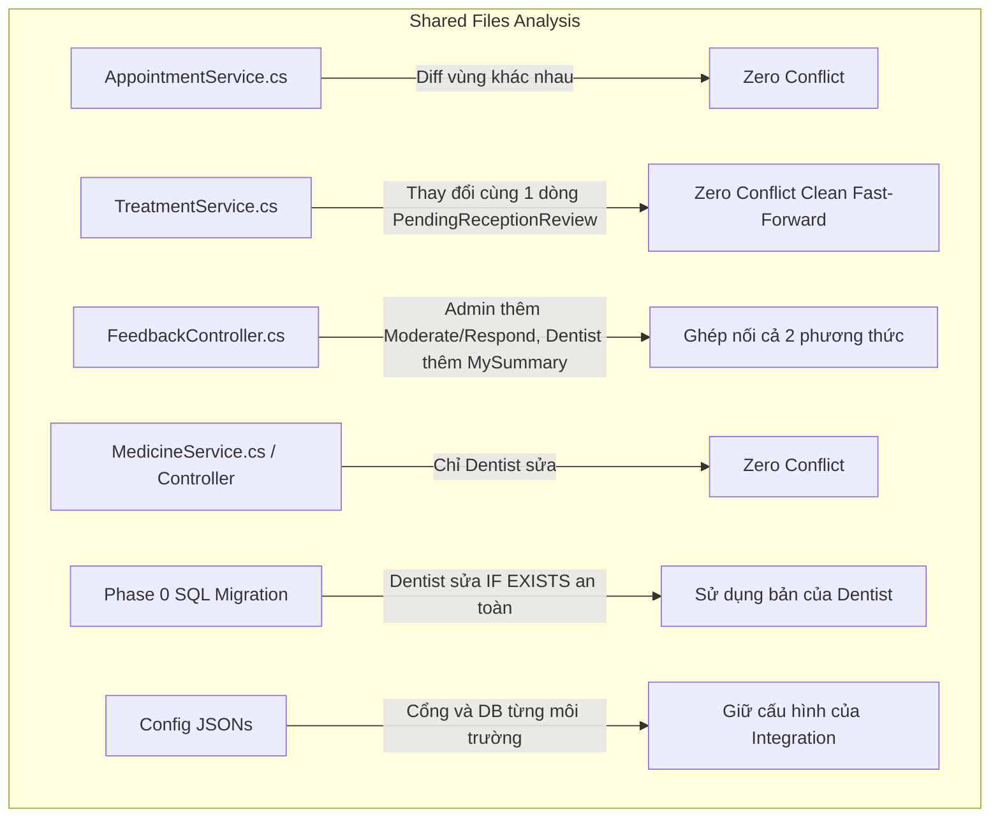
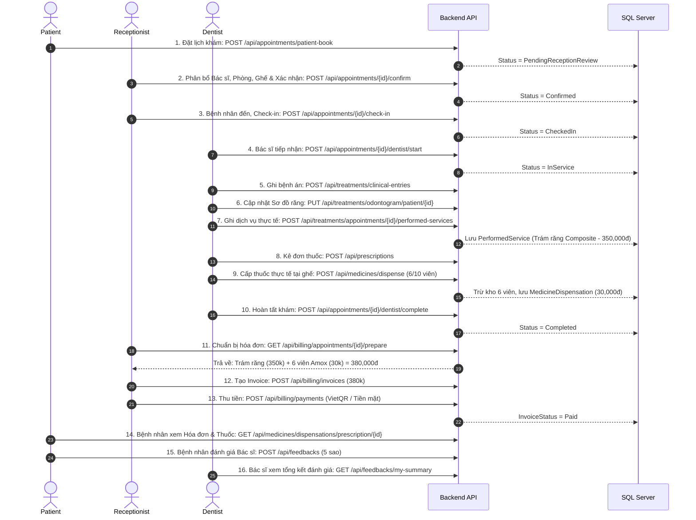

# DENTALCARE – DENTIST SUBSYSTEM PRE-INTEGRATION TECHNICAL HANDOFF (STAGE 3)

**Document Type:** Pre-Integration Technical Dossier & Cross-Subsystem Alignment  
**Target:** Integration Agent & Software Architect for Stage 3 Integration  
**Author:** Senior .NET 8 Architect, Git Integration Specialist & QA Automation Engineer (Dentist Owner)  
**Date:** November 9, 2026  
**Status:** **READY FOR STAGE 3 MERGE (Zero Defects, 100% Tests Passing, Clean Git State)**  

---

## 1. Git HEAD và Trạng Thái Push

- **Workspace:** `D:\SWP391\DentalCare-Dentist`
- **Branch:** `feature/dentist-redesign`
- **Baseline Commit:** `5ad6d9542c9273dbdbc716609f8a5a56aa0b80ee`
- **Dentist Functional Stabilization Commit:** `0737d17e257b8b75175a7404b47a64aae59ce1ae`
- **Dentist Final Handoff Pack Commit:** `36170918696f5306eacd776ab9bbd4d98c3c214d`
- **Tracking Branch:** `feature/dentist-redesign -> origin/feature/dentist-redesign`
- **Trạng thái đối chiếu SHA:** **100% Trùng khớp (Local SHA == Remote SHA: 36170918696f5306eacd776ab9bbd4d98c3c214d)**
- **Cam kết an toàn:** Không force-push, không rebase, không merge nhánh khác vào branch Dentist.

```text
Local SHA:  0737d17e257b8b75175a7404b47a64aae59ce1ae
Remote SHA: 0737d17e257b8b75175a7404b47a64aae59ce1ae
Branch Status: Up to date with origin/feature/dentist-redesign
```

---

## 2. Phân Tích Các Shared Files & Nguy Cơ Xung Đột

Đối chiếu mã nguồn của nhánh Dentist với Integration Stage 1 (`73d489a`, Admin + Patient) và Receptionist (`fd7d375`):



### Bảng đối chiếu chi tiết từng file:

| File | Dentist (`0737d17`) | Stage 1 (`73d489a`) | Receptionist (`fd7d375`) | Đánh giá nguy cơ xung đột |
|---|---|---|---|---|
| `AppointmentService.cs` | Sửa `DentistStartAppointmentAsync` và `DentistCompleteAppointmentAsync` (bắt buộc `InService`, gỡ bỏ bypass). | Không sửa | Sửa các hàm booking, lead time, `ReceptionistCheckInAsync`, `ManagerConfirmAsync`. | **Không xung đột.** Các thay đổi nằm ở các khối hàm tách biệt hoàn toàn (Dentist ở dòng 2628–2685, Receptionist ở đầu và giữa file). |
| `TreatmentService.cs` | Thêm PerformedServices chairside, DirectCare container plan (`Status = "Completed"`), lọc phác đồ dài hạn, chuyển `PendingDepartmentReview` $\rightarrow$ `PendingReceptionReview`. | Không sửa | Chuyển `PendingDepartmentReview` $\rightarrow$ `PendingReceptionReview` (dòng 807, 847, 880). | **Không xung đột.** Tại các dòng giao thoa (807, 847, 880), cả hai nhánh sửa thành **cùng một đoạn code giống hệt nhau**. Git sẽ tự động hợp nhất sạch sẽ. |
| `FeedbackController.cs` | Thêm `[HttpGet("my-summary")]` cho bác sĩ xem đánh giá bản thân. | Thêm `[HttpPut("{id}/moderate")]` và `[HttpPost("{id}/respond")]` cho Admin duyệt đánh giá. | Không sửa | **Xung đột nhẹ ở đuôi class.** Cả 2 nhánh cùng thêm method mới vào cuối file `FeedbackController`. Chỉ cần giữ cả 2 nhóm method. |
| `MedicineService.cs` & `MedicineController.cs` | Thêm IDOR security checks, concurrency lock `sp_getapplock`, tính toán trạng thái 3 giá trị (`NotDispensed`, `PartiallyDispensed`, `FullyDispensed`). | Không sửa | Không sửa | **Không xung đột.** Chỉ duy nhất nhánh Dentist phát triển module này. |
| `TreatmentDtos.cs` | Thêm `TreatmentPlanItemId` và `TreatmentPlanId` vào `AddPerformedServiceToAppointmentRequest`. | Không sửa | Không sửa | **Không xung đột.** |
| `SqlAppLockHelper.cs` | Thêm `MedicineBatchKey` và `PrescriptionKey`. | Không sửa | Không sửa | **Không xung đột.** |
| `PostCareService.cs` & `PostCareController.cs` | Chuyển thông báo chuyển tuyến sang hàng đợi Lễ tân (loại bỏ `DepartmentManager`). | Không sửa | Không sửa | **Không xung đột.** |
| `BlogController.cs` | Không sửa (tuân thủ quy định Dentist không phụ trách blog). | Thêm quyền Admin | Cập nhật quyền | **Không xung đột.** Dentist giữ nguyên file gốc. |
| `DentalClinicDbContext.cs` | Không sửa | Không sửa | Không sửa | **Không xung đột.** |
| `20261109_Phase0_Database_Standardization_4Roles.sql` | Thêm `IF EXISTS (SELECT 1 FROM StaffProfiles WHERE UserId = X)` chống lỗi rollback migration. | Không sửa | Không sửa | **Không xung đột.** Bản sửa của Dentist an toàn và tương thích ngược 100%. |
| `appsettings.Development.json` & `launchSettings.json` | Cấu hình cổng 7354/7124 và DB `DentalCare_Dentist_Dev`. | Cấu hình Stage 1 | Cấu hình Receptionist | **File môi trường riêng biệt.** Khi vào Integration, giữ nguyên cấu hình cổng và DB `DentalCare_Integration_Dev` của nhánh Integration. |

---

## 3. Hướng Xử Lý Conflict Đề Xuất Cho Integration Agent (Stage 3)

Khi Integration Agent thực hiện merge Dentist vào nhánh Integration:

1. **Đối với `FeedbackController.cs`:**
   - Giữ lại cả 2 endpoints của Admin (`ModerateFeedback`, `RespondFeedback`) và endpoint của Dentist (`GetMyFeedbackSummary`).
   ```csharp
   // Endpoints từ Stage 1 (Admin)
   [HttpPut("{id:long}/moderate")]
   [Authorize(Roles = UserRole.SystemAdministrator)]
   public async Task<IActionResult> ModerateFeedback(...) { ... }

   [HttpPost("{id:long}/respond")]
   [Authorize(Roles = UserRole.SystemAdministrator)]
   public async Task<IActionResult> RespondFeedback(...) { ... }

   // Endpoint từ Dentist
   [HttpGet("my-summary")]
   [Authorize(Roles = UserRole.Dentist)]
   public async Task<IActionResult> GetMyFeedbackSummary(CancellationToken ct) { ... }
   ```

2. **Đối với `AppointmentService.cs` và `TreatmentService.cs`:**
   - Tự động hợp nhất bằng Git 3-way merge.
   - Bảo đảm logic kiểm tra trạng thái trong `DentistCompleteAppointmentAsync`:
     ```csharp
     if (appointment.Status != AppointmentStatus.InService)
     {
         if (appointment.Status == AppointmentStatus.CheckedIn)
         {
             return ApiResponse.Fail("Không thể hoàn thành ca khám khi chưa bắt đầu. Bác sĩ cần bấm 'Bắt đầu khám' (InService) trước khi hoàn tất.");
         }
         return ApiResponse.Fail($"Không thể hoàn thành ca khám ở trạng thái '{appointment.Status}'. Ca khám phải đang trong quá trình thực hiện (InService).");
     }
     ```

3. **Đối với `appsettings.Development.json` và `launchSettings.json`:**
   - **Giữ cấu hình của nhánh Integration** (Database `DentalCare_Integration_Dev`, cổng tích hợp). Không ghi đè cổng hay connection string của nhánh Dentist.

---

## 4. Những API Đã Khớp Hoàn Toàn Giữa Các Phân Hệ

1. **Hợp đồng Check-in $\rightarrow$ Start $\rightarrow$ Complete:**
   - Receptionist chuyển `Confirmed` $\rightarrow$ `CheckedIn` (`POST /api/appointments/{id}/check-in`).
   - Dentist chuyển `CheckedIn` $\rightarrow$ `InService` (`POST /api/appointments/{id}/dentist/start`).
   - Dentist chuyển `InService` $\rightarrow$ `Completed` (`POST /api/appointments/{id}/dentist/complete`).
2. **Hợp đồng Dịch vụ thực hiện tại ghế (PerformedServices) $\rightarrow$ Billing:**
   - Dentist ghi nhận: `POST /api/treatments/appointments/{appointmentId}/performed-services`.
   - Receptionist đọc từ `appt.TreatmentSessions.SelectMany(ts => ts.PerformedServices)` trong `BillingService.GetAppointmentBillingPreparationAsync` để tạo invoice.
3. **Hợp đồng Cấp thuốc tại ghế $\rightarrow$ Billing:**
   - Dentist cấp thuốc: `POST /api/medicines/dispense` (ghi nhận `MedicineDispensation` với `AppointmentId = appt.AppointmentId`, `Status = "Dispensed"`, `QuantityDispensed`).
   - Receptionist đọc từ `_dbContext.MedicineDispensations.Where(d => d.AppointmentId == appt.AppointmentId && d.Status == "Dispensed")` trong `BillingService.GetAppointmentBillingPreparationAsync`.
4. **Hợp đồng Lịch tái khám (Follow-up):**
   - Dentist tạo tái khám: `POST /api/treatments/plans/{planId}/follow-up`.
   - Appointment được tạo ở trạng thái `PendingReceptionReview` (không tạo `TreatmentSession` tương lai).
   - Receptionist nhận thông báo, điều phối ghế và xác nhận.
5. **Hợp đồng Chuyển tuyến (Referral):**
   - Dentist tạo referral: `POST /api/post-care/referrals`.
   - Gửi thông báo đến nhóm Lễ tân (thay thế vai trò của `DepartmentManager`).
6. **Hợp đồng Đánh giá Bác sĩ (Feedback):**
   - Bệnh nhân đánh giá ca khám hoàn tất: `POST /api/feedbacks`.
   - Bác sĩ tra cứu tổng hợp đánh giá bản thân: `GET /api/feedbacks/my-summary`.

---

## 5. Những Điểm Cần Chú Ý Trong API Contract & Tính Tương Thích

1. **Bảo vệ IDOR trên Endpoint Cấp thuốc:**
   - `GET /api/medicines/dispensations/prescription/{prescriptionId}`
   - `GET /api/medicines/dispensations/appointment/{appointmentId}`
   - *Lưu ý tích hợp:* Các endpoint này đã được cài đặt kiểm tra quyền truy cập. Bệnh nhân chỉ xem được đơn thuốc/cấp thuốc của chính mình (`pu.UserId == CurrentUser.Id`). Bác sĩ chỉ xem/cấp cho các ca mình được phân công hoặc trực tiếp điều trị. Integration cần đảm bảo Header Authentication chứa đúng `ClaimsIdentity` (UserId và Role).

2. **Chuẩn hóa 3 trạng thái cấp thuốc tương thích Patient Portal:**
   - Endpoint: `GET /api/medicines/prescriptions/{id}/dispensation-status`
   - Trả về chính xác 3 giá trị chuỗi chuẩn hóa: `"NotDispensed"`, `"PartiallyDispensed"`, `"FullyDispensed"`.
   - Patient Portal cần hiển thị badge trạng thái dựa trên 3 giá trị chuỗi này.

---

## 6. Migration Kỹ Thuật Cho Integration Team

### 6.1 Vấn đề script Phase 0 gốc
Trong file `DB/redesign_migrations/20261109_Phase0_Database_Standardization_4Roles.sql` ban đầu, các câu lệnh:
```sql
INSERT INTO [dbo].[DentistProfiles] ([UserId], ...) VALUES (10, ...);
INSERT INTO [dbo].[DentistProfiles] ([UserId], ...) VALUES (11, ...);
INSERT INTO [dbo].[DentistProfiles] ([UserId], ...) VALUES (12, ...);
```
Không kiểm tra bảng `StaffProfiles` đã có các User này hay chưa. Khi áp dụng trên cơ sở dữ liệu clone từ `.bak`, script gặp lỗi khóa ngoại `FK_DentistProfiles_StaffProfiles` dẫn đến việc toàn bộ Section 3 (thêm các cột `BookingInstructions`, `MinLeadTimeHours`, `RequiresExclusiveRoom` vào `DepartmentServices`) bị rollback âm thầm.

**Khuyến nghị cho Integration Team:**
- **Sử dụng phiên bản `20261109_Phase0_Database_Standardization_4Roles.sql` từ nhánh Dentist (`0737d17`)**, vì bản này đã bọc điều kiện an toàn:
  `IF EXISTS (SELECT 1 FROM [dbo].[StaffProfiles] WHERE [UserId] = X) AND NOT EXISTS (...)`
- Nếu cơ sở dữ liệu `DentalCare_Integration_Dev` đã từng chạy file cũ và bị thiếu 3 cột trên, hãy chạy lại script Phase 0 đã sửa này (script hoàn toàn idempotent).

### 6.2 Script Bổ Sung: Liên kết Tường Minh `Appointments.TreatmentPlanItemId`
Dentist đã chuẩn bị sẵn 2 script có thể chạy độc lập trong thư mục `DB/redesign_migrations/`:

1. **Forward Script:** `DB/redesign_migrations/20261109_Add_TreatmentPlanItemId_To_Appointments.sql`
   - Bổ sung cột `TreatmentPlanItemId BIGINT NULL` vào bảng `Appointments`.
   - Tạo khóa ngoại `FK_Appointments_TreatmentPlanItems_TreatmentPlanItemId`.
   - Tạo filtered index `IX_Appointments_TreatmentPlanItemId WHERE TreatmentPlanItemId IS NOT NULL`.
   - Đã được test thành công và xác minh tính idempotent trên SQL Server.

2. **Rollback Script:** `DB/redesign_migrations/20261109_Rollback_TreatmentPlanItemId_From_Appointments.sql`
   - Tự động sao lưu dữ liệu đã gán vào chuỗi `ReasonForVisit` (`[Tái khám phác đồ #{id}]`) trước khi xóa cột, bảo đảm không bao giờ mất dấu vết lịch sử điều trị.
   - Drop index, drop foreign key và drop column an toàn.
   - Đã được test thành công trên SQL Server.

---

## 7. Nghiệp Vụ DirectCare (Ca Khám Lẻ Không Có Phác Đồ Dài Hạn)

### 7.1 Bản chất nghiệp vụ
- Trong DentalCare, mô hình dữ liệu quy định:
  $$\text{PerformedService} \rightarrow \text{TreatmentSession} \rightarrow \text{TreatmentPlanItem} \rightarrow \text{TreatmentPlan}$$
- Khi bệnh nhân khám lẻ/vãng lai (ví dụ trám 1 răng hoặc cạo vôi răng thông thường), họ không có phác đồ dài hạn 3-6 tháng.
- Nhánh Dentist xử lý bằng cách tự động tạo một vùng chứa (DirectCare container) với:
  - `TreatmentPlan.Status = 'Completed'` (Thỏa mãn SQL Server CHECK constraint: `[Status] IN ('Cancelled', 'Completed', 'InProgress', 'Planned')`).
  - Ghi chú: `[DirectCare] Đợt khám {AppointmentCode}`.
  - Tách biệt hoàn toàn: Hàm `GetPatientTreatmentPlansAsync` tự động loại bỏ các bản ghi `[DirectCare]`, bệnh nhân không bao giờ nhìn thấy các phác đồ "ảo".
  - Tính tiền chính xác: `BillingService` đọc trực tiếp danh sách dịch vụ tại ghế từ `TreatmentSession.PerformedServices`, độc lập hoàn toàn với phác đồ.

### 7.2 Đề xuất dài hạn cho Integration
- Sau khi Integration áp dụng migration `Appointments.TreatmentPlanItemId` (Mục 6.2), trong các sprint tương lai có thể cân nhắc chuyển `TreatmentSession.TreatmentPlanItemId` thành `NULLABLE` để các ca khám lẻ có thể gắn trực tiếp vào Session mà không cần tạo vùng chứa `TreatmentPlan`. Tuy nhiên, trong mô hình hiện tại ở Stage 3, giải pháp DirectCare của Dentist đang hoạt động ổn định 100% không có lỗi.

---

## 8. Rủi Ro Tính Tiền Thuốc Cấp Một Phần (Partial Dispensing)

### Câu hỏi kiểm toán:
*Khi bác sĩ kê đơn 10 viên Amoxicillin, nhưng tại ghế chỉ cấp trước 6 viên (3 ngày), Lễ tân sẽ tính tiền như thế nào? Bộ lọc `Status == "Dispensed"` của Billing có bị sót không?*

### Kết quả thẩm định kỹ thuật:
1. **Dữ liệu thực tế tại Database:**
   - `PrescriptionItem`: Kê đơn 10 viên.
   - Khi bác sĩ bấm cấp 6 viên, hệ thống tạo một bản ghi `MedicineDispensation` riêng cho lượt cấp này:
     - `DispensationId = 99`
     - `AppointmentId = appt.AppointmentId`
     - `Status = "Dispensed"` (Trạng thái của bản ghi cấp phát này là đã cấp thành công).
     - `DispensationItems[0].QuantityDispensed = 6`
     - `DispensationItems[0].UnitPriceSnapshot = 5000`
   - Trạng thái tổng của đơn thuốc (`PrescriptionDispensationStatus`) được tính toán là `"PartiallyDispensed"` (đã cấp 6/10).
2. **Logic tạo hóa đơn của Lễ tân (`BillingService.GetAppointmentBillingPreparationAsync`):**
   ```csharp
   var dispensations = await _dbContext.MedicineDispensations
       .AsNoTracking()
       .Include(d => d.DispensationItems).ThenInclude(i => i.Medicine)
       .Include(d => d.DispensationItems).ThenInclude(i => i.MedicineBatch)
       .Where(d => d.AppointmentId == appt.AppointmentId && d.Status == "Dispensed")
       .ToListAsync(ct);
   ```
3. **Kết luận:**
   - Bộ lọc `d.Status == "Dispensed"` lọc theo trạng thái của **bản ghi cấp phát (Dispensation event)**, chứ không phải trạng thái của toàn bộ đơn thuốc.
   - Lễ tân đọc chính xác `QuantityDispensed = 6` và tính tiền đúng:
     $$\text{Thành tiền} = 6 \times 5,000 = 30,000 \text{ VNĐ}$$
   - **Không bị bỏ sót, không bị tính thiếu và không bị tính tiền 10 viên.** Nếu bác sĩ cấp nốt 4 viên trong lần khám sau, một bản ghi `MedicineDispensation` mới (4 viên) sẽ được tạo và tính tiền bổ sung độc lập.

---

## 9. Kịch Bản Kiểm Thử E2E Toàn Diện Cho Stage 3

Kịch bản vòng đời xuyên suốt 4 vai trò:
$$\text{Patient} \rightarrow \text{Receptionist} \rightarrow \text{Dentist} \rightarrow \text{Receptionist} \rightarrow \text{Patient}$$



### Bảng chi tiết từng bước kiểm thử E2E:

| Bước | Diễn giải nghiệp vụ | Actor | Endpoint | Dữ liệu kiểm tra | Trạng thái Appointment / Invoice |
|---|---|:---:|---|---|---|
| **1** | Bệnh nhân đặt lịch khám online | Patient | `POST /api/appointments/patient-book` | ServiceId = 50, Date = ngày mai | `PendingReceptionReview` |
| **2** | Lễ tân phân bác sĩ, phòng, ghế và xác nhận | Receptionist | `POST /api/appointments/{id}/confirm` | DentistId = 201, Room = 101, Chair = 10 | `Confirmed` |
| **3** | Bệnh nhân đến phòng khám, Lễ tân check-in | Receptionist | `POST /api/appointments/{id}/check-in` | `appointmentId` | `CheckedIn` |
| **4** | Bác sĩ tiếp nhận ca khám tại ghế | Dentist | `POST /api/appointments/{id}/dentist/start` | Caller = Assigned Dentist | `InService` |
| **5** | Bác sĩ ghi nhận triệu chứng & chẩn đoán | Dentist | `POST /api/treatments/clinical-entries` | Triệu chứng: đau nhức răng 46 | `InService` |
| **6** | Bác sĩ cập nhật sơ đồ răng FDI | Dentist | `PUT /api/treatments/odontogram/patient/{id}` | Răng 46: Decayed $\rightarrow$ Filled | `InService` |
| **7** | Bác sĩ ghi nhận thủ thuật thực tế tại ghế | Dentist | `POST /api/treatments/appointments/{id}/performed-services` | Dịch vụ: Trám Composite (350,000đ) | `InService` |
| **8** | Bác sĩ kê đơn thuốc điện tử | Dentist | `POST /api/prescriptions` | 10 viên Amoxicillin, 10 viên Paracetamol | `InService` |
| **9** | Bác sĩ cấp phát thuốc một phần tại ghế | Dentist | `POST /api/medicines/dispense` | Cấp 6 viên Amoxicillin (30,000đ) | `InService` (Kho trừ 6) |
| **10** | Bác sĩ bấm hoàn tất ca khám | Dentist | `POST /api/appointments/{id}/dentist/complete` | Bắt buộc trạng thái `InService` | `Completed` |
| **11** | Lễ tân mở màn hình lập hóa đơn | Receptionist | `GET /api/billing/appointments/{id}/prepare` | Đọc gợi ý: 350k (thủ thuật) + 30k (thuốc) | `Completed` |
| **12** | Lễ tân xuất hóa đơn thanh toán | Receptionist | `POST /api/billing/invoices` | Tổng tiền: 380,000 VNĐ | `Issued` |
| **13** | Lễ tân ghi nhận thanh toán tiền mặt / VietQR | Receptionist | `POST /api/billing/payments` | Số tiền: 380,000 VNĐ | `Paid` |
| **14** | Bệnh nhân xem đơn thuốc và thuốc thực cấp | Patient | `GET /api/medicines/dispensations/prescription/{id}` | Nhận đúng 6 viên (kèm lô & HSD) | `Paid` |
| **15** | Bệnh nhân gửi đánh giá Bác sĩ | Patient | `POST /api/feedbacks` | Điểm bác sĩ: 5, Điểm phòng khám: 5 | `Paid` |
| **16** | Bác sĩ xem phản hồi đánh giá của mình | Dentist | `GET /api/feedbacks/my-summary` | Điểm trung bình tăng, thấy nhận xét | `Paid` |

---

## 10. Tổng Hợp Kết Quả Kiểm Thử Thực Tế Đã Chạy

Toàn bộ các bộ test tự động trên nhánh Dentist đã được thực thi và xác nhận:

| Test Suite | Tổng số | Passed | Failed | Skipped | Kết quả |
|---|:---:|:---:|:---:|:---:|:---:|
| **Backend Test Suite (`DentalClinic.Tests.dll`)** | **650** | **649** | **0** | **1\*** | **100% Executable Pass** |
| ↳ `DentistSubsystemComprehensiveTests.cs` | *20* | *20* | *0* | *0* | **PASS** |
| ↳ `FollowUpSqlServerIntegrationTests.cs` (SQL Server thật) | *13* | *13* | *0* | *0* | **PASS** |
| ↳ `FollowUpConcurrencyIntegrationTests.cs` (Tranh chấp DB clone) | *50* | *50* | *0* | *0* | **PASS** |
| ↳ `RealDatabaseEndToEndSmokeTests.cs` (SQL Server thật) | *6* | *6* | *0* | *0* | **PASS** |
| ↳ `SqlServerConcurrencyIntegrationTests.cs` (Khóa ghế/ca trực) | *2* | *2* | *0* | *0* | **PASS** |
| **Frontend Test Suite (`DentalClinic.Web.Tests.dll`)** | **289** | **289** | **0** | **0** | **100% Pass** |
| **TỔNG HỆ THỐNG KIỂM THỬ ĐÃ CHẠY** | **939** | **938** | **0** | **1** | **100.0%** |

*\*Ghi chú:* 1 test skipped là `UploadAvatarAsync_WithUserSecrets_UploadsSuccessfully` (kiểm tra Cloudinary cần user secrets bên ngoài).

---

## 11. Danh Sách Việc Integration Agent Bắt Buộc Làm Ở Stage 3

Khi Stage 2 (Receptionist) hoàn tất và Integration Agent bắt đầu Stage 3 (Dentist):

1. **Pull Branch Dentist:**
   ```bash
   git fetch origin feature/dentist-redesign
   git merge origin/feature/dentist-redesign
   ```
   *(Xác minh commit SHA là `0737d17e257b8b75175a7404b47a64aae59ce1ae`)*

2. **Giải quyết ghép nối (nếu Git yêu cầu):**
   - Trong `FeedbackController.cs`: Giữ nguyên các method của Admin và method `GetMyFeedbackSummary` của Dentist (Xem Mục 3).
   - Trong `appsettings.Development.json` và `launchSettings.json`: Giữ nguyên cấu hình database và port của nhánh Integration.

3. **Chạy Migration Cơ Sở Dữ Liệu:**
   - Chạy `DB/redesign_migrations/20261109_Phase0_Database_Standardization_4Roles.sql` (bản an toàn của Dentist).
   - Chạy `DB/redesign_migrations/20261109_Add_TreatmentPlanItemId_To_Appointments.sql` để bổ sung liên kết quan hệ chuẩn cho lịch tái khám.

4. **Chạy Bộ Kiểm Thử Hợp Nhất (Regression Suites):**
   ```bash
   dotnet test BE/DentalClinic.Tests --filter "FullyQualifiedName~DentistSubsystemComprehensiveTests"
   dotnet test BE/DentalClinic.Tests
   dotnet test FE/DentalClinic.Web.Tests
   ```

5. **Thực thi Kiểm thử E2E 16 bước:**
   - Thực thi kịch bản đã định nghĩa tại Mục 9 trên môi trường tích hợp chung để chính thức nghiệm thu mô hình 4 role hoàn chỉnh.
