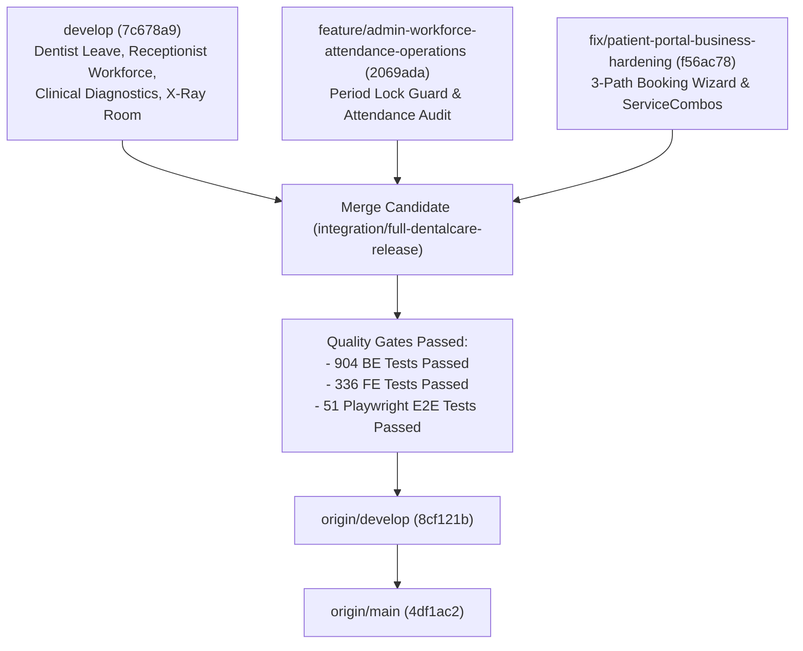

# DENTALCARE – FINAL ALL-BRANCH RELEASE REPORT
**Release Status:** `SUCCESS – ALL FEATURES MERGED INTO DEVELOP AND MAIN`  
**Date:** 2026-11-10  
**Repository:** `https://github.com/kaybern1512/SWP391_Group6.git`  
**Develop HEAD:** `8cf121b`  
**Main HEAD:** `4df1ac2`  

---

## 1. Executive Summary

This release marks the final production-ready integration of the DentalCare SWP391 Clinical Dental Clinic Management System. All developed subsystems across the 4 core clinical personas (**Patient**, **Receptionist**, **Dentist**, **SystemAdministrator**) have been consolidated, verified via end-to-end automated testing, and merged into both `origin/develop` and `origin/main` without using `--force`.

---

## 2. Integrated Feature Highlights & Capabilities

### 2.1 Patient Experience & Booking Flow
- **3-Path Booking Architecture:**
  - **Path A (Combo Dịch Vụ):** Displays combo packages (`COMBO_CARE`, `COMBO_IMPLANT`, `COMBO_WHITEN`, `COMBO_ORTHO`) loaded dynamically from the SQL database catalog with savings calculation.
  - **Path B (Dịch Vụ Lẻ):** Enables procedural selection by Department and Service, automatic estimation of procedure duration, and dentist assignment.
  - **Path C (Khám Tổng Quát):** General consultation path dynamically assigning the General RHM department and auto-configuring diagnostic consultation slots.
- **Shift Booking Safeguards:** Enforces single booking per day session (maximum 2 per calendar day: 1 Morning and 1 Afternoon session) to prevent slot starvation.
- **VietQR Settlement:** Full dynamic VietQR generation and real-time payment reconciliation.

### 2.2 Receptionist Workforce & Shift Coordination
- **Counter Check-in & Queue Numbering:** Real-time generation of room-based queue tokens (`XR-xxx`, counter tickets) with waiting time estimation.
- **Shift & Leave Management:** Support for Receptionist shift swap requests, emergency leave approvals, and shift handover notes between consecutive shifts.
- **Invoice & Billing Console:** Unified billing workflow retaining completed appointments for settlement, deposit reconciliation, and post-care follow-up tracking.

### 2.3 Dentist Clinical Workspace & Specialty Coordination
- **Medical Records & EMR:** Interactive dental chart (32 adult teeth), clinical diagnostic ordering, and automated treatment plan timeline generation.
- **Doctor Leave & Disruption Recovery:** Automatic impact detection for doctor leave, instant patient notifications with secure Action Tokens, and safe reschedule/reassignment without data loss.
- **Internal Consultations & Referrals:** Inter-specialty referrals between clinic departments and multidisciplinary consultation requests with SLA tracking.

### 2.4 Clinical Diagnostics & Dedicated Imaging Room
- **Room `XRAY-01` Architecture:** Dedicated diagnostic imaging room with real-time queue capacity monitoring (`MaxConcurrentPatients = 1`, `MaxWaitingPatients = 3`).
- **End-to-End Workflow:** Order creation $\to$ Slot booking on equipment (`XRAY-MACH-01`) $\to$ Counter Check-in $\to$ Technical image acquisition $\to$ Cloud storage upload $\to$ Dentist review & technical sign-off.

### 2.5 Administrator Attendance & Operations Intelligence
- **Workforce Attendance:** Biometric clock-in/out tracking with grace period calculations, late punch logging, and supervisor adjustment workflows.
- **Period Finalization & Locking:** Immutable monthly attendance period closing with audited reopen justification protocols.
- **Operations Dashboard:** Live clinic operational KPIs, receptionist staffing shortage alerts, and unattended patient escalation monitors.

---

## 3. Comprehensive Verification & Quality Gates

| Verification Gate | Target Suite / Project | Results | Verdict |
| :--- | :--- | :--- | :--- |
| **Backend Build** | `BE/DentalClinic.Backend.sln` (Release) | 0 Errors, 2 Warnings (CS8600) | **PASSED** |
| **Frontend Build** | `FE/DentalClinic.Web/DentalClinic.Web.csproj` (Release) | 0 Errors, 0 Warnings | **PASSED** |
| **BE Unit & Integration Tests** | `BE/DentalClinic.Tests/DentalClinic.Tests.csproj` | **904 Passed, 1 Skipped, 0 Failed** | **PASSED** |
| **FE Web Unit Tests** | `FE/DentalClinic.Web.Tests/DentalClinic.Web.Tests.csproj` | **336 Passed, 0 Failed** | **PASSED** |
| **Patient Portal E2E** | `patient-portal-full-business-flow.spec.js` | **14 / 14 Passed** | **PASSED** |
| **Imaging Queue E2E** | `imaging-queue-workflow.spec.js` | **10 / 10 Passed** | **PASSED** |
| **Admin Operations E2E** | `admin-workforce-operations.spec.js` | **9 / 9 Passed** | **PASSED** |
| **Four-Role Browser E2E** | `four-role-full-flow.spec.js` | **6 / 6 Passed** | **PASSED** |
| **Doctor Leave E2E** | `doctor-leave-recovery.spec.js` | **6 / 6 Passed** | **PASSED** |
| **Receptionist Workforce E2E** | `receptionist-workforce.spec.js` | **6 / 6 Passed** | **PASSED** |
| **Total Playwright E2E** | All 6 Core E2E Suites | **51 / 51 Passed (100%)** | **PASSED** |

---

## 4. Git Deployment Log

1. **Candidate Branch:** `integration/full-dentalcare-release`
2. **Merge Commits:**
   - `1a5b6d9`: Merged `origin/feature/admin-workforce-attendance-operations` (`2069ada`).
   - `38e8356`: Merged `origin/fix/patient-portal-business-hardening` (`f56ac78`).
   - `0b3693f`: Resolved entity syntax and DbContext conflicts.
   - `ee24074`: Harmonized concurrency & SQL Server integration tests with 4-role model.
   - `8cf121b`: Hardened Playwright E2E test suites for 3-path booking and async redirects.
3. **Pushed to `origin/develop`:**
   - Commit: `8cf121b`
   - Mode: Non-force fast-forward push.
4. **Merged and Pushed to `origin/main`:**
   - Commit: `4df1ac2` (`release: merge develop into main - DentalCare 4-Role Full Production Release`)
   - Mode: Clean non-force push.
5. **Database Governance:**
   - Production database `DentalClinicManagementDB` remained untouched.
   - Standardized migration script `DB/20261110_Add_ServiceCombos_And_Appointment_Combo_Tracking.sql` committed for production staging.
