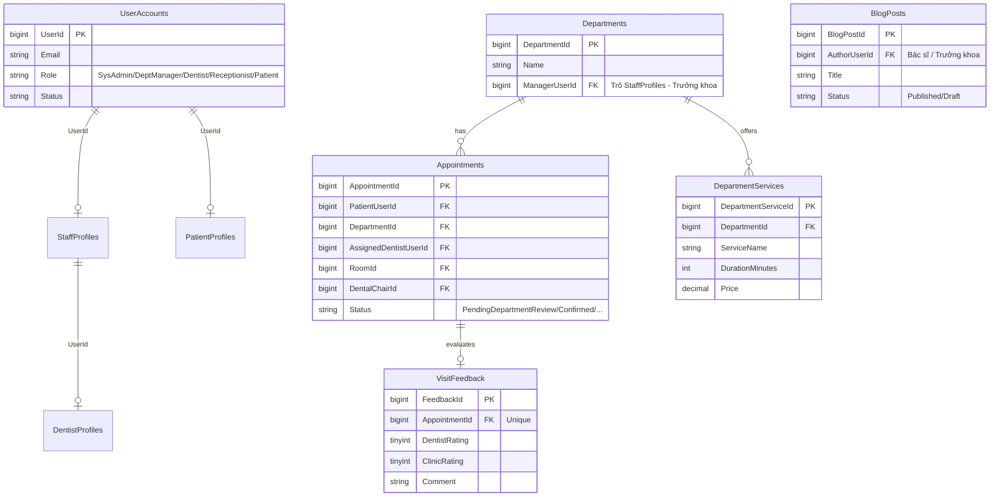
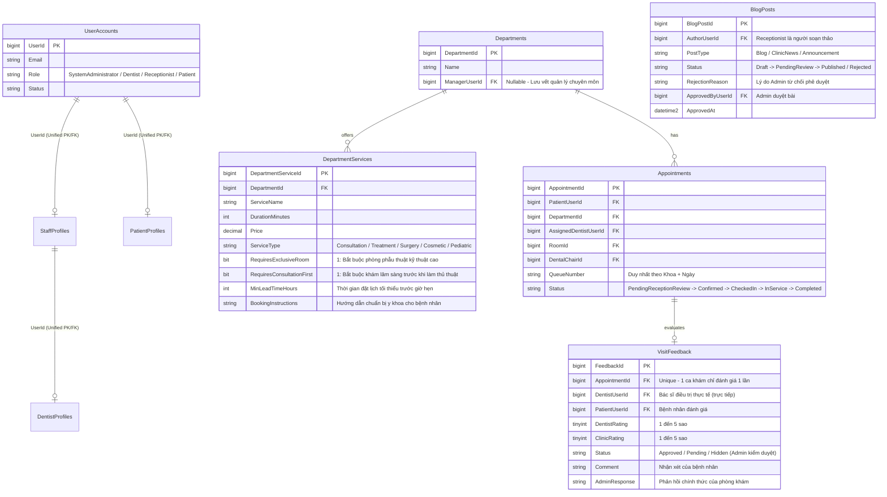

# KẾ HOẠCH NÂNG CẤP VÀ CHUẨN HÓA DATABASE – PHASE 0 (DATABASE FIX PLAN)
## Dự án: DentalCare Clinic Management System (SWP391 Group 6)
**Ngày lập:** 09/11/2026  
**Chuyên viên:** Senior .NET Software Architect & Database Architect  
**Trạng thái nhánh:** `refactor/phase-0-database-redesign`  

---

## 1. NGUYÊN TẮC AN TOÀN VÀ PHẠM VI ÁP DỤNG

1. **Tuyệt đối không thao tác trực tiếp trên CSDL Production:**
   - Mọi thử nghiệm, chạy kiểm tra và xác minh DDL/DML chỉ được phép thực hiện trên CSDL clone `DentalClinic_Phase0_QAClone` (được phục hồi từ bản sao lưu `DentalClinicManagementDB_Phase0_PreMigration.bak`).
2. **Giao dịch nguyên tử (Atomic Transaction):**
   - Script di chuyển dữ liệu được bọc hoàn toàn trong `BEGIN TRANSACTION ... BEGIN TRY ... COMMIT / ROLLBACK`. Bất kỳ lỗi nào phát sinh đều tự động hoàn tác toàn bộ trạng thái CSDL.
3. **Tính lũy thừa (Idempotency):**
   - Script kiểm tra sự tồn tại của bảng, cột, khóa ngoại, chỉ mục trước khi thêm mới hoặc sửa đổi, đảm bảo chạy nhiều lần không sinh lỗi.
4. **Bảo toàn dữ liệu lịch sử:**
   - Không xóa bất kỳ bản ghi tài khoản, lịch hẹn, lịch sử trạng thái, bệnh án hay kiểm toán nào.
   - Không gán cứng ID; sử dụng định danh chuẩn xác và có giải trình nghiệp vụ rõ ràng.

---

## 2. SƠ ĐỒ THỰC THỂ QUAN HỆ (ERD)

### 2.1. ERD Hiện Tại (Mô Hình 5 Role & Luồng Trưởng Khoa)

---

### 2.2. ERD Mục Tiêu (Mô Hình 4 Role & Luồng Chuẩn Hóa Nha Khoa)

---

## 3. KẾ HOẠCH NÂNG CẤP CHI TIẾT THEO 5 BƯỚC

### Bước 1: Chuyển Đổi Vai Trò `DepartmentManager` sang `Dentist`
- **Mục tiêu:** Loại bỏ vai trò trung gian `DepartmentManager` nhưng bảo toàn 100% hồ sơ, chứng chỉ và lịch sử của 4 vị bác sĩ trưởng khoa.
- **Thực thi:**
  1. Kiểm tra 4 tài khoản (UserId 4, 10, 11, 12). Cả 4 vị này đều là Bác sĩ chuyên khoa cao cấp (Tiến sĩ, Thạc sĩ, CKII).
  2. Bổ sung bản ghi chứng chỉ hành nghề vào bảng `DentistProfiles` cho 4 tài khoản trên (`LIC-VN-2026-MGR1` đến `MGR4`).
  3. Gán phân công chuyên khoa vào `DentistDepartments` (Khoa 1, 2, 3, 4).
  4. Cập nhật `UserAccounts.Role = 'Dentist'` cho 4 tài khoản.
  5. Cập nhật ràng buộc CHECK trên `UserAccounts.Role`: Chỉ chấp nhận đúng 4 giá trị (`SystemAdministrator`, `Dentist`, `Receptionist`, `Patient`).

### Bước 2: Chuyển Tiếp Các Ca Khám Chờ Duyệt Sang Hàng Đợi Lễ Tân
- **Mục tiêu:** Không để bất kỳ lịch hẹn nào bị tắc nghẽn khi bãi bỏ bước duyệt của Trưởng khoa.
- **Thực thi:**
  1. Lấy danh sách 7 ca khám có `Status = 'PendingDepartmentReview'`.
  2. Thêm 7 dòng vào `AppointmentStatusHistories` với `OldStatus = 'PendingDepartmentReview'`, `NewStatus = 'PendingReceptionReview'`, ghi rõ lý do chuyển đổi mô hình 4 role.
  3. Cập nhật trạng thái của 7 ca hẹn sang `PendingReceptionReview`.

### Bước 3: Nâng Cấp Schema Đặt Lịch Theo Từng Dịch Vụ (`DepartmentServices`)
- **Mục tiêu:** Đáp ứng yêu cầu dịch vụ chuyên sâu phải có cấu hình riêng biệt, không dùng chung khung khám tổng quát.
- **Thực thi:**
  1. Thêm các cột:
     - `ServiceType` VARCHAR(30) DEFAULT 'Treatment'
     - `RequiresExclusiveRoom` BIT DEFAULT 0
     - `RequiresConsultationFirst` BIT DEFAULT 0
     - `MinLeadTimeHours` INT DEFAULT 2
     - `BookingInstructions` NVARCHAR(1000) NULL
  2. Cập nhật phân loại cho 31 dịch vụ hiện có:
     - Khám & tư vấn: `ServiceType = 'Consultation'`, không yêu cầu phòng độc quyền, đặt trước tối thiểu 2 giờ.
     - Tiểu phẫu / Implant: `ServiceType = 'Surgery'`, `RequiresExclusiveRoom = 1` (chỉ dùng phòng 201, 202), `RequiresConsultationFirst = 1` (phải khám trước), đặt trước tối thiểu 12 giờ.
     - Chỉnh nha / Thẩm mỹ: `ServiceType = 'Cosmetic'`, `RequiresConsultationFirst = 1`, đặt trước tối thiểu 4 giờ.
     - Răng trẻ em: `ServiceType = 'Pediatric'`.

### Bước 4: Hoàn Thiện Schema Đánh Giá Bác Sĩ Sau Khám (`VisitFeedback`)
- **Mục tiêu:** Bệnh nhân đánh giá bác sĩ sau ca khám Completed; Bác sĩ xem phản hồi của mình; Admin kiểm duyệt công khai.
- **Thực thi:**
  1. Thêm các cột: `DentistUserId`, `PatientUserId`, `Status`, `AdminNotes`, `AdminRespondedByUserId`, `AdminResponse`, `UpdatedAt`.
  2. Nạp dữ liệu tự động (Backfill): Gán `DentistUserId = a.AssignedDentistUserId` và `PatientUserId = a.PatientUserId` từ bảng `Appointments` cho tất cả 25 bản ghi đánh giá hiện có.
  3. Tạo Foreign Keys tới `DentistProfiles` và `UserAccounts`.
  4. Tạo chỉ mục `IX_VisitFeedback_Dentist_Status` để hỗ trợ tính điểm rating trung bình của Bác sĩ cực nhanh.

### Bước 5: Hoàn Thiện Schema Quản Trị Blog & Tin Tức Phòng Khám (`BlogPosts`)
- **Mục tiêu:** Lễ tân viết bài blog $\rightarrow$ Chờ duyệt $\rightarrow$ Admin duyệt xuất bản hoặc từ chối có lý do $\rightarrow$ Admin đăng tin tức phòng khám.
- **Thực thi:**
  1. Thêm các cột: `PostType` (Blog/ClinicNews/Announcement), `RejectionReason`, `ApprovedByUserId`, `ApprovedAt`.
  2. Tạo Foreign Key `FK_BlogPosts_ApprovedByUser` tham chiếu tới `UserAccounts(UserId)`.
  3. Tạo ràng buộc CHECK `CK_BlogPosts_PostType`.

---

## 4. QUY TRÌNH KIỂM CHỨNG & ROLLBACK AN TOÀN

1. **Kiểm tra trước khi chạy (Preflight Check):**
   - Đảm bảo database target là `DentalClinic_Phase0_QAClone`.
   - Kiểm tra không có xung đột dữ liệu trên các bảng liên quan.
2. **Kiểm tra sau khi chạy (Postflight Verification):**
   - Đếm số lượng role trong `UserAccounts`: Phải có đúng 4 role, số lượng `Dentist` tăng từ 6 lên 10, số lượng `DepartmentManager` bằng 0.
   - Đếm trạng thái trong `Appointments`: Không còn bản ghi nào có trạng thái `PendingDepartmentReview`.
   - Kiểm tra toàn vẹn khóa ngoại (FK Integrity): Kiểm tra không có orphaned records.
3. **Quy trình Rollback:**
   - Đã chuẩn bị sẵn file `DB/redesign_migrations/20261109_Phase0_Database_Standardization_4Roles_Rollback.sql`.
   - Khi cần hoàn tác, script sẽ xóa các ràng buộc, chỉ mục, cột mới thêm và khôi phục lại vai trò cũ của 4 tài khoản mà không làm mất dữ liệu gốc.
