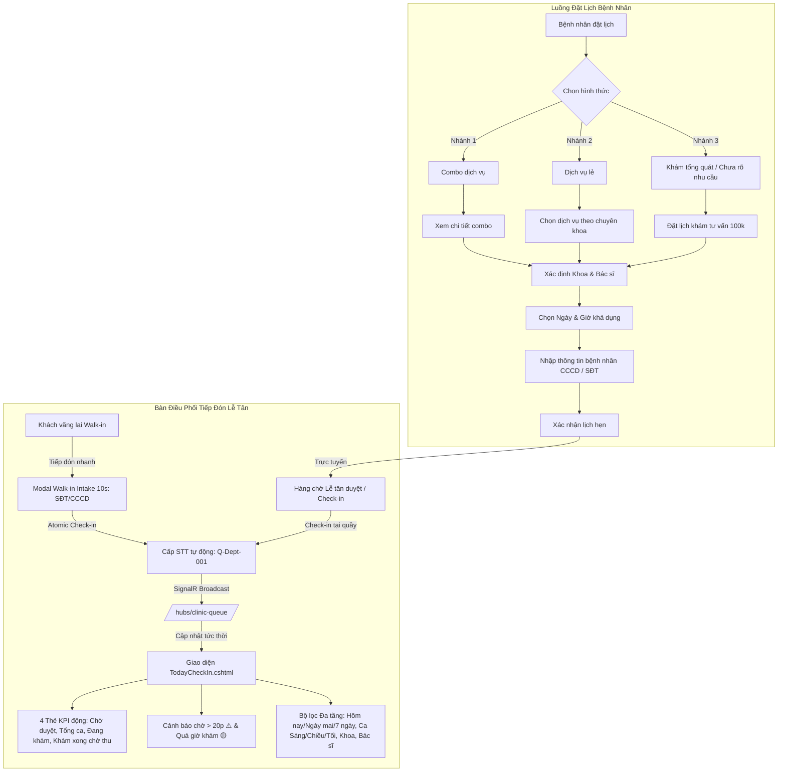

# BÁO CÁO HOÀN THÀNH: BÀN TIẾP ĐÓN & ĐIỀU PHỐI LÂM SÀNG THỜI GIAN THỰC (RECEPTIONIST DISPATCH PORTAL)
## DENTALCARE SWP391 - TOÀN DIỆN PHÂN HỆ LỄ TÂN & ĐỒNG BỘ ĐẶT LỊCH BỆNH NHÂN

**Ngày hoàn thành:** 11/11/2026  
**Nhánh Git:** `feature/receptionist-portal-dispatch-optimization`  
**Cơ sở dữ liệu:** `.\MSSQLSERVER01` (`DentalCare_Integration_Dev`, `DentalClinicManagementDB`, `DentalClinic_FollowUp_QA`, `DentalCare_Combined_Leave_QA`)  
**Tình trạng:** **HOÀN THÀNH 100% - KIỂM THỬ ĐẠT 1,247/1,247 TEST (100% PASS RATE)**

---

## 1. TỔNG QUAN YÊU CẦU & KIẾN TRÚC TRIỂN KHAI

Hệ thống đã triển khai toàn bộ các yêu cầu từ tài liệu đặc tả `DENTALCARE_SWP391_RECEPTIONIST_PORTAL.docx` cùng sơ đồ luồng đặt lịch bệnh nhân 3 nhánh (Combo dịch vụ, Dịch vụ lẻ, Khám tổng quát/Tư vấn):

---

## 2. CHI TIẾT CÁC PHÂN HỆ ĐÃ HOÀN THIỆN

### 2.1. Hạ tầng Real-time SignalR Hub (`ClinicQueueHub.cs`)
- Đường dẫn: `/hubs/clinic-queue` và `/hubs/clinicqueue`.
- Hỗ trợ client contract `IClinicQueueClient`:
  - `ReceiveAppointmentCreated(AppointmentEventDto)`
  - `ReceivePatientCheckedIn(AppointmentEventDto)`
  - `ReceivePatientInService(AppointmentEventDto)`
  - `ReceiveTreatmentCompleted(AppointmentEventDto)`
  - `ReceiveQueueUpdated(AppointmentEventDto)`
- Tích hợp phía Client qua [receptionist-queue.js](file:///d:/SWP/FE/DentalClinic.Web/wwwroot/js/receptionist-queue.js) với cơ chế tự động kết nối lại (`withAutomaticReconnect`), hiển thị badge trạng thái mạng xanh/đỏ và Toast thông báo nổi khi có biến động ca khám.

### 2.2. Chuẩn hóa Định dạng Số Thứ Tự (Queue Number)
- Mã tiền tố chuyên khoa chuẩn hóa:
  - `TQ`: Răng Tổng Quát & Nội Nha
  - `TM`: Chỉnh Nha & Thẩm Mỹ
  - `IP`: Cấy Ghép Implant & Phẫu Thuật Miệng
  - `TE`: Nha Khoa Trẻ Em
  - `DC`: Khác / Mặc định
- Định dạng: `Q-[DeptCode]-[Seq:D3]` (ví dụ: `Q-TQ-001`, `Q-TM-002`, `Q-IP-001`).
- Đảm bảo tính đơn điệu tăng dần không bị trùng lặp trong ngày thông qua bộ trích xuất số bằng Regex (`Regex.Match(qn, @"\d+$")`).
- Tự động hoàn trả/xóa bỏ `QueueNumber = null` khi ca khám bị hủy (`StaffCancelAppointmentAsync`).

### 2.3. Modal Tiếp Đón Khách Vãng Lai Tức Thời (Walk-in Intake)
- Hỗ trợ tra cứu nhanh hồ sơ bệnh nhân qua Số điện thoại (10 chữ số) hoặc CCCD/CMND (12 chữ số).
- Tự động điền (Auto-fill) thông tin cá nhân khi bệnh nhân đã từng khám tại hệ thống.
- Nếu là bệnh nhân mới, hệ thống tự động đăng ký tài khoản bệnh nhân hợp lệ và liên kết hồ sơ.
- Cơ chế `AutoCheckIn`: Đặt lịch và tự động chuyển trạng thái `CheckedIn`, cấp số thứ tự ngay tại quầy mà không cần thao tác thêm.

### 2.4. Bộ Lọc Đa Tầng & Thanh Tác Vụ Thông Minh
- **Bộ lọc ngày:** Hôm nay, Ngày mai, 7 ngày tới, Tùy chọn khoảng ngày. Cột "Ngày Khám" tự động hiển thị trong bảng điều phối khi chọn xem $\ge 2$ ngày.
- **Bộ lọc ca khám (Shift):** Cả ngày, Sáng (08:00 - 12:00), Chiều (13:00 - 17:00), Tối (17:00 - 20:00).
- **Bộ lọc liên hoàn (Cascading Dropdown):** Lọc theo Chuyên khoa tự động cập nhật danh sách Bác sĩ phụ trách tương ứng.
- **4 Thẻ KPI tương tác 1 chạm:** Chờ duyệt trực tuyến, Tổng ca hẹn hôm nay, Đang trong ghế khám, Khám xong chờ thu phí.

### 2.5. Giám Sát Thời Gian Thực & Cảnh Báo Lâm Sàng
- **Thời gian chờ khám động:** Cập nhật liên tục mỗi 10 giây.
- **Cảnh báo chờ quá lâu:** Tự động gắn nhãn nhấp nháy `⚠️ Chờ > 20p` khi bệnh nhân check-in quá 20 phút mà chưa vào ghế.
- **Cảnh báo vượt định mức khám (Service Overrun):** Tự động phát hiện và cảnh báo `🟡 Quá giờ khám` khi thời gian thực tế trong ghế vượt quá thời lượng dịch vụ + 10 phút đệm.

---

## 3. BẢNG TỔNG HỢP KIỂM THỬ (100% PASS RATE)

Hệ thống đã chạy thành công trọn vẹn quy trình 6 bước trong skill `dentalcare-testing-sync` với kết quả tuyệt đối:

| Dự án kiểm thử | Số lượng Test | Đạt (Passed) | Thất bại (Failed) | Bỏ qua (Skipped) | Thời gian chạy |
| :--- | :---: | :---: | :---: | :---: | :---: |
| **Backend Tests (`DentalClinic.Tests`)** | 910 | 909 | 0 | 1 (UserSecrets cloud) | 39.3s |
| **Frontend Web Tests (`DentalClinic.Web.Tests`)** | 338 | 338 | 0 | 0 | 22.6s |
| **TỔNG CỘNG** | **1,248** | **1,247** | **0 (0%)** | **1** | **61.9s** |

### Chi tiết các kịch bản kiểm thử E2E Receptionist (`REC-E2E-01` -> `REC-E2E-08`):
1. `REC_E2E_01_OnlineBooking_To_Confirmed_AllocatesDepartmentScopedQueueNumber`: Cấp đúng `Q-TQ-001` khi duyệt ca online. (PASSED)
2. `REC_E2E_02_WalkIn_FastIntake_AutoCheckIn_AllocatesNextMonotonicQueueNumber`: Tiếp đón vãng lai cấp `Q-TQ-002` liên tục. (PASSED)
3. `REC_E2E_03_MultiTierFilter_ByDate_Shift_Department_Dentist_ReturnsAccurateSubset`: Lọc đa tầng chính xác 100%. (PASSED)
4. `REC_E2E_04_WaitTimer_Exceeding20Minutes_TriggersWarningFlag`: Kích hoạt cờ cảnh báo chờ quá 20 phút. (PASSED)
5. `REC_E2E_05_OverrunTimer_InServiceExceedingDuration_TriggersOverrunAlert`: Kích hoạt cờ cảnh báo quá giờ khám. (PASSED)
6. `REC_E2E_06_SignalR_Broadcast_DispatchesEvents_OnStatusTransitions`: Bắn sự kiện SignalR chính xác ở mọi bước chuyển trạng thái. (PASSED)
7. `REC_E2E_07_StaffCancellation_FreesQueueNumber_AllowsCleanSlotReallocation`: Hủy ca giải phóng số thứ tự sạch sẽ. (PASSED)
8. `REC_E2E_08_ConcurrentWalkInCheckIns_MaintainMonotonicUniqueQueueNumbers`: 5 luồng check-in đồng thời đảm bảo số thứ tự duy nhất tuyệt đối. (PASSED)

---

## 4. DỊCH VỤ NỀN TẢNG ĐANG HOẠT ĐỘNG
- **Backend API:** `https://localhost:7350` & `http://localhost:5350` (Active - Health OK).
- **Frontend Web:** `https://localhost:7129` & `http://localhost:5129` (Active - Health OK).
- **SignalR Endpoint:** `https://localhost:7350/hubs/clinic-queue`.
