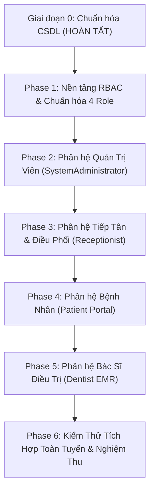

# KẾ HOẠCH TRIỂN KHAI THEO TỪNG VAI TRÒ – PHASE 1 ĐẾN PHASE 6
## Tài liệu: ROLE_BY_ROLE_IMPLEMENTATION_PLAN.md
**Dự án:** DentalCare Clinic Management System (SWP391 Group 6)  
**Ngày lập:** 09/11/2026  
**Chiến lược:** Tiếp cận từng bước (Phased Approach), kiểm thử và nghiệm thu từng giai đoạn độc lập trước khi chuyển sang giai đoạn kế tiếp.

---

## TỔNG QUAN LỘ TRÌNH 6 GIAI ĐOẠN

---

## CHI TIẾT KẾ HOẠCH TỪNG GIAI ĐOẠN

### PHASE 1 – NỀN TẢNG RBAC & LOẠI BỎ PHỤ THUỘC `DepartmentManager`
- **Mục tiêu:** Đồng bộ toàn bộ Backend Web API và Frontend MVC về đúng 4 vai trò: `SystemAdministrator`, `Dentist`, `Receptionist`, `Patient`.
- **Nội dung công việc:**
  1. Rà soát file [UserRole.cs](file:///D:/SWP391/SWP391_Group6/BE/DentalClinic.Domain/Enums/UserRole.cs): Loại bỏ hằng số `DepartmentManager`, cập nhật mảng `All` gồm 4 vai trò.
  2. Rà soát tất cả các Controller trong Backend API:
     - Gỡ bỏ `[Authorize(Roles = ... UserRole.DepartmentManager ...)]`.
     - Chuyển quyền phê duyệt lịch hẹn sang `Receptionist`.
     - Chuyển quyền quản lý lịch trực và bảng giá dịch vụ sang `SystemAdministrator`.
  3. Chuẩn hóa trạng thái lịch hẹn trong [AppointmentStatus.cs](file:///D:/SWP391/SWP391_Group6/BE/DentalClinic.Domain/Enums/AppointmentStatus.cs):
     - Luồng chuẩn: `PendingReceptionReview` $\rightarrow$ `Confirmed` $\rightarrow$ `CheckedIn` $\rightarrow$ `InService` $\rightarrow$ `Completed`.
     - Giữ `PendingDepartmentReview` chỉ cho tương thích ngược dữ liệu cũ nếu có.
  4. Chạy toàn bộ test suites kiểm chứng bảo toàn RBAC và không có controller nào bị gãy authorization.
- **Tiêu chí nghiệm thu (Gate 1):** Backend và Frontend build 0 lỗi; Không còn bất kỳ tham chiếu phân quyền nào tới `DepartmentManager`.

---

### PHASE 2 – HOÀN THIỆN PHÂN HỆ QUẢN TRỊ VIÊN (`SystemAdministrator`)
- **Mục tiêu:** Cung cấp đầy đủ công cụ cấu hình hệ thống, quản lý danh mục, kho thuốc, kiểm duyệt bài viết và đánh giá bác sĩ.
- **Nội dung công việc:**
  1. Quản lý tài khoản 4 vai trò: Thêm mới, phân công nhân sự, khóa/mở khóa tài khoản.
  2. Quản lý Chuyên khoa và Danh mục Dịch vụ:
     - Nhập liệu và cấu hình 5 thuộc tính mới cho từng dịch vụ: `ServiceType`, `RequiresExclusiveRoom`, `RequiresConsultationFirst`, `MinLeadTimeHours`, `BookingInstructions`.
  3. Quản lý Bác sĩ, Phòng khám và Ghế nha khoa: Phân bổ ghế vào phòng, chia ca trực tuần (`DentistWorkSchedules`).
  4. Quản lý Kho thuốc nội bộ:
     - Danh mục thuốc nha khoa, giá xuất.
     - Nhập kho theo số lô và hạn sử dụng (`MedicineBatches`).
     - Theo dõi thẻ kho và nhật ký xuất nhập tồn (`MedicineStockTransactions`).
  5. Quản lý & Kiểm duyệt Blog / Tin tức:
     - Màn hình duyệt bài viết do Lễ tân gửi lên: Xem trước, Phê duyệt (`Published`) hoặc Từ chối (`Rejected`) kèm lý do `RejectionReason`.
     - Màn hình đăng Tin tức / Thông báo phòng khám (`ClinicNews`, `Announcement`) hiển thị ra trang chủ.
  6. Quản trị Đánh giá Bác sĩ (`VisitFeedback`):
     - Rà soát các đánh giá của bệnh nhân: Duyệt hiển thị (`Approved`), ẩn đánh giá vi phạm (`Hidden`), gửi phản hồi chính thức của phòng khám (`AdminResponse`).
- **Tiêu chí nghiệm thu (Gate 2):** Admin thực hiện đầy đủ các chức năng quản trị; Dữ liệu lưu trữ đúng schema CSDL Phase 0.

---

### PHASE 3 – HOÀN THIỆN PHÂN HỆ TIẾP TÂN & THU NGÂN (`Receptionist`)
- **Mục tiêu:** Đơn giản hóa quy trình tiếp nhận, điều phối một bước nhanh gọn, thu ngân chính xác và viết blog.
- **Nội dung công việc:**
  1. Tiếp nhận và Xác nhận lịch hẹn trực tiếp:
     - Rà soát yêu cầu đặt lịch mới (`PendingReceptionReview`).
     - Gán Bác sĩ phụ trách, Phòng và Ghế nha khoa thích hợp theo thời lượng dịch vụ.
     - Bấm Xác nhận (`Confirmed`) trực tiếp, hệ thống tự động khóa tài nguyên chống trùng lịch.
  2. Tiếp đón tại quầy (Walk-in): Tạo hồ sơ bệnh nhân nhanh, chọn dịch vụ, gán bác sĩ/ghế và xác nhận ngay tại bàn lễ tân.
  3. Check-in & Cấp số thứ tự sảnh chờ (`QueueNumber`):
     - Bấm Check-in ca khám hôm nay $\rightarrow$ Tự động sinh số thứ tự theo khoa (`Q-TQ-001`, `Q-TM-001`...).
  4. Lập Hóa đơn & Thu tiền viện phí (Billing):
     - Tự động nạp các khoản phí: Phí khám + Thủ thuật Bác sĩ thực tế đã làm + Thuốc Bác sĩ thực tế đã cấp tại ghế.
     - Áp dụng mã giảm giá, voucher (nếu có), ghi nhận hình thức thanh toán (Tiền mặt / Chuyển khoản / POS) $\rightarrow$ Xuất hóa đơn `Paid`.
  5. Soạn thảo bài viết Blog:
     - Soạn nội dung kiến thức nha khoa (`Draft`), tải ảnh/video, chọn chuyên mục $\rightarrow$ Gửi Admin kiểm duyệt (`PendingReview`).
     - Xem lý do từ chối nếu Admin yêu cầu chỉnh sửa $\rightarrow$ Cập nhật và gửi duyệt lại.
  6. Trực tuyến Live Chat: Tiếp nhận và phản hồi tin nhắn tư vấn từ khách hàng / bệnh nhân.
- **Tiêu chí nghiệm thu (Gate 3):** Lễ tân thực hiện trơn tru từ tiếp nhận $\rightarrow$ check-in $\rightarrow$ lập hóa đơn thu tiền $\rightarrow$ gửi bài blog duyệt.

---

### PHASE 4 – HOÀN THIỆN PHÂN HỆ BỆNH NHÂN (`Patient Portal`)
- **Mục tiêu:** Trải nghiệm đặt lịch nha khoa thông minh, tra cứu bệnh án minh bạch và đánh giá bác sĩ sau điều trị.
- **Nội dung công việc:**
  1. Giao diện Đặt lịch theo dịch vụ (Service-First Booking):
     - Bệnh nhân chọn dịch vụ trước $\rightarrow$ Hệ thống tự động hiển thị thời lượng, giá niêm yết, lưu ý y khoa đặc thù và lọc bác sĩ/khung giờ khả dụng.
  2. Quản lý Lịch hẹn của tôi: Xem trạng thái ca khám, xem số thứ tự sảnh chờ, đề xuất đổi giờ khám nếu bận.
  3. Tra cứu Hồ sơ bệnh án điện tử (EMR):
     - Xem lịch sử điều trị qua các buổi khám.
     - Xem sơ đồ răng trực quan (`Odontogram`) ghi nhận răng sâu, răng đã trám, răng sứ.
     - Xem hình ảnh X-quang, phim chẩn đoán nha khoa.
  4. Tra cứu Đơn thuốc và Hóa đơn viện phí:
     - Xem đơn thuốc bác sĩ kê và thuốc thực tế đã nhận tại phòng khám.
     - Xem chi tiết hóa đơn thanh toán từng buổi.
  5. Đánh giá Bác sĩ điều trị sau ca khám:
     - Sau khi ca khám ở trạng thái `Completed`, hiển thị nút **"Đánh giá Bác sĩ"**.
     - Bệnh nhân chấm điểm 1–5 sao cho Bác sĩ, điểm phòng khám và gửi nhận xét.
  6. Xem Tin tức / Blog nha khoa và Live Chat hỗ trợ.
- **Tiêu chí nghiệm thu (Gate 4):** Bệnh nhân thao tác đặt lịch chuẩn xác; Đánh giá bác sĩ sau ca khám lưu đúng CSDL và bảo mật quyền truy cập.

---

### PHASE 5 – HOÀN THIỆN PHÂN HỆ BÁC SĨ ĐIỀU TRỊ (`Dentist EMR`)
- **Mục tiêu:** Tối ưu thao tác chuyên môn tại ghế nha khoa, ghi nhận trung thực thủ thuật và cấp phát thuốc chính xác.
- **Nội dung công việc:**
  1. Dashboard Ghế nha khoa: Xem danh sách bệnh nhân đã Check-in chờ khám trong ca trực của mình.
  2. Bắt đầu ca khám (`InService`):
     - Khám lâm sàng, ghi chẩn đoán.
     - Cập nhật sơ đồ răng 3D (`Odontogram`).
     - Tải lên hình ảnh chẩn đoán X-quang (`ImagingRecords`).
     - Ghi nhận thủ thuật thực tế (`PerformedServices`).
  3. Lập Phác đồ điều trị (`TreatmentPlans`) cho các liệu trình dài ngày.
  4. Trực tiếp đặt hẹn tái khám (`FollowUpSchedule`): Chọn ngày giờ buổi tiếp theo ngay trên giao diện EMR sau khi trao đổi với bệnh nhân $\rightarrow$ Tự động xác nhận và lên lịch nhắc email.
  5. Kê đơn & Cấp phát thuốc thực tế tại ghế (`MedicineDispensations`):
     - Kê đơn thuốc từ danh mục sẵn có trong kho.
     - Xác nhận số lượng thuốc thực tế bàn giao cho bệnh nhân $\rightarrow$ Hệ thống tự động trừ tồn kho theo lô (FEFO).
  6. Hoàn tất ca khám (`Completed`) $\rightarrow$ Tự động chuyển dữ liệu sang quầy Thu ngân của Lễ tân.
  7. Xem Đánh giá từ Bệnh nhân: Xem điểm số sao trung bình và phản hồi của bệnh nhân dành riêng cho mình.
- **Tiêu chí nghiệm thu (Gate 5):** Bác sĩ thao tác thuận tiện tại ghế; Sơ đồ răng, cấp thuốc và hoàn tất ca khám đồng bộ chính xác với hóa đơn viện phí.

---

### PHASE 6 – KIỂM THỬ TÍCH HỢP TOÀN TUYẾN & NGHIỆM THU (E2E INTEGRATION)
- **Mục tiêu:** Kiểm chứng toàn bộ chu trình hành trình bệnh nhân (Patient Journey) trên môi trường hoàn chỉnh.
- **Kịch bản kiểm thử trọng điểm:**
  1. **Luồng chuẩn toàn trình:**
     $$\text{Patient đặt lịch theo dịch vụ} \rightarrow \text{Receptionist xác nhận & gán ghế} \rightarrow \text{Check-in cấp STT} \rightarrow \text{Dentist khám, Odontogram, cấp thuốc} \rightarrow \text{Completed} \rightarrow \text{Receptionist lập hóa đơn thu tiền} \rightarrow \text{Patient đánh giá Bác sĩ 5 sao}.$$
  2. **Luồng Bệnh nhân vãng lai (Walk-in) tại quầy tiếp đón.**
  3. **Luồng Điều trị theo phác đồ nhiều buổi & Bác sĩ đặt hẹn tái khám tại ghế.**
  4. **Kiểm tra kiểm soát đồng thời (Concurrency):** Chống đặt trùng bác sĩ, trùng ghế nha khoa bằng `sp_getapplock`.
  5. **Kiểm tra kho thuốc:** Đảm bảo trừ tồn kho theo lô FEFO chính xác khi Bác sĩ cấp thuốc, không trừ kho khi mới kê đơn.
  6. **Kiểm tra phân quyền Blog & Tin tức:** Lễ tân viết $\rightarrow$ Chờ duyệt $\rightarrow$ Admin duyệt xuất bản ra Trang chủ; Admin đăng thông báo phòng khám.
- **Tiêu chí nghiệm thu (Gate 6):** 100% kịch bản kiểm thử tự động và thủ công đạt kết quả xanh; Báo cáo nghiệm thu hoàn tất.
