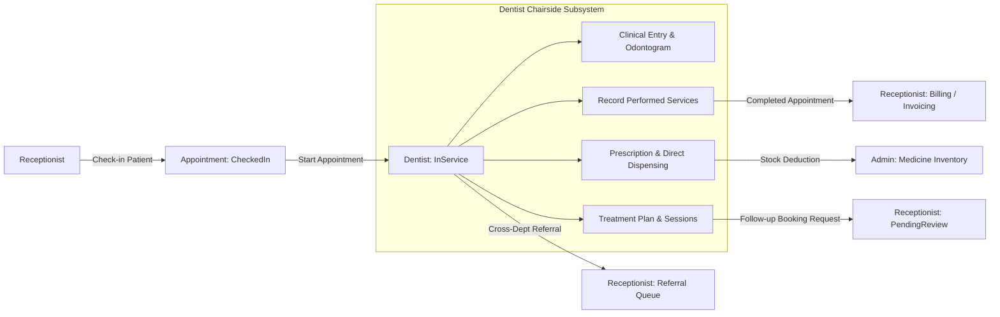

# DENTALCARE 4-ROLE ARCHITECTURE: DENTIST SUBSYSTEM API CONTRACTS & REQUIREMENTS

**Branch:** `feature/dentist-redesign` | **Commit:** `31a47f1fe933d486108c2c5e68043160c2b5b7c9` | **Target Architecture:** 4-Role DentalCare Subsystem Model  
**Backend:** `https://localhost:7354` | **Frontend:** `https://localhost:7124` | **Database:** `DentalCare_Dentist_Dev`  

## 1. Overview & Architectural Boundaries

Under the DentalCare **4-Role Architecture** (`Patient`, `Receptionist`, `Dentist`, `SystemAdministrator`), legacy roles `DepartmentManager`, `Pharmacist`, and `Cashier` have been decommissioned.

As the owner of the **Dentist Subsystem**, this document establishes the precise API contracts, lifecycle transitions, and cross-subsystem handoffs connecting the Dentist with Receptionist (Booking & Billing), Admin (Inventory), and Patient.



---

## 2. Appointment Lifecycle & State Machine

### 2.1 State Transitions
| Current Status | Action | Actor | New Status | Pre-conditions |
|---|---|---|---|---|
| `CheckedIn` | `POST /api/appointments/{id}/dentist/start` | Assigned Dentist | `InService` | Appointment has `AssignedDentistUserId == CurrentUser.Id`, room/chair allocated, patient checked-in. |
| `InService` | Clinical modifications | Assigned Dentist | `InService` | Recording ClinicalEntry, Odontogram, PerformedServices, Prescriptions, Dispensing. |
| `InService` | `POST /api/appointments/{id}/dentist/complete` | Assigned Dentist | `Completed` | Sets `CompletedAt = UtcNow`. Handoff to Billing. |

### 2.2 Security & Strict Validation Rules
- **Mandatory Start Before Complete:** Bác sĩ bắt buộc phải chuyển trạng thái ca khám sang `InService` trước khi hoàn tất. Tuyệt đối **không cho phép bypass** từ `CheckedIn` thẳng sang `Completed`. Nếu gọi `/dentist/complete` khi trạng thái không phải `InService`, hệ thống trả về `400 Bad Request` ("Chỉ có thể hoàn tất ca khám khi đang ở trạng thái 'InService'... Bác sĩ cần bấm 'Bắt đầu khám' trước").
- **Check-in Enforced:** Bác sĩ không thể bắt đầu khám các ca đang ở trạng thái `Confirmed`, `PendingReceptionReview`, hoặc `Cancelled`. Check-in bởi Lễ tân là tiền đề bắt buộc.
- **Dentist Ownership:** Bác sĩ không thể bắt đầu hoặc sửa đổi ca khám được phân công cho bác sĩ khác.
- **Audit Logging:** Trạng thái chuyển đổi được ghi lại chi tiết trong `AppointmentStatusHistories` và phát thông báo SignalR/In-app đến bệnh nhân.

---

## 3. Performed Services API (Handoff to Receptionist Billing)

### 3.1 Motivation & Business Rule
The patient's initial requested service (`RequestedServiceId`) is only the booking intent. During chairside examination, the dentist diagnoses actual dental conditions and records real procedures (`PerformedServices`).
Billing calculations must **never** rely solely on `RequestedServiceId`. Receptionist's `BillingService.PrepareBillingAsync` inspects:
```csharp
appointment.TreatmentSessions.SelectMany(ts => ts.PerformedServices)
```

### 3.2 Endpoints

#### `GET /api/treatments/appointments/{appointmentId}/performed-services`
- **Role:** `Dentist`, `Receptionist`
- **Response:**
```json
{
  "success": true,
  "data": [
    {
      "performedServiceId": 12,
      "treatmentSessionId": 45,
      "departmentServiceId": 50,
      "serviceName": "Trám Răng Composite",
      "quantity": 2,
      "unitPrice": 350000.0,
      "amount": 700000.0,
      "note": "Trám 2 răng hàm 46 và 47",
      "performedAt": "2026-11-09T08:30:00Z"
    }
  ]
}
```

#### `POST /api/treatments/appointments/{appointmentId}/performed-services`
- **Role:** `Dentist` (Assigned Dentist only)
- **Request Body:**
```json
{
  "departmentServiceId": 50,
  "treatmentPlanItemId": 402,
  "treatmentPlanId": 12,
  "quantity": 2,
  "unitPrice": 350000.0,
  "note": "Trám 2 răng hàm 46 và 47"
}
```
- **Rules & Explicit Linking:**
  - `treatmentPlanItemId` (optional): Khi chỉ định giai đoạn cụ thể, backend xác minh giai đoạn này thuộc đúng bệnh nhân của ca khám (`planItem.TreatmentPlan.PatientUserId == appointment.PatientUserId`). Nếu không trùng khớp, trả về lỗi từ chối ngay.
  - `treatmentPlanId` (optional): Tự động liên kết với giai đoạn chưa hoàn thành tương ứng trong phác đồ của bệnh nhân.
  - **Single-Visit Isolation (Direct Care):** Nếu không gắn phác đồ dài hạn, hệ thống tạo bản ghi vùng chứa cách ly với `Status = 'Completed'` và ghi chú prefix `[DirectCare]`, đảm bảo tuân thủ 100% SQL Server CHECK constraint: `[Status] IN ('Cancelled', 'Completed', 'InProgress', 'Planned')`.
  - Snapshots current catalog price if `unitPrice` is omitted or zero.

#### `DELETE /api/treatments/performed-services/{performedServiceId}`
- **Role:** `Dentist` (Assigned Dentist only)
- **Rules:** Cannot delete performed services if the appointment has already been invoiced or paid.

---

## 4. Chairside Medicine Dispensing (No Pharmacist Role)

### 4.1 Architecture & Flow
In DentalCare's 4-role model, **there is no Pharmacist**. The Dentist directly prescribes, selects batches, and dispenses take-home medications at chairside.
- Admin manages warehouse master catalog and batch stock additions.
- Dentist has read-only access to available batches (`Status == 'Available'`, `QuantityAvailable > 0`, `ExpiryDate > Today`).
- Stock is deducted **only upon Dispense confirmation**, not upon prescription creation.
- Partial dispensing is supported (e.g. prescribed 10 tablets, doctor dispenses 6).

### 4.2 Anti-IDOR Security & Concurrency Protection
1. **Access Control:**
   - **Patient:** Can only query dispensations belonging to their own prescriptions/appointments (`pu.UserId == CurrentUser.Id`). Attempting to read another patient's dispensation returns `403 Forbidden`.
   - **Dentist:** Can only query/dispense for appointments where they are the assigned doctor or treating doctor.
2. **Distributed App Lock:**
   - Obtains exclusive application locks on `PrescriptionKey(prescriptionId)` and `MedicineBatchKey(batchId)` via `sp_getapplock` within an atomic transaction.
3. **Lot Quality Gate:**
   - Rejects batches where `ExpiryDate <= DateOnly.FromDateTime(DateTime.Today)`.
   - Rejects quantities where `Quantity > batch.QuantityAvailable` (negative stock prevented).

### 4.3 Endpoints

#### `POST /api/medicines/dispense`
- **Role:** `Dentist`
- **Request Body:**
```json
{
  "prescriptionId": 801,
  "notes": "Bàn giao 6 viên Amoxicillin 500mg đợt 1",
  "items": [
    {
      "prescriptionItemId": 1205,
      "medicineId": 14,
      "medicineBatchId": 22,
      "quantity": 6
    }
  ]
}
```

#### `GET /api/medicines/dispensations/prescription/{prescriptionId}`
- **Role:** `Patient`, `Dentist`, `Receptionist`
- **Security:** Verifies patient ownership / doctor assignment.
- **Response:**
```json
{
  "success": true,
  "data": [
    {
      "dispensationId": 99,
      "prescriptionId": 801,
      "dispensedByDentistName": "BS. Trần Văn Khám",
      "dispensedAt": "2026-11-09T08:45:00Z",
      "status": "Dispensed",
      "totalAmount": 30000.0,
      "items": [
        {
          "medicineName": "Amoxicillin 500mg",
          "batchNumber": "LOT-2026-001",
          "quantityDispensed": 6,
          "unit": "Viên",
          "unitPriceSnapshot": 5000.0,
          "lineTotal": 30000.0
        }
      ]
    }
  ]
}
```

#### `GET /api/medicines/prescriptions/{prescriptionId}/dispensation-status`
- **Role:** `Patient`, `Dentist`, `Receptionist`
- **Contract with Patient Portal:** Returns the canonical 3 dispensation states:
  - `"NotDispensed"`: Chưa có lượt cấp phát nào.
  - `"PartiallyDispensed"`: Đã cấp phát một phần số lượng hoặc một phần danh mục thuốc.
  - `"FullyDispensed"`: Toàn bộ danh mục thuốc trong đơn đã được cấp đủ.

---

## 5. Follow-up Booking API Contract (Handoff to Receptionist)

### 5.1 Business Rules
- Dentist agrees with patient on next treatment phase and timing.
- Dentist triggers "Create Follow-up" from the active Treatment Plan or Appointment console.
- **Contract:** Creates an appointment in `AppointmentStatus.PendingReceptionReview`.
- **Rule:** TreatmentSession is **not** created when booking a future follow-up. Sessions are strictly created when the appointment occurs.
- Receptionist receives real-time notification (`type: 'FollowUpRequested'`) to review, allocate optimal room/chair, and confirm.

### 5.2 Endpoint
#### `POST /api/treatments/plans/{planId}/follow-up`
- **Role:** `Dentist`
- **Request Body:**
```json
{
  "planItemId": 402,
  "scheduledStart": "2026-11-16T09:00:00Z",
  "durationMinutes": 30,
  "reason": "Tái khám kiểm tra lành thương và điều trị tủy giai đoạn 2"
}
```

---

## 6. Intra-Clinic Referrals (No Department Manager)

### 6.1 Business Rules
- If patient requires another specialty:
  - Dentist specifies target department and clinical rationale.
  - No Department Manager approval required (role removed).
  - Referral status is set to `Pending`.
  - Notification sent to `Receptionist` pool so receptionists can contact patient and schedule cross-specialty appointments.

### 6.2 Endpoint
#### `POST /api/post-care/referrals`
- **Role:** `Dentist`
- **Request Body:**
```json
{
  "treatmentSessionId": 105,
  "toDepartmentId": 2,
  "reason": "Răng khôn 38 mọc lệch 90 độ sát dây thần kinh, chuyển chuyên khoa Phẫu thuật hàm mặt",
  "urgency": "Normal"
}
```

---

## 7. Dentist Feedback Self-View API

### 7.1 Business Rules
- Patients submit feedback upon appointment completion.
- Dentists have read-only visibility into their aggregated rating, breakdown, and patient comments.
- Dentists cannot create, edit, or delete feedback.

### 7.2 Endpoint
#### `GET /api/feedbacks/my-summary`
- **Role:** `Dentist`
- **Response:** Returns aggregated average dentist rating, average clinic rating, feedback count, and recent comment history.

---

## 8. Database Migration Recommendation for Integration Team

### 8.1 Schema Gap Analysis
Currently, appointments created for follow-up treatment phases do not have a direct foreign key column referencing `TreatmentPlanItems` in the `Appointments` table schema.

### 8.2 Proposed Relational Migration
The Integration Lead should apply the following non-breaking migration across all environments:

```sql
-- 1. Add TreatmentPlanItemId nullable foreign key column to Appointments
IF NOT EXISTS (
    SELECT 1 FROM sys.columns 
    WHERE object_id = OBJECT_ID('Appointments') AND name = 'TreatmentPlanItemId'
)
BEGIN
    ALTER TABLE Appointments ADD TreatmentPlanItemId BIGINT NULL;
    
    ALTER TABLE Appointments ADD CONSTRAINT FK_Appointments_TreatmentPlanItems_TreatmentPlanItemId
        FOREIGN KEY (TreatmentPlanItemId) REFERENCES TreatmentPlanItems(TreatmentPlanItemId)
        ON DELETE NO ACTION;
        
    CREATE NONCLUSTERED INDEX IX_Appointments_TreatmentPlanItemId 
        ON Appointments(TreatmentPlanItemId) 
        WHERE TreatmentPlanItemId IS NOT NULL;
END
GO
```

### 8.3 Data Preservation & Transition Strategy
- For existing legacy appointments, the backward-compatible regex parser for `appointment.ReasonForVisit` (`[Tái khám phác đồ #{id}]`) will remain in place as a secondary fallback.
- Newly scheduled follow-ups and chairside performed service records will populate `Appointments.TreatmentPlanItemId` explicitly, achieving full relational integrity.
