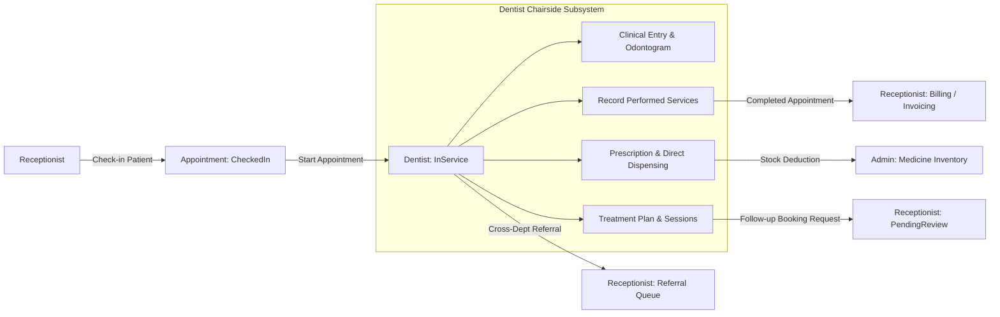

# DENTALCARE 4-ROLE ARCHITECTURE: DENTIST SUBSYSTEM API CONTRACTS & REQUIREMENTS

**Branch:** `feature/dentist-redesign` | **Commit:** `679a82737fe19655e55fbd3468613bf792008fad`  
**Backend:** `https://localhost:7354` | **Frontend:** `https://localhost:7124` | **Database:** `DentalCare_Dentist_Dev`  

## 1. Overview & Architectural Boundaries

Under the DentalCare **4-Role Architecture** (`Patient`, `Receptionist`, `Dentist`, `SystemAdministrator`), the legacy roles `DepartmentManager`, `Pharmacist`, and `Cashier` have been decommissioned.

As the owner of the **Dentist Subsystem**, this document establishes the precise API contracts, lifecycle transitions, and cross-subsystem handoffs connecting the Dentist with Receptionist (Booking & Billing), Admin (Inventory), and Patient.



---

## 2. Appointment Lifecycle & State Machine

### 2.1 State Transitions
| Current Status | Action | Actor | New Status | Pre-conditions |
|---|---|---|---|---|
| `CheckedIn` | `POST /api/appointments/{id}/dentist/start` | Assigned Dentist | `InService` | Appointment has `AssignedDentistUserId == CurrentUser.Id`, room/chair allocated, patient checked-in. |
| `InService` | Clinical modifications | Assigned Dentist | `InService` | Recording ClinicalEntry, Odontogram, PerformedServices, Prescriptions, Dispensing. |
| `InService` | `POST /api/appointments/{id}/dentist/complete` | Assigned Dentist | `Completed` | Sets `CompletedAt = UtcNow`. Handoff to Billing. |

### 2.2 Security & Access Control
- Dentists **cannot** start appointments that are `Confirmed`, `PendingReceptionReview`, or `Cancelled`. Check-in by Receptionist is mandatory.
- Dentists **cannot** start or modify appointments assigned to a different dentist.
- Dentists **cannot** modify clinical entries or performed services of completed appointments without controlled audit logs.

---

## 3. Performed Services API (Handoff to Receptionist Billing)

### 3.1 Motivation & Business Rule
The patient's initial requested service (`RequestedServiceId`) is only the booking intent. During chairside examination, the dentist diagnoses actual dental conditions and records real procedures (`PerformedServices`).
Billing calculations must **never** rely solely on `RequestedServiceId`. Receptionist's `BillingService.PrepareBillingAsync` inspects:
```csharp
appointment.TreatmentSessions.SelectMany(ts => ts.PerformedServices)
```

### 3.2 Endpoints

#### `GET /api/treatments/appointments/{appointmentId}/performed-services`
- **Role:** `Dentist`, `Receptionist`
- **Response:**
```json
{
  "success": true,
  "data": [
    {
      "performedServiceId": 12,
      "treatmentSessionId": 45,
      "departmentServiceId": 50,
      "serviceName": "Trám Răng Composite",
      "quantity": 2,
      "unitPrice": 350000.0,
      "amount": 700000.0,
      "note": "Trám 2 răng hàm 46 và 47",
      "performedAt": "2026-11-09T08:30:00Z"
    }
  ]
}
```

#### `POST /api/treatments/appointments/{appointmentId}/performed-services`
- **Role:** `Dentist` (Assigned Dentist only)
- **Request Body:**
```json
{
  "departmentServiceId": 50,
  "quantity": 2,
  "unitPrice": 350000.0,
  "note": "Trám 2 răng hàm 46 và 47"
}
```
- **Rules:**
  - Appointment must be `InService`.
  - Automatically links or provisions an appointment-specific `TreatmentSession`.
  - Snapshots current catalog price if `unitPrice` is omitted or zero.

#### `DELETE /api/treatments/performed-services/{performedServiceId}`
- **Role:** `Dentist` (Assigned Dentist only)
- **Rules:** Cannot delete performed services if the appointment has already been invoiced or paid.

---

## 4. Chairside Medicine Dispensing (No Pharmacist Role)

### 4.1 Architecture & Flow
In DentalCare's 4-role model, **there is no Pharmacist**. The Dentist directly prescribes, selects batches, and dispenses take-home medications at chairside.
- Admin manages warehouse master catalog and batch stock additions.
- Dentist has read-only access to available batches (`Status == 'Available'`, `QuantityAvailable > 0`, `ExpiryDate > Today`).
- Stock is deducted **only upon Dispense confirmation**, not upon prescription creation.
- Partial dispensing is supported (e.g. prescribed 10 tablets, doctor dispenses 6).

### 4.2 Concurrency & Transaction Isolation
To prevent negative stock and race conditions between multiple chairside dentists dispensing from the same lot:
1. `SqlAppLockHelper.MedicineBatchKey(batchId)` obtains an application lock:
   ```sql
   EXEC sp_getapplock @Resource = 'Lock_MedicineBatch_{id}', @LockMode = 'Exclusive', @LockOwner = 'Transaction'
   ```
2. Validates `QuantityAvailable >= request.Quantity` and `ExpiryDate > Today`.
3. Creates `MedicineDispensation` and `MedicineDispensationItem` with unit price snapshot.
4. Decrements `MedicineBatch.QuantityAvailable`.
5. Logs `MedicineStockTransaction` (`TransactionType = 'Dispense'`).
6. All steps execute within a single atomic database transaction.

### 4.3 Endpoints

#### `POST /api/medicines/dispense`
- **Role:** `Dentist`
- **Request Body:**
```json
{
  "prescriptionId": 801,
  "notes": "Bàn giao 6 viên Amoxicillin 500mg đợt 1",
  "items": [
    {
      "prescriptionItemId": 1205,
      "medicineId": 14,
      "medicineBatchId": 22,
      "quantity": 6
    }
  ]
}
```
- **Response:**
```json
{
  "dispensationId": 99,
  "prescriptionId": 801,
  "dispensedByUserId": 201,
  "dispensedAt": "2026-11-09T08:45:00Z",
  "totalAmount": 30000.0,
  "status": "Dispensed",
  "items": [
    {
      "dispensationItemId": 150,
      "medicineId": 14,
      "medicineBatchId": 22,
      "quantityDispensed": 6,
      "unitPriceSnapshot": 5000.0,
      "lineTotal": 30000.0
    }
  ]
}
```

---

## 5. Follow-up Booking API Contract (Handoff to Receptionist)

### 5.1 Business Rules
- Dentist agrees with patient on next treatment phase and timing.
- Dentist triggers "Create Follow-up" from the active Treatment Plan or Appointment console.
- **Rule:** The dentist does NOT directly book a confirmed slot or lock clinic chairs bypassing concurrency controls.
- **Contract:** Creates an appointment in `AppointmentStatus.PendingReceptionReview`.
- **Rule:** TreatmentSession is **not** created when booking a future follow-up. Sessions are strictly created when the appointment occurs.
- Receptionist receives real-time notification (`type: 'FollowUpRequested'`) to review, allocate optimal room/chair, and confirm.

### 5.2 Endpoint
#### `POST /api/treatments/plans/{planId}/follow-up`
- **Role:** `Dentist`
- **Request Body:**
```json
{
  "planItemId": 402,
  "scheduledStart": "2026-11-16T09:00:00Z",
  "durationMinutes": 30,
  "reason": "Tái khám kiểm tra lành thương và điều trị tủy giai đoạn 2"
}
```

---

## 6. Intra-Clinic Referrals (No Department Manager)

### 6.1 Business Rules
- If patient requires another specialty (e.g. general dentist refers complex impacted wisdom tooth to Oral & Maxillofacial Surgery):
  - Dentist specifies target department and clinical rationale.
  - No Department Manager approval required (role removed).
  - Referral status is set to `Pending`.
  - Notification sent to `Receptionist` pool so receptionists can proactively contact patient and schedule the cross-specialty appointment upon consent.

### 6.2 Endpoint
#### `POST /api/post-care/referrals`
- **Role:** `Dentist`
- **Request Body:**
```json
{
  "treatmentSessionId": 105,
  "toDepartmentId": 2,
  "reason": "Răng khôn 38 mọc lệch 90 độ sát dây thần kinh, chuyển chuyên khoa Phẫu thuật hàm mặt",
  "urgency": "Normal"
}
```

---

## 7. Dentist Feedback Self-View API

### 7.1 Business Rules
- Patients submit feedback upon appointment completion.
- Dentists have read-only visibility into their aggregated rating, breakdown, and patient comments.
- Dentists cannot create, edit, or delete feedback.

### 7.2 Endpoint
#### `GET /api/feedbacks/my-summary`
- **Role:** `Dentist`
- **Response:**
```json
{
  "success": true,
  "data": {
    "dentistUserId": 201,
    "dentistName": "BS. Trần Văn Khám",
    "totalFeedbacks": 48,
    "averageDentistRating": 4.9,
    "averageClinicRating": 4.8,
    "recentFeedbacks": [
      {
        "feedbackId": 312,
        "appointmentId": 105,
        "appointmentCode": "APT-20261109-001",
        "patientName": "Nguyễn Văn A",
        "dentistRating": 5,
        "clinicRating": 5,
        "comment": "Bác sĩ làm rất êm, giải thích phác đồ tỉ mỉ và tận tâm!",
        "createdAt": "2026-11-09T09:30:00Z"
      }
    ]
  }
}
```
