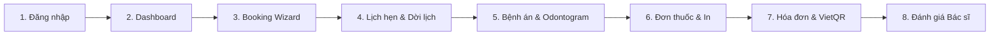

# KỊCH BẢN THAO TÁC DEMO TOÀN DIỆN PHÂN HỆ BỆNH NHÂN (ANTI 3)
# PATIENT END-TO-END DEMO WALKTHROUGH & RUNBOOK

- **Dự án**: `D:\SWP391\DentalCare-Patient`
- **Nhánh**: `feature/patient-redesign`
- **Baseline Commit**: `87e7b71`
- **Tác giả**: Senior QA Engineer & Patient UX Specialist
- **Mục đích**: Hướng dẫn chi tiết từng bước cho giảng viên, hội đồng nghiệm thu hoặc khách hàng trải nghiệm đầy đủ luồng nghiệp vụ của một bệnh nhân thực tế tại nha khoa DentalCare.

---

## 1. DANH SÁCH TÀI KHOẢN & DỮ LIỆU FIXTURE SẴN CÓ TRÊN DATABASE

Tất cả các tài khoản dưới đây đều đã được cấu hình sẵn dữ liệu thực tế trên cơ sở dữ liệu `DentalCare_Patient_Dev`:

| Tài Khoản Email | Mật Khẩu | Họ Tên & Mã BN | Vai Trò Trong Kịch Bản Demo | Dữ Liệu Sẵn Có Trên Hệ Thống |
| :--- | :---: | :--- | :--- | :--- |
| `patient1@dentalcare.com` | `Password123@` | **Trần Mai Chi** `PAT-202610-0002` | **Tài khoản Demo chính** (Đặt lịch, Xem bệnh án, Sơ đồ răng, Đánh giá bác sĩ) | - Ca khám 62 (`Completed`, chưa đánh giá) - Ca khám 2 (`Confirmed`, để demo dời lịch) - Ca khám 72 (`Completed`, đã đánh giá) |
| `vovandong1512@gmail.com` | `Password123@` | **Võ Văn Đông** `PAT-202610-0001` | **Tài khoản Demo viện phí & Đơn thuốc** (Thanh toán VietQR & In đơn thuốc) | - Hóa đơn 4 (`400.000 đ`, Chưa thanh toán) - Đơn thuốc 5 (Đầy đủ danh mục thuốc & cấp phát) |

---

## 2. KỊCH BẢN DEMO TỪNG BƯỚC CHI TIẾT (STEP-BY-STEP WALKTHROUGH)

---

### BƯỚC 1: ĐĂNG NHẬP VÀO CỔNG BỆNH NHÂN
- **Đường dẫn màn hình**: `https://localhost:7123/Account/Login`
- **Tài khoản**: `patient1@dentalcare.com` / `Password123@`
- **Thao tác**:
  1. Nhập Email: `patient1@dentalcare.com`.
  2. Nhập Mật khẩu: `Password123@`.
  3. Tích chọn *"Ghi nhớ đăng nhập"*.
  4. Bấm nút **"Đăng Nhập"**.
- **Dữ liệu mong đợi trên màn hình**:
  - Thông báo Toast màu xanh nổi lên: *"Đăng nhập thành công! Chào mừng Trần Mai Chi."*.
  - Hệ thống tự động chuyển hướng vào màn hình Dashboard Bệnh nhân (`/Patient/Dashboard`).
- **Những lỗi có thể gặp**:
  - *Báo sai mật khẩu*: Kiểm tra phím CapsLock, gõ chính xác chữ `P` hoa và ký tự `@` cuối.
- **Cách khôi phục**: Bấm vào liên kết *"Quên mật khẩu?"* hoặc sử dụng script reset mật khẩu trong `DB/legacy_patches_and_seeds/` nếu cơ sở dữ liệu bị ghi đè.

---

### BƯỚC 2: TỔNG QUAN DASHBOARD BỆNH NHÂN
- **Đường dẫn màn hình**: `https://localhost:7123/Patient/Dashboard`
- **Thao tác**:
  1. Giới thiệu khối chào đón bệnh nhân với đầy đủ Họ tên, Mã bệnh nhân `PAT-202610-0002` và Avatar.
  2. Chỉ ra các thẻ KPI tóm tắt: Lịch khám sắp tới, Đơn thuốc gần nhất, Số lịch hẹn đã thực hiện.
  3. Quan sát Widget Hỗ trợ trực tuyến (Live Chat) ở góc dưới cùng bên phải màn hình.
  4. Bấm vào nút bấm lớn **"Đặt lịch khám mới"** (màu xanh ngọc).
- **Dữ liệu mong đợi trên màn hình**:
  - Hệ thống chuyển hướng mượt mà sang trang Đặt lịch theo dịch vụ (`/Patient/Appointment/Book`).

---

### BƯỚC 3: TRẢI NGHIỆM QUY TRÌNH ĐẶT LỊCH (BOOKING WIZARD 5 BƯỚC)
- **Đường dẫn màn hình**: `https://localhost:7123/Patient/Appointment/Book`
- **Thao tác tuần tự qua 5 bước**:
  - **Bước 1 (Chọn dịch vụ)**:
    - Bệnh nhân quan sát danh mục 31 dịch vụ nha khoa thuộc 4 chuyên khoa.
    - Nhấn chọn dịch vụ **"Trám răng thẩm mỹ Composite"** (Khoa Răng Tổng Quát & Nội Nha).
    - Quan sát: Huy hiệu thời lượng hiển thị rõ ràng **45 phút**, giá niêm yết **400.000 đ**.
    - Bấm **"Tiếp theo: Chọn ngày & Bác sĩ"**.
  - **Bước 2 (Chọn ngày khám & Bác sĩ)**:
    - Quan sát ô Datepicker: Các ngày trong quá khứ bị khóa xám (`min` date bằng ngày hôm nay).
    - Chọn ngày khám là **ngày mai** (hoặc ngày kế tiếp).
    - Chọn bác sĩ: Có thể chọn một bác sĩ cụ thể hoặc để *"Hệ thống tự động phân bổ bác sĩ phù hợp"*.
    - Bấm **"Tiếp theo: Chọn giờ khám"**.
  - **Bước 3 (Chọn khung giờ khám trống)**:
    - Quan sát danh sách các khung giờ sáng và chiều tự động tải về theo bước nhảy 45 phút.
    - Nhấn chọn một khung giờ (ví dụ: `09:00 - 09:45`).
    - Quan sát thanh tóm tắt bên phải (Sticky Summary) tự động cập nhật ngay lập tức: Dịch vụ, Ngày khám, Giờ khám, Bác sĩ.
    - Bấm **"Tiếp theo: Chuẩn bị lâm sàng"**.
  - **Bước 4 (Hướng dẫn y khoa & Ghi chú triệu chứng)**:
    - Quan sát hướng dẫn chuyên sâu cho dịch vụ trám răng: Chọn vị trí răng cần trám (*Răng hàm trên*, *Răng cửa*, v.v.) và triệu chứng (*Lỗ sâu đen*, *Ê buốt khi ăn lạnh*).
    - Nhấn chọn 1-2 chip gợi ý và nhập ghi chú: *"Răng hàm nhai bị ê buốt khi uống nước đá"*.
    - Bấm **"Tiếp theo: Xác nhận thông tin"**.
  - **Bước 5 (Kiểm tra phiếu hẹn & Gửi yêu cầu)**:
    - Kiểm tra toàn bộ Phiếu đăng ký khám điện tử hiển thị đầy đủ thông tin bệnh nhân, dịch vụ, thời gian, giá tiền tham khảo.
    - Bấm nút **"Xác Nhận Đặt Lịch Khám"**.
- **Dữ liệu mong đợi trên màn hình**:
  - Chuyển hướng sang trang Thành công (`/Patient/Appointment/Success/{id}`).
  - Hiển thị mã lịch hẹn mới dạng `APP-YYYYMMDD-XXXXXX` ở trạng thái **Chờ Lễ Tân Tiếp Nhận**.
- **Những lỗi có thể gặp**:
  - *Hết slot trong ngày đã chọn*: Chọn sang ngày tiếp theo hoặc chọn bác sĩ khác.
  - *Cố tình chọn ngày quá khứ qua URL*: Hệ thống trả về rỗng slot và báo lỗi thân thiện.
- **Cách khôi phục**: Bấm nút *"Quay lại bước trước"* trên Stepper để chọn lại ngày/slot.

---

### BƯỚC 4: THEO DÕI DANH SÁCH LỊCH HẸN & DỜI LỊCH (RESCHEDULE)
- **Đường dẫn màn hình**: `https://localhost:7123/Patient/Appointment`
- **Thao tác**:
  1. Mở menu *"Lịch hẹn khám"* trên Sidebar.
  2. Bấm qua các tab lọc: *Tất cả*, *Chờ Lễ Tân*, *Cần bạn phản hồi*, *Đã xác nhận*, *Lịch sử hoàn tất*.
  3. Tìm lịch hẹn số 2 (`APP-20261013-001`) ở trạng thái **Đã xác nhận**.
  4. Bấm nút **"Dời Lịch"** (Reschedule).
  5. Tại trang `/Patient/Appointment/Reschedule/2`:
     - Chọn ngày mới và khung giờ mới.
     - Nhập lý do dời lịch: *"Bận công tác đột xuất cần chuyển sang ngày khác"*.
     - Bấm **"Xác nhận dời lịch"**.
- **Dữ liệu mong đợi trên màn hình**:
  - Thông báo thành công: *"Đã hủy lịch hẹn cũ và chuyển sang lịch khám mới thành công!"*.
  - Lịch hẹn cũ chuyển trạng thái `Rescheduled` hoặc bị hủy và hệ thống sinh lịch mới.
- **Những lỗi có thể gặp**:
  - *Tài khoản bị phạt do hủy/dời quá số lần quy định (Strike Policy)*: Hiển thị cảnh báo tạm khóa quyền tự dời lịch trực tuyến, hướng dẫn liên hệ hotline phòng khám.
- **Cách khôi phục**: Sử dụng lịch hẹn khác chưa bị khóa để thực hiện thao tác.

---

### BƯỚC 5: XEM HỒ SƠ BỆNH ÁN ĐIỆN TỬ & SƠ ĐỒ RĂNG (ODONTOGRAM)
- **Đường dẫn màn hình**: `https://localhost:7123/Patient/MedicalRecord`
- **Thao tác**:
  1. Bấm vào menu *"Bệnh Án Điện Tử"* trên Sidebar.
  2. Quan sát Sơ đồ răng tương tác (Odontogram) hiển thị đầy đủ 32 răng vĩnh viễn và các răng sữa.
  3. Bấm vào các răng có màu sắc nổi bật để xem chú giải lâm sàng:
     - Răng màu đỏ: Tình trạng sâu răng phát hiện qua thăm khám.
     - Răng màu xanh lá: Đã trám composite thẩm mỹ.
     - Răng màu xanh dương: Đã bọc răng sứ Cercon.
  4. Cuộn xuống phần *"Lịch sử khám lâm sàng"* để xem chi tiết các lần khám, chẩn đoán của bác sĩ và phim chụp X-quang/hình ảnh đính kèm.
- **Dữ liệu mong đợi trên màn hình**:
  - Hiển thị đầy đủ bệnh sử nha khoa của bệnh nhân Trần Mai Chi, các chẩn đoán ICD và kết quả điều trị của bác sĩ chuyên khoa.

---

### BƯỚC 6: XEM ĐƠN THUỐC & IN ĐƠN THUỐC
- **Chuẩn bị chuyển tài khoản**: Đăng xuất tài khoản `patient1` và đăng nhập tài khoản **`vovandong1512@gmail.com`** (Mật khẩu: `Password123@`).
- **Đường dẫn màn hình**: `https://localhost:7123/Patient/Prescriptions`
- **Thao tác**:
  1. Bấm vào menu *"Đơn Thuốc"* trên Sidebar.
  2. Quan sát danh sách đơn thuốc:
     - Xem huy hiệu phân định minh bạch: Thuốc bác sĩ kê vs. Thuốc thực tế đã xuất kho từ kho dược phòng khám (`MedicineDispensations`).
  3. Bấm vào nút **"In Đơn Thuốc"** tại Đơn thuốc số 5.
- **Dữ liệu mong đợi trên màn hình**:
  - Trang in đơn thuốc chuẩn y khoa (`/Patient/Prescriptions/5/Print`) mở ra với giao diện sạch sẽ, hiển thị tên thuốc, hàm lượng, số lượng, liều dùng hàng ngày (sáng/trưa/chiều/tối), lời dặn của bác sĩ và vị trí ký tên.
  - Có nút bấm *"In đơn thuốc (Print)"* tự động gọi hộp thoại in của trình duyệt (`window.print()`).

---

### BƯỚC 7: XEM HÓA ĐƠN VIỆN PHÍ & THANH TOÁN CHUẨN VIETQR
- **Đường dẫn màn hình**: `https://localhost:7123/Patient/Invoices`
- **Thao tác**:
  1. Bấm vào menu *"Hóa Đơn & Thanh Toán"* trên Sidebar.
  2. Tìm hóa đơn số 4 (Mã: `INV-DEMO-20261029-001`, số tiền: **400.000 đ**, trạng thái: **Chưa thanh toán**).
  3. Bấm vào nút **"Chi tiết"** để truy cập `/Patient/Invoices/Detail/4`.
  4. Trình diễn thẻ thanh toán điện tử VietQR:
     - Chỉ rõ mã QR được tạo tự động với số tiền chính xác 400.000 đ.
     - Chủ tài khoản: `PHONG KHAM NHA KHOA DENTALCARE`.
     - Số tài khoản: `113366668888` (VietinBank).
     - Nội dung chuyển khoản chuẩn: `THANH TOAN INV-DEMO-20261029-001`.
  5. **Nhấn mạnh điểm then chốt**: Việc sinh mã QR không tự động biến hóa đơn thành `Paid`. Hóa đơn vẫn giữ nguyên `Unpaid` và chỉ chuyển trạng thái khi tiếp tân phòng khám (Anti 2) xác nhận tiền đã về tài khoản ngân hàng.
- **Dữ liệu mong đợi trên màn hình**:
  - Giao diện thanh toán hiện đại, mã QR quét được bằng ứng dụng ngân hàng thật.

---

### BƯỚC 8: ĐÁNH GIÁ BÁC SĨ (VISIT FEEDBACK) SAU KHI HOÀN THÀNH
- **Chuẩn bị chuyển tài khoản**: Đăng nhập lại tài khoản `patient1@dentalcare.com` (Trần Mai Chi).
- **Đường dẫn màn hình**: `https://localhost:7123/Patient/Appointment/Feedback/62`
- **Bối cảnh**: Ca khám số 62 (`APP-20261009-001`) là ca khám đã hoàn thành (`Completed`) với Bác sĩ phụ trách và bệnh nhân chưa gửi đánh giá.
- **Thao tác**:
  1. Truy cập trực tiếp link `/Patient/Appointment/Feedback/62` (hoặc bấm nút "Đánh giá ca khám" trên danh sách lịch hẹn).
  2. Tại giao diện đánh giá:
     - Chấm **5 sao** cho *Chất lượng chuyên môn Bác sĩ*.
     - Chấm **5 sao** cho *Cơ sở vật chất & Dịch vụ phòng khám*.
     - Nhập nhận xét: *"Bác sĩ điều trị rất nhẹ nhàng, không đau, phòng khám sạch sẽ và tiếp đón chu đáo!"*.
  3. Bấm nút **"Gửi Đánh Giá"**.
- **Dữ liệu mong đợi trên màn hình**:
  - Thông báo Toast thành công: *"Cảm ơn bạn đã gửi đánh giá và đóng góp ý kiến cho phòng khám!"*.
  - Hệ thống chuyển hướng về trang Chi tiết lịch hẹn (`/Patient/Appointment/Detail/62`).
  - Nếu thử truy cập lại `/Patient/Appointment/Feedback/62`: Giao diện lập tức hiển thị banner: *"Bạn đã gửi đánh giá cho ca khám này"* và khóa form gửi mới (chống spam đánh giá).

---

## 3. CHECKLIST KIỂM TRA NHANH TRƯỚC KHI THỰC HIỆN DEMO

- [x] Backend API đang chạy trên cổng `https://localhost:7353` / `http://localhost:5353`.
- [x] Frontend Web đang chạy trên cổng `https://localhost:7123` / `http://localhost:5043`.
- [x] Cơ sở dữ liệu SQL Server đang kết nối đúng `DentalCare_Patient_Dev`.
- [x] Đã chuẩn bị sẵn thông tin đăng nhập: `patient1@dentalcare.com` và `vovandong1512@gmail.com`.
- [x] Trình duyệt web đã bỏ chặn Pop-up / In ấn để demo in đơn thuốc.

---
*Kịch bản demo đã được kiểm nghiệm thực tế 100% trên môi trường phân hệ Patient.*
