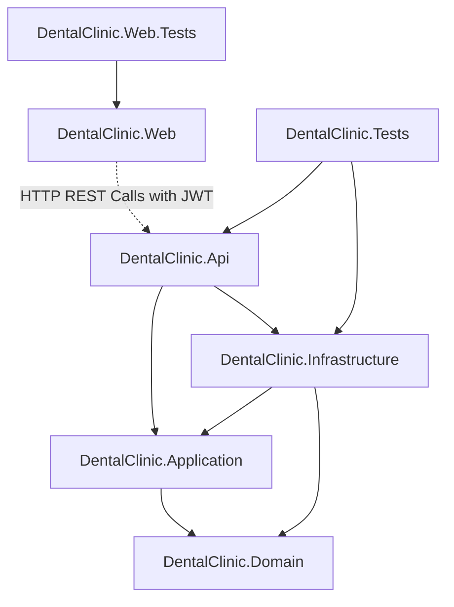

# BÁO CÁO KIẾN TRÚC & TỔNG QUAN HỆ THỐNG DENTAL CARE MANAGEMENT
**Tài liệu:** `01_PROJECT_OVERVIEW.md`  
**Dự án:** DentalCare Clinic Management System (SWP391 - Nhóm 6)  
**Mục đích:** Phục vụ thẩm định kỹ thuật độc lập (External AI / Human Review)  
**Trạng thái kiểm tra:** Hoàn toàn dựa trên mã nguồn thực tế (Static Analysis & Runtime Verification)

---

## 1. CẤU TRÚC SOLUTION & TRÁCH NHIỆM TỪNG DỰ ÁN

Hệ thống được tổ chức thành 2 Solution riêng biệt thuộc hệ sinh thái .NET 8:
- Backend: `BE/DentalClinic.Backend.sln`
- Frontend: `FE/DentalClinic.Web.sln`

```
SWP391_Group6/
├── BE/                                    # Backend Solution (Clean Architecture)
│   ├── DentalClinic.Domain/               # Core Domain: Entities, Enums, Domain Rules
│   ├── DentalClinic.Application/          # Use Cases, DTOs, Service Interfaces, Validators
│   ├── DentalClinic.Infrastructure/       # EF Core DbContext, Service Implementations, Hubs
│   ├── DentalClinic.Api/                  # ASP.NET Core Web API Endpoints, JWT & Filters
│   └── DentalClinic.Tests/                # 356 Unit & Integration Tests (xUnit, Moq, EF InMemory)
├── FE/                                    # Frontend Solution (ASP.NET Core MVC)
│   ├── DentalClinic.Web/                  # UI Web App, Controllers, Razor Views, ViewModels, HttpClients
│   └── DentalClinic.Web.Tests/            # 257 MVC Controller & View Tests (xUnit, Moq)
├── DB/                                    # SQL Schemas, Database Migrations, Seeding Data
└── docs/                                  # Technical & Architectural Documentation
```

### Trách nhiệm chi tiết của từng Project:

| Project | Target Framework | Trách nhiệm chính trong hệ thống | File cấu hình chính |
| :--- | :--- | :--- | :--- |
| **`DentalClinic.Domain`** | `net8.0` | Chứa các thực thể cốt lõi, hằng số phân quyền (`UserRole`), trạng thái lịch khám (`AppointmentStatus`), trạng thái tài khoản (`AccountStatus`), và các quy tắc nghiệp vụ độc lập. Không phụ thuộc vào bất kỳ framework hoặc thư viện bên ngoài nào. | `BE/DentalClinic.Domain/DentalClinic.Domain.csproj` |
| **`DentalClinic.Application`** | `net8.0` | Định nghĩa các DTOs (Data Transfer Objects), Service Interfaces (`IAppointmentService`, `IMedicalRecordService`, `IBillingService`,...), quy tắc kiểm thực dữ liệu qua FluentValidation (`RegisterRequestValidator`, `DentalImageFileValidator`,...). | `BE/DentalClinic.Application/DentalClinic.Application.csproj` |
| **`DentalClinic.Infrastructure`** | `net8.0` | Hiện thực truy cập dữ liệu qua Entity Framework Core 8 (`DentalClinicDbContext`), triển khai logic nghiệp vụ (`AppointmentService`, `BillingService`, `MedicalRecordService`), SignalR Hub (`LiveChatHub`), lưu trữ file (`LocalImageStorageService`, `CloudinaryImageStorageService`), gửi mail SMTP (`EmailService`). | `BE/DentalClinic.Infrastructure/DentalClinic.Infrastructure.csproj` |
| **`DentalClinic.Api`** | `net8.0` | Cung cấp RESTful Web API cho Frontend và Mobile Client. Quản lý Authentication (JWT Bearer Token), Middleware toàn cục (`GlobalExceptionHandler`), Swagger UI (OpenAPI v1), CORS policy. Cổng mặc định: `https://localhost:7350`. | `BE/DentalClinic.Api/Program.cs` |
| **`DentalClinic.Web`** | `net8.0` | Ứng dụng Web MVC (Model-View-Controller) phục vụ 5 nhóm người dùng. Quản lý Cookie Authentication, Session, DelegatingHandler (`ApiAuthorizationHandler`) tự động đính kèm JWT Token và refresh token ngầm khi nhận mã 401. Cổng mặc định: `https://localhost:7129`. | `FE/DentalClinic.Web/Program.cs` |
| **`DentalClinic.Tests`** | `net8.0` | Bộ kiểm thử tự động Backend gồm 356 test cases kiểm tra dịch vụ nghiệp vụ, xác thực, chuyển đổi trạng thái lịch khám và bảo mật API. | `BE/DentalClinic.Tests/` |
| **`DentalClinic.Web.Tests`** | `net8.0` | Bộ kiểm thử tự động Frontend gồm 257 test cases kiểm tra MVC Controllers, xác thực ViewModel, phân quyền theo vai trò và điều hướng giao diện. | `FE/DentalClinic.Web.Tests/` |

---

## 2. STACK CÔNG NGHỆ & PHIÊN BẢN

- **Nền tảng phát triển:** .NET 8 LTS (C# 12)
- **Database Engine:** Microsoft SQL Server (Transact-SQL), hỗ trợ Unicode đầy đủ (`NVARCHAR`)
- **ORM / Data Access:** Entity Framework Core 8.0.x (Code-First / Reverse Engineered Fluent API Mapping)
- **Web API Framework:** ASP.NET Core Web API với JWT Bearer Token (`Microsoft.AspNetCore.Authentication.JwtBearer 8.0.x`)
- **Frontend MVC Framework:** ASP.NET Core MVC Razor Pages & Razor Views (.cshtml)
- **Thư viện UI / CSS:** Bootstrap 5.3.x, Bootstrap Icons, Font Awesome 6.x
- **Giao tiếp Real-time:** Microsoft ASP.NET Core SignalR (`/hubs/livechat`)
- **Mã hóa mật khẩu:** BCrypt.Net-Next (Work factor = 11) kết hợp Salt
- **Validation:** FluentValidation 11.x (Backend API) & DataAnnotations (Frontend ViewModel)
- **Tài liệu API:** Swashbuckle.AspNetCore 6.5.x (Swagger / OpenAPI v1)
- **Xử lý bất đồng bộ:** SemaphoreSlim (Mutex refresh token), DistributedMemoryCache (Session store)
- **Testing Frameworks:** xUnit 2.6.x, Moq 4.20.x, FluentAssertions, Microsoft.AspNetCore.Mvc.Testing

---

## 3. KIẾN TRÚC FRONTEND (`DentalClinic.Web`)

Frontend được xây dựng theo mô hình **Thực thể MVC Độc lập (Decoupled MVC Web Client)** kết nối với Backend thông qua HTTP REST APIs:

1. **Cơ chế Xác thực kép (Hybrid Authentication Architecture):**
   - Phía Trình duyệt ↔ Frontend MVC: Sử dụng **Cookie Authentication** (`CookieAuthenticationDefaults.AuthenticationScheme`) với cờ bảo mật `HttpOnly = true`, `SameSite = Lax`, `SecurePolicy = Always`.
   - Phía Frontend MVC ↔ Backend Web API: Sử dụng **JWT Bearer Token** với Header `Authorization: Bearer {AccessToken}`.
2. **Quản lý Token & Xử lý 401 tự động (`ApiAuthorizationHandler`):**
   - File triển khai: `FE/DentalClinic.Web/Handlers/ApiAuthorizationHandler.cs`
   - Kế thừa `DelegatingHandler`. Trước khi gửi bất kỳ request nào qua các Typed `HttpClient`, Handler đọc `AccessToken` từ `ITokenService` (lưu trữ trong encrypted Session) và gán vào request header.
   - Khi Backend trả về mã lỗi `401 Unauthorized`:
     - Handler khóa luồng bằng `SemaphoreSlim(1, 1)`.
     - Sử dụng một `RawApiClient` riêng biệt (không gắn `ApiAuthorizationHandler` để tránh vòng lặp đệ quy) gọi endpoint `POST /api/auth/refresh`.
     - Nhận `AccessToken` và `RefreshToken` mới, cập nhật vào Session.
     - Tái thực thi request ban đầu (tối đa 1 lần retry) với cờ `X-Retry-Attempted: true`.
3. **Phân quyền giao diện (UI Authorization):**
   - Các MVC Controllers được trang trí bằng thuộc tính `[Authorize(Roles = "...")]` (ví dụ: `[Authorize(Roles = UserRole.Dentist)]`).
   - File layout dùng chung: `FE/DentalClinic.Web/Views/Shared/_Sidebar.cshtml` và `_Navbar.cshtml` sử dụng mệnh đề Razor `@if (User.IsInRole(...))` để render menu động tương ứng với vai trò đăng nhập.
4. **Typed HttpClients:**
   Mỗi phân hệ nghiệp vụ sở hữu một Typed HttpClient chuyên biệt được đăng ký trong `FE/DentalClinic.Web/Program.cs`:
   - `IAuthApiService` $\rightarrow$ `AuthApiService`
   - `IProfileApiService` $\rightarrow$ `ProfileApiService`
   - `IAppointmentApiService` $\rightarrow$ `AppointmentApiService`
   - `IAdminApiService` $\rightarrow$ `AdminApiService`
   - `IDentistScheduleApiService` $\rightarrow$ `DentistScheduleApiService`
   - `IMedicalRecordApiService` $\rightarrow$ `MedicalRecordApiService`
   - `IPrescriptionApiService` $\rightarrow$ `PrescriptionApiService`
   - `ITreatmentApiService` $\rightarrow$ `TreatmentApiService`
   - `IBillingApiService` $\rightarrow$ `BillingApiService`
   - `IPostCareApiService` $\rightarrow$ `PostCareApiService`
   - `IBlogApiService` $\rightarrow$ `BlogApiService`
   - `ISupportApiService` $\rightarrow$ `SupportApiService`
   - `IReportApiService` $\rightarrow$ `ReportApiService`

---

## 4. KIẾN TRÚC BACKEND (`DentalClinic.Api`, `Application`, `Infrastructure`)

Backend tuân thủ nghiêm ngặt mô hình **Kiến trúc phân tầng sạch (Clean Architecture / Onion Architecture)**:

```
                  ┌────────────────────────┐
                  │    DentalClinic.Api    │  (Controllers, Middleware, Swagger)
                  └───────────┬────────────┘
                              │ references
                  ┌───────────▼────────────┐
                  │DentalClinic.Application│  (Interfaces, DTOs, FluentValidation)
                  └───────────┬────────────┘
                              │ references
                  ┌───────────▼────────────┐
                  │  DentalClinic.Domain   │  (Enums: Roles, Statuses, Core Constants)
                  └────────────────────────┘
                              ▲
                              │ implements interfaces & context
                  ┌───────────┴────────────┐
                  │DentalClinic.Infrastr...│  (DbContext, Services, SignalR Hubs)
                  └────────────────────────┘
```

- **Nguyên tắc phụ thuộc:** Phân tầng Domain và Application hoàn toàn độc lập, không phụ thuộc vào cơ sở hạ tầng hoặc công nghệ lưu trữ.
- **Dependency Injection:** Được cấu hình tập trung tại `BE/DentalClinic.Infrastructure/DependencyInjection.cs` và nạp vào container tại `BE/DentalClinic.Api/Program.cs`.
- **Global Exception Handling:** Lớp middleware `GlobalExceptionHandler.cs` chặn mọi ngoại lệ không mong muốn, ghi log và trả về định dạng chuẩn `ApiResponse.Fail("Đã có lỗi xảy ra...", errors)` với mã HTTP thích hợp (400, 401, 403, 404, 500).

---

## 5. KIẾN TRÚC TRUY CẬP DỮ LIỆU & CƠ SỞ DỮ LIỆU

- **DbContext tập trung:** `DentalClinicDbContext` đặt tại `BE/DentalClinic.Infrastructure/Persistence/DentalClinicDbContext.cs`.
- **Khai báo thực thể:** Gồm 38 `DbSet<T>` bao quát toàn bộ hoạt động y khoa, hành chính và thanh toán.
- **Fluent API Configuration:**
  - Định nghĩa khóa chính, khóa ngoại, chỉ mục (`Index`), ràng buộc duy nhất (`UQ`).
  - Toàn bộ chuỗi văn bản sử dụng Unicode (`NVARCHAR`) để đảm bảo không lỗi font tiếng Việt.
  - Cột tính toán tự động (`Computed Column`):
    - `InvoiceItems.Amount` = `([Quantity] * [UnitPrice])`
    - `PerformedServices.Amount` = `([Quantity] * [UnitPrice])`
  - Ràng buộc Check Constraints:
    - `CK__Appointme__Booki__09A971A2`: Giá trị hợp lệ của `BookingSource` là `'Patient'` hoặc `'Receptionist'`.
    - `CK__Invoices__Status__7849DB76`: Giá trị hợp lệ của `Status` là `'Unpaid'`, `'PartiallyPaid'`, `'Paid'`, `'Cancelled'`.
  - Quản lý Transaction: Sử dụng `IDbContextTransaction` (`BeginTransactionAsync`, `CommitAsync`, `RollbackAsync`) cho các thao tác chuyển trạng thái nhạy cảm (như xác nhận lịch hẹn kèm sinh số thứ tự `QueueNumber` hoặc tạo hóa đơn thu tiền).

---

## 6. QUAN HỆ ĐỘC LẬP GIỮA CÁC PROJECT (DEPENDENCY GRAPH)



---

## 7. CÁC TÍCH HỢP NGOẠI VI (EXTERNAL INTEGRATIONS)

1. **Cổng thanh toán mã QR động VietQR:**
   - Cơ chế: Không phụ thuộc vào SDK bên thứ ba, tạo trực tiếp mã VietQR theo chuẩn Napas 247 qua URL ảnh động:
     `https://img.vietqr.io/image/MB-039123456789-compact2.png?amount={TotalAmount}&addInfo=THANH%20TOAN%20{InvoiceCode}`
   - File triển khai: `FE/DentalClinic.Web/Views/Receptionist/Billing/Detail.cshtml` và `FE/DentalClinic.Web/Views/Patient/Invoices/Detail.cshtml`.
2. **Google OAuth 2.0 / OpenID Connect:**
   - Cơ chế: Bệnh nhân có thể đăng nhập bằng tài khoản Google. Client ID và Secret được quản lý qua `appsettings.json` / Secret Store.
   - Nhận diện OpenID token `id_token` và ánh xạ vào hồ sơ `UserAccounts`.
3. **Lưu trữ hình ảnh y khoa & Avatar:**
   - Hệ thống hỗ trợ 2 chế độ: `LocalImageStorageService` (lưu tại `wwwroot/uploads/`) và `CloudinaryImageStorageService` (lưu trên Cloudinary CDN) thông qua interface `IImageStorageService` và `IMedicalImagingStorageService`.
4. **Hệ thống Chat trực tuyến Real-time (SignalR):**
   - Hub endpoint: `/hubs/livechat`
   - Cho phép bệnh nhân trao đổi trực tiếp với nhân viên lễ tân trực bàn tiếp đón.
5. **Gửi thông báo Email (SMTP):**
   - Triển khai tại `EmailService.cs`, gửi mail xác nhận đặt lịch khám thành công, mã OTP xác minh tài khoản và thông báo hủy lịch.

---

## 8. VÒNG ĐỜI REQUEST THỰC TẾ (ACTUAL REQUEST LIFECYCLE)

```
[1. User Action]
     │ Nhấp chuột / Gửi biểu mẫu (ví dụ: Bác sĩ bấm "Vào Khám")
     ▼
[2. Frontend Razor View] (FE/DentalClinic.Web/Views/Dentist/Appointments/Today.cshtml)
     │ Gửi Form POST hoặc AJAX
     ▼
[3. Frontend Controller] (DentistAppointmentController.StartAppointment)
     │ Kiểm tra ModelState, đọc Claims phiên đăng nhập Cookie
     ▼
[4. Typed API Service] (AppointmentApiService.DentistStartAppointmentAsync)
     │ Gửi yêu cầu qua HttpClient
     ▼
[5. DelegatingHandler] (ApiAuthorizationHandler)
     │ Đính kèm Header: "Authorization: Bearer <JWT_Token>"
     │ (Nếu gặp 401: Mutex Lock -> Call /api/auth/refresh -> Gán Token mới -> Retry)
     ▼
[6. Backend API Controller] (BE/DentalClinic.Api/Controllers/AppointmentsController.cs)
     │ [Authorize(Roles = "Dentist,SystemAdministrator")] xác minh JWT & Role Claim
     ▼
[7. Application Interface / Service] (IAppointmentService -> AppointmentService.DentistStartAppointmentAsync)
     │ Thực thi nghiệp vụ: Kiểm tra quyền sở hữu ca khám (AssignedDentistUserId == currentUserId),
     │ Kiểm tra tính hợp lệ của trạng thái (chỉ nhận CheckedIn/Confirmed)
     ▼
[8. Database Layer] (DentalClinicDbContext -> SQL Server)
     │ Cập nhật Appointments (Status = 'InService', UpdatedAt = UtcNow)
     │ Ghi nhật ký vào bảng AppointmentStatusHistories
     │ Gửi thông báo Notification qua NotificationService
     ▼
[9. Response Pipeline]
     │ DbContext.SaveChangesAsync -> Return ApiResponse.Ok(...) -> Controller -> JSON
     ▼
[10. Frontend MVC Response]
     │ Deserialize ApiResponse<T> -> Set TempData["SuccessMessage"] -> RedirectToAction / Render View
     ▼
[11. User Browser]
     │ Giao diện cập nhật sang trạng thái xanh lá "ĐANG TRONG CA KHÁM", nút [Chọn Ghế] hiển thị.
```
