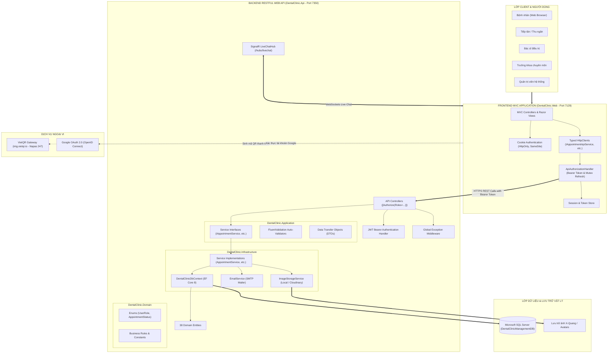
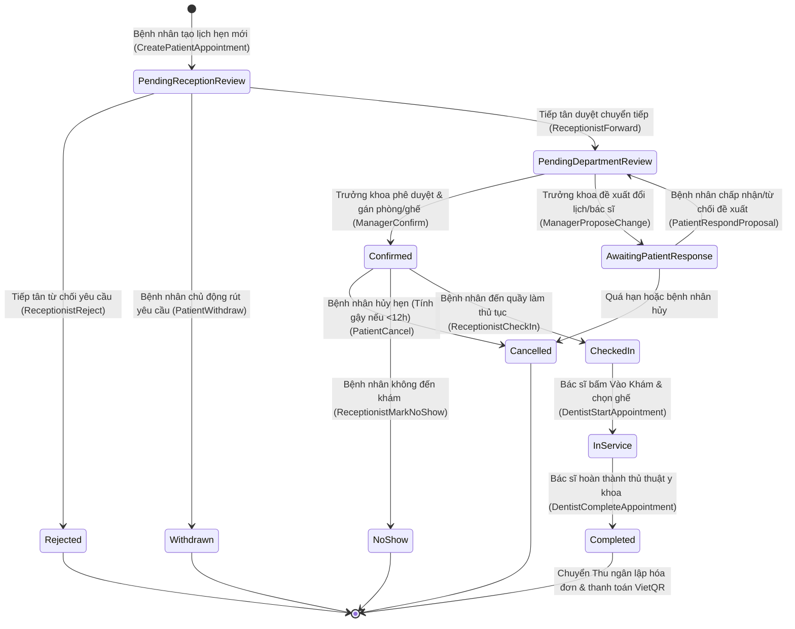
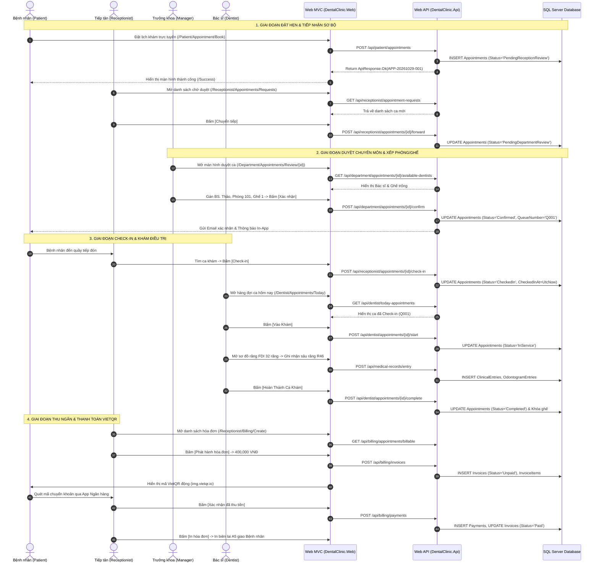
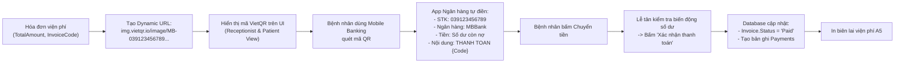

# TẬP HỢP BIỂU ĐỒ HỆ THỐNG TOÀN DIỆN (SYSTEM ARCHITECTURAL & WORKFLOW DIAGRAMS)
**Tài liệu:** `14_DIAGRAMS.md`  
**Dự án:** DentalCare Clinic Management System (SWP391 - Nhóm 6)  
**Định dạng:** Chuẩn Markdown Mermaid Diagrams

---

## 1. SƠ ĐỒ KIẾN TRÚC TỔNG THỂ HỆ THỐNG (SYSTEM ARCHITECTURE)

---

## 2. BIỂU ĐỒ CỖ MÁY TRẠNG THÁI LỊCH HẸN (APPOINTMENT STATE MACHINE)

---

## 3. BIỂU ĐỒ TRÌNH TỰ BÀN GIAO KHÉP KÍN 5 PHÂN QUYỀN (END-TO-END SEQUENCE)

---

## 4. QUY TRÌNH THANH TOÁN MÃ QR ĐỘNG VIETQR

