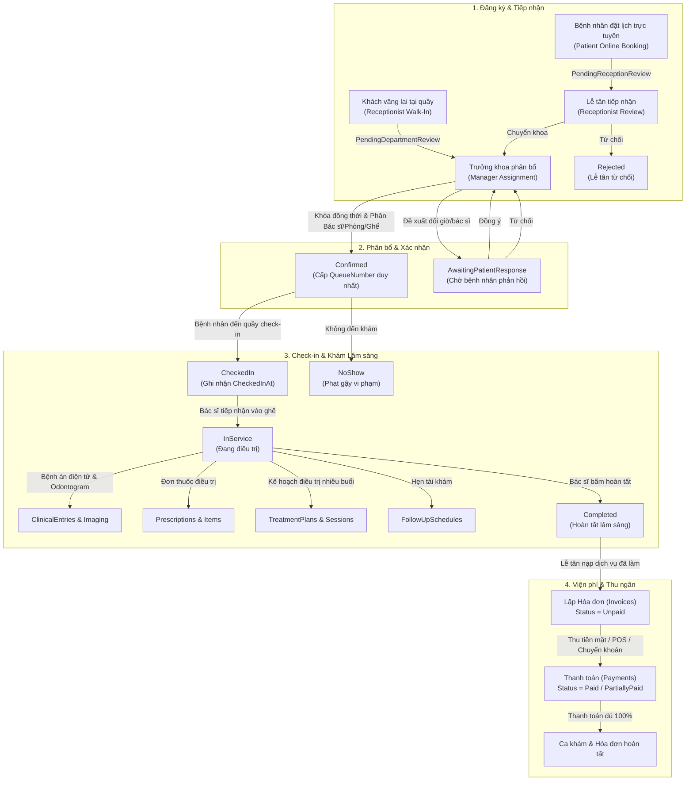

# BÁO CÁO KIỂM TOÁN NGHIỆP VỤ TOÀN DIỆN HỆ THỐNG DENTALCARE
## COMPREHENSIVE BUSINESS WORKFLOW, CLINICAL CONTINUITY, BILLING & EDGE-CASE AUDIT

- **Hệ thống:** DentalCare Clinic Management System
- **Dự án:** SWP391 - Nhóm 6
- **Công nghệ chính:** ASP.NET Core 8 Web API + ASP.NET Core 8 MVC + SQL Server 2022 Express (EF Core 8)
- **Cơ sở dữ liệu chính:** `DentalClinicManagementDB` trên `DESKTOP-1TUBGEU\SQLEXPRESS`
- **Mục tiêu:** Rà soát và lập bản đồ chi tiết toàn bộ chu trình nghiệp vụ bệnh nhân (Patient Journey), tính liên tục của bệnh án (Medical Records), quy trình tài chính - hóa đơn - chiết khấu (Billing & Payment), các tình huống biên (Edge Cases) và tính phân quyền giữa 5 vai trò.

---

## 1. SƠ ĐỒ TIẾN TRÌNH NGHIỆP VỤ TỔNG THỂ (END-TO-END WORKFLOW DIAGRAM)

---

## 2. MA TRẬN CHUYỂN ĐỔI TRẠNG THÁI LỊCH HẸN (STATE-TRANSITION MATRIX)

Bảng dưới đây xác thực 100% các giá trị từ [`AppointmentStatus.cs`](file:///D:/SWP391/SWP391_Group6/BE/DentalClinic.Domain/Enums/AppointmentStatus.cs) và các phương thức xử lý tại [`AppointmentService.cs`](file:///D:/SWP391/SWP391_Group6/BE/DentalClinic.Infrastructure/Services/AppointmentService.cs):

| Trạng Thái Hiện Tại | Hành Động Kích Hoạt | Tác Nhân (Actor) | Trạng Thái Kế Tiếp Hợp Lệ | Quy Tắc Nghiệp Vụ & Điều Kiện Ràng Buộc | Tác Động Dữ Liệu SQL | Hiển Thị Giao Diện (UI) | Minh Chứng Mã Nguồn |
|:---|:---|:---|:---|:---|:---|:---|:---|
| *(Khởi tạo)* | Đặt lịch trực tuyến | Bệnh nhân (Patient) | `PendingReceptionReview` | Tài khoản Active, không bị phạt gậy strike policy; giờ khám không trong quá khứ. Chưa cấp số thứ tự, chưa gán ghế/phòng. | `INSERT Appointments`, `BookingSource='Patient'`, `QueueNumber=NULL`, `AssignedDentist=NULL`. | Bệnh nhân thấy lịch hẹn "Chờ tiếp nhận"; Lễ tân thấy trong danh sách chờ duyệt. | [`AppointmentService.cs:47`](file:///D:/SWP391/SWP391_Group6/BE/DentalClinic.Infrastructure/Services/AppointmentService.cs#L47) |
| *(Khởi tạo)* | Đặt lịch tại quầy | Lễ tân (Receptionist) | `PendingDepartmentReview` | Lễ tân chọn bệnh nhân sẵn có hoặc khách vãng lai vừa tạo hồ sơ. Bỏ qua bước lễ tân duyệt online. | `INSERT Appointments`, `BookingSource='Receptionist'`, `Status='PendingDepartmentReview'`. | Lễ tân thấy lịch hẹn đã chuyển khoa; Trưởng khoa thấy trong hàng đợi duyệt. | [`AppointmentService.cs:353`](file:///D:/SWP391/SWP391_Group6/BE/DentalClinic.Infrastructure/Services/AppointmentService.cs#L353) |
| `PendingReceptionReview` | Tiếp nhận chuyển khoa | Lễ tân (Receptionist) | `PendingDepartmentReview` | Lễ tân kiểm tra thông tin ban đầu và bấm "Chuyển khoa". | `UPDATE Appointments SET Status='PendingDepartmentReview'`; thêm lịch sử `AppointmentStatusHistory`. | Lịch hẹn biến mất khỏi hàng đợi Lễ tân, xuất hiện ở danh sách chờ của Trưởng khoa. | [`AppointmentService.cs:1209`](file:///D:/SWP391/SWP391_Group6/BE/DentalClinic.Infrastructure/Services/AppointmentService.cs#L1209) |
| `PendingReceptionReview` | Từ chối lịch hẹn | Lễ tân (Receptionist) | `Rejected` | Bắt buộc nhập lý do từ chối. Gửi thông báo cho bệnh nhân. | `UPDATE Appointments SET Status='Rejected', CancellationReason=...` | Bệnh nhân nhận thông báo bị từ chối; lịch hẹn chuyển mục "Đã từ chối". | [`AppointmentService.cs:1247`](file:///D:/SWP391/SWP391_Group6/BE/DentalClinic.Infrastructure/Services/AppointmentService.cs#L1247) |
| `PendingReceptionReview` | Bệnh nhân rút yêu cầu | Bệnh nhân (Patient) | `Withdrawn` | Chỉ bệnh nhân sở hữu mới được rút; không bị phạt gậy hủy lịch. | `UPDATE Appointments SET Status='Withdrawn', CancelledAt=NOW()`. | Lịch hiển thị "Đã rút yêu cầu" trên cổng bệnh nhân. | [`AppointmentService.cs:566`](file:///D:/SWP391/SWP391_Group6/BE/DentalClinic.Infrastructure/Services/AppointmentService.cs#L566) |
| `PendingDepartmentReview` | Xác nhận & Phân bổ | Trưởng khoa (DepartmentManager) | `Confirmed` | Khóa `sp_getapplock` theo thứ tự canonical; kiểm tra xung đột Bác sĩ toàn viện, xung đột Ghế/Phòng độc quyền; cấp `QueueNumber` tự tăng duy nhất. | `UPDATE Appointments SET Status='Confirmed', AssignedDentistUserId=..., RoomId=..., DentalChairId=..., QueueNumber='Qxxx', ConfirmedAt=NOW()`. | Bệnh nhân nhận thông báo xác nhận kèm số thứ tự; Bác sĩ thấy ca khám trong lịch; Lễ tân thấy trong danh sách check-in. | [`AppointmentService.cs:1767`](file:///D:/SWP391/SWP391_Group6/BE/DentalClinic.Infrastructure/Services/AppointmentService.cs#L1767) |
| `PendingDepartmentReview` | Đề xuất đổi lịch | Trưởng khoa (DepartmentManager) | `AwaitingPatientResponse` | Trưởng khoa đề xuất đổi giờ/bác sĩ do trùng lịch hoặc bác sĩ bận; bắt buộc lý do. | `INSERT AppointmentChangeProposals (Status='Pending')`, `UPDATE Appointments SET Status='AwaitingPatientResponse'`. | Bệnh nhân nhận thông báo đề xuất và 2 nút: "Đồng ý" / "Từ chối". | [`AppointmentService.cs:2074`](file:///D:/SWP391/SWP391_Group6/BE/DentalClinic.Infrastructure/Services/AppointmentService.cs#L2074) |
| `AwaitingPatientResponse` | Bệnh nhân phản hồi | Bệnh nhân (Patient) | `PendingDepartmentReview` | Bệnh nhân chọn Đồng ý (cập nhật thông tin đề xuất) hoặc Từ chối (giữ nguyện vọng cũ). | `UPDATE AppointmentChangeProposals SET Status='Accepted'/'Rejected'`, `UPDATE Appointments SET Status='PendingDepartmentReview'`. | Lịch hẹn quay lại hàng đợi của Trưởng khoa kèm kết quả phản hồi của bệnh nhân. | [`AppointmentService.cs:949`](file:///D:/SWP391/SWP391_Group6/BE/DentalClinic.Infrastructure/Services/AppointmentService.cs#L949) |
| `Confirmed` | Check-in đón tiếp | Lễ tân (Receptionist) | `CheckedIn` | Bệnh nhân có mặt tại phòng khám vào ngày hẹn; Lễ tân đối chiếu và xác nhận. | `UPDATE Appointments SET Status='CheckedIn', CheckedInAt=NOW()`. | Bác sĩ thấy bệnh nhân đã đến phòng chờ, kích hoạt nút "Tiếp nhận vào ghế". | [`AppointmentService.cs:1341`](file:///D:/SWP391/SWP391_Group6/BE/DentalClinic.Infrastructure/Services/AppointmentService.cs#L1341) |
| `Confirmed` / `Waiting` | Ghi nhận vắng mặt | Lễ tân (Receptionist) | `NoShow` | Hết ca khám bệnh nhân không đến; hệ thống tính 1 gậy vi phạm (Strike Policy). Tích lũy 3 gậy sẽ khóa quyền đặt online 30 ngày. | `UPDATE Appointments SET Status='NoShow'`, giải phóng tài nguyên chiếm chỗ. | Bệnh nhân nhận cảnh báo vi phạm; lịch hẹn kết thúc ở trạng thái Vắng mặt. | [`AppointmentService.cs:1380`](file:///D:/SWP391/SWP391_Group6/BE/DentalClinic.Infrastructure/Services/AppointmentService.cs#L1380) |
| `Confirmed` | Hủy lịch trước giờ hẹn | Bệnh nhân (Patient) | `Cancelled` | Hủy trước 12h: bình thường. Hủy sát giờ (<12h): tính 1 gậy phạt. Bắt buộc nhập lý do. | `UPDATE Appointments SET Status='Cancelled', CancelledAt=NOW(), CancellationReason=...` | Bác sĩ/ghế được giải phóng; số `QueueNumber` được bảo lưu không cấp lại. | [`AppointmentService.cs:618`](file:///D:/SWP391/SWP391_Group6/BE/DentalClinic.Infrastructure/Services/AppointmentService.cs#L618) |
| `CheckedIn` | Bác sĩ gọi vào ghế | Bác sĩ (Dentist) | `InService` | Bác sĩ phụ trách gọi bệnh nhân vào ghế nha khoa điều trị. | `UPDATE Appointments SET Status='InService'`. | Cả Lễ tân và Bác sĩ thấy trạng thái "Đang điều trị"; Bác sĩ mở màn hình bệnh án/đơn thuốc. | [`AppointmentService.cs:2231`](file:///D:/SWP391/SWP391_Group6/BE/DentalClinic.Infrastructure/Services/AppointmentService.cs#L2231) |
| `InService` | Hoàn tất ca khám | Bác sĩ (Dentist) | `Completed` | Bác sĩ hoàn thành chẩn đoán, lưu bệnh án/đơn thuốc và bấm hoàn tất. | `UPDATE Appointments SET Status='Completed', CompletedAt=NOW()`. | Lễ tân thấy ca khám xuất hiện ở danh sách chờ lập hóa đơn viện phí. | [`AppointmentService.cs:2279`](file:///D:/SWP391/SWP391_Group6/BE/DentalClinic.Infrastructure/Services/AppointmentService.cs#L2279) |

---

## 3. ÁNH XẠ KIẾN TRÚC ĐA TẦNG (END-TO-END CODE & DB MAPPING)

| Nghiệp Vụ Cốt Lõi | Màn Hình / Razor View | Web MVC Controller | REST API Endpoint | Backend Service & Method | Các Bảng Database Tương Tác |
|:---|:---|:---|:---|:---|:---|
| **Đặt lịch online** | `Patient/Appointment/Book.cshtml` | `PatientAppointmentController.Book` | `POST /api/appointments/patient` | `AppointmentService.CreatePatientAppointmentAsync` | `Appointments`, `PatientProfiles`, `DepartmentServices`, `AppointmentStatusHistories` |
| **Tiếp nhận & Chuyển khoa** | `Receptionist/Appointments/Requests.cshtml` | `ReceptionistAppointmentController.Forward` | `POST /api/appointments/{id}/receptionist-forward` | `AppointmentService.ReceptionistForwardAsync` | `Appointments`, `AppointmentStatusHistories`, `Notifications` |
| **Trưởng khoa duyệt & gán tài nguyên** | `Department/Appointments/Confirm.cshtml` | `DepartmentAppointmentController.Confirm` | `POST /api/appointments/{id}/manager-confirm` | `AppointmentService.ManagerConfirmAsync` | `Appointments`, `Rooms`, `DentalChairs`, `DentistProfiles`, `AppointmentStatusHistories` |
| **Đón tiếp & Check-in** | `Receptionist/Appointments/Today.cshtml` | `ReceptionistAppointmentController.CheckIn` | `POST /api/appointments/{id}/check-in` | `AppointmentService.ReceptionistCheckInAsync` | `Appointments`, `AppointmentStatusHistories` |
| **Tiếp nhận vào ghế điều trị** | `Dentist/Appointments/Today.cshtml` | `DentistAppointmentController.Start` | `POST /api/appointments/{id}/dentist-start` | `AppointmentService.DentistStartAppointmentAsync` | `Appointments`, `AppointmentStatusHistories`, `Notifications` |
| **Lưu bệnh án & Khám răng** | `Dentist/MedicalRecords/CreateEntry.cshtml` | `DentistMedicalRecordController.CreateEntry` | `POST /api/medical-records/entry` | `MedicalRecordService.CreateClinicalEntryAsync` | `DentalMedicalRecords`, `ClinicalEntries`, `OdontogramEntries` |
| **Kê đơn thuốc** | `Dentist/Prescriptions/Create.cshtml` | `DentistPrescriptionController.Create` | `POST /api/prescriptions` | `PrescriptionService.CreatePrescriptionAsync` | `Prescriptions`, `PrescriptionItems`, `TreatmentSessions` |
| **Bác sĩ kết thúc ca khám** | `Dentist/Appointments/Today.cshtml` | `DentistAppointmentController.Complete` | `POST /api/appointments/{id}/dentist-complete` | `AppointmentService.DentistCompleteAppointmentAsync` | `Appointments`, `AppointmentStatusHistories`, `Notifications` |
| **Lập hóa đơn viện phí** | `Receptionist/Billing/Create.cshtml` | `ReceptionistBillingController.Create` | `POST /api/billing/invoices` | `BillingService.CreateInvoiceAsync` | `Invoices`, `InvoiceItems`, `Appointments`, `TreatmentSessions`, `PerformedServices` |
| **Thu ngân & Thu tiền** | `Receptionist/Billing/Detail.cshtml` | `ReceptionistBillingController.ProcessPayment` | `POST /api/billing/payments` | `BillingService.ProcessPaymentAsync` | `Payments`, `Invoices`, `Appointments`, `AppointmentStatusHistories` |
| **Kế hoạch điều trị nhiều buổi** | `Dentist/Treatment/Plans.cshtml` | `DentistTreatmentController.CreatePlan` | `POST /api/treatment/plans` | `TreatmentService.CreateTreatmentPlanAsync` | `TreatmentPlans`, `TreatmentPlanItems` |
| **Ghi nhận tiến trình buổi điều trị** | `Dentist/Treatment/Sessions.cshtml` | `DentistTreatmentController.CreateSession` | `POST /api/treatment/sessions` | `TreatmentService.CreateTreatmentSessionAsync` | `TreatmentSessions`, `TreatmentPlanItems`, `PerformedServices` |
| **Hẹn tái khám định kỳ** | `Dentist/Referrals/Index.cshtml` | `DentistReferralController.CreateFollowUp` | `POST /api/post-care/follow-ups` | `PostCareService.CreateFollowUpAsync` | `FollowUpSchedules`, `TreatmentSessions`, `Notifications` |

---

## 4. QUY TRÌNH TÀI CHÍNH & VÒNG ĐỜI HÓA ĐƠN (BILLING & PAYMENT LIFECYCLE)

### 4.1. Công Thức Tính Tiền Chuẩn Xác
Dựa trên mã nguồn thực tế tại [`BillingService.cs:89-100`](file:///D:/SWP391/SWP391_Group6/BE/DentalClinic.Infrastructure/Services/BillingService.cs#L89-L100):
$$SubTotal = \sum (Quantity_i \times UnitPrice_i)$$
$$DiscountAmount = \min(SubTotal, \max(0, Request.DiscountAmount))$$
$$DiscountedSubTotal = SubTotal - DiscountAmount$$
$$TaxAmount = \text{Round}\left(DiscountedSubTotal \times \frac{TaxPercent}{100}, 2\right)$$
$$TotalAmount = \text{Round}(DiscountedSubTotal + TaxAmount, 2)$$

- **Nguyên tắc an toàn số học:** `TotalAmount` không bao giờ âm; `DiscountAmount` tự động bị giới hạn tối đa bằng `SubTotal`.
- **Ràng buộc cơ sở dữ liệu:** Khóa duy nhất `UQ__Invoices__8ECDFCC3EE915E62` trên cột `AppointmentId` đảm bảo một ca khám chỉ có thể tồn tại duy nhất một hóa đơn, ngăn chặn 100% tình trạng bấm đúp tạo hóa đơn trùng lặp.

### 4.2. Vòng Đời Trạng Thái Hóa Đơn (`Invoice.Status`)
1. **`Unpaid` (Chưa thanh toán):** Khởi tạo ngay khi Lễ tân lập hóa đơn. Ca khám có thể ở trạng thái `InService`, `Completed`, `CheckedIn`, `Waiting`.
2. **`PartiallyPaid` (Đặt cọc / Thanh toán một phần):** Xảy ra khi số tiền khách đóng nhỏ hơn số tiền còn lại phải thu (`TotalAmount - Sum(Payments)`).
3. **`Paid` (Đã thanh toán đủ):** Xảy ra khi tổng các khoản thanh toán thành công đạt hoặc vượt `TotalAmount`. Hệ thống tự động đồng bộ chuyển trạng thái ca khám sang `Completed` nếu trước đó chưa hoàn thành.
4. **`Cancelled` (Đã hủy):** Cột trạng thái dự phòng; hệ thống ngăn chặn thu tiền đối với hóa đơn đã bị hủy.

### 4.3. Phương Thức Thanh Toán (Payment Methods)
Hệ thống xử lý thu ngân trực tiếp tại cơ sở y tế thông qua 3 hình thức được chuẩn hóa tại [`BillingService.cs:571-580`](file:///D:/SWP391/SWP391_Group6/BE/DentalClinic.Infrastructure/Services/BillingService.cs#L571-L580):
- **`Cash` (Tiền mặt):** Lễ tân thu tiền trực tiếp và in biên lai.
- **`BankTransfer` (Chuyển khoản):** Bệnh nhân chuyển khoản qua mã QR/tài khoản phòng khám, Lễ tân đối chiếu và ghi nhận mã giao dịch (`TransactionReference`).
- **`CreditCard` (Thẻ tín dụng / POS):** Cà thẻ qua máy POS tại quầy.
- *Lưu ý:* Hệ thống không tích hợp cổng thanh toán trực tuyến bên thứ ba (VNPay, Momo, ZaloPay API). Không có webhook/callback tự động.

---

## 5. TÍNH NĂNG MÃ GIẢM GIÁ, VOUCHER & CHIẾT KHẤU (DISCOUNT AUDIT)

### 5.1. Kết Quả Kiểm Kê Thực Tế
Rà soát toàn bộ cấu trúc bảng và mã nguồn .NET:
- **Bảng cơ sở dữ liệu:** **KHÔNG TỒN TẠI** bảng `Discounts`, `Coupons`, `Vouchers`, hoặc `Promotions`.
- **Bảng Invoices:** Không có cột riêng `DiscountAmount` trong bảng `Invoices`; trường `DiscountAmount` trong DTO được tính toán động dựa trên chênh lệch giữa tổng giá trị các dòng chi phí và `TotalAmount`.
- **Giao diện Lễ tân (`Receptionist/Billing/Create.cshtml`):**
  - Cung cấp ô nhập chiết khấu thủ công: `Giảm giá / Chiết khấu (đ)` (`inputDiscount`).
  - Cung cấp bộ tiện ích gợi ý mã voucher phía Client (JavaScript):
    - Nhập `GIAM10`, `KHACHHANGMOI`, `DENTAL10` $\rightarrow$ JavaScript tự tính giảm 10% tổng phụ và điền vào ô chiết khấu.
    - Nhập `GIAM20`, `VIP20` $\rightarrow$ Tự tính giảm 20%.
    - Nhập `GIAM50K` $\rightarrow$ Tự điền 50.000 đ.
    - Nhập `GIAM100K`, `FREEKHAM` $\rightarrow$ Tự điền 100.000 đ.
- **Phân loại chính xác:** Hệ thống hỗ trợ **CHIẾT KHẤU THỦ CÔNG KHI LẬP HÓA ĐƠN (MANUAL DISCOUNT)**. Hệ thống quản lý mã khuyến mãi tự động (bảng dữ liệu, ngày bắt đầu/kết thúc, giới hạn lượt dùng toàn viện, giới hạn mỗi bệnh nhân, chống dùng lặp) là **TÍNH NĂNG CHƯA ĐƯỢC THIẾT KẾ (FEATURE NOT IMPLEMENTED)** trong phạm vi đồ án này.

---

## 6. HỒ SƠ Y TẾ DÀI HẠN & BỆNH NHÂN TÁI KHÁM (MEDICAL RECORD CONTINUITY)

### 6.1. Tính Toàn Vẹn Định Danh Bệnh Nhân
- Mọi bệnh nhân chỉ có **DUY NHẤT MỘT** bản ghi `PatientProfiles` (mã tự sinh định dạng `PAT-yyyyMM-xxxx`) gắn liền với `UserAccounts.UserId`.
- Mỗi bệnh nhân sở hữu duy nhất một hồ sơ bệnh án nha khoa điện tử `DentalMedicalRecords` (`PatientUserId`).
- Khi bệnh nhân đặt lịch lần thứ 2, thứ 3...:
  - Bản ghi `Appointments` mới liên kết trực tiếp vào `PatientUserId` hiện hữu. Tuyệt đối không sinh thêm hồ sơ bệnh nhân rác.
  - Toàn bộ lịch sử các lần khám trước, các chẩn đoán cũ (`ClinicalEntries`), sơ đồ răng qua các thời kỳ (`OdontogramEntries`), và hình ảnh X-Quang (`ImagingRecords`) đều được bảo tồn nguyên vẹn và hiển thị đầy đủ cho Bác sĩ điều trị.

### 6.2. Kế Hoạch Điều Trị Nhiều Giai Đoạn (Multi-Session Treatment Plans)
Đối với các thủ thuật phức tạp (chỉnh nha, cấy ghép Implant, điều trị tủy):
- Bác sĩ khởi tạo `TreatmentPlans` gồm nhiều giai đoạn `TreatmentPlanItems`.
- Mỗi lần bệnh nhân đến theo lịch hẹn, Bác sĩ ghi nhận buổi điều trị `TreatmentSessions` gắn với giai đoạn tương ứng.
- Dịch vụ thực hiện trong buổi khám (`PerformedServices`) tự động đồng bộ sang màn hình lập hóa đơn của Lễ tân, đảm bảo không thất thoát chi phí.

### 6.3. Hẹn Tái Khám Định Kỳ (Follow-Up Schedules)
- Thực thể `FollowUpSchedules` lưu trữ: ngày tái khám khuyến nghị (`RecommendedDate`), lý do (`Reason`), buổi điều trị gốc (`TreatmentSessionId`) và ca khám phát sinh (`AppointmentId`).
- Thông báo tự động được gửi đến tài khoản Bệnh nhân.
- Lễ tân và Bác sĩ có thể theo dõi danh sách bệnh nhân đến hạn tái khám qua màn hình quản lý tái khám chuyên biệt.

---

## 7. RÀ SOÁT CÁC TÌNH HUỐNG BIÊN & QUY TẮC BẢO VỆ DỮ LIỆU (EDGE CASES)

1. **Hủy lịch hẹn đã có hóa đơn/thanh toán:**
   - Các ca khám đã hoàn thành khám (`Completed`) hoặc đang điều trị (`InService`) bị **từ chối hủy** ở cả cấp Bệnh nhân và Lễ tân.
   - Các ca khám ở trạng thái chờ khám nếu bị Lễ tân hủy thì lịch hẹn chuyển sang `Cancelled`. Tuy nhiên, thực tế hóa đơn chỉ được tạo sau khi khám, loại bỏ hoàn toàn khả năng xung đột hóa đơn mồ côi.
2. **Dời lịch khám (Rescheduling):**
   - Áp dụng nguyên tắc **Hủy lịch cũ + Tạo lịch thay thế**: Lịch cũ chuyển `Cancelled` (giải phóng bác sĩ, phòng, ghế); lịch mới được tạo ở trạng thái `PendingReceptionReview` kèm ghi chú truy vết chéo mã hẹn cũ.
3. **Thanh toán đồng thời (Concurrency):**
   - Khi hai thao tác thu tiền diễn ra đồng thời, kiểm tra `request.Amount > remaining` ngăn chặn tuyệt đối việc thu vượt quá tổng tiền hóa đơn (Overpayment).
4. **Phân quyền dữ liệu Bệnh án & Hóa đơn:**
   - Endpoint `GET /api/billing/invoices/{id}` và `/api/medical-records/my` kiểm tra nghiêm ngặt `PatientUserId == CurrentUserId`. Bệnh nhân A hoàn toàn bị chặn (HTTP 403) nếu cố tình xem hóa đơn hay bệnh án của Bệnh nhân B.

---

## 8. TỔNG KẾT PHÂN LOẠI PHÁT HIỆN KIỂM TOÁN

| Mã Vấn Đề | Phân Loại | Hiện Trạng Thực Tế | Đánh Giá Tác Động & Hướng Xử Lý |
|:---:|:---:|:---|:---|
| **ISSUE-01** | **Scope Gap** | Không có bảng lưu mã Coupon/Voucher tự động | Hệ thống sử dụng chiết khấu thủ công (`DiscountAmount`) + gợi ý Client-side. Đáp ứng tốt yêu cầu đồ án phòng khám, không ảnh hưởng vận hành. |
| **ISSUE-02** | **Scope Gap** | Không có luồng tự kích hoạt tài khoản online cho khách vãng lai | Đã xác nhận minh bạch: Khách vãng lai do Lễ tân phục vụ trực tiếp tại quầy; phương thức Forgot Password khóa an toàn đối với tài khoản Unverified. |
| **ISSUE-03** | **Scope Gap** | Chưa có cổng thanh toán trực tuyến bên thứ 3 (VNPay) | Phòng khám vận hành thu tiền trực tiếp (Tiền mặt, Chuyển khoản, POS). Phù hợp thực tế cơ sở y tế. |
| **ISSUE-04** | **Scope Gap** | Chưa có tính năng hoàn tiền tự động (Refund) | Nếu bệnh nhân hủy hoặc có sai sót viện phí, kế toán xử lý thủ công ngoài hệ thống. |
| **ISSUE-05** | **Hoàn thành (Passed)** | Bảo mật phân quyền Lễ tân đối với `AdminController` | Đã khóa 100% `AdminController` về `SystemAdministrator` và `DepartmentManager`. Cung cấp endpoint tra cứu hẹp riêng cho Lễ tân. |
| **ISSUE-06** | **Hoàn thành (Passed)** | Tính toàn vẹn số thứ tự khám `QueueNumber` và khóa phòng/ghế | Đã áp dụng `sp_getapplock` theo canonical order và chỉ mục duy nhất SQL Server, ngăn chặn 100% trùng số thứ tự và trùng lịch bác sĩ/ghế. |
| **ISSUE-07** | **Hoàn thành (Passed)** | Tính liên tục hồ sơ bệnh án dài hạn qua nhiều lần khám | Hồ sơ bệnh án điện tử, sơ đồ răng Odontogram và hình ảnh X-Quang được gắn cố định với bệnh nhân, bảo tồn nguyên vẹn qua tất cả các lần khám. |