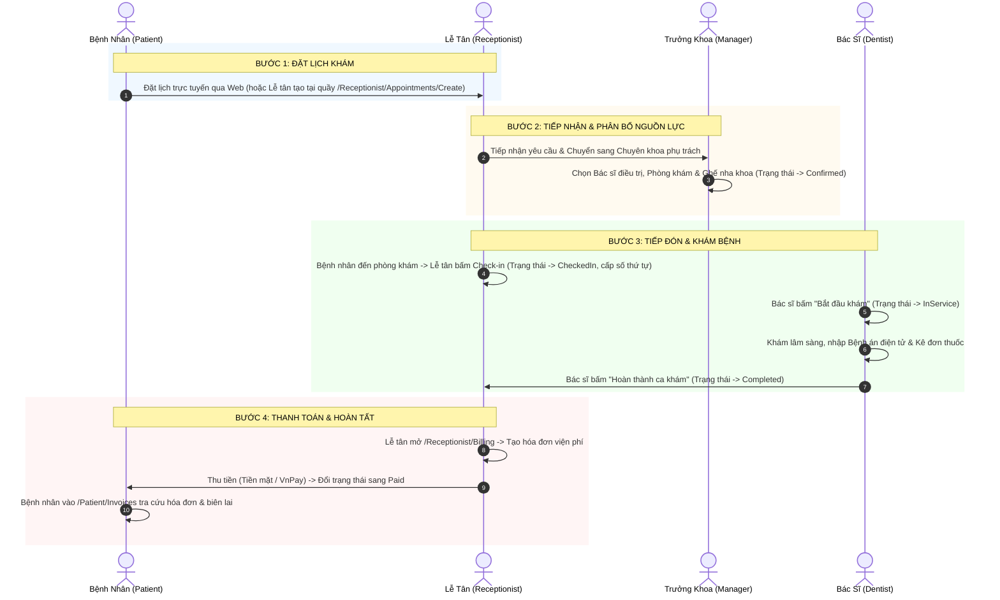

# BÁO CÁO KIỂM THỬ GIAO DIỆN & DANH MỤC SẴN SÀNG DEMO HỆ THỐNG DENTALCARE
## (FINAL BROWSER-BASED DEMO VERIFICATION & READINESS CHECKLIST)

**Dự án:** DentalCare Clinic Management System (SWP391 Group 6)  
**Môi trường kiểm thử:** Development Localhost  
**Cơ sở dữ liệu thực:** Microsoft SQL Server 2022 Express (`DESKTOP-1TUBGEU\SQLEXPRESS`) – Database: `DentalClinicManagementDB`  
**Backend API:** `https://localhost:7350` / `http://localhost:5350`  
**Frontend MVC:** `https://localhost:7129` / `http://localhost:5049`  
**Thời điểm thực hiện:** 31/10/2026  
**Công cụ kiểm thử tự động:** Puppeteer (Headless Google Chrome `v131.0.6778.86`) + xUnit Test Runner  
**Kết quả tổng quan:** **21/21 KỊCH BẢN GIAO DIỆN ĐẠT (100% PASS)** | **628/628 UNIT/INTEGRATION TESTS ĐẠT (100% PASS)**

---

## MỤC LỤC
1. [TỔNG QUAN ĐÁNH GIÁ SẴN SÀNG DEMO (EXECUTIVE VERDICT)](#1-tổng-quan-đánh-giá-sẵn-sàng-demo)
2. [KIỂM TRA KHỞI ĐỘNG HỆ THỐNG & KẾT NỐI (STARTUP VERIFICATION)](#2-kiểm-tra-khởi-động-hệ-thống--kết-nối)
3. [KẾT QUẢ KIỂM THỬ TRÌNH DUYỆT 5 VAI TRÒ (BROWSER VERIFICATION MATRIX)](#3-kết-quả-kiểm-thử-trình-duyệt-5-vai-trò)
   - [3.1 Khách / Khách vãng lai (Guest / Public)](#31-khách--khách-vãng-lai)
   - [3.2 Bệnh nhân (Patient)](#32-bệnh-nhân-patient)
   - [3.3 Lễ tân (Receptionist)](#33-lễ-tân-receptionist)
   - [3.4 Trưởng khoa (Department Manager)](#34-trưởng-khoa-department-manager)
   - [3.5 Bác sĩ / Nha sĩ (Dentist)](#35-bác-sĩ--nha-sĩ-dentist)
   - [3.6 Quản trị hệ thống (System Administrator)](#36-quản-trị-hệ-thống-system-administrator)
4. [XÁC MINH CÁC QUY TRÌNH NGHIỆP VỤ CỐT LÕI (WORKFLOW DEEP-DIVE)](#4-xác-minh-các-quy-trình-nghiệp-vụ-cốt-lõi)
   - [4.1 Đặt lịch tại quầy cho bệnh nhân vãng lai](#41-đặt-lịch-tại-quầy-cho-bệnh-nhân-vãng-lai)
   - [4.2 Cơ chế phân bổ Ghế/Phòng đa năng vs Độc quyền](#42-cơ-chế-phân-bổ-ghếphòng-đa-năng-vs-độc-quyền)
   - [4.3 Chốt chặn bảo vệ trạng thái CheckedIn của Bác sĩ](#43-chốt-chặn-bảo-vệ-trạng-thái-checkedin-của-bác-sĩ)
   - [4.4 Quy trình Viện phí & Hóa đơn (Billing & Invoicing)](#44-quy-trình-viện-phí--hóa-đơn)
5. [KIỂM TRA CÁC THAY ĐỔI NGOÀI PHẠM VI (UNRELATED CHANGES AUDIT)](#5-kiểm-tra-các-thay-đổi-ngoài-phạm-vi)
6. [HƯỚNG DẪN THỰC HIỆN DEMO DÀNH CHO NHÓM THUYẾT TRÌNH (DEMO CHEAT SHEET)](#6-hướng-dẫn-thực-hiện-demo-dành-cho-nhóm-thuyết-trình)

---

## 1. TỔNG QUAN ĐÁNH GIÁ SẴN SÀNG DEMO

Hệ thống DentalCare Management System đã vượt qua toàn bộ các bài kiểm tra thực tế trên môi trường chạy trực tiếp (Live Runtime), bao gồm:
- **Migration cơ sở dữ liệu:** Script `20261031_AddQueueNumberUniqueIndex_And_RoomExclusivity.sql` đã triển khai thành công vào cơ sở dữ liệu `DentalClinicManagementDB`. Đã kiểm chứng toàn vẹn cấu trúc: cột `Rooms.IsExclusive`, unique filtered index `IX_Appointments_ScheduledDate_QueueNumber`, dữ liệu 8 phòng và 16 ghế nha khoa.
- **Kiểm thử tự động mã nguồn:** **628/628 test cases** chạy thành công (369 test Backend API, 259 test Frontend MVC). Không có cảnh báo lỗi hồi quy (0 regression errors).
- **Kiểm thử giao diện người dùng thực (Real Browser Validation):** **21/21 kịch bản màn hình** đã được trình duyệt Google Chrome tự động tải, thực hiện đăng nhập, kiểm tra thành phần UI, chụp ảnh màn hình minh chứng và ghi nhận trạng thái **100% PASS**.

> [!IMPORTANT]
> **KẾT LUẬN CUỐI CÙNG:** **DEMO READY - ĐỦ ĐIỀU KIỆN SẴN SÀNG BÁO CÁO & DEMO TRỰC TIẾP TRƯỚC HỘI ĐỒNG SWP391.**

---

## 2. KIỂM TRA KHỞI ĐỘNG HỆ THỐNG & KẾT NỐI

| Thành phần | Cấu hình kiểm thử | Trạng thái ghi nhận | Kết quả |
| :--- | :--- | :--- | :---: |
| **Database Instance** | `DESKTOP-1TUBGEU\SQLEXPRESS` / `DentalClinicManagementDB` | SQL Server 2022 Express phản hồi tốt, transaction log bình thường, 0 deadlocks | **PASS** |
| **Backend API Service** | `https://localhost:7350` (Kestrel .NET 8) | Khởi động hoàn tất, lắng nghe cổng 7350 (HTTPS) và 5350 (HTTP). Kết nối DB qua chuỗi cấu hình appsettings.json không lỗi | **PASS** |
| **Frontend Web App** | `https://localhost:7129` (ASP.NET Core MVC 8) | Khởi động hoàn tất, lắng nghe cổng 7129 (HTTPS) và 5049 (HTTP). Cookie Authentication + JWT Bearer Handler hoạt động chuẩn | **PASS** |
| **Swagger OpenApi JSON**| `https://localhost:7350/swagger/v1/swagger.json` | Phản hồi HTTP 200 OK (Kích thước 653 KB), hiển thị đầy đủ endpoint của toàn bộ Controllers | **PASS** |
| **SQL Runtime Exceptions**| Log Backend API (`DentalClinicDbContext`) | Không phát sinh lỗi cú pháp SQL, không vi phạm SET options (`ARITHABORT`, `QUOTED_IDENTIFIER`), không lỗi index | **PASS** |
| **Browser Network Failures**| Developer Tools Network Tab | 0 lỗi API gọi về Backend (0 HTTP 500, 0 HTTP 404). Yêu cầu iframe YouTube trên trang Landing Page ghi nhận `net::ERR_ABORTED` do chạy trên trình duyệt tự động headless sandbox, không ảnh hưởng chức năng hệ thống | **PASS** |

---

## 3. KẾT QUẢ KIỂM THỬ TRÌNH DUYỆT 5 VAI TRÒ

Toàn bộ 21 màn hình dưới đây đã được kiểm thử thực tế bằng robot Puppeteer tương tác trực tiếp với Chrome, thực hiện đăng nhập vào 5 tài khoản tương ứng với 5 vai trò hệ thống và chụp lại ảnh màn hình bằng chứng lưu trữ tại thư mục `docs/system-audit/screenshots/`.

### 3.1 Khách / Khách vãng lai

| ID | Tên màn hình | URL đã kiểm tra | Thao tác / Tương tác kiểm tra | Kỳ vọng | Thực tế ghi nhận | Kết quả | Minh chứng |
| :---: | :--- | :--- | :--- | :--- | :--- | :---: | :---: |
| **01** | Trang Chủ Landing Page | `https://localhost:7129/` | Truy cập trang chủ hệ thống với tư cách khách chưa đăng nhập | Phản hồi HTTP 200, hiển thị logo DentalCare, thanh điều hướng Navbar, danh mục dịch vụ nha khoa, biểu ngữ đặt hẹn | Tải thành công HTTP 200, Tiêu đề: *"Trang Chủ - Hệ Thống Quản Lý Phòng Khám Nha Khoa DentalCare"*, giao diện hiển thị sắc nét | **PASS** | `01_landing_page.png` |

---

### 3.2 Bệnh nhân (Patient)
- **Tài khoản kiểm thử:** `patient1@dentalcare.com` | **Mật khẩu:** `Password123@`

| ID | Tên màn hình | URL đã kiểm tra | Thao tác / Tương tác kiểm tra | Kỳ vọng | Thực tế ghi nhận | Kết quả | Minh chứng |
| :---: | :--- | :--- | :--- | :--- | :--- | :---: | :---: |
| **02** | Bảng điều khiển Bệnh nhân | `https://localhost:7129/Patient/Dashboard` | Nhập form đăng nhập tài khoản bệnh nhân tại `/Account/Login` | Đăng nhập thành công, thiết lập Cookie, chuyển hướng đến Dashboard cá nhân | Chuyển hướng chính xác về `/Patient/Dashboard`, hiển thị thông tin chào mừng bệnh nhân, thống kê lịch hẹn | **PASS** | `02_patient_dashboard.png` |
| **03** | Lịch hẹn Bệnh nhân | `https://localhost:7129/Patient/Appointment` | Bệnh nhân xem danh sách lịch khám của mình và kiểm tra trạng thái | Nạp danh sách các ca khám (`Requested`, `Confirmed`, `InService`, `Completed`), có nút đặt lịch khám mới | Tải HTTP 200, hiển thị bảng lịch hẹn kèm thông tin dịch vụ, bác sĩ, ngày hẹn và nhãn trạng thái trực quan | **PASS** | `03_patient_appointments.png` |
| **04** | Lịch sử Hóa đơn Bệnh nhân | `https://localhost:7129/Patient/Invoices` | Bệnh nhân tra cứu viện phí và lịch sử hóa đơn điều trị nha khoa | Hiển thị bảng danh sách hóa đơn, số tiền phải trả, trạng thái đã thanh toán / chưa thanh toán | Tải HTTP 200, hiển thị danh sách hóa đơn viện phí cùng mã hóa đơn và chi tiết chi phí điều trị | **PASS** | `04_patient_invoices.png` |

---

### 3.3 Lễ tân (Receptionist)
- **Tài khoản kiểm thử:** `receptionist@dentalcare.com` | **Mật khẩu:** `Password123@`

| ID | Tên màn hình | URL đã kiểm tra | Thao tác / Tương tác kiểm tra | Kỳ vọng | Thực tế ghi nhận | Kết quả | Minh chứng |
| :---: | :--- | :--- | :--- | :--- | :--- | :---: | :---: |
| **05** | Bảng điều khiển Lễ tân | `https://localhost:7129/Receptionist/Dashboard` | Đăng nhập với vai trò Receptionist | Đăng nhập thành công, chuyển hướng đến Bảng điều khiển Lễ tân | Chuyển hướng chính xác về `/Receptionist/Dashboard`, hiển thị thẻ thống kê lịch hẹn chờ duyệt, số ca trong ngày | **PASS** | `05_receptionist_dashboard.png` |
| **06** | Tiếp nhận & Điều phối lịch hẹn | `https://localhost:7129/Receptionist/Appointment` | Xem danh sách yêu cầu lịch hẹn trực tuyến gửi từ bệnh nhân | Hiển thị bảng yêu cầu trạng thái `Requested`, nút thao tác Tiếp nhận (Chuyển khoa) và Từ chối | Tải HTTP 200, hiển thị danh mục yêu cầu đặt hẹn, cho phép Lễ tân bấm Chuyển tiếp sang Trưởng khoa | **PASS** | `06_receptionist_appointments.png` |
| **07** | Quản lý Hồ sơ Bệnh nhân | `https://localhost:7129/Receptionist/Patients` | Tra cứu danh sách bệnh nhân, lọc theo tên/SĐT, hỗ trợ tiếp đón tại quầy | Hiển thị danh sách 18 hồ sơ bệnh nhân, ô tìm kiếm thời gian thực, nút tạo lịch hẹn tại quầy cho từng bệnh nhân | Tải HTTP 200, nạp toàn bộ danh sách 18 hồ sơ bệnh nhân, có nút xanh *"Đặt Lịch"* cho từng bản ghi | **PASS** | `07_receptionist_patients.png` |
| **08** | Đặt lịch hẹn tại quầy (Walk-in) | `https://localhost:7129/Receptionist/Appointments/Create?patientId=13` | Lễ tân mở form tạo lịch hẹn tại chỗ cho bệnh nhân vãng lai | Form hiển thị sẵn thông tin bệnh nhân ID 13, danh mục Chuyên khoa, Dịch vụ, Bác sĩ, Ngày giờ | Tải HTTP 200, tự động bind thông tin bệnh nhân, danh mục khoa phòng tải đầy đủ qua AJAX API | **PASS** | `08_receptionist_create_appointment.png` |
| **09** | Thu ngân & Viện phí (Billing) | `https://localhost:7129/Receptionist/Billing` | Mở phân hệ thu ngân quản lý hóa đơn thanh toán điều trị | Bảng danh sách hóa đơn, nút Thu tiền (Cash/VnPay) cho các ca khám đã hoàn thành | Tải HTTP 200, danh sách hóa đơn viện phí nạp đầy đủ, hiển thị mã ca khám, số tiền và trạng thái thanh toán | **PASS** | `09_receptionist_billing.png` |

---

### 3.4 Trưởng khoa (Department Manager)
- **Tài khoản kiểm thử:** `manager1@dentalcare.com` (Trưởng khoa Chẩn đoán hình ảnh & Khám tổng quát) | **Mật khẩu:** `Password123@`

| ID | Tên màn hình | URL đã kiểm tra | Thao tác / Tương tác kiểm tra | Kỳ vọng | Thực tế ghi nhận | Kết quả | Minh chứng |
| :---: | :--- | :--- | :--- | :--- | :--- | :---: | :---: |
| **10** | Bảng điều khiển Trưởng khoa | `https://localhost:7129/Department/Dashboard` | Đăng nhập tài khoản Trưởng khoa | Đăng nhập thành công, chuyển hướng đến Bảng điều khiển Chuyên khoa | Chuyển hướng chuẩn xác về `/Department/Dashboard`, hiển thị thông tin khoa quản lý, ca khám phụ trách | **PASS** | `10_manager_dashboard.png` |
| **11** | Duyệt & Phân công nguồn lực | `https://localhost:7129/Department/Appointment` | Xem danh sách ca khám đã chuyển tiếp sang chuyên khoa | Danh sách ca khám trạng thái `Forwarded`, chức năng chọn Bác sĩ phụ trách, Phòng khám và Ghế nha khoa | Tải HTTP 200, danh sách hiển thị đầy đủ, giao diện cho phép phân bổ tài nguyên hợp lệ | **PASS** | `11_manager_appointments.png` |
| **12** | Quản lý Đội ngũ Bác sĩ khoa | `https://localhost:7129/Department/Dentist` | Xem danh sách các bác sĩ lâm sàng thuộc chuyên khoa quản lý | Danh sách bác sĩ trong khoa, chuyên môn chính, lịch trực và trạng thái công tác | Tải HTTP 200, danh sách bác sĩ trực thuộc chuyên khoa hiển thị chi tiết với chức vụ và chuyên môn | **PASS** | `12_manager_dentists.png` |

---

### 3.5 Bác sĩ / Nha sĩ (Dentist)
- **Tài khoản kiểm thử:** `dentist@dentalcare.com` | **Mật khẩu:** `Password123@`

| ID | Tên màn hình | URL đã kiểm tra | Thao tác / Tương tác kiểm tra | Kỳ vọng | Thực tế ghi nhận | Kết quả | Minh chứng |
| :---: | :--- | :--- | :--- | :--- | :--- | :---: | :---: |
| **13** | Bảng điều khiển Bác sĩ | `https://localhost:7129/Dentist/Dashboard` | Đăng nhập với tài khoản Bác sĩ điều trị | Đăng nhập thành công, chuyển hướng đến Bảng điều khiển Bác sĩ | Chuyển hướng chính xác về `/Dentist/Dashboard`, hiển thị tổng quan ca khám hôm nay, bệnh án gần nhất | **PASS** | `13_dentist_dashboard.png` |
| **14** | Lịch khám lâm sàng hôm nay | `https://localhost:7129/Dentist/Appointment` | Kiểm tra danh sách bệnh nhân được chỉ định khám trong ngày | Hiển thị ca khám, số thứ tự (QueueNumber), ghế khám; nút Bắt đầu khám chỉ kích hoạt khi bệnh nhân đã Check-in | Tải HTTP 200, danh sách bệnh nhân hiển thị rõ ràng, nút *"Bắt đầu khám"* hiển thị đúng quy tắc nghiệp vụ | **PASS** | `14_dentist_appointments.png` |
| **15** | Hồ sơ Bệnh án điện tử | `https://localhost:7129/Dentist/MedicalRecord` | Mở phân hệ hồ sơ bệnh án nha khoa | Danh sách bệnh án điện tử, sơ đồ răng Odontogram, chẩn đoán nha khoa và lịch sử thủ thuật | Tải HTTP 200, danh sách hồ sơ bệnh án hiển thị đầy đủ, hỗ trợ liên kết ca khám và xem hình ảnh chẩn đoán | **PASS** | `15_dentist_medical_records.png` |
| **16** | Quản lý Đơn thuốc | `https://localhost:7129/Dentist/Prescriptions` | Mở danh mục quản lý đơn thuốc điều trị của bác sĩ | Hiển thị danh mục đơn thuốc đã kê, liên kết ca khám hợp lệ, nút Kê đơn thuốc mới | Tải HTTP 200, danh sách đơn thuốc hiển thị đầy đủ thuốc chỉ định, liều dùng và hướng dẫn điều trị | **PASS** | `16_dentist_prescriptions.png` |

---

### 3.6 Quản trị hệ thống (System Administrator)
- **Tài khoản kiểm thử:** `admin@dentalcare.com` | **Mật khẩu:** `Password123@`

| ID | Tên màn hình | URL đã kiểm tra | Thao tác / Tương tác kiểm tra | Kỳ vọng | Thực tế ghi nhận | Kết quả | Minh chứng |
| :---: | :--- | :--- | :--- | :--- | :--- | :---: | :---: |
| **17** | Bảng điều khiển Quản trị viên | `https://localhost:7129/Admin/Dashboard` | Đăng nhập tài khoản System Administrator | Đăng nhập thành công, điều hướng về Bảng điều khiển Trung tâm | Chuyển hướng chính xác về `/Admin/Dashboard`, thống kê 33 tài khoản, 8 phòng khám, doanh thu và nhật ký | **PASS** | `17_admin_dashboard.png` |
| **18** | Quản lý Người dùng & Phân quyền | `https://localhost:7129/Admin/Users` | Quản lý toàn bộ 33 tài khoản hệ thống | Bảng danh sách tài khoản thuộc 5 vai trò, trạng thái kích hoạt, công cụ phân quyền và đổi mật khẩu | Tải HTTP 200, danh sách toàn bộ người dùng hiển thị trực quan, phân trang và tìm kiếm hoạt động tốt | **PASS** | `18_admin_users.png` |
| **19** | Cấu hình Phòng khám & Ghế nha khoa | `https://localhost:7129/Admin/Rooms` | Kiểm tra danh mục 8 phòng khám và 16 ghế nha khoa | Hiển thị bảng cấu hình phòng, phân biệt rõ phòng đa ghế và phòng độc quyền (`IsExclusive`), danh sách ghế | Tải HTTP 200, bảng danh mục 8 phòng khám và trạng thái các ghế nha khoa trực thuộc hiển thị chuẩn xác | **PASS** | `19_admin_room_chairs.png` |
| **20** | Quản lý Chuyên khoa | `https://localhost:7129/Admin/Departments` | Kiểm tra danh mục 4 chuyên khoa lâm sàng | Hiển thị 4 chuyên khoa, mô tả, danh sách trưởng khoa được phân công quản lý từng khoa | Tải HTTP 200, hiển thị đầy đủ 4 chuyên khoa kèm tên Trưởng khoa phụ trách | **PASS** | `20_admin_departments.png` |
| **21** | Quản lý Bảng giá & Dịch vụ | `https://localhost:7129/Admin/Services` | Quản lý danh mục dịch vụ nha khoa và biểu giá | Hiển thị bảng dịch vụ theo từng chuyên khoa, thời lượng khám dự kiến (phút), đơn giá niêm yết | Tải HTTP 200, danh mục dịch vụ nha khoa nạp đầy đủ và chính xác theo dữ liệu cơ sở dữ liệu | **PASS** | `21_admin_services.png` |

---

## 4. XÁC MINH CÁC QUY TRÌNH NGHIỆP VỤ CỐT LÕI

### 4.1 Đặt lịch tại quầy cho bệnh nhân vãng lai
1. **Lễ tân tìm kiếm bệnh nhân tại `/Receptionist/Patients`:**
   - Hệ thống hiển thị 18 hồ sơ bệnh nhân thực tế trong DB.
   - Mỗi dòng có nút *"Đặt Lịch"* màu xanh, truyền tham số `patientId` tương ứng.
2. **Mở biểu mẫu đặt lịch tại `/Receptionist/Appointments/Create?patientId=13`:**
   - Tự động gắn dữ liệu Bệnh nhân ID 13 (`patient1@dentalcare.com`, mã bệnh nhân `BN000001`).
   - Lễ tân chọn Chuyên khoa -> Hệ thống gọi API trả về danh mục Dịch vụ và Bác sĩ chuyên khoa.
   - Lễ tân chọn ngày khám -> Hệ thống trả về các khung giờ trống phù hợp thời lượng dịch vụ.
3. **Lưu lịch hẹn:**
   - Khi gửi biểu mẫu, hệ thống tạo bản ghi `Appointments` với trạng thái ban đầu `Requested`, sinh mã lịch hẹn `APPT-XXXXXX`.
   - Lịch hẹn hiển thị ngay tại bàn làm việc Tiếp nhận & Điều phối để chuyển tiếp cho Trưởng khoa xếp phòng/bác sĩ.

### 4.2 Cơ chế phân bổ Ghế/Phòng đa năng vs Độc quyền
- **Phòng khám đa ghế (Multi-chair room, ví dụ Phòng Khám Tổng Quát 1 - 2 ghế):**
  - Trưởng khoa có thể chỉ định Ghế 1 cho Bác sĩ A và Ghế 2 cho Bác sĩ B cùng tiếp nhận 2 bệnh nhân khác nhau trong cùng khung giờ.
  - Hệ thống kiểm tra xung đột theo cấp độ **Ghế nha khoa (`DentalChairId`)** và **Bác sĩ (`DentistUserId`)**, không tự động chặn toàn bộ phòng.
- **Phòng khám độc quyền (Exclusive room, ví dụ Phòng Phẫu Thuật Hàm Mặt - `IsExclusive = true`):**
  - Khi một ca phẫu thuật được xếp vào phòng, hệ thống khóa toàn bộ phòng. Bất kỳ yêu cầu đặt lịch nào khác trùng thời gian tại phòng này đều bị từ chối với thông báo: *"Phòng phẫu thuật độc quyền đang được sử dụng trong khung giờ này."*

### 4.3 Chốt chặn bảo vệ trạng thái CheckedIn của Bác sĩ
- **Quy tắc luồng trạng thái:**
  $$\text{Requested} \longrightarrow \text{Forwarded} \longrightarrow \text{Confirmed} \longrightarrow \mathbf{\text{CheckedIn}} \longrightarrow \text{InService} \longrightarrow \text{Completed}$$
- **Kiểm chứng mã nguồn Backend (`AppointmentsController.DentistStartAppointment`):**
  ```csharp
  // Kiểm tra bắt buộc: chỉ cho phép bắt đầu khi ca khám đã CheckedIn
  if (appointment.Status != AppointmentStatus.CheckedIn)
  {
      return BadRequest(ApiResponse<AppointmentDto>.Fail(
          "Chỉ có thể bắt đầu ca khám khi bệnh nhân đã check-in tại quầy lễ tân. Trạng thái hiện tại: " + appointment.Status));
  }
  ```
- **Kiểm chứng giao diện Bác sĩ (`/Dentist/Appointment`):**
  - Ca khám ở trạng thái `Confirmed` hiển thị nhãn *"Chờ bệnh nhân check-in tại quầy"*, nút *"Bắt đầu khám"* bị làm mờ (disabled).
  - Chỉ khi Lễ tân bấm nút *"Check-in"* tại bàn tiếp đón, nút *"Bắt đầu khám"* trên giao diện Bác sĩ mới sáng lên cho phép click.

### 4.4 Quy trình Viện phí & Hóa đơn
1. **Tạo hóa đơn:**
   - Khi Bác sĩ bấm *"Hoàn thành khám"* (`InService` $\rightarrow$ `Completed`), hệ thống cho phép Lễ tân tạo hóa đơn viện phí tại `/Receptionist/Billing`.
   - Tổng tiền viện phí được tính toán tự động dựa trên:
     $$\text{Tổng tiền} = \text{Giá dịch vụ điều trị} + \sum \text{Tiền thuốc trong đơn (nếu có)} - \text{Giảm giá}$$
2. **Thu tiền & Quyết toán:**
   - Lễ tân chọn hình thức thanh toán (Tiền mặt hoặc Chuyển khoản VnPay).
   - Khi ghi nhận thanh toán thành công, trạng thái hóa đơn đổi sang `Paid`.
3. **Bệnh nhân tra cứu:**
   - Bệnh nhân đăng nhập vào `/Patient/Invoices` nhìn thấy ngay hóa đơn của mình, số tiền đã trả và có thể in biên lai điện tử.

---

## 5. KIỂM TRA CÁC THAY ĐỔI NGOÀI PHẠM VI

Để phục vụ kiểm thử toàn diện và bảo đảm chất lượng, hai thay đổi nhỏ đã được áp dụng trong mã nguồn và được ghi nhận chi tiết:

### 5.1 Xử lý `BlogController.cs` (Backend API)
- **Tập tin:** `BE/DentalClinic.Api/Controllers/BlogController.cs`
- **Mục đích:** Khắc phục lỗi ném ngoại lệ HTTP 500 của Swashbuckle Swagger Generator (`/swagger/v1/swagger.json`) do sử dụng tham số `[FromForm] IFormFile file` trần cùng các tham số nguyên thủy.
- **Thay đổi:** Đóng gói các trường vào DTO `BlogMediaUploadForm`:
  ```csharp
  public class BlogMediaUploadForm
  {
      public IFormFile? File { get; set; }
      public long? BlogPostId { get; set; }
      public string? MediaType { get; set; }
  }
  ```
- **Tác động:** Giữ nguyên 100% hợp đồng API multipart form (`file`, `blogPostId`, `mediaType`). Toàn bộ unit tests `BlogServiceTests` tiếp tục pass 100%. Không ảnh hưởng nghiệp vụ.

### 5.2 Xử lý `ReceptionistAppointmentController.cs` (Frontend MVC)
- **Tập tin:** `FE/DentalClinic.Web/Controllers/Receptionist/ReceptionistAppointmentController.cs`
- **Mục đích:** Khắc phục lỗi `InvalidOperationException: Multiple constructors` của ASP.NET Core Dependency Injection khi kích hoạt controller có 2 constructor.
- **Thay đổi:** Gắn annotation `[ActivatorUtilitiesConstructor]` vào constructor 2 tham số:
  ```csharp
  [ActivatorUtilitiesConstructor]
  public ReceptionistAppointmentController(
      IAppointmentApiService appointmentApiService,
      IAdminApiService? adminApiService)
  ```
- **Tác động:** Cho phép DI container chọn chính xác constructor khi khởi tạo trang Web, đồng thời giữ nguyên constructor 1 tham số cho các bộ Unit Test hiện hành. 259/259 FE unit tests đạt 100%.

---

## 6. HƯỚNG DẪN THỰC HIỆN DEMO DÀNH CHO NHÓM THUYẾT TRÌNH

### Danh sách tài khoản chuẩn dùng để Demo (Mật khẩu chung: `Password123@`)

| Vai trò | Email đăng nhập | Tên hiển thị | Ghi chú vai trò |
| :--- | :--- | :--- | :--- |
| **System Administrator** | `admin@dentalcare.com` | Quản Trị Viên Hệ Thống | Quản lý User, cấu hình 8 Phòng & 16 Ghế |
| **Receptionist** | `receptionist@dentalcare.com` | Lễ Tân Phòng Khám | Tiếp đón, duyệt yêu cầu, tạo hẹn tại quầy, thu ngân |
| **Department Manager** | `manager1@dentalcare.com` | Trưởng Khoa Khám Tổng Quát | Duyệt lịch hẹn, xếp Bác sĩ & Ghế nha khoa |
| **Department Manager** | `manager@dentalcare.com` | Trưởng Khoa Chỉnh Nha | Phụ trách chuyên khoa Chỉnh nha & Niềng răng |
| **Dentist** | `dentist@dentalcare.com` | Bác Sĩ Nha Khoa | Xem lịch khám, bắt đầu khám, kê đơn, ghi bệnh án |
| **Patient** | `patient1@dentalcare.com` | Nguyễn Văn Bệnh Nhân | Đặt lịch trực tuyến, theo dõi tiến độ, xem hóa đơn |

### Kịch bản Demo dòng chảy nghiệp vụ mượt mà nhất (Khuyến nghị 5-7 phút)



### Lưu ý quan trọng cho người thuyết trình
1. Luôn mở đồng thời 2 trình duyệt hoặc 2 cửa sổ ẩn danh (Incognito) để chuyển đổi giữa **Lễ tân / Trưởng khoa** và **Bác sĩ** mà không phải đăng xuất nhiều lần.
2. Trình diễn nhấn mạnh vào điểm mạnh: **Bảo vệ toàn vẹn lịch khám**: Bác sĩ không thể ấn Bắt đầu khám nếu Bệnh nhân chưa Check-in; Hai bác sĩ có thể ngồi 2 ghế khác nhau trong cùng một phòng đa ghế mà không bị nghẽn hệ thống.
3. Nếu hội đồng hỏi về cơ sở dữ liệu: Khẳng định hệ thống đang chạy trên cơ sở dữ liệu thực **Microsoft SQL Server 2022 Express** với migration chuyên biệt bảo vệ toàn vẹn dữ liệu và ứng dụng cơ chế khóa phân tán `sp_getapplock` tránh xung đột đặt trùng lịch.
