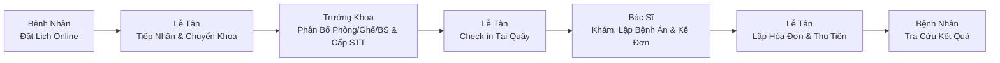
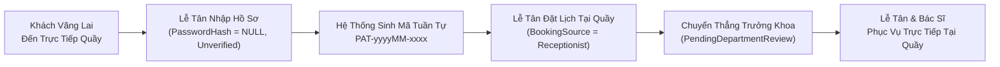

# KỊCH BẢN THUYẾT TRÌNH BẢO VỆ ĐỒ ÁN HỆ THỐNG DENTALCARE
## STEP-BY-STEP FINAL DEMO SCRIPT FOR GRADUATION PROJECT DEFENSE

- **Hệ thống:** Phòng Khám Nha Khoa Đa Chuyên Khoa DentalCare (SWP391 - Group 6)
- **Thời lượng khuyến nghị:** 15 - 20 phút
- **Trạng thái phát hành:** **SẴN SÀNG TRÌNH DIỄN CÓ KIỂM SOÁT (READY FOR CONTROLLED DEMO)**
- **Cấu hình môi trường trình diễn:**
  - Frontend URL: `https://localhost:7129`
  - Backend Swagger: `https://localhost:7350/swagger`
  - Database: `DentalClinicManagementDB` trên `DESKTOP-1TUBGEU\SQLEXPRESS`

---

## I. BẢNG TÀI KHOẢN TRÌNH DIỄN THEO 5 VAI TRÒ (DEMO ACCOUNTS)

| STT | Vai Trò (Role) | Email Đăng Nhập | Mật Khẩu Thử Nghiệm | Họ Và Tên Đại Diện | Quyền Hạn & Trách Nhiệm Chính |
|:---:|:---|:---|:---|:---|:---|
| **1** | **Bệnh Nhân (Patient)** | `patient1@dentalcare.com` | `Password123@` | Nguyễn Thị Mai (PAT-202610-0001) | Đặt lịch khám, theo dõi tiến trình, xem bệnh án, hóa đơn |
| **2** | **Lễ Tân (Receptionist)** | `receptionist@dentalcare.com` | `Password123@` | Trần Thị Lễ Tân | Tiếp nhận yêu cầu, chuyển khoa, check-in, thu ngân |
| **3** | **Trưởng Khoa (DepartmentManager)**| `manager1@dentalcare.com` | `Password123@` | BS. Hoàng Văn Quản Lý (Khoa Tổng Quát) | Duyệt lịch, phân bổ Bác sĩ / Phòng / Ghế khám, cấp QueueNumber |
| **4** | **Bác Sĩ (Dentist)** | `dentist@dentalcare.com` | `Password123@` | BS. Trần Văn Hùng (Mã: DEN-001) | Bắt đầu khám, ghi bệnh án, kê đơn thuốc, kết thúc ca khám |
| **5** | **Quản Trị Viên (SystemAdmin)** | `admin@dentalcare.com` | `Password123@` | Quản Trị Hệ Thống | Quản lý người dùng, phòng khám, ghế nha khoa, cấu hình |

---

## II. KỊCH BẢN 1: QUY TRÌNH BỆNH NHÂN TRỰC TUYẾN ĐẾN HOÀN TẤT ĐIỀU TRỊ (ONLINE BOOKING FLOW)

### Bước 1: Bệnh nhân đăng nhập & đặt lịch khám trực tuyến
- **Tài khoản:** `patient1@dentalcare.com` / `Password123@`
- **Địa chỉ:** `https://localhost:7129/Patient/Appointment/Book`
- **Thao tác:**
  1. Chọn Chuyên khoa: **Khoa Khám Tổng Quát**.
  2. Chọn Dịch vụ: **Khám tổng quát & Tư vấn chăm sóc răng miệng**.
  3. Chọn Bác sĩ mong muốn (Tùy chọn): **BS. Trần Văn Hùng**.
  4. Chọn Ngày & Giờ khám (ví dụ ngày tiếp theo, lúc 09:00).
  5. Nhập Lý do khám: *"Bệnh nhân muốn kiểm tra định kỳ răng hàm mặt và lấy cao răng"*.
  6. Bấm nút **"Xác Nhận Đặt Lịch Khám"**.
- **Kết quả hiển thị:** Hệ thống chuyển về màn hình Lịch Hẹn Của Tôi (`/Patient/Appointment`), trạng thái lịch hẹn là **Chờ tiếp nhận (`PendingReceptionReview`)**, mã lịch dạng `APP-yyyyMMdd-xxxxxx`.
- **Lời thoại thuyết trình:** *"Bệnh nhân chủ động chọn dịch vụ và bác sĩ mong muốn từ cổng thông tin trực tuyến. Hệ thống khởi tạo yêu cầu với mã định danh duy nhất và chuyển sang hòm thư tiếp nhận của bộ phận Lễ tân."*

---

### Bước 2: Lễ tân tiếp nhận sơ bộ & chuyển tiếp chuyên khoa
- **Tài khoản:** `receptionist@dentalcare.com` / `Password123@`
- **Địa chỉ:** `https://localhost:7129/Receptionist/Appointments/Requests`
- **Thao tác:**
  1. Xem danh sách yêu cầu mới trong tab **"Chờ Tiếp Nhận"**.
  2. Tìm mã lịch hẹn vừa tạo của bệnh nhân Nguyễn Thị Mai.
  3. Bấm nút **"Chuyển Khoa"** (màu xanh lá).
  4. Nhập ghi chú điều phối: *"Đã kiểm tra thông tin bệnh nhân hợp lệ, chuyển Trưởng khoa sắp xếp ghế khám"*.
  5. Bấm **"Xác Nhận Chuyển Khoa"**.
- **Kết quả hiển thị:** Thông báo thành công hiển thị. Trạng thái lịch chuyển sang **Chờ Trưởng Khoa Xử Lý (`PendingDepartmentReview`)**.
- **Lời thoại thuyết trình:** *"Lễ tân đóng vai trò phân luồng ban đầu, lọc bỏ các yêu cầu trùng lặp hoặc không hợp lệ, sau đó chuyển giao hồ sơ sang đúng Khoa chuyên môn phụ trách."*

---

### Bước 3: Trưởng khoa duyệt lịch, phân bổ tài nguyên & tự động cấp số thứ tự
- **Tài khoản:** `manager1@dentalcare.com` / `Password123@`
- **Địa chỉ:** `https://localhost:7129/Department/Appointments`
- **Thao tác:**
  1. Tại danh sách **"Lịch Hẹn Cần Phân Bổ"**, chọn lịch hẹn của bệnh nhân Nguyễn Thị Mai.
  2. Bấm **"Phân Bổ & Xác Nhận"**.
  3. Giao diện hiển thị danh sách tài nguyên rảnh theo thời gian thực (kiểm tra chống xung đột khóa ứng dụng `sp_getapplock`):
     - Chọn Bác sĩ: **BS. Trần Văn Hùng**.
     - Chọn Phòng: **Phòng Khám 101 (Phòng chia sẻ đa ghế - IsExclusive = 0)**.
     - Chọn Ghế nha khoa: **Ghế Nha Khoa 01**.
  4. Bấm **"Xác Nhận & Phân Bổ Nguồn Lực"**.
- **Kết quả hiển thị:** Lịch hẹn chuyển sang trạng thái **Đã Xác Nhận (`Confirmed`)**. Hệ thống **tự động cấp số thứ tự khám `QueueNumber` (ví dụ: `Q001` hoặc `Q002`)** đảm bảo tính duy nhất trong ngày theo chỉ mục SQL Server `[UQ_Appointments_Department_Date_QueueNumber]`.
- **Lời thoại thuyết trình:** *"Đây là mắt xích cốt lõi của hệ thống: Trưởng khoa phân bổ tài nguyên y tế. Cơ chế khóa ứng dụng sp_getapplock ngăn chặn triệt để tình trạng hai bác sĩ bị trùng ghế nha khoa hoặc vượt quá công suất phòng độc quyền, đồng thời cấp số thứ tự khám tuần tự chuẩn xác."*

---

### Bước 4: Bệnh nhân đến phòng khám & Lễ tân thực hiện Check-in
- **Tài khoản:** `receptionist@dentalcare.com` / `Password123@`
- **Địa chỉ:** `https://localhost:7129/Receptionist/Appointments/TodayCheckIn`
- **Thao tác:**
  1. Nhập mã bệnh nhân hoặc mã lịch hẹn vào ô tìm kiếm nhanh.
  2. Hệ thống hiển thị thông tin ca khám: Bệnh nhân Nguyễn Thị Mai, Số khám `Q001`, Bác sĩ Trần Văn Hùng, Phòng 101 - Ghế 1.
  3. Bấm nút **"Check-in"**.
- **Kết quả hiển thị:** Trạng thái ca khám chuyển thành **Đã Check-in (`CheckedIn`)**, mốc thời gian `CheckedInAt` được đóng dấu vào cơ sở dữ liệu. Bệnh nhân được mời ngồi tại khu vực sảnh chờ.
- **Lời thoại thuyết trình:** *"Thao tác Check-in không tạo mới số thứ tự mà là điểm ghi nhận sự có mặt thực tế của khách hàng tại cơ sở y tế, kích hoạt ca khám vào hàng đợi phục vụ của Bác sĩ."*

---

### Bước 5: Bác sĩ bắt đầu ca khám tại phòng nha
- **Tài khoản:** `dentist@dentalcare.com` / `Password123@`
- **Địa chỉ:** `https://localhost:7129/Dentist/Appointments`
- **Thao tác:**
  1. Bác sĩ thấy bệnh nhân đã check-in trong danh sách ca khám hôm nay.
  2. Bấm nút **"Bắt Đầu Khám"**.
- **Kết quả hiển thị:** Trạng thái chuyển sang **Đang Khám (`InService`)**. Màn hình làm việc chuyên môn của Bác sĩ mở ra với đầy đủ công cụ hồ sơ bệnh án.
- **Lời thoại thuyết trình:** *"Bác sĩ bắt đầu thực hiện thủ thuật khám lâm sàng. Toàn bộ tiến trình chuyển trạng thái được ghi lại trong lịch sử Audit Log."*

---

### Bước 6: Bác sĩ lập bệnh án lâm sàng & kê đơn thuốc điện tử
- **Tài khoản:** `dentist@dentalcare.com` / `Password123@`
- **Thao tác 6A (Ghi bệnh án lâm sàng):**
  1. Vào menu **"Bệnh Án Điện Tử"** $\rightarrow$ Chọn bệnh nhân Nguyễn Thị Mai.
  2. Nhập Triệu chứng cơ năng: *"Ê buốt nhẹ vùng răng cối hàm dưới khi uống nước lạnh"*.
  3. Nhập Chẩn đoán y khoa: *"Viêm lợi mức độ nhẹ, có vôi răng bám kẽ"*.
  4. Nhập Hướng điều trị: *"Lấy cao răng siêu âm toàn hàm, đánh bóng bề mặt men răng"*.
  5. Bấm **"Lưu Bệnh Án Lâm Sàng"** (`POST /Dentist/MedicalRecords/CreateEntry`).
- **Thao tác 6B (Kê đơn thuốc điện tử):**
  1. Vào tab **"Đơn Thuốc"** $\rightarrow$ Bấm **"Kê Đơn Thuốc"**.
  2. Thêm thuốc: *Amoxicillin 500mg (14 viên, Uống 2 lần/ngày sau ăn)*, *Paracetamol 500mg (10 viên, Uống khi đau nhức)*.
  3. Nhập lời dặn bác sĩ: *"Uống thuốc đúng giờ, tránh đồ cay nóng và đánh răng bằng bàn chải mềm"*.
  4. Bấm **"Lưu Đơn Thuốc"** (`POST /Dentist/Prescriptions/Create`).
- **Kết quả hiển thị:** Bản ghi Bệnh án và Đơn thuốc liên kết chặt chẽ với ca khám thông qua bảng phiên điều trị (`TreatmentSessions`).

---

### Bước 7: Bác sĩ kết thúc ca khám
- **Tài khoản:** `dentist@dentalcare.com`
- **Thao tác:**
  1. Bấm nút **"Hoàn Thành Ca Khám"** (`POST /Dentist/Appointments/{id}/Complete`).
- **Kết quả hiển thị:** Trạng thái lịch hẹn chuyển sang **Hoàn Thành (`Completed`)**. Chu trình lâm sàng kết thúc thành công.
- **Lời thoại thuyết trình:** *"Quy trình y tế hoàn tất, trạng thái ca khám đạt 'Completed'. Bây giờ hệ thống tự động thông báo để bộ phận Lễ tân tiến hành khâu thu ngân tài chính."*

---

### Bước 8: Lễ tân lập hóa đơn & thu ngân nội bộ
- **Tài khoản:** `receptionist@dentalcare.com` / `Password123@`
- **Địa chỉ:** `https://localhost:7129/Receptionist/Billing`
- **Thao tác 8A (Tạo hóa đơn):**
  1. Chọn ca khám vừa hoàn thành của Nguyễn Thị Mai $\rightarrow$ Bấm **"Tạo Hóa Đơn"**.
  2. Hệ thống tự động tổng hợp chi phí dịch vụ khám (500,000đ).
  3. Bấm **"Lưu Hóa Đơn"**. Mã hóa đơn được sinh tuần tự (ví dụ: `INV-20261031-0003`), trạng thái ban đầu là **Chưa Thanh Toán (`Unpaid`)**.
- **Thao tác 8B (Ghi nhận thanh toán):**
  1. Bấm **"Thanh Toán"**.
  2. Chọn Phương thức: **Tiền mặt (Cash)** (hoặc Chuyển khoản / Thẻ).
  3. Nhập số tiền thu: `500,000đ`.
  4. Bấm **"Xác Nhận Thu Tiền"** (`POST /Receptionist/Billing/Pay`).
- **Kết quả hiển thị:** Hóa đơn chuyển trạng thái thành **Đã Thanh Toán (`Paid`)**. Bảng giao dịch `Payments` ghi nhận đầy đủ nhân viên thu ngân và mã tham chiếu.
- **Lời thoại thuyết trình:** *"Khâu thanh toán diễn ra minh bạch, độc lập với hồ sơ bệnh án lâm sàng. Hệ thống hỗ trợ đa dạng phương thức thanh toán tiền mặt, chuyển khoản và thẻ nội bộ."*

---

### Bước 9: Bệnh nhân tra cứu kết quả khám & biên lai điện tử
- **Tài khoản:** `patient1@dentalcare.com` / `Password123@`
- **Địa chỉ:** `https://localhost:7129/Patient/Invoices`
- **Kết quả hiển thị:** Bệnh nhân xem được đầy đủ Hóa đơn đã thanh toán kèm mã biên lai, lịch hẹn trạng thái `Completed`, xem lại đơn thuốc và bệnh án điều trị một cách tiện lợi ngay trên điện thoại hoặc máy tính.

---

## III. KỊCH BẢN 2: QUY TRÌNH TIẾP NHẬN BỆNH NHÂN VÃNG LAI TRỰC TIẾP TẠI QUẦY (WALK-IN WORKFLOW)

### Bước 1: Tiếp nhận thông tin bệnh nhân vãng lai
- **Tài khoản:** `receptionist@dentalcare.com`
- **Địa chỉ:** `https://localhost:7129/Receptionist/Patients`
- **Thao tác:**
  1. Bấm nút **"Tiếp Nhận Bệnh Nhân Mới"**. Modal mở ra.
  2. Nhập thông tin:
     - Họ và tên: `Lê Văn Vãng Lai`
     - Số điện thoại: `0978861467`
     - Email: `walkin.patient@demo.vn`
     - Giới tính: `Nam` (Hệ thống chuẩn hóa sang `Male` bảo đảm ràng buộc DB)
     - Ngày sinh: `20/08/1992`
  3. Bấm **"Lưu Hồ Sơ"**.
- **Kết quả hiển thị:** Hệ thống tạo hồ sơ thành công với mã bệnh nhân tự tăng `PAT-202610-0019`.
- **Điểm nhấn bảo mật giải trình trước Hội đồng:** *"Hệ thống không tạo mật khẩu mặc định như 123456 nhằm ngăn ngừa rò rỉ dữ liệu y tế. Bản ghi UserAccounts có PasswordHash = NULL và Status = Unverified. Bệnh nhân được tiếp nhận và chăm sóc trực tiếp tại cơ sở y tế bởi nhân viên phòng khám. Luồng tự kích hoạt tài khoản trực tuyến từ xa được giữ ở trạng thái NOT IMPLEMENTED để không làm suy yếu kiểm soát danh tính ban đầu."*

---

### Bước 2: Đặt lịch hẹn khám ngay cho bệnh nhân tại quầy
- **Thao tác:**
  1. Ngay trên dòng hồ sơ bệnh nhân vừa tạo, bấm nút **"Đặt Lịch"**.
  2. Chọn Khoa: **Khoa Khám Tổng Quát**.
  3. Chọn Dịch vụ: **Khám tổng quát & Tư vấn**.
  4. Chọn Ngày & Giờ: Hôm nay hoặc ngày mai lúc 14:00.
  5. Nhập Lý do: *"Bệnh nhân đau buốt răng cấp tính đến trực tiếp phòng khám"*.
  6. Bấm **"Tạo Lịch Hẹn Tại Quầy"**.
- **Kết quả hiển thị:**
  - Lịch hẹn được tạo với nguồn gốc: **`BookingSource = Receptionist`**.
  - Trạng thái được chuyển thẳng sang **`PendingDepartmentReview`** (bỏ qua bước tiếp nhận của Lễ tân vì chính Lễ tân đã kiểm tra thông tin).
  - Trưởng khoa có thể duyệt và cấp ghế khám ngay lập tức cho ca khẩn cấp.

---

## IV. CÂU HỎI THƯỜNG GẶP VÀ HƯỚNG DẪN TRẢ LỜI TRƯỚC HỘI ĐỒNG BẢO VỆ

1. **Hội đồng hỏi:** *"Làm sao hệ thống xử lý trường hợp 2 lễ tân cùng đặt lịch cho 2 bệnh nhân vào cùng 1 bác sĩ hoặc 1 ghế nha khoa tại cùng một khung giờ?"*
   - **Trả lời:** *"Hệ thống áp dụng cơ chế khóa ứng dụng cấp độ cơ sở dữ liệu `sp_getapplock` với phạm vi Transaction. Khóa này bao quát tài nguyên bác sĩ, ghế khám và phòng độc quyền. Bất kỳ giao dịch tranh chấp nào đến sau sẽ bị từ chối với thông báo rõ ràng, loại bỏ hoàn toàn hiện tượng Race Condition."*

2. **Hội đồng hỏi:** *"Số thứ tự QueueNumber được sinh ra ở đâu và có bị trùng khi nhiều người cùng duyệt không?"*
   - **Trả lời:** *"QueueNumber được sinh ra tại phương thức `ManagerConfirmAsync` của Trưởng khoa và được bảo vệ nghiêm ngặt bằng chỉ mục duy nhất SQL Server `[UQ_Appointments_Department_Date_QueueNumber]`. Nếu có xung đột, Database sẽ phát hiện và cơ chế Retry sẽ tự động tăng số kế tiếp, đảm bảo không trùng lặp và không đứt gãy trải nghiệm người dùng."*

3. **Hội đồng hỏi:** *"Hồ sơ bệnh nhân vãng lai tạo tại quầy có thể tự đăng nhập trực tuyến không?"*
   - **Trả lời:** *"Đối với bệnh nhân vãng lai, hệ thống ưu tiên quy trình phục vụ tại quầy: Lễ tân in phiếu khám, đơn thuốc và biên lai trực tiếp. Để đảm bảo an toàn danh tính, tài khoản hành chính được khởi tạo với PasswordHash = NULL và Status = Unverified. Hệ thống không cho phép dùng ForgotPassword để đặt lại mật khẩu cho tài khoản Unverified (ngăn chặn chiếm đoạt tài khoản). Tính năng cổng tự phục vụ kích hoạt tài khoản trực tuyến cho khách vãng lai được đánh dấu là NOT IMPLEMENTED trong phiên bản demo này và được quy hoạch vào giai đoạn tích hợp xác thực danh tính quốc gia tiếp theo."*

4. **Hội đồng hỏi:** *"Lễ tân có thể truy cập các chức năng quản trị hệ thống như xem báo cáo doanh thu hay khóa tài khoản không?"*
   - **Trả lời:** *"Hoàn toàn không. Lễ tân bị chặn 100% (HTTP 403 Forbidden) đối với AdminController. Để tìm kiếm bệnh nhân đặt lịch, Lễ tân sử dụng endpoint riêng biệt GET /api/receptionist/patients chỉ trả về tài khoản bệnh nhân, bảo đảm nguyên tắc đặc quyền tối thiểu (Least Privilege)."*
