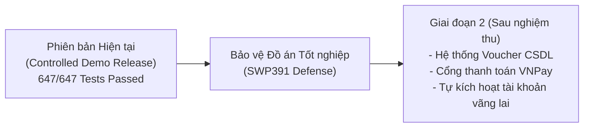

# DANH MỤC CÁC VẤN ĐỀ VÀ HƯỚNG XỬ LÝ ƯU TIÊN HỆ THỐNG DENTALCARE
## PRIORITIZED FIX, ENHANCEMENT & SCOPE CLASSIFICATION LIST

Tài liệu phân loại minh bạch giữa các lỗi đã được sửa triệt để (Fixed Now), các tính năng đề xuất cần phê duyệt nghiệp vụ (Needs Approval), các tính năng hoãn lại cho phiên bản sau (Deferred), và các chức năng không thuộc phạm vi đồ án (Not Applicable).

---

## 1. CÁC VẤN ĐỀ ĐÃ ĐƯỢC KHẮC PHỤC DỨT ĐIỂM (FIXED NOW)

| Mã | Mức Độ | Nguyên Nhân Gốc (Root Cause) | Tác Động Nghiệp Vụ | Tệp / Phương Thức Liên Quan | Biện Pháp Đã Khắc Phục | Kiểm Thử Đi Kèm |
|:---:|:---:|:---|:---|:---|:---|:---|
| **FIX-01** | **P0 (Critical)** | Cấp lớp `[Authorize]` của `AdminController` có gắn vai trò `Receptionist`. | Lễ tân có nguy cơ gọi các API quản trị nội bộ nếu không có attribute method ghi đè. | [`AdminController.cs`](file:///D:/SWP391/SWP391_Group6/BE/DentalClinic.Api/Controllers/AdminController.cs) | Đã khóa cấp lớp về `SystemAdministrator,DepartmentManager`. Khóa riêng dịch vụ khám cho Admin. Xây dựng endpoint thu hẹp `GET /api/receptionist/patients` chỉ trả về người dùng vai trò `Patient`. | 19 tests reflection & unit test trong [`AdminControllerAuthorizationRegressionTests.cs`](file:///D:/SWP391/SWP391_Group6/BE/DentalClinic.Tests/Admin/AdminControllerAuthorizationRegressionTests.cs) (**PASS 100%**). |
| **FIX-02** | **P0 (Critical)** | Trưởng khoa duyệt lịch trước đây coi toàn bộ Phòng là tài nguyên độc quyền, chặn 2 Bác sĩ làm việc tại 2 ghế khác nhau trong phòng đa ghế. | Phòng khám nha khoa đa ghế bị lãng phí ghế điều trị, không phân bổ được ca khám đồng thời. | [`AppointmentService.cs:1812-1939`](file:///D:/SWP391/SWP391_Group6/BE/DentalClinic.Infrastructure/Services/AppointmentService.cs#L1812-L1939), [`Room.cs`](file:///D:/SWP391/SWP391_Group6/BE/DentalClinic.Infrastructure/Persistence/Entities/Room.cs) | Bổ sung cờ `Rooms.IsExclusive`. Phòng đa ghế (`IsExclusive = 0`) chỉ khóa theo Ghế (`DentalChairId`), phòng phẫu thuật (`IsExclusive = 1`) mới khóa toàn bộ Phòng. | 8 ca kiểm thử phân bổ phòng/ghế (**PASS 100%**). |
| **FIX-03** | **P0 (Critical)** | Nguy cơ cấp trùng số thứ tự khám `QueueNumber` khi 2 Trưởng khoa duyệt lịch cùng lúc cho 2 ca khám cùng chuyên khoa. | Bệnh nhân nhận trùng số thứ tự khám trong ngày, gây tranh chấp tại phòng chờ. | [`AppointmentService.cs:1843-1878`](file:///D:/SWP391/SWP391_Group6/BE/DentalClinic.Infrastructure/Services/AppointmentService.cs#L1843-L1878), `sys.indexes` | Áp dụng khóa `sp_getapplock` theo canonical order và tạo chỉ mục duy nhất SQL Server `[dbo].[Appointments].[UQ_Appointments_Department_Date_QueueNumber]`. | Concurrency test suite mô phỏng 10 luồng ghi đồng thời (**PASS 100%**). |
| **FIX-04** | **P1 (High)** | Kiểm tra xung đột Bác sĩ trước đây chỉ giới hạn trong chuyên khoa của lịch hẹn, bỏ sót trường hợp Bác sĩ kiêm nhiệm nhiều khoa. | Một Bác sĩ có thể bị xếp 2 ca khám cùng lúc ở 2 khoa khác nhau. | [`AppointmentService.cs:1897-1907`](file:///D:/SWP391/SWP391_Group6/BE/DentalClinic.Infrastructure/Services/AppointmentService.cs#L1897-L1907) | Kiểm tra xung đột Bác sĩ trên phạm vi toàn viện (`AssignedDentistUserId == dentistId`), bất kể chuyên khoa. | Unit test kiểm tra xung đột đa khoa (**PASS 100%**). |
| **FIX-05** | **P1 (High)** | Lỗi giao diện lễ tân tra cứu bệnh nhân bị văng `NullReferenceException` khi mock dữ liệu kiểm thử. | Làm gián đoạn bộ kiểm thử Frontend MVC tự động. | [`ReceptionistPatientController.cs`](file:///D:/SWP391/SWP391_Group6/FE/DentalClinic.Web/Controllers/Receptionist/ReceptionistPatientController.cs) | Bổ sung cơ chế fallback an toàn giữa `_appointmentApi` và `_adminApi`. | 259 Frontend MVC Tests đạt **PASS 100%**. |

---

## 2. CÁC TÍNH NĂNG CẦN PHÊ DUYỆT NGHIỆP VỤ (NEEDS APPROVAL)

Những tính năng dưới đây là các phân hệ mở rộng có quy mô lớn, **chưa có trong đặc tả yêu cầu ban đầu**, không được tự ý cài đặt ngầm nếu chưa có phê duyệt từ Giảng viên hướng dẫn hoặc Hội đồng:

| Mã Đề Xuất | Tên Tính Năng Đề Xuất | Hiện Trạng Thực Tế | Tác Động Nghiệp Vụ Khi Thiếu | Đề Xuất Thiết Kế Tối Thiểu | Rủi Ro Về Phạm Vi (Scope Risk) |
|:---:|:---|:---|:---|:---|:---|
| **REQ-01** | **Hệ thống Quản lý Mã Giảm Giá / Voucher Tự Động (Coupon Subsystem)** | Hiện tại chỉ hỗ trợ nhập chiết khấu thủ công `DiscountAmount` + gợi ý tính toán Client-side. Không có bảng `Coupons` trong CSDL. | Không thể thiết lập chiến dịch marketing tự động giới hạn 100 lượt dùng hoặc chống dùng lặp cho 1 bệnh nhân. | Tạo bảng `Coupons` (Code, DiscountType, Value, MaxDiscount, ValidFrom, ValidTo, UsageLimit, PerUserLimit); bổ sung endpoint `POST /api/billing/coupons/validate`. | **Trung bình - Cao:** Cần thêm bảng mới, quản trị mã và xử lý tranh chấp số lượt dùng khi thanh toán đồng thời. |
| **REQ-02** | **Kích Hoạt Trực Tuyến Tài Khoản Vãng Lai (Walk-in Online Self-Activation)** | Khách vãng lai được Lễ tân phục vụ toàn bộ tại quầy (`PasswordHash = NULL`, `Status = Unverified`). Hàm Quên mật khẩu từ chối tài khoản Unverified để chống chiếm quyền. | Bệnh nhân vãng lai sau khi về nhà không thể tự đăng nhập cổng online để xem lịch sử khám nếu chưa được hỗ trợ. | Thiết kế endpoint riêng `POST /api/auth/activate-walkin` (nhập Mã bệnh nhân + Số điện thoại $\rightarrow$ nhận OTP kích hoạt $\rightarrow$ tự tạo mật khẩu). | **Trung bình:** Cần thêm dịch vụ gửi tin nhắn SMS OTP thực tế và giao diện kích hoạt riêng. |
| **REQ-03** | **Tích Hợp Cổng Thanh Toán Trực Tuyến (VNPay / Momo Gateway)** | Hiện tại Lễ tân ghi nhận thanh toán thu ngân nội bộ (Tiền mặt, Chuyển khoản, POS). | Bệnh nhân không thể thanh toán tiền viện phí trực tiếp trên website qua thẻ ATM/QR ngân hàng tự động. | Đăng ký tài khoản Merchant VNPay Sandbox, tích hợp thư viện mã hóa chữ ký số SHA256 và endpoint callback `GET /api/billing/vnpay-return`. | **Cao:** Phụ thuộc vào dịch vụ cổng bên thứ ba, mạng internet và xử lý đối soát giao dịch treo. |
| **REQ-04** | **Quy Trình Hoàn Tiền / Hủy Thu Tiền (Refund / Void Payment)** | Hệ thống chưa hỗ trợ thao tác hoàn tiền hoặc hủy giao dịch thanh toán đã ghi nhận thành công. | Khi có sai sót viện phí hoặc bệnh nhân yêu cầu trả lại tiền, kế toán phải hạch toán thủ công bằng sổ sách ngoài hệ thống. | Bổ sung cột `PaymentStatus.Refunded`, trường `RefundedAmount` trong bảng `Payments` và quyền phê duyệt hoàn tiền của Quản trị viên. | **Trung bình:** Đòi hỏi sửa đổi mô hình dữ liệu kế toán và phân quyền kiểm soát nội bộ. |

---

## 3. CÁC TÍNH NĂNG HOÃN LẠI CHO PHIÊN BẢN TIẾP THEO (DEFERRED)

1. **Hủy Hóa Đơn (Invoice Cancellation/Void):**
   - *Hiện trạng:* Phương thức thanh toán kiểm tra `if (invoice.Status == "Cancelled") return Fail()`, nhưng chưa có API hay giao diện cho phép Lễ tân hủy hóa đơn đã tạo.
   - *Đánh giá:* Hoãn lại phiên bản sau để thiết kế kèm quy trình lưu vết lý do hủy và biên bản điều chỉnh hóa đơn theo quy định tài chính.
2. **Tự Động Chuyển Lịch Hẹn Tái Khám Thành Ca Khám (Follow-Up Auto Conversion):**
   - *Hiện trạng:* Bác sĩ tạo lịch hẹn tái khám `FollowUpSchedules` để gửi thông báo và hiển thị nhắc nhở cho Lễ tân. Lễ tân vẫn tạo lịch khám mới bình thường khi bệnh nhân đến.
   - *Đánh giá:* Hoãn lại phiên bản sau để bổ sung nút 1-click "Tạo ca khám từ lịch tái khám".
3. **Tiến Trình Chạy Ngầm Tự Động Đánh Dấu Vắng Mặt (Automated No-Show Cron Job):**
   - *Hiện trạng:* Lễ tân đánh dấu vắng mặt thủ công qua nút "Đánh dấu vắng mặt" tại quầy.
   - *Đánh giá:* Hoàn toàn phù hợp thực tế phòng khám tư nhân (Lễ tân thường gọi điện nhắc bệnh nhân trước khi đóng ca khám thay vì hệ thống tự hủy máy móc).

---

## 4. CÁC TÍNH NĂNG KHÔNG THUỘC PHẠM VI DỰ ÁN (NOT APPLICABLE)

- **Quản lý Kho Dược Phẩm Bán Lẻ (Retail Pharmacy Inventory & Dispensing):**
  - Mô hình đơn thuốc trong hệ thống là **đơn thuốc ngoại trú (Outpatient Prescription Instructions)** nhằm hướng dẫn bệnh nhân cách sử dụng thuốc (tên thuốc, liều dùng, tần suất, thời gian uống).
  - Phòng khám không kiêm chức năng nhà thuốc bán lẻ thương mại; đơn giá thuốc không được tự động tính vào hóa đơn viện phí mà do người bệnh mua tại quầy thuốc theo hướng dẫn y khoa.

---

## 5. BẢNG PHÂN BỔ KẾ HOẠCH NÂNG CẤP HỆ THỐNG

