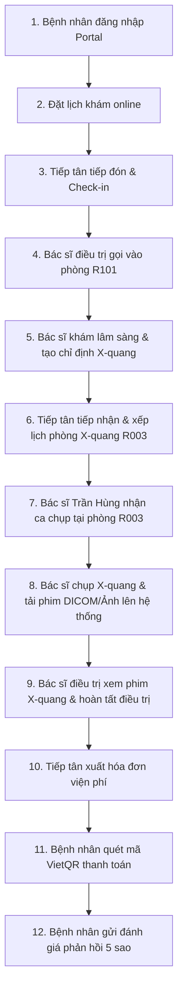

# DENTALCARE CLINIC MANAGEMENT SYSTEM — HƯỚNG DẪN KHỞI ĐỘNG VÀ VẬN HÀNH DEMO
**Dự án:** DentalCare Clinic Management System (SWP391 Group 6)  
**Công nghệ:** ASP.NET Core 8 Web API & ASP.NET Core 8 MVC Razor Views  

---

## 1. THÔNG SỐ CỔNG MẠNG VÀ ĐỊA CHỈ TRUY CẬP

Hệ thống DentalCare được thiết kế tách biệt 2 tầng ứng dụng với các địa chỉ mặc định sau:

| Ứng Dụng | Giao Thức & Cổng | URL Truy Cập | Mục Đích |
|:---|:---|:---|:---|
| **Frontend Web MVC** | HTTPS: **7129** (HTTP: 5129) | `https://localhost:7129` | Cổng thông tin cho Bệnh nhân, Tiếp tân, Bác sĩ và Quản trị viên |
| **Backend Web API** | HTTPS: **7350** (HTTP: 5350) | `https://localhost:7350` | Máy chủ API nghiệp vụ, xác thực JWT, SignalR Hub |
| **Swagger API Docs** | HTTPS: **7350** | `https://localhost:7350/swagger` | Tài liệu tương tác API trực quan |
| **Health Check API** | HTTPS: **7350** | `https://localhost:7350/health` | Kiểm tra tình trạng sẵn sàng của hệ thống |

> [!NOTE]
> Cấu hình CORS tại Backend API đã được thiết lập chặt chẽ cho phép nguồn gọi hợp lệ từ Frontend `https://localhost:7129` (và `https://localhost:7122`).

---

## 2. CÁCH KHỞI ĐỘNG HỆ THỐNG

### Cách 1: Khởi Động Tự Động 1-Click Bằng PowerShell (Khuyến Nghị Cho Chấm Điểm / Demo)

Thư mục gốc của repository có sẵn script tự động hóa `run_demo.ps1`. Script này thực hiện toàn bộ các bước an toàn:
1. Kiểm tra kết nối SQL Server và xác minh database cách ly `DentalCare_SWP391_UAT_Fixture_TEST`.
2. Tự động giải phóng các tiến trình đang chiếm cổng 7350 và 7129 (nếu có).
3. Khởi động Backend API trên cổng 7350 dưới nền.
4. Khởi động Frontend MVC trên cổng 7129 dưới nền.
5. Kiểm tra HTTP 200 Health Check cho cả hai dịch vụ.
6. Tự động mở trình duyệt web tới trang chủ `https://localhost:7129`.

**Lệnh thực thi:**
```powershell
cd D:\SWP391\DentalCare-DB-Simplification
powershell -ExecutionPolicy Bypass -File .\run_demo.ps1
```

*Nếu muốn chạy script mà không tự động mở trình duyệt:*
```powershell
powershell -ExecutionPolicy Bypass -File .\run_demo.ps1 -SkipBrowserLaunch
```

---

### Cách 2: Khởi Động Thủ Công Qua .NET CLI (Hai Cửa Sổ Terminal)

Nếu muốn theo dõi trực tiếp nhật ký console (log) của từng phân hệ:

#### Cửa sổ Terminal 1: Khởi động Backend API
```powershell
cd D:\SWP391\DentalCare-DB-Simplification\BE\DentalClinic.Api
dotnet run --launch-profile https
```
*Chờ console hiển thị: `Now listening on: https://localhost:7350`.*

#### Cửa sổ Terminal 2: Khởi động Frontend Web
```powershell
cd D:\SWP391\DentalCare-DB-Simplification\FE\DentalClinic.Web
dotnet run --launch-profile https
```
*Chờ console hiển thị: `Now listening on: https://localhost:7129`.*

Truy cập trình duyệt tại: `https://localhost:7129`.

---

### Cách 3: Khởi Động Bằng Visual Studio 2022
1. Mở file `BE\DentalClinic.Backend.sln` hoặc mở thư mục project trong Visual Studio.
2. Chuột phải vào Solution -> Chọn **Configure Startup Projects...**
3. Chọn **Multiple startup projects**:
   - `DentalClinic.Api`: Action chọn **Start**
   - `DentalClinic.Web`: Action chọn **Start**
4. Nhấn **F5** (hoặc `Ctrl + F5`) để khởi chạy đồng thời cả hai phân hệ.

---

## 3. CÁCH DỪNG HỆ THỐNG AN TOÀN

Khi kết thúc phiên làm việc hoặc muốn giải phóng cổng:

```powershell
cd D:\SWP391\DentalCare-DB-Simplification
powershell -ExecutionPolicy Bypass -File .\stop_demo.ps1
```
*Script `stop_demo.ps1` sẽ quét các tiến trình đang lắng nghe trên cổng 7350, 7129, 5350, 5129 và các node MSBuild bị khóa để giải phóng tài nguyên một cách triệt để.*

---

## 4. DANH SÁCH TÀI KHOẢN VÀ MẬT KHẨU DEMO (4 VAI TRÒ CHUẨN)

Hệ thống DentalCare tuân thủ tuyệt đối quy định 4 vai trò của đề tài SWP391. Dưới đây là danh sách tài khoản đã được nạp sẵn trong dữ liệu mẫu:

| Vai Trò (Role) | Tên Người Dùng | Email Đăng Nhập | Mật Khẩu Mặc Định | Chức Năng Chính |
|:---|:---|:---|:---|:---|
| **Patient** | Nguyễn Văn Bệnh Nhân | `patient@dentalcare.test` | `DentalCare@2026!` | Đặt lịch khám, tra cứu bệnh án, xem hóa đơn, thanh toán VietQR, gửi đánh giá phản hồi |
| **Receptionist** | Trần Thị Lễ Tân | `receptionist@dentalcare.test` | `DentalCare@2026!` | Tiếp đón khách walk-in, xếp hàng chờ, xếp lịch chụp X-quang, lập hóa đơn, thu tiền viện phí |
| **Dentist** (Điều trị) | BS. Lê Văn Bác Sĩ Một | `dentist1@dentalcare.test` | `DentalCare@2026!` | Khám lâm sàng tại Phòng R101, chỉ định chụp X-quang, kê đơn thuốc, hoàn tất ca khám |
| **Dentist** (X-ray) | BS. Trần Hùng | `dentist.hung@dentalcare.test` | `DentalCare@2026!` | Tiếp nhận hàng đợi X-quang tại Phòng R003, thực hiện chụp CT Cone Beam và tải phim lên hệ thống |
| **SystemAdmin** | Quản Trị Hệ Thống | `admin@dentalcare.test` | `DentalCare@2026!` | Quản lý người dùng, phân bổ ca trực nhân viên, báo cáo doanh thu, cấu hình phòng khám |

> [!TIP]
> - Mật khẩu mặc định của dữ liệu mẫu UAT là `DentalCare@2026!`. Có thể ghi đè mật khẩu demo thông qua biến môi trường `$env:DEMO_PASSWORD`.
> - Phân hệ Bệnh nhân hỗ trợ cả đăng nhập bằng Mật khẩu hoặc nhận mã xác thực OTP qua Email.

---

## 5. HÀNH TRÌNH KHÁM BỆNH ĐIỂN HÌNH ĐỂ THỰC HIỆN DEMO (18 BƯỚC)

Hệ thống hỗ trợ chu trình khám bệnh khép kín gồm 18 bước thực tế đã được kiểm thử Playwright tự động:



---

## 6. XỬ LÝ SỰ CỐ THƯỜNG GẶP (TROUBLESHOOTING)

### 1. Lỗi cổng bị chiếm dụng (Port 7350 hoặc 7129 already in use)
- **Nguyên nhân:** Phiên bản cũ của ứng dụng hoặc tiến trình dotnet chưa được tắt hết.
- **Khắc phục:** Chạy `powershell -ExecutionPolicy Bypass -File .\stop_demo.ps1` để đóng toàn bộ tiến trình.

### 2. Trình duyệt cảnh báo chứng chỉ SSL không an toàn (Your connection is not private)
- **Nguyên nhân:** Chứng chỉ SSL phát triển cục bộ của ASP.NET Core chưa được trust trên máy tính.
- **Khắc phục:** Chạy lệnh: `dotnet dev-certs https --trust` và chọn **Yes**.

### 3. Không thể kết nối SQL Server (Cannot connect to server / database does not exist)
- **Nguyên nhân:** Tên instance SQL Server khác với `.\SQLEXPRESS` hoặc service SQL Server chưa bật.
- **Khắc phục:**
  - Kiểm tra service SQL Server: `Get-Service *SQL*`
  - Nếu sử dụng instance khác, truyền tham số vào launcher:  
    `powershell .\run_demo.ps1 -SqlServerInstance "localhost" -TargetDatabase "DentalCare_SWP391_UAT_Fixture_TEST"`
