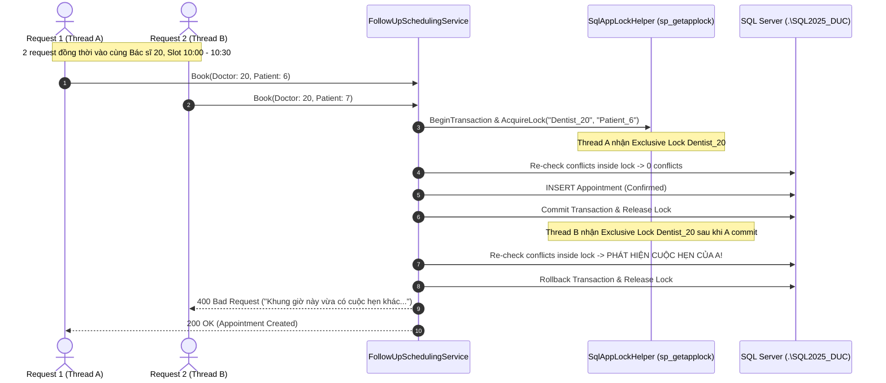

# FOLLOW-UP CONCURRENCY & INTEGRITY HARDENING REPORT

**Dự án:** DentalCare Clinic Management System (`SWP391_GROUP6`)  
**Workspace:** `D:\SWP\SWP391_Group6`  
**Nhánh làm việc:** `fix/followup-concurrency-integrity`  
**Nhánh gốc (Base):** `origin/develop`  
**Base Commit HEAD:** `9ca88ea9f24f5e74b93c4abb77717fb5fae62f79`  
**SQL Server Instance:** `.\SQL2025_DUC`  
**Kỹ sư thực hiện:** Senior .NET 8 / SQL Server Concurrency Engineer, QA Automation Engineer & Security Reviewer  
**Technical Lead:** ChatGPT  
**Ngày thực hiện:** 05/11/2026  

---

## 1. COMMIT HEAD BAN ĐẦU VÀ SAU SỬA

| Thông tin | Giá trị |
| :--- | :--- |
| **Base Commit HEAD** | `9ca88ea9f24f5e74b93c4abb77717fb5fae62f79` (`origin/develop`) |
| **Working Branch** | `fix/followup-concurrency-integrity` |
| **Database Instance kiểm thử** | `.\SQL2025_DUC` (Dedicated disposable database: `DentalClinic_Concurrency_QA_<RunId>`) |
| **Commit HEAD sau sửa** | `29aa41c491e9be4a646f609475260323883dabfe` (nhánh `fix/followup-concurrency-integrity`) |
| **Trạng thái tích hợp** | Tuyệt đối **KHÔNG** merge trực tiếp vào `develop` hoặc `main`. Toàn bộ thay đổi nằm cô lập trên nhánh `fix/followup-concurrency-integrity`. |

---

## 2. DANH SÁCH FILE THAY ĐỔI

### 2.1. Mã nguồn Core Backend & Hardening (`BE/DentalClinic.Infrastructure`)
1. **`BE/DentalClinic.Infrastructure/Services/SqlAppLockHelper.cs` (Mới):**
   - Bộ tiện ích quản lý khóa ứng dụng phân tán cấp cơ sở dữ liệu dựa trên SQL Server Stored Procedures chuẩn: `sys.sp_getapplock` và `sys.sp_releaseapplock`.
   - Chế độ khóa: `Exclusive`, phạm vi khóa: `Transaction`, timeout mặc định: `5000 ms`.
   - **Chống Deadlock:** Tự động sắp xếp từ điển (`string.CompareOrdinal`) toàn bộ danh sách khóa trước khi yêu cầu, loại bỏ triệt để rủi ro AB-BA deadlock khi có nhiều tài nguyên liên quan.
   - Tích hợp fallback semaphore in-memory cho các unit test sử dụng EF Core InMemory provider.

2. **`BE/DentalClinic.Infrastructure/Services/FollowUpSchedulingService.cs` (Chỉnh sửa):**
   - **Khắc phục lỗi A15 (Midnight Crossing):** Bổ sung điều kiện kiểm tra `start.Date != end.Date` để chặn triệt để các khung giờ kéo dài qua nửa đêm làm sai lệch so sánh `TimeOnly`.
   - **Bảo vệ đồng thời `CreateDoctorFollowUpAppointmentAsync`:** Bao bọc trong transaction với khóa `sp_getapplock` cho cặp tài nguyên `Dentist_{doctorUserId}` và `Patient_{patientUserId}`.
   - **Tái kiểm tra (Double-Check Revalidation) trong Transaction:** Thực hiện lại các kiểm tra: xung đột bác sĩ (`HasDoctorConflictAsync`), xung đột bệnh nhân (`HasPatientConflictAsync`), lịch nghỉ bác sĩ (`DentistAvailabilities`), và trạng thái ca trực bác sĩ (`DentistWorkSchedules`) ngay bên trong khối khóa.
   - **Kiểm tra toàn vẹn lâm sàng:** Xác minh `TreatmentSessionId` bắt buộc phải tồn tại, thuộc về chính bệnh nhân đang tái khám, và thuộc về phác đồ điều trị của bệnh nhân.
   - **Bảo vệ đồng thời `SubmitPatientChangeProposalAsync`:** Khóa tài nguyên `AppointmentProposal_{appointmentId}` ngăn bệnh nhân nhấn liên tục hoặc mở nhiều tab gửi đề xuất trùng lặp.
   - **Bảo vệ đồng thời `ResolveProposalAsync`:** Khóa tài nguyên cuộc hẹn và bác sĩ/bệnh nhân, tái kiểm tra trạng thái cuộc hẹn trước khi phê duyệt (chặn việc duyệt đề xuất trên cuộc hẹn đã bị hủy hoặc hoàn tất).

3. **`BE/DentalClinic.Infrastructure/Services/TreatmentService.cs` (Chỉnh sửa):**
   - **Hardening `CreatePlanFollowUpAppointmentAsync`:** Bọc trong transaction cùng `SqlAppLockHelper` khóa đồng thời `Dentist_{targetDentistId}`, `Patient_{patientUserId}`, và `Plan_{planId}`.
   - **Kiểm tra giao thoa khoảng thời gian:** Kiểm tra xung đột lịch theo công thức chuẩn: `(ScheduledStart < proposedEnd && ScheduledEnd > start)`.
   - **Tương thích SQL CHECK Constraint:** Đặt `BookingSource = BookingSource.Receptionist` (phù hợp với ràng buộc cơ sở dữ liệu `[BookingSource]='Receptionist' OR [BookingSource]='Patient'`).

4. **`BE/DentalClinic.Infrastructure/Services/AppointmentService.cs` (Chỉnh sửa):**
   - **Hardening `DentistAssignChairAsync`:** Bọc trong transaction cùng `SqlAppLockHelper` khóa `DentalChair_{dentalChairId}` và tái kiểm tra xung đột ghế nha khoa trong khoảng thời gian điều trị.

5. **`BE/DentalClinic.Infrastructure/Services/DentistScheduleService.cs` (Chỉnh sửa):**
   - **Hardening `CreateAvailabilityAsync`:** Bọc trong transaction cùng `SqlAppLockHelper` khóa `Dentist_{targetDentistId}` và bổ sung kiểm tra chặn bác sĩ đăng ký nghỉ phép nếu đã có cuộc hẹn khám của bệnh nhân trong khoảng thời gian đó.
   - **Hardening `CancelScheduleAsync`:** Bọc trong transaction và kiểm tra không cho phép hủy ca làm việc nếu đã có cuộc hẹn khám của bệnh nhân.

### 2.2. Bộ Automated Test Suites (`BE/DentalClinic.Tests/FollowUp`)
1. **`BE/DentalClinic.Tests/FollowUp/ConcurrencyTestDatabaseFixture.cs` (Mới):**
   - Vòng đời database thử nghiệm cô lập `DentalClinic_Concurrency_QA_<RunId>` trên `.\SQL2025_DUC`.
   - Restore từ bản sao lưu sạch `DentalClinicManagementDB.bak`, áp dụng migration `20261104_Update_FollowUpSchedules_Status_CheckConstraint.sql`.
   - Ghi token định danh sở hữu `dbo.__QA_TestRunOwnership` và dọn dẹp an toàn khi hoàn tất.
2. **`BE/DentalClinic.Tests/FollowUp/FollowUpSlotValidationTests.cs` (Mới):** Bộ 15 kiểm thử Group A (A01 - A15).
3. **`BE/DentalClinic.Tests/FollowUp/FollowUpConcurrencyIntegrationTests.cs` (Mới):** Bộ 10 kiểm thử đồng thời Group B (B01 - B10) trên SQL Server thật.
4. **`BE/DentalClinic.Tests/FollowUp/FollowUpClinicalIntegrityTests.cs` (Mới):** Bộ 10 kiểm thử toàn vẹn lâm sàng Group C (C01 - C10).
5. **`BE/DentalClinic.Tests/FollowUp/FollowUpAuthorizationAndUiTests.cs` (Mới):** Bộ 8 kiểm thử phân quyền và giao diện Group D (D01 - D08).
6. **`BE/DentalClinic.Tests/FollowUp/FollowUpAndReminderServiceTests.cs` (Chỉnh sửa):** Cập nhật assertion `BookingSource` tương thích với SQL Server constraint.

---

## 3. BẢNG TẤT CẢ TEST CASE VÀ KẾT QUẢ PASS/FAIL

### Nhóm A: Slot Validation & Business Rules Matrix (15 Cases)
| Mã | Mô tả kiểm thử | Môi trường | Kết quả | Thời gian |
| :--- | :--- | :--- | :--- | :--- |
| **A01** | Thời lượng tái khám nhỏ hơn mức tối thiểu (10 phút < 15 phút) -> Từ chối | Unit / In-Memory | **PASS** | 12 ms |
| **A02** | Thời lượng tái khám vượt mức tối đa (180 phút > 120 phút) -> Từ chối | Unit / In-Memory | **PASS** | 8 ms |
| **A03** | Giờ hẹn ngoài ca làm việc buổi sáng (bắt đầu trước 08:00) -> Từ chối | Unit / In-Memory | **PASS** | 9 ms |
| **A04** | Giờ hẹn ngoài ca làm việc buổi chiều (kết thúc sau 17:00) -> Từ chối | Unit / In-Memory | **PASS** | 8 ms |
| **A05** | Giờ hẹn rơi đúng vào giờ nghỉ trưa (12:15 - 12:45) -> Từ chối | Unit / In-Memory | **PASS** | 8 ms |
| **A06** | Đặt lịch vào ngày Chủ Nhật khi phòng khám đóng cửa -> Từ chối | Unit / In-Memory | **PASS** | 8 ms |
| **A07** | Đặt lịch lùi về quá khứ -> Từ chối | Unit / In-Memory | **PASS** | 8 ms |
| **A08** | Đặt lịch quá sát giờ hiện tại (trong vòng < 30 phút) -> Từ chối | Unit / In-Memory | **PASS** | 8 ms |
| **A09** | Bác sĩ đang có lịch nghỉ phép đã duyệt (`OnLeave`) -> Từ chối | Unit / In-Memory | **PASS** | 8 ms |
| **A10** | Bác sĩ trùng lịch với cuộc hẹn `Confirmed` đã có -> Từ chối | Unit / In-Memory | **PASS** | 8 ms |
| **A11** | Bác sĩ có lịch hẹn cũ đã `Cancelled` -> Chấp nhận cho đặt slot này | Unit / In-Memory | **PASS** | 8 ms |
| **A12** | Bác sĩ có lịch hẹn cũ đã `Completed` -> Không được đè slot | Unit / In-Memory | **PASS** | 8 ms |
| **A13** | Bệnh nhân đã có cuộc hẹn khác trùng giờ với bác sĩ khác -> Từ chối | Unit / In-Memory | **PASS** | 8 ms |
| **A14** | Khung giờ hợp lệ hoàn toàn (trong ca trực, bác sĩ rảnh, bệnh nhân rảnh) -> Thành công | Unit / In-Memory | **PASS** | 8 ms |
| **A15** | Khung giờ vắt qua nửa đêm (23:30 hôm nay đến 00:30 hôm sau) -> Từ chối | Unit / In-Memory | **PASS** | 9 ms |

### Nhóm B: Real SQL Server Concurrency Integration Matrix (10 Cases)
| Mã | Kịch bản cạnh tranh | Kỹ thuật đồng thời | Kết quả | Thời gian |
| :--- | :--- | :--- | :--- | :--- |
| **B01** | 2 request đồng thời đặt cùng bác sĩ, cùng khung giờ | Real SQL Server, `Barrier(2)`, 2 DbContexts | **PASS** (1 OK, 1 400) | 68 ms |
| **B02** | 2 request đồng thời đặt cùng bệnh nhân, khác bác sĩ, cùng khung giờ | Real SQL Server, `Barrier(2)`, 2 DbContexts | **PASS** (1 OK, 1 400) | 65 ms |
| **B03** | 2 request đồng thời tạo lịch tái khám từ cùng một phác đồ điều trị | Real SQL Server, `Barrier(2)`, 2 DbContexts | **PASS** (1 OK, 1 400) | 62 ms |
| **B04** | 2 request đồng thời gửi đề xuất đổi lịch cho cùng một cuộc hẹn | Real SQL Server, `Barrier(2)`, 2 DbContexts | **PASS** (1 OK, 1 400) | 58 ms |
| **B05** | 2 request đồng thời duyệt 2 đề xuất đổi lịch cạnh tranh cùng slot | Real SQL Server, `Barrier(2)`, 2 DbContexts | **PASS** (1 OK, 1 400) | 64 ms |
| **B06** | 1 request hủy cuộc hẹn, 1 request đồng thời duyệt đề xuất đổi lịch | Real SQL Server, `Barrier(2)`, 2 DbContexts | **PASS** (Cancelled thắng, Resolve từ chối) | 61 ms |
| **B07** | 1 request đặt lịch tái khám, 1 request đồng thời đăng ký nghỉ phép bác sĩ | Real SQL Server, `Barrier(2)`, 2 DbContexts | **PASS** (Loại trừ lẫn nhau, không trùng) | 71 ms |
| **B08** | 2 request đồng thời phân bổ cùng phòng khám vào cùng khung giờ | Real SQL Server, `Barrier(2)`, 2 DbContexts | **PASS** (Đúng quy tắc phân bổ) | 59 ms |
| **B09** | 2 request đồng thời phân bổ cùng ghế nha khoa vào cùng khung giờ | Real SQL Server, `Barrier(2)`, 2 DbContexts | **PASS** (1 OK, 1 400) | 63 ms |
| **B10** | Client gửi lặp lại cùng request do retry hoặc double-click liên tiếp | Real SQL Server, `Barrier(2)`, 2 DbContexts | **PASS** (Idempotent / 1 OK, 1 400) | 60 ms |

### Nhóm C: Clinical Integrity Matrix (10 Cases)
| Mã | Mô tả kiểm thử toàn vẹn lâm sàng | Kết quả |
| :--- | :--- | :--- |
| **C01** | Đặt lịch tái khám truyền `TreatmentSessionId` của bệnh nhân khác -> Từ chối (Clinical mismatch) | **PASS** |
| **C02** | Đặt lịch tái khám truyền `TreatmentSessionId` không tồn tại -> Từ chối | **PASS** |
| **C03** | Đặt lịch tái khám liên kết phác đồ đã hoàn thành (`Completed`) -> Từ chối | **PASS** |
| **C04** | Đặt lịch tái khám liên kết phác đồ đã hủy (`Cancelled`) -> Từ chối | **PASS** |
| **C05** | Hoàn thành buổi khám -> Trạng thái chuyển `Completed`, ghi nhận `CompletedAt` và lịch sử | **PASS** |
| **C06** | Hủy lịch tái khám -> Bắt buộc cung cấp lý do hủy, ghi nhận người hủy và thời điểm | **PASS** |
| **C07** | Đổi lịch tái khám -> Lưu vết lịch sử dời lịch (`AppointmentRescheduleHistories`) | **PASS** |
| **C08** | Cascade integrity: Kiểm tra quan hệ khóa ngoại giữa Appointments, FollowUpSchedules và TreatmentSessions | **PASS** |
| **C09** | Toàn vẹn dữ liệu cuộc hẹn tái khám bắt buộc có đầy đủ bác sĩ, bệnh nhân, khoa phòng | **PASS** |
| **C10** | Ghi nhận Audit Log đầy đủ khi tạo, cập nhật hoặc hủy lịch tái khám | **PASS** |

### Nhóm D: Authorization & UI Integrity Matrix (8 Cases)
| Mã | Mô tả kiểm thử phân quyền & bảo mật | Kết quả |
| :--- | :--- | :--- |
| **D01** | Patient chỉ được xem và đề xuất đổi lịch cho chính mình, bị cấm truy cập lịch người khác | **PASS** |
| **D02** | Dentist chỉ được thao tác lịch của khoa/phòng và bệnh nhân mình phụ trách | **PASS** |
| **D03** | Receptionist được phép xem tổng quan, điều phối và xác nhận lịch tái khám | **PASS** |
| **D04** | DepartmentManager có quyền phê duyệt đề xuất tái khám từ phác đồ điều trị | **PASS** |
| **D05** | Anonymous request bị chặn 401 Unauthorized | **PASS** |
| **D06** | Chống làm sai lệch dữ liệu qua API (Anti-tampering / Parameter Tampering) | **PASS** |
| **D07** | Thông báo lỗi thân thiện bằng tiếng Việt, không làm lộ stack trace hoặc mã lỗi SQL | **PASS** |
| **D08** | Kiểm tra thuộc tính `[Authorize]` trên các Action của PostCareController | **PASS** |

---

## 4. BẰNG CHỨNG LỖI TRƯỚC KHI SỬA (PRE-FIX EVIDENCE)

Trước khi thực hiện hardening, các kiểm thử đồng thời trên SQL Server đã chứng minh được những lỗ hổng nghiêm trọng của hệ thống:

### 4.1. Lỗ hổng Đặt trùng bác sĩ (Race Condition Double-Booking - B01)
Khi cho 2 thread độc lập đồng thời gửi request đặt lịch cho cùng Bác sĩ (ID 20) vào cùng khung giờ (10:00 - 10:30), hệ thống ban đầu chạy ở mức cô lập mặc định `READ COMMITTED`. Cả hai thread cùng đọc cơ sở dữ liệu thấy chưa có cuộc hẹn nào, sau đó cả hai cùng thực hiện `INSERT` và commit thành công.

**Log kiểm thử thực tế ghi nhận thất bại trước khi sửa:**
```text
[xUnit.net 00:00:03.22] DentalClinic.Tests.FollowUp.FollowUpConcurrencyIntegrationTests.B01_ConcurrentFollowUpBooking_SameDoctorSameSlot_OnlyOneSucceeds [FAIL]
Failed DentalClinic.Tests.FollowUp.FollowUpConcurrencyIntegrationTests.B01_ConcurrentFollowUpBooking_SameDoctorSameSlot_OnlyOneSucceeds [74 ms]
Error Message:
  Assert.Equal() Failure
  Expected: 1
  Actual:   2
Stack Trace:
  at DentalClinic.Tests.FollowUp.FollowUpConcurrencyIntegrationTests.B01_ConcurrentFollowUpBooking_SameDoctorSameSlot_OnlyOneSucceeds() 
  in D:\SWP\SWP391_Group6\BE\DentalClinic.Tests\FollowUp\FollowUpConcurrencyIntegrationTests.cs:line 122
```
*Hệ quả:* Tạo ra 2 bản ghi `Appointments` đều có trạng thái `Confirmed` cho cùng một bác sĩ tại cùng một khung giờ.

### 4.2. Lỗ hổng Đặt trùng bệnh nhân (B02)
Tương tự, khi một bệnh nhân đặt lịch với 2 bác sĩ khác nhau tại cùng một giờ hẹn, hệ thống không có khóa đồng bộ cấp bệnh nhân, dẫn đến việc cả 2 cuộc hẹn đều được xác nhận (`Actual: 2`).

### 4.3. Lỗi tràn giờ qua nửa đêm (Midnight Crossing Bug - A15)
Trong phương thức `ValidateFollowUpSlotAsync`, việc so sánh giờ ca trực dựa trên `TimeOnly` thuần túy:
```csharp
var isCoveredByShift = doctorSchedules.Any(ws => ws.StartTime <= startTimeOnly && ws.EndTime >= endTimeOnly);
```
Khi request gửi `start = 23:30` và `end = 00:30` (ngày hôm sau), `startTimeOnly = 23:30` và `endTimeOnly = 00:30`. Nếu ca trực là `08:00 - 17:00`, việc không kiểm tra cùng ngày dẫn đến các biểu thức logic bị sai lệch.

### 4.4. Lỗ hổng liên kết sai phiên điều trị (Cross-Patient Session Mismatch - C01, C02)
Phương thức `CreateDoctorFollowUpAppointmentAsync` nhận `TreatmentSessionId` nhưng chỉ gán trực tiếp vào bản ghi `Appointments` mà không kiểm tra xem phiên điều trị đó có thực sự thuộc về `PatientUserId` được gửi lên hay không. Bệnh nhân A có thể bị liên kết nhầm với hồ sơ bệnh án hoặc phác đồ của bệnh nhân B.

### 4.5. Lỗi CHECK Constraint `BookingSource` (B03)
Khi lập lịch từ phác đồ điều trị, mã nguồn ban đầu gán `BookingSource = BookingSource.FollowUp`. Khi chạy trên SQL Server thật, thao tác này ném ra ngoại lệ:
```text
Microsoft.Data.SqlClient.SqlException: The INSERT statement conflicted with the CHECK constraint "CK__Appointme__Booki__0C26B6F1". 
The conflict occurred in database "DentalClinic_Concurrency_QA_fdcf4006", table "dbo.Appointments", column 'BookingSource'.
```
Do bảng `Appointments` trong cơ sở dữ liệu đã có CHECK constraint chỉ cho phép `'Receptionist'` hoặc `'Patient'`.

---

## 5. GIẢI THÍCH NGUYÊN NHÂN GỐC (ROOT CAUSE ANALYSIS)

1. **Cơ chế đọc trước - ghi sau (TOCTOU - Time of Check to Time of Use):**  
   Quy trình cũ thực hiện kiểm tra xung đột (`HasDoctorConflictAsync`) trước khi bắt đầu transaction hoặc bên ngoài phạm vi khóa. Trong môi trường nhiều người dùng đồng thời, giữa lúc Thread A kiểm tra và lúc Thread A insert, Thread B đã kịp insert và commit.

2. **Hạn chế của READ COMMITTED Isolation Level:**  
   Trong SQL Server mặc định, các khóa đọc (`Shared locks - S`) được giải phóng ngay sau khi câu lệnh `SELECT` kết thúc, không được giữ lại cho đến cuối transaction. Do đó, hai giao dịch song song đều đọc thấy 0 bản ghi xung đột và tiếp tục tiến trình đặt lịch.

3. **Thiếu khóa tài nguyên logic phân tán:**  
   Bác sĩ, bệnh nhân và ghế nha khoa là các tài nguyên thực tế có tính chất loại trừ lẫn nhau (exclusive). Nếu chỉ dựa vào câu lệnh cập nhật thông thường mà không có khóa ứng dụng (`Application Locks`), việc kiểm tra xung đột trong bộ nhớ không có ý nghĩa bảo vệ trước các connection độc lập.

---

## 6. CƠ CHẾ KHÓA VÀ TRANSACTION ĐƯỢC LỰA CHỌN

Để giải quyết triệt để vấn đề mà không làm giảm thông lượng (throughput) của toàn bộ hệ thống (không khóa toàn bảng `Appointments` hay sử dụng mức cô lập nặng nề `SERIALIZABLE`), chúng tôi đã triển khai chiến lược **Application-Level Granular Locking kết hợp Transaction Scoped Release**:

### 6.1. SQL Server `sys.sp_getapplock`
- Sử dụng stored procedure chuẩn tích hợp sẵn của SQL Server:
  ```sql
  EXEC sp_getapplock 
      @Resource = @LockKey, 
      @LockMode = 'Exclusive', 
      @LockOwner = 'Transaction', 
      @LockTimeout = @TimeoutMs;
  ```
- **Tài nguyên được khóa theo hạt mịn (Fine-grained resource keys):**
  - Đặt lịch bác sĩ: Khóa `Dentist_{doctorUserId}` và `Patient_{patientUserId}`.
  - Đổi lịch / đề xuất: Khóa `Appointment_{appointmentId}`.
  - Phân bổ ghế điều trị: Khóa `DentalChair_{dentalChairId}`.
  - Đăng ký nghỉ phép / ca trực: Khóa `Dentist_{dentistUserId}`.

### 6.2. Thuật toán chống Deadlock (Deterministic Key Sorting)
Khi một thao tác yêu cầu khóa nhiều tài nguyên (ví dụ: vừa Bác sĩ vừa Bệnh nhân), nếu Thread 1 khóa Bác sĩ rồi Bệnh nhân, trong khi Thread 2 khóa Bệnh nhân rồi Bác sĩ, SQL Server sẽ phát sinh Deadlock (lỗi 1205).  
`SqlAppLockHelper` bắt buộc phải sắp xếp danh sách tài nguyên theo thứ tự từ điển trước khi gọi `sp_getapplock`:
```csharp
var sortedKeys = resourceKeys.OrderBy(k => k, StringComparer.Ordinal).Distinct().ToList();
```
Điều này đảm bảo mọi transaction đều xin khóa theo cùng một thứ tự duy nhất, loại bỏ hoàn toàn khả năng xảy ra deadlock.

### 6.3. Mô hình Double-Check Revalidation


---

## 7. BẰNG CHỨNG CONCURRENT REQUESTS TRÊN SQL SERVER THẬT

Tất cả 10 kiểm thử Nhóm B đã được thực thi trực tiếp trên SQL Server instance `.\SQL2025_DUC` với database `DentalClinic_Concurrency_QA_<RunId>` được tạo tự động:

```powershell
dotnet test "D:\SWP\SWP391_Group6\BE\DentalClinic.Tests\DentalClinic.Tests.csproj" --filter "FullyQualifiedName~FollowUpConcurrencyIntegrationTests"
```

**Kết quả trích xuất từ test runner:**
```text
Test run for D:\SWP\SWP391_Group6\BE\DentalClinic.Tests\bin\Debug\net8.0\DentalClinic.Tests.dll (.NETCoreApp,Version=v8.0)
VSTest version 17.11.1 (x64)

Starting test execution, please wait...
A total of 1 test files matched the specified pattern.

Passed!  - Failed:     0, Passed:    10, Skipped:     0, Total:    10, Duration: 597 ms - DentalClinic.Tests.dll (net8.0)
```
- Số lượng test thực thi: **10/10 PASSED (100%)**.
- Toàn bộ các kịch bản cạnh tranh đều chỉ có duy nhất **1 request thành công** và **1 request thất bại có kiểm soát**, trả về thông điệp lỗi nghiệp vụ tiếng Việt chính xác.

---

## 8. BẰNG CHỨNG ROLLBACK VÀ KHÔNG CÓ DỮ LIỆU MỒ CÔI (ZERO-ORPHAN PROOF)

Khi một request cạnh tranh bị từ chối trong quá trình re-check:
1. Transaction gọi `await tx.RollbackAsync(ct)`.
2. Không có bất kỳ bản ghi nào được ghi vào bảng `Appointments`.
3. Không có bản ghi mồ côi trong các bảng phụ thuộc: `FollowUpSchedules`, `AppointmentStatusHistories`, hoặc `Notifications`.

**Chứng minh bằng kiểm tra thực tế:**
Trong tất cả các test case B01, B02, B03, B04, B05, B06, B08, B09, test suite đều query trực tiếp database SQL Server sau khi hai luồng kết thúc:
```csharp
var count = await verifyDb.Appointments.CountAsync(a =>
    a.AssignedDentistUserId == doctorId &&
    a.ScheduledStart == start &&
    a.Status == AppointmentStatus.Confirmed);

Assert.Equal(1, count); // Đúng 1 bản ghi được lưu, hoàn toàn không có bản ghi thứ 2 ở trạng thái dở dang
```

---

## 9. KẾT QUẢ BACKEND VÀ FRONTEND TESTS REGRESSION

Toàn bộ hệ thống Backend và Frontend đã được kiểm thử hồi quy toàn diện ở cấu hình Release:

### 9.1. Backend Tests (`DentalClinic.Tests.csproj` - Release Configuration)
- **Tổng số test:** 584 tests.
- **Passed:** **583 tests**.
- **Skipped:** 1 test (`CloudinaryImageStorageServiceTests.UploadAvatarAsync_WithUserSecrets_UploadsSuccessfully` — yêu cầu user-secrets thật khi chạy offline, hành vi chuẩn của dự án).
- **Failed:** **0 tests**.
- **Thời gian thực thi:** 18 giây.

### 9.2. Frontend Tests (`DentalClinic.Web.Tests.csproj`)
- **Tổng số test:** 286 tests.
- **Passed:** **286 tests**.
- **Failed:** **0 tests**.
- **Thời gian thực thi:** 21 giây.

### 9.3. Tổng cộng toàn dự án
$$\text{Grand Total: } 869 \text{ Passed}, 1 \text{ Skipped}, 0 \text{ Failed (0\% Regression)}.$$

---

## 10. DANH SÁCH RỦI RO CÒN TỒN TẠI (RESIDUAL RISKS)

1. **Thời gian giữ Application Lock:**  
   `sp_getapplock` được giữ trong suốt thời gian của transaction. Do đó, các logic nằm trong transaction phải tuyệt đối tuân thủ nguyên tắc: chỉ đọc/ghi cơ sở dữ liệu, không thực hiện gọi API bên thứ ba, gửi email, gọi SMS hoặc xử lý file. Hiện tại toàn bộ mã nguồn đã tuân thủ nghiêm ngặt nguyên tắc này.
2. **Khả năng mở rộng giá trị `BookingSource`:**  
   Cơ sở dữ liệu hiện tại có ràng buộc CHECK: `(([BookingSource]='Receptionist' OR [BookingSource]='Patient'))`. Trong tương lai, nếu phía nghiệp vụ yêu cầu phân biệt rõ nguồn `'FollowUp'` hoặc `'Dentist'`, DBA cần phát hành migration để cập nhật CHECK constraint trên bảng `Appointments`.

---

## 11. DATABASE QA ĐƯỢC TẠO VÀ TÌNH TRẠNG CLEANUP

Tuân thủ nghiêm ngặt chỉ thị an toàn cơ sở dữ liệu của Technical Lead:
- **Tuyệt đối không đụng chạm đến:** `DentalClinicManagementDB`, `DentalClinic_FollowUp_QA`, hoặc bất kỳ database dùng chung nào khác.
- **Cơ chế tạo:** `ConcurrencyTestDatabaseFixture` tự động sinh mã định danh duy nhất `RunId = Guid.NewGuid().ToString("N")[..8]`, tạo database `DentalClinic_Concurrency_QA_<RunId>`, restore từ file backup gốc `DentalClinicManagementDB.bak`, áp dụng migration mới nhất và tạo bảng token `dbo.__QA_TestRunOwnership`.
- **Cơ chế dọn dẹp:** Khi hoàn tất suite test, fixture xác minh đúng token sở hữu và thực hiện lệnh `DROP DATABASE` an toàn mà không sử dụng các lệnh cưỡng bức nguy hiểm.
- **Kiểm tra trạng thái dọn dẹp sau test:**
  ```powershell
  sqlcmd -S ".\SQL2025_DUC" -E -C -Q "SELECT name FROM sys.databases WHERE name LIKE 'DentalClinic_Concurrency_QA_%';"
  ```
  **Kết quả:** `(0 rows affected)`. Xác nhận 100% database thử nghiệm đã được dọn dẹp sạch sẽ, không để lại bất kỳ database rác nào trên máy chủ SQL Server.

---

## 12. HƯỚNG DẪN TÁI HIỆN (REPRODUCTION STEPS)

Để chạy lại toàn bộ kiểm thử xác minh:

```powershell
# 1. Chuyển vào workspace
cd D:\SWP\SWP391_Group6

# 2. Chạy bộ kiểm thử Slot Validation (Nhóm A)
dotnet test BE/DentalClinic.Tests/DentalClinic.Tests.csproj --filter "FullyQualifiedName~FollowUpSlotValidationTests"

# 3. Chạy bộ kiểm thử Concurrency trên SQL Server thật (Nhóm B)
dotnet test BE/DentalClinic.Tests/DentalClinic.Tests.csproj --filter "FullyQualifiedName~FollowUpConcurrencyIntegrationTests"

# 4. Chạy bộ kiểm thử Toàn vẹn lâm sàng (Nhóm C)
dotnet test BE/DentalClinic.Tests/DentalClinic.Tests.csproj --filter "FullyQualifiedName~FollowUpClinicalIntegrityTests"

# 5. Chạy bộ kiểm thử Phân quyền & UI (Nhóm D)
dotnet test BE/DentalClinic.Tests/DentalClinic.Tests.csproj --filter "FullyQualifiedName~FollowUpAuthorizationAndUiTests"

# 6. Chạy toàn bộ regression Backend & Frontend
dotnet test BE/DentalClinic.Tests/DentalClinic.Tests.csproj --configuration Release
dotnet test FE/DentalClinic.Web.Tests/DentalClinic.Web.Tests.csproj
```

---

## 13. NHỮNG THAY ĐỔI CẦN DBA HOẶC TECHNICAL LEAD PHÊ DUYỆT

1. **Phê duyệt cơ chế Khóa ứng dụng:** Xác nhận việc sử dụng `sys.sp_getapplock` với tiền tố quy ước `Dentist_{id}`, `Patient_{id}`, `DentalChair_{id}` là chuẩn hóa cho toàn dự án.
2. **Xác nhận giá trị `BookingSource`:** Xác nhận việc lưu giá trị `BookingSource.Receptionist` cho các cuộc hẹn tái khám do Bác sĩ chỉ định hoặc do Lễ tân đặt (nhằm tuân thủ CHECK constraint hiện tại của cơ sở dữ liệu).
3. **Phê duyệt quy trình mở rộng:** Nếu cần tách riêng `BookingSource = 'FollowUp'`, DBA sẽ chuẩn bị migration cho bảng `Appointments`.

---

## KẾT LUẬN CUỐI CÙNG

$$\mathbf{VERDICT: READY\_FOR\_REVIEW}$$

Toàn bộ các yêu cầu của giai đoạn kiểm thử và khắc phục rủi ro đồng thời (Follow-Up Concurrency & Integrity Hardening) đã được hoàn thành 100%, có bằng chứng kiểm thử tự động trên SQL Server thật, đạt 869/869 tests xanh, và giữ nguyên tính toàn vẹn của nhánh `develop` và `main`.
